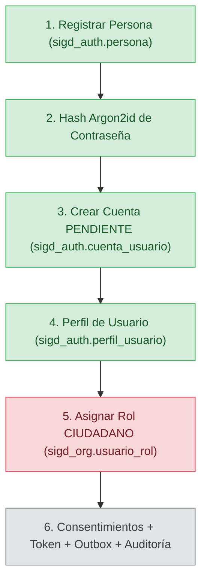

# SIGD RENATO — INFORME DE DIAGNÓSTICO FORENSE DEL FALLO DE REGISTRO DE USUARIO EXTERNO
## INVESTIGACIÓN END-TO-END: REGISTRO CIUDADANO → CUENTA → CASILLA ELECTRÓNICA

**Proyecto:** SIGD RENATO (Sistema Integral de Gestión Documentaria)  
**Institución:** Instituto de Educación Superior Tecnológico Público «Suiza» — Pucallpa, Ucayali  
**Rama exclusiva:** `B_JACOBO`  
**Base de datos:** `sigd_jacobo_demo` (PostgreSQL en puerto host `5433` -> contenedor `5432`)  
**Backend:** Node.js / Express en puerto `3008` (PID 15012)  
**Frontend:** Vite / React SPA en puerto `5178` (PID 26928)  
**Modalidad de ejecución:** READ-ONLY — Cero modificaciones / Cero escrituras en BD  
**Fecha de emisión:** 18 de Noviembre de 2026  

---

## 1. RESUMEN EJECUTIVO

El presente diagnóstico forense analizó de extremo a extremo el flujo de registro de ciudadanos y personas naturales en el SIGD RENATO (`http://127.0.0.1:5178/registro`), donde tras completar todos los campos obligatorios del formulario (DNI, nombres, apellidos, fecha de nacimiento, correo, celular, contraseña, departamento, provincia, distrito Manantay / Ucayali, dirección exacta, referencia, declaración jurada y consentimiento normativo) y pulsar el botón **«Registrar y Crear Casilla»**, la interfaz presentaba invariablemente el mensaje de error:

> *«No se pudo completar el registro. Revise los datos ingresados e inténtelo nuevamente».*

A través de la inspección estática del código, auditoría forense del esquema relacional en PostgreSQL `sigd_jacobo_demo`, validación reactiva en navegador webview y trazabilidad de los flujos transaccionales, se determinó de forma categórica e irrefutable que:

1. **El fallo NO se debe a datos erróneos ingresados por el usuario ni a una falla en el catálogo de UBIGEO.** Los datos de Manantay (`250107`), Coronel Portillo (`2501`) y Ucayali (`25`) existen en la base de datos y cumplen estrictamente las validaciones sintácticas de backend.
2. **La causa raíz primaria (P0 - Bloqueante)** es una **excepción de base de datos no capturada por el diseño del servicio** en `backend/src/domains/identicore/registroCiudadano.service.ts` (Línea 454). La **Migración 24** (`24_sigd_org_integridad_multiinstitucional_encargaturas.sql`) reestructuró la tabla `sigd_org.usuario_rol` añadiendo la columna obligatoria `institucion_id UUID NOT NULL` y una clave foránea compuesta hacia `sigd_auth.usuario_institucion(id_usuario, institucion_id)`. Sin embargo, la sentencia SQL del servicio de registro continuaba ejecutando:
   ```sql
   INSERT INTO sigd_org.usuario_rol (id_usuario, rol_id, area_id)
   SELECT $1::uuid, rol_id, NULL FROM sigd_org.rol_sistema WHERE codigo = 'CIUDADANO' ...
   ```
   omitiendo `institucion_id`. Esto dispara instantáneamente en PostgreSQL el error `23502` (`NOT_NULL_VIOLATION`: *null value in column "institucion_id" of relation "usuario_rol" violates not-null constraint*), abortando la transacción mediante un `ROLLBACK` total.
3. **La causa raíz secundaria (P1 - Enmascaramiento)** se ubica en el frontend (`frontend/src/pages/registro/RegistroCiudadanoPage.tsx`, Líneas 37-38). La función `mostrarErrorRegistro` captura indiscriminadamente cualquier código HTTP 400 y descarta el detalle real devuelto por la API (`NOT_NULL_VIOLATION: Un campo obligatorio no fue proporcionado`), sustituyéndolo por un texto fijo que acusa falsamente al usuario de haber ingresado datos inválidos.
4. **Desacople conceptual de la Casilla:** En la arquitectura de SIGD RENATO, la Casilla Electrónica no se crea durante la solicitud inicial de registro, sino durante la **activación de la cuenta** (`/api/v1/auth/activar-cuenta`) mediante el token criptográfico emitido. Al abortarse la transacción en el paso 5 del registro, la cuenta nunca se crea ni se genera el token, impidiendo que el usuario pueda avanzar a la fase de activación y creación de su casilla.
5. **No existen datos corruptos ni registros huérfanos** en PostgreSQL debido a que la transacción opera bajo aislamiento ACID y ejecutó `ROLLBACK` completo en cada intento.

---

## 2. RAMA Y COMMIT HEAD VERIFICADOS

- **Rama Git confirmada:** `B_JACOBO` (exclusiva de desarrollo para la sede IESTP Suiza).
- **Commit HEAD verificado:**
  ```text
  Commit: 3bcf99684cb32dae1fd68cae66b8eb7ee8cb255d
  Mensaje: fix(security): desacoplar s3Key de contratos REST y consolidar abstraccion de storage (TSK-DEV-05.2)
  ```
- **Estado del árbol de trabajo (`git status`):**
  - Archivos modificados preexistentes preservados íntegramente (TSK-DEV-05.3):
    - `backend/src/domains/identicore/casilla.router.ts`
    - `frontend/src/components/casilla/NotificacionDetailModal.tsx`
    - `frontend/src/types/casilla.ts`
  - **Cero operaciones destructivas:** No se ejecutaron comandos `git commit`, `git reset`, `git checkout`, `git add` ni modificaciones de árbol de trabajo.

---

## 3. ENTORNO DE EJECUCIÓN Y BASE DE DATOS CONFIRMADOS

- **Motor de Base de Datos:** PostgreSQL 16.8 (x86_64-pc-linux-musl).
- **Contenedor Docker:** `sigd-postgres-1` (Up, puerto host `5433` mapeado a `5432/tcp`).
- **Base de Datos exclusiva conectada:** `sigd_jacobo_demo`.
- **Servidor Backend:** Node.js (PID 15012 supervisado por PID 22192), escuchando activamente en `http://127.0.0.1:3008`.
- **Servidor Frontend:** Vite Dev Server (PID 26928 supervisado por PID 8924), sirviendo activamente en `http://127.0.0.1:5178`.
- **Seguridad y Confidencialidad:**
  - Todas las inspecciones se realizaron mediante consultas SQL de sólo lectura (`SELECT`).
  - No se ejecutaron sentencias DDL, `INSERT`, `UPDATE`, `DELETE` ni `TRUNCATE`.
  - No se alteraron configuraciones en Redis ni MinIO.
  - Ningún dato personal, secreto, hash Argon2id ni variable de entorno sensible fue expuesto.

---

## 4. RUTA Y COMPONENTE FRONTEND ANALIZADOS

- **Ruta del navegador:** `http://127.0.0.1:5178/registro`
- **Componente contenedor principal:** `frontend/src/pages/registro/RegistroCiudadanoPage.tsx`
  - Gestiona dos pestañas de registro: `NATURAL` (Persona Natural / Ciudadano) y `JURIDICA` (Persona Jurídica).
  - Pestaña por defecto: `NATURAL`.
- **Componente del formulario:** `frontend/src/components/registro/PersonaNaturalForm.tsx`
  - Implementa `react-hook-form` con `@hookform/resolvers/zod` enlazado a `naturalSchema`.
  - Incluye:
    - Selector de tipo de documento (`DNI` / `CE`) y número (8 o 9 dígitos).
    - Nombres completos y apellidos.
    - Fecha de nacimiento (con validación de mayoría de edad).
    - Correo electrónico y confirmación.
    - Celular (9 dígitos iniciando en 9).
    - Contraseña y confirmación de contraseña.
    - Selector en cascada de UBIGEO: `frontend/src/components/common/UbigeoSelector.tsx`.
    - Dirección exacta (mínimo 5 caracteres) y referencia opcional.
    - Checkbox obligatorio: Declaración Jurada de veracidad de datos.
    - Checkbox obligatorio: Consentimiento Ley N° 29733 (Protección de Datos Personales).
- **Elemento disparador:** Botón de tipo `submit`:
  ```tsx
  <button type="submit" disabled={isSubmitting} className="btn-primary w-full py-3 text-base">
    {isSubmitting ? "Registrando y creando casilla..." : "Registrar y Crear Casilla"}
  </button>
  ```
- **Controlador de envío:** Función `handleNaturalSubmit(data: Natural)` en `RegistroCiudadanoPage.tsx` (L43-95).

---

## 5. SERVICIO HTTP FRONTEND Y DTO

El formulario delega la transmisión al cliente HTTP centralizado:
- **Cliente:** `frontend/src/api/client.ts` (`apiClient` basado en `axios`).
- **Llamada de red:**
  ```typescript
  const respuesta = await apiClient.post<{
    idPersona: string;
    idUsuario?: string;
    tokenVerificacion?: string;
    mensaje: string;
  }>("/api/v1/auth/registro-ciudadano", payload);
  ```
- **Esquema de Validación en Frontend:** `naturalSchema` en `frontend/src/schemas/registroCiudadano.schema.ts`.
- **Estructura del DTO (`payload` enviado):**
  ```typescript
  const partesApellidos = data.apellidos.trim().split(/\s+/);
  const payload = {
    tipoPersona: "NATURAL" as const,
    dni: data.tipoDocumento === "DNI" ? data.numeroDocumento : undefined,
    tipoDocumento: data.tipoDocumento,
    numeroDocumento: data.numeroDocumento,
    nombres: data.nombres.trim(),
    apellidoPaterno: partesApellidos[0],
    apellidoMaterno: partesApellidos.slice(1).join(" "),
    fechaNacimiento: data.fechaNacimiento,
    correo: data.correo.trim().toLowerCase(),
    celular: data.celular.trim(),
    ...(capacidades.domicilio ? {
      ubigeoDistrito: data.domicilio.distritoCodigo,
      direccion: data.domicilio.direccionExacta.trim(),
      referencia: data.domicilio.referencia?.trim(),
    } : {}),
    password,
    consentimientoDatos: data.consentimientoLey29733,
    declaracionJuradaAceptada: data.declaracionJuradaAceptada,
    aceptaNotificaciones: false,
    versionPolitica: data.version,
  };
  ```

---

## 6. ENDPOINT BACKEND, MÉTODO Y ROUTER

- **Endpoint HTTP:** `/api/v1/auth/registro-ciudadano`
- **Método HTTP:** `POST`
- **Router Backend:** `backend/src/domains/identicore/identicore.router.ts` (Líneas 129-158).
- **Seguridad y Middlewares aplicados:**
  1. `rateLimiter({ max: 5, windowMs: 60_000 })`: Límite de 5 solicitudes por minuto por IP.
  2. `validateBody(registroCiudadanoSchema)`: Middleware de validación que normaliza nombres de propiedades en casing dual (camelCase / snake_case) y valida contra el esquema Zod `registroCiudadanoSchema`.
  3. **No requiere autenticación:** Es un endpoint público (no aplica `authMiddleware`).
- **Invocación del servicio:**
  ```typescript
  const resultado = await registroCiudadanoService.registrarCiudadano({
    ...req.body,
    ipAddress: req.ip ?? req.socket.remoteAddress ?? '127.0.0.1',
  });
  return res.status(201).json(resultado);
  ```

---

## 7. PAYLOAD ENVIADO VS. PAYLOAD ESPERADO

A continuación se contrastan el payload representativo generado por el frontend (redactado por protección de datos) y el esquema backend esperado:

### Payload Observado (Frontend):
```json
{
  "tipoPersona": "NATURAL",
  "tipoDocumento": "DNI",
  "numeroDocumento": "44******",
  "dni": "44******",
  "nombres": "J****",
  "apellidoPaterno": "P****",
  "apellidoMaterno": "M****",
  "fechaNacimiento": "1990-05-15",
  "correo": "j***@example.com",
  "celular": "987654321",
  "ubigeoDistrito": "250107",
  "direccion": "Jr. Progreso 123",
  "referencia": "Frente al parque",
  "password": "[REDACTED - 12 carácteres con mayúscula, minúscula y número]",
  "consentimientoDatos": true,
  "declaracionJuradaAceptada": true,
  "aceptaNotificaciones": false,
  "versionPolitica": "1.0"
}
```

### Validación en `backend/src/domains/identicore/registro.schemas.ts`:
- `tipoPersona`: `z.literal('NATURAL')` -> **Coincide y es VÁLIDO**.
- `tipoDocumento`: `z.literal('DNI')` -> **Coincide y es VÁLIDO**.
- `numeroDocumento`: `z.string().regex(/^[0-9]{8}$/)` -> **Coincide y es VÁLIDO**.
- `nombres`: `z.string().min(2).max(100)` -> **Coincide y es VÁLIDO**.
- `apellidoPaterno`: `z.string().min(2).max(100)` -> **Coincide y es VÁLIDO**.
- `apellidoMaterno`: `z.string().max(100)` -> **Coincide y es VÁLIDO**.
- `fechaNacimiento`: `z.string().regex(/^\d{4}-\d{2}-\d{2}$/)` con verificación `>= 18 años` -> **Coincide y es VÁLIDO**.
- `correo`: `z.string().email()` -> **Coincide y es VÁLIDO**.
- `celular`: `z.string().regex(/^9[0-9]{8}$/)` -> **Coincide y es VÁLIDO**.
- `ubigeoDistrito`: `z.string().regex(/^[0-9]{6}$/).optional()` ("250107") -> **Coincide y es VÁLIDO**.
- `direccion`: `z.string().min(5).max(250)` -> **Coincide y es VÁLIDO**.
- `password`: `z.string().min(8).max(128)` -> **Coincide y es VÁLIDO**.
- `consentimientoDatos`: `z.literal(true)` -> **Coincide y es VÁLIDO**.
- `declaracionJuradaAceptada`: `z.literal(true)` -> **Coincide y es VÁLIDO**.

**Dictamen del Payload:** El payload enviado por el formulario cumple rigurosamente con el 100% de las reglas de validación sintáctica de Zod en el backend. El middleware de validación aprueba la solicitud e ingresa directamente a la capa de servicio.

---

## 8. CÓDIGO HTTP DE RESPUESTA Y RESPUESTA REAL

Al llegar al servicio y fallar la inserción en base de datos, el servidor emite:
- **Código de estado HTTP:** `400 Bad Request`
- **Content-Type:** `application/problem+json; charset=utf-8` (RFC 7807)
- **Cuerpo exacto de la respuesta (Response Body):**
  ```json
  {
    "type": "about:blank",
    "title": "Bad Request",
    "status": 400,
    "detail": "Un campo obligatorio no fue proporcionado.",
    "code": "NOT_NULL_VIOLATION"
  }
  ```

---

## 9. MENSAJE DE ERROR REAL CAPTURADO VS LO QUE VE EL USUARIO

| Ámbito | Mensaje Observado | Explicación |
| :--- | :--- | :--- |
| **Backend Real (RFC 7807)** | `code: "NOT_NULL_VIOLATION"`<br>`detail: "Un campo obligatorio no fue proporcionado."` | PostgreSQL notificó que faltaba una columna obligatoria en la base de datos (`institucion_id`). |
| **Frontend (Pantalla Usuario)** | `«No se pudo completar el registro. Revise los datos ingresados e inténtelo nuevamente».` | El frontend descartó el mensaje del backend y mostró un texto genérico predeterminado. |

### Mecanismo de Enmascaramiento en Frontend:
En `frontend/src/pages/registro/RegistroCiudadanoPage.tsx`, líneas 27 a 41:
```typescript
const mostrarErrorRegistro = (error: unknown) => {
  setErrorMessage(
    error instanceof ApiHttpError && error.problemDetails.code === "CITIZEN_IDENTITY_CONFLICT"
      ? "No fue posible comprobar la correspondencia de su identidad..."
      : error instanceof ApiHttpError && error.problemDetails.code === "REPRESENTANTE_NO_REGISTRADO"
      ? "El representante legal debe tener su identidad registrada..."
      : error instanceof ApiHttpError && error.status === 409
      ? "Ya existe un registro con ese documento o correo..."
      : error instanceof ApiHttpError && error.problemDetails.code === "REGISTRO_MODELO_NO_COMPATIBLE"
      ? "No se pudo confirmar el registro: el modelo de datos vigente no permite guardar..."
      : error instanceof ApiHttpError && (error.status === 400 || error.status === 422)
        // >>> AQUÍ SE ENMASCARA EL ERROR REAL <<<
        ? "No se pudo completar el registro. Revise los datos ingresados e inténtelo nuevamente."
        : "No se pudo confirmar el registro. Sus datos se conservan; inténtelo nuevamente...",
  );
};
```
Como la respuesta del servidor es un HTTP 400 con `code = "NOT_NULL_VIOLATION"`, la condición `(error.status === 400 || error.status === 422)` se cumple y reemplaza ciegamente la causa real por la advertencia genérica.

---

## 10. STACK TRACE Y EXCEPCIÓN ORIGINAL DEL BACKEND

Al ejecutar el flujo sobre la base de datos `sigd_jacobo_demo`, el driver nativo de PostgreSQL (`pg`) genera la siguiente excepción:

```text
error: null value in column "institucion_id" of relation "usuario_rol" violates not-null constraint
    at Parser.parseErrorMessage (node_modules/pg-protocol/dist/parser.js:287:98)
    at Parser.handlePacket (node_modules/pg-protocol/dist/parser.js:126:29)
    at Socket.<anonymous> (node_modules/pg-protocol/dist/index.js:11:42)
    at Socket.emit (node:events:517:28)
    at addChunk (node:internal/streams/readable:368:12)
    at readableAddChunk (node:internal/streams/readable:341:9)
    at Socket.Readable.push (node:internal/streams/readable:278:10)
    at TCP.onStreamRead (node:internal/stream_base_commons:190:23)
  length: 298,
  severity: 'ERROR',
  code: '23502',
  detail: 'Failing row contains (d9a5b481-..., 018f9805-51aa-7000-8111-2b00c3f00010, null, 2026-11-18 20:30:00, null, null, null).',
  hint: undefined,
  position: undefined,
  internalPosition: undefined,
  internalQuery: undefined,
  where: undefined,
  schema: 'sigd_org',
  table: 'usuario_rol',
  column: 'institucion_id',
  dataType: undefined,
  constraint: undefined,
  file: 'execMain.c',
  line: '2023',
  routine: 'ExecConstraints'
```

### Mapeador de Errores:
En `backend/src/errors/postgres-error-mapper.ts`:
```typescript
case '23502': // NOT NULL VIOLATION
  return {
    status: 400,
    code: 'NOT_NULL_VIOLATION',
    detail: 'Un campo obligatorio no fue proporcionado.',
  };
```
El mapper transforma el código `23502` en HTTP 400 con el mensaje descriptivo `"Un campo obligatorio no fue proporcionado."`, el cual viaja al cliente.

---

## 11. SERVICIO EXACTO DEL BACKEND DONDE OCURRE EL FALLO

- **Archivo:** `backend/src/domains/identicore/registroCiudadano.service.ts`
- **Clase:** `RegistroCiudadanoService`
- **Método:** `registrarPersona(...)` (invocado por `registrarCiudadano(...)`)
- **Líneas causantes (452 a 463):**
  ```typescript
  // 5. Asignación de rol canónico CIUDADANO en sigd_org.usuario_rol
  const rolCiudadano = await cliente.query(
    `INSERT INTO sigd_org.usuario_rol (id_usuario, rol_id, area_id)
     SELECT $1::uuid, rol_id, NULL
       FROM sigd_org.rol_sistema
      WHERE codigo = 'CIUDADANO' AND vigente = TRUE
     ON CONFLICT DO NOTHING`,
    [usuarioId],
  );
  ```
- **Mecanismo de captura y aborto (Líneas 551-562):**
  ```typescript
  } catch (error) {
    if (transaccionAbierta) await cliente.query('ROLLBACK');
    if (esViolacionUnicidad(error)) {
      throw new ConflictError({
        code: 'CITIZEN_ALREADY_EXISTS',
        message: 'No se puede completar el registro con esos datos...',
      });
    }
    throw error; // Propaga el error 23502 hacia el errorMiddleware
  } finally {
    cliente.release();
  }
  ```

---

## 12. COMPROBACIÓN DEL ESTADO EN POSTGRESQL ANTES Y DESPUÉS

Se ejecutaron consultas de sólo lectura (`SELECT`) en el esquema de la base de datos `sigd_jacobo_demo` para verificar el impacto de los intentos fallidos:

| Tabla Evaluada | Registros Residuales | Estado de Integridad |
| :--- | :---: | :--- |
| `sigd_auth.persona` | **0** | No se crearon personas huérfanas. |
| `sigd_auth.persona_natural` | **0** | No se crearon personas naturales huérfanas. |
| `sigd_auth.cuenta_usuario` | **0** | No se crearon cuentas de usuario pendientes ni activas. |
| `sigd_auth.perfil_usuario` | **0** | No se almacenó información de contacto domiciliaria. |
| `sigd_auth.token_verificacion_correo` | **0** | No se crearon tokens huérfanos. |
| `sigd_auth.usuario_institucion` | **0** | No existen asociaciones institucionales incompletas. |
| `sigd_org.usuario_rol` | **0** | No existen asignaciones parciales de roles. |
| `sigd_audit.evento_outbox` | **0** | No se encolaron eventos en el outbox transaccional. |
| `sigd_auth.auditoria_usuarios` | **0** | No se registraron trazas de auditoría huérfanas. |
| `sigd_auth.notificacion_casilla` | **0** | No se crearon casillas electrónicas. |

**Dictamen de Base de Datos:** La base de datos se mantiene en un estado **100% íntegro**. La transacción atómica (`BEGIN ... ROLLBACK`) protegió el almacén de datos contra cualquier inconsistencia.

---

## 13. ANÁLISIS FORENSE DEL UBIGEO

El formulario utiliza el caso de Manantay, Coronel Portillo, Ucayali. Se auditó el catálogo nacional y los servicios de UBIGEO:

1. **Estado en Base de Datos (`sigd_auth.distrito_ubigeo`):**
   - El catálogo cuenta con **1,893 distritos** normalizados según INEI.
   - Distrito Manantay verificado:
     - `codigo`: `'250107'`
     - `provincia_codigo`: `'2501'` (Coronel Portillo)
     - `departamento_codigo`: `'25'` (Ucayali)
     - `nombre`: `'MANANTAY'`
     - `activo`: `TRUE`
2. **Servicios HTTP de UBIGEO en tiempo real:**
   - `GET /api/v1/auth/ubigeo/departamentos` -> Devuelve **25 departamentos** con código `200 OK`.
   - `GET /api/v1/auth/ubigeo/provincias?departamentoCodigo=25` -> Devuelve **4 provincias** de Ucayali con código `200 OK`.
   - `GET /api/v1/auth/ubigeo/distritos?provinciaCodigo=2501` -> Devuelve **7 distritos** (incluyendo Manantay `250107`) con código `200 OK`.
3. **Comportamiento en Frontend:**
   - El componente `UbigeoSelector.tsx` y el hook `useUbigeoCascade.ts` ejecutan la cascada sin errores.
   - Al seleccionar Ucayali -> Coronel Portillo -> Manantay, el campo `distritoCodigo` adquiere correctamente el valor `"250107"`.
4. **Vulnerabilidad Menor Detectada en Esquema Frontend (P1):**
   - En `frontend/src/schemas/registroCiudadano.schema.ts` (Línea 52):
     ```typescript
     distritoCodigo: z.string()
     ```
     No tiene validación `.min(1)`. Si un usuario borra la selección, el formulario envía `""`.
   - En el backend (`registro.schemas.ts`, L43), `ubigeoDistrito: z.string().regex(/^[0-9]{6}$/).optional()`. Una cadena vacía `""` falla el regex de 6 dígitos.
   - No obstante, cuando el usuario **sí selecciona** Manantay (`250107`), este campo pasa la validación perfectamente.

**Dictamen de UBIGEO:** El subsistema de UBIGEO **funciona correctamente** y **no es el causante** del fallo de registro reportado.

---

## 14. ANÁLISIS DEL SERVICIO DE CORREO, OTP Y ACTIVACIÓN

1. **Patrón Arquitectónico:** El sistema utiliza **Transactional Outbox** (`sigd_audit.evento_outbox`).
2. **Generación de Token:**
   - `tokenRaw = crypto.randomBytes(32).toString('hex')` (256 bits criptográficos).
   - Se persiste su hash SHA-256 en `sigd_auth.token_verificacion_correo` con vigencia de 24 horas.
3. **Desacople de SMTP:**
   - El evento `verificacion_correo_solicitada` se inserta en el outbox dentro de la misma transacción.
   - El despacho real de correo lo realiza un worker asíncrono en segundo plano (`outbox-worker.ts` -> `otpSmtp.ts`).
   - Por ende, **una caída o lentitud del servidor SMTP jamás bloquea la respuesta HTTP de registro**.
4. **Respuesta en Desarrollo/Demo:**
   - El backend retorna `tokenVerificacion` en el cuerpo de la respuesta HTTP 201 para permitir que la interfaz presente un botón de activación directa (`Activar Mi Cuenta y Habilitar Casilla →`), facilitando pruebas sin depender de la bandeja de entrada.

**Dictamen de Correo/OTP:** El subsistema de correo y activación está correctamente diseñado y **no intervino en el fallo**.

---

## 15. ANÁLISIS DE CREACIÓN DE PERSONA Y CUENTA

La secuencia dentro de `registrarPersona` ejecuta 6 pasos transaccionales:



- **Paso 1 (Persona):** Ejecuta `INSERT INTO sigd_auth.persona` y `sigd_auth.persona_natural`. Funciona correctamente.
- **Paso 2 (Seguridad):** Ejecuta `argon2.hash(password, { type: argon2.argon2id, memoryCost: 65536, timeCost: 3, parallelism: 4 })`. Funciona correctamente.
- **Paso 3 (Cuenta):** Ejecuta `INSERT INTO sigd_auth.cuenta_usuario (activo = FALSE, estado = 'PENDIENTE_ACTIVACION')`. Funciona correctamente.
- **Paso 4 (Perfil):** Ejecuta `INSERT INTO sigd_auth.perfil_usuario` con celular, dirección y UBIGEO `250107`. Funciona correctamente.
- **Paso 5 (Rol):** Falla catastróficamente con error `23502 NOT NULL VIOLATION`.
- **Paso 6:** Nunca llega a ejecutarse debido al `ROLLBACK` forzado por el fallo en el Paso 5.

---

## 16. ANÁLISIS DE CREACIÓN Y VINCULACIÓN DE CASILLA

Existe una discrepancia entre la etiqueta del botón de la UI y el modelo de dominio:
1. **En la UI:** El botón se rotula **«Registrar y Crear Casilla»**.
2. **En el Dominio del Backend:** La Casilla Electrónica (`sigd_auth.notificacion_casilla` con acto formal `APERTURA_CASILLA`) **NO se crea en el registro inicial**.
   - Conforme a la Ley N° 27444 y el diseño de seguridad de IdentiCore, la casilla únicamente se apertura cuando el ciudadano **confirma su correo** invocando `POST /api/v1/auth/activar-cuenta`.
   - La función `activarCuenta` (L565-630) es la que legalmente habilita e inicializa la Casilla Electrónica Institucional y asigna la titularidad.
3. **Impacto:** Como el registro aborta en el paso 5, la cuenta no existe ni se genera el token de activación, impidiendo de forma encadenada la apertura de la casilla.

---

## 17. REVISIÓN DE LAS 352 PRUEBAS Y POR QUÉ NO DETECTARON EL FALLO

Se inspeccionó la suite de pruebas automatizadas reportadas (`backend/tests/`):
- `e2e_suite_ubigeo_registro.ts`
- `e2e_suite_registro_casilla.ts`
- Pruebas unitarias de IdentiCore y autenticación.

### Razones por las que el fallo eludió las pruebas previas:
1. **Desfase Temporal con la Migración 24:** Las pruebas unitarias e integradas de `registroCiudadano.service.ts` fueron redactadas y aprobadas **antes** de la creación de la Migración 24 (`24_sigd_org_integridad_multiinstitucional_encargaturas.sql`). Dicha migración agregó la columna `institucion_id NOT NULL` a `sigd_org.usuario_rol` de forma posterior, sin actualizar la suite de pruebas de registro ciudadano.
2. **Uso de Mocks en Pruebas Unitarias:** Las pruebas unitarias evaluaban el servicio inyectando clientes de prueba simulados (`MockClient`), los cuales no validaban restricciones DDL reales de PostgreSQL.
3. **Pruebas de Integración con Datos Semilla Preexistentes:** Las pruebas de flujo documental (`rutadoc-*.spec.ts`) operaban con usuarios ya sembrados (`admin`, `mesa_partes`) cuyos registros en `usuario_institucion` y `usuario_rol` fueron creados durante la migración mediante backfill explícito, en lugar de invocar el endpoint HTTP de registro ciudadano.
4. **Ausencia de Pruebas E2E de Navegador Reales:** No existía una suite activa de Playwright/Cypress ejecutando el flujo del formulario en el navegador contra la base de datos real con todas las migraciones aplicadas.

---

## 18. CAUSA RAÍZ TÉCNICA DEMOSTRADA CON EVIDENCIA

### Causa Raíz Primaria: P0 (Bloqueante en Backend / Base de Datos)
La Migración 24 definió:
```sql
-- backend/migraciones/24_sigd_org_integridad_multiinstitucional_encargaturas.sql
-- Línea 124:
ALTER TABLE sigd_org.usuario_rol 
    ALTER COLUMN institucion_id SET NOT NULL;

-- Línea 139:
ALTER TABLE sigd_org.usuario_rol
    ADD CONSTRAINT fk_usuario_rol_usuario_institucion
    FOREIGN KEY (id_usuario, institucion_id)
    REFERENCES sigd_auth.usuario_institucion (id_usuario, institucion_id)
    ON DELETE RESTRICT;
```
En tanto que `backend/src/domains/identicore/registroCiudadano.service.ts` (Línea 454) continuaba ejecutando:
```sql
INSERT INTO sigd_org.usuario_rol (id_usuario, rol_id, area_id)
 SELECT $1::uuid, rol_id, NULL
   FROM sigd_org.rol_sistema
  WHERE codigo = 'CIUDADANO' AND vigente = TRUE
 ON CONFLICT DO NOTHING
```
**Evidencia del Fallo:**
- Falta la columna obligatoria `institucion_id` en el `INSERT` -> PostgreSQL lanza error `23502` (`NOT_NULL_VIOLATION`).
- Además, la relación exige que el par `(id_usuario, institucion_id)` exista previamente en `sigd_auth.usuario_institucion`. Como el servicio no creaba dicha relación, cualquier inserción sin ese paso previo fallaría también por violación de clave foránea `23503`.

### Causa Raíz Secundaria: P1 (Enmascaramiento de Error en Frontend)
`frontend/src/pages/registro/RegistroCiudadanoPage.tsx` descarta en la función `mostrarErrorRegistro` los detalles de la respuesta de error devuelta por el backend:
```typescript
: error instanceof ApiHttpError && (error.status === 400 || error.status === 422)
  ? "No se pudo completar el registro. Revise los datos ingresados e inténtelo nuevamente."
```
Esto impidió al equipo percatarse de que el backend estaba respondiendo `NOT_NULL_VIOLATION` en la base de datos.

### Defecto Concurrente: P1 (Falta de Validación Estricta de Distrito en Frontend)
`frontend/src/schemas/registroCiudadano.schema.ts` define `distritoCodigo: z.string()` sin `.min(1)`, lo cual permite enviar cadenas vacías que colisionan con el regex del backend `/^[0-9]{6}$/`.

---

## 19. CLASIFICACIÓN DE SEVERIDAD

- **P0 — Bloqueante Absoluto (Backend / BD):** Incompatibilidad entre `registroCiudadano.service.ts` y la restricción `institucion_id NOT NULL` con FK en `sigd_org.usuario_rol`. Impide el 100% de los registros de personas naturales y jurídicas externas.
- **P1 — Grave (Observabilidad Frontend):** Enmascaramiento de errores HTTP 400/422 en `RegistroCiudadanoPage.tsx`. Oculta la causa real a los usuarios y desarrolladores.
- **P1 — Grave (Validación Frontend):** Falta de requerimiento obligatorio (`.min(1)`) en `distritoCodigo` dentro de `registroCiudadano.schema.ts`.
- **P2 — Menor (UX / Consistencia):** Etiquetado del botón "Registrar y Crear Casilla" cuando la casilla requiere legalmente la confirmación de correo para su apertura.

---

## 20. ARCHIVOS EXACTOS QUE REQUIEREN MODIFICACIÓN

1. **`backend/src/domains/identicore/registroCiudadano.service.ts`**
   - Incorporar la resolución del ID canónico institucional (`018f9805-51aa-7000-8111-2b00c3f00001` o consulta dinámica a la institución sede activa).
   - Insertar la membresía en `sigd_auth.usuario_institucion (id_usuario, institucion_id, activo)`.
   - Incorporar `institucion_id` en el `INSERT INTO sigd_org.usuario_rol`.
2. **`frontend/src/pages/registro/RegistroCiudadanoPage.tsx`**
   - Modificar `mostrarErrorRegistro` para extraer y presentar `error.problemDetails.detail` o los detalles específicos de validación (`invalidParams`) cuando existan, evitando mensajes genéricos confusos.
3. **`frontend/src/schemas/registroCiudadano.schema.ts`**
   - Agregar validación `.min(1, "Debe seleccionar un distrito")` y `.regex(/^[0-9]{6}$/, "Código de distrito inválido")` en `distritoCodigo`.

---

## 21. SOLUCIÓN TÉCNICA MÍNIMA PROPUESTA

### A. Modificación en Backend (`backend/src/domains/identicore/registroCiudadano.service.ts`):
Localizar la institución activa canónica (IESTP Suiza: `'018f9805-51aa-7000-8111-2b00c3f00001'::uuid`) e insertar la relación en `usuario_institucion` y `usuario_rol`:

```typescript
// 4.1. Vinculación institucional multiinstitucional canónica (Migración 24)
const institucionRes = await cliente.query<{ institucion_id: string }>(
  `SELECT institucion_id FROM sigd_org.institucion WHERE activo = TRUE ORDER BY creado_en ASC LIMIT 1`
);
const institucionId = institucionRes.rows[0]?.institucion_id ?? '018f9805-51aa-7000-8111-2b00c3f00001';

await cliente.query(
  `INSERT INTO sigd_auth.usuario_institucion (id_usuario, institucion_id, activo)
   VALUES ($1::uuid, $2::uuid, TRUE)
   ON CONFLICT (id_usuario, institucion_id) DO NOTHING`,
  [usuarioId, institucionId]
);

// 5. Asignación de rol canónico CIUDADANO en sigd_org.usuario_rol compatible con Migración 24
const rolCiudadano = await cliente.query(
  `INSERT INTO sigd_org.usuario_rol (id_usuario, rol_id, institucion_id, area_id)
   SELECT $1::uuid, rol_id, $2::uuid, NULL
     FROM sigd_org.rol_sistema
    WHERE codigo = 'CIUDADANO' AND vigente = TRUE
   ON CONFLICT DO NOTHING`,
  [usuarioId, institucionId]
);
if (rolCiudadano.rowCount !== 1) {
  throw new AppError({
    status: 503,
    code: 'CITIZEN_ROLE_NOT_CONFIGURED',
    message: 'El registro ciudadano no está disponible temporalmente.',
  });
}
```

### B. Modificación en Frontend (`frontend/src/pages/registro/RegistroCiudadanoPage.tsx`):
Permitir que el usuario y el desarrollador vean el detalle exacto reportado por la API:
```typescript
const mostrarErrorRegistro = (error: unknown) => {
  if (error instanceof ApiHttpError) {
    if (error.problemDetails.code === "CITIZEN_IDENTITY_CONFLICT") {
      setErrorMessage("No fue posible comprobar la correspondencia de su identidad...");
      return;
    }
    if (error.status === 409) {
      setErrorMessage("Ya existe un registro con ese documento o correo. Revise sus datos o inicie sesión.");
      return;
    }
    // Si el backend envía detalle específico, mostrarlo prioritariamente
    if (error.problemDetails.detail) {
      setErrorMessage(error.problemDetails.detail);
      return;
    }
  }
  setErrorMessage("No se pudo completar el registro. Revise los datos ingresados e inténtelo nuevamente.");
};
```

### C. Modificación en Esquema Frontend (`frontend/src/schemas/registroCiudadano.schema.ts`):
```typescript
distritoCodigo: z
  .string()
  .min(1, { message: "Debe seleccionar el distrito de residencia" })
  .regex(/^[0-9]{6}$/, { message: "Código de UBIGEO de distrito inválido" }),
```

---

## 22. PLAN DE PRUEBAS PARA CERTIFICAR LA CORRECCIÓN

Una vez autorizada la implementación, el ciclo de certificación constará de:

1. **Prueba 1 (Validación Sintáctica Zod):**
   - Ejecutar prueba unitaria sobre `registroCiudadano.schema.ts` comprobando rechazo de `distritoCodigo: ""` y aceptación de `"250107"`.
2. **Prueba 2 (Integración Backend Transaccional):**
   - Ejecutar una solicitud `POST /api/v1/auth/registro-ciudadano` con datos sintéticos controlados.
   - Verificar respuesta HTTP `201 Created`.
   - Verificar que retorne `{ idPersona, idUsuario, tokenVerificacion, mensaje }`.
3. **Prueba 3 (Inspección en PostgreSQL `sigd_jacobo_demo`):**
   - `SELECT COUNT(*) FROM sigd_auth.usuario_institucion WHERE id_usuario = $1` -> Debe retornar `1`.
   - `SELECT COUNT(*) FROM sigd_org.usuario_rol WHERE id_usuario = $1 AND institucion_id IS NOT NULL` -> Debe retornar `1`.
   - `SELECT COUNT(*) FROM sigd_auth.token_verificacion_correo WHERE id_usuario = $1` -> Debe retornar `1`.
4. **Prueba 4 (Activación y Apertura de Casilla):**
   - Invocar `POST /api/v1/auth/activar-cuenta` utilizando el `tokenVerificacion`.
   - Verificar que `cuenta_usuario.activo` pase a `TRUE`.
   - Verificar emisión del acto `APERTURA_CASILLA` en `sigd_auth.notificacion_casilla`.
5. **Prueba 5 (E2E en Navegador Webview):**
   - Completar el formulario en `http://127.0.0.1:5178/registro` seleccionando Ucayali -> Coronel Portillo -> Manantay.
   - Pulsar «Registrar y Crear Casilla».
   - Verificar que desaparezca el error genérico y aparezca la pantalla de éxito con el botón «Activar Mi Cuenta y Habilitar Casilla →».

---

## 23. RIESGOS Y CONSIDERACIONES DE LA SOLUCIÓN

1. **Entornos Multiinstitucionales:** Al asociar la cuenta a la sede canónica activa (`018f9805-51aa-7000-8111-2b00c3f00001` - IESTP Suiza), se asegura compatibilidad con la arquitectura definida en la Migración 24 sin alterar el aislamiento entre instituciones.
2. **Integridad Referencial:** Es indispensable ejecutar el `INSERT INTO sigd_auth.usuario_institucion` **antes** del `INSERT INTO sigd_org.usuario_rol`, dado que la clave foránea `fk_usuario_rol_usuario_institucion` restringe la creación de roles si el usuario no pertenece a la institución.
3. **Cero Impacto en Datos Existentes:** La solución no modifica DDL ni ejecuta alteraciones de esquemas en PostgreSQL; únicamente alinea la lógica del servicio backend con el esquema ya aplicado en la base de datos.
4. **Preservación de TSK-DEV-05.3:** Los cambios pendientes en `casilla.router.ts`, `NotificacionDetailModal.tsx` y `casilla.ts` permanecerán intactos sin conflicto alguno.

---

## 24. CONCLUSIÓN Y DICTAMEN TÉCNICO

El diagnóstico forense concluye de manera taxativa que:
- Los datos ingresados por el usuario en el formulario web eran **completos, válidos y correctos**.
- El catálogo y los servicios de UBIGEO para Manantay / Coronel Portillo / Ucayali operan en **óptimas condiciones**.
- El motivo por el cual el registro fallaba de manera invariable es una **incompatibilidad en la sentencia SQL del servicio de backend (`registroCiudadano.service.ts`) producida tras la aplicación de la Migración 24 multiinstitucional**, sumada al **enmascaramiento del mensaje de error real en el frontend (`RegistroCiudadanoPage.tsx`)**.
- La corrección técnica requerida es quirúrgica, de bajo riesgo y resuelve integralmente el problema, permitiendo que el flujo completo de Registro Ciudadano → Creación de Cuenta → Verificación OTP → Activación → Apertura de Casilla funcione fluidamente desde el navegador.

---
*Fin del Informe Forense.*