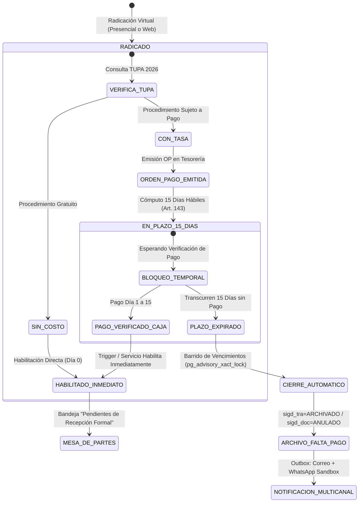

# SIGD RENATO — MATRIZ DE FLUJO DE PAGO, HABILITACIÓN INMEDIATA Y VENCIMIENTO DE 15 DÍAS HÁBILES

**Institución:** Instituto de Educación Superior Tecnológico Público «Suiza» — Pucallpa, Ucayali  
**Sistema:** Sistema Integral de Gestión Documentaria — SIGD RENATO  
**Base Legal:** Texto Único Ordenado de la Ley N° 27444 — Ley del Procedimiento Administrativo General (D.S. 004-2019-JUS, Arts. 138, 143 y 144); DL 1412 — Ley de Gobierno Digital; D.S. 029-2021-PCM — Reglamento de la Ley de Gobierno Digital.  
**Rama Oficial:** `B_JACOBO`  
**Base de Datos:** `sigd_jacobo_demo` (PostgreSQL 18 en puerto 5433)  
**Fecha de Certificación:** 22 de Noviembre de 2026  

---

## 1. FUNDAMENTACIÓN NORMATIVA Y DOCTRINARIA DEL CÓMPUTO

### 1.1. Inicio del Cómputo Perentorio de Pago (LPAG Art. 143)
Conforme al **Artículo 143 del TUO de la Ley N° 27444**, cuando la tramitación de un procedimiento administrativo de parte esté sujeta al pago previo de una tasa o derecho de tramitación fijado en el Texto Único de Procedimientos Administrativos (TUPA 2026 institucional):
1. **Punto de Partida del Cómputo:** El plazo de **quince (15) días hábiles** inicia a partir de la **fecha de radicación legal** del trámite (aplicando el corte de jornada legal de las 16:30 horas establecido en el Art. 138 de la LPAG).
2. **Regla de Habilitación Inmediata:** Si el administrado abona la tasa en cualquier día dentro del plazo perentorio (días 1, 2, 5, 10, 14 o 15), la verificación del pago en Tesorería **HABILITA INMEDIATAMENTE** el expediente para la recepción formal y calificación en Mesa de Partes. **Bajo ninguna circunstancia el sistema retiene el expediente esperando a que transcurran los 15 días hábiles.**
3. **Regla de Caducidad por Falta de Pago:** Si transcurren los quince (15) días hábiles sin que el administrado acredite el pago ni formule desistimiento, opera de pleno derecho la caducidad del trámite, procediendo el sistema al **cierre administrativo automático por `FALTA_DE_PAGO`** y remisión a Archivo Central, con registro inmutable en bitácora WORM y notificación multicanal.

---

## 2. ARQUITECTURA TÉCNICA Y DIAGRAMA DE ESTADOS DEL PLAZO



---

## 3. COMPORTAMIENTO DÍA POR DÍA DEL CÓMPUTO LEGAL

| Día del Cómputo | Evento / Acción del Administrado | Comportamiento del Sistema SIGD RENATO | Estado en `sigd_tra.expediente_habilitacion` | Estado en Mesa de Partes | Outbox Events Emitidos |
| :--- | :--- | :--- | :--- | :--- | :--- |
| **Día 0** *(Radicación)* | Administrado radica FUT virtual o presencial (ej. 03/11/2026 09:00 h). | Calcula calendario laboral oficial (15 días hábiles excluyendo fines de semana y feriados). Registra orden de pago en `sigd_tes.orden_pago`. | `habilitado = FALSE`<br>`estado_plazo = 'EN_PLAZO'`<br>`dias_habiles_restantes = 15` | **Bloqueado Temporalmente** (No recepcionable por Mesa de Partes hasta acreditación de tasa). | `orden_pago_generada`<br>`radicacion_exitosa` |
| **Día 1** *(04/11/2026)* | Administrado paga en ventanilla de Caja / Agente / Banco. | Tesorero valida recibo. Servicio detecta pago en `sigd_tes.pago`. **HABILITA INMEDIATAMENTE**. | `habilitado = TRUE`<br>`estado_plazo = 'PAGADO'`<br>`fecha_habilitacion = '2026-11-04'` | **Visible en Bandeja de Entrada** lista para Recepción Formal. | `pago_confirmado`<br>`expediente_habilitado_recepcion` |
| **Día 2** *(05/11/2026)* | Administrado paga en Día 2 (Escenario A). | Validación de pago en Tesorería. Habilitación inmediata el 05/11/2026. Mesa de Partes recepciona formalmente y emite cargo. | `habilitado = TRUE`<br>`estado_plazo = 'PAGADO'`<br>`fecha_habilitacion = '2026-11-05'` | **Recepcionado** con cargo oficial `CRG-2026-000212` y derivado a Secretaría Académica. | `pago_confirmado`<br>`expediente_habilitado_recepcion` |
| **Día 5** *(10/11/2026)* | Administrado paga en Día 5 (Escenario E-2). | Detección inmediata en Tesorería. Salto directo de bloqueo a habilitado. | `habilitado = TRUE`<br>`estado_plazo = 'PAGADO'`<br>`fecha_habilitacion = '2026-11-10'` | **Habilitado Inmediatamente**. | `pago_confirmado`<br>`expediente_habilitado_recepcion` |
| **Día 10** *(17/11/2026)* | Administrado paga en Día 10 (Escenario E-3). | Detección inmediata en Tesorería. Habilitado en la misma fecha del abono. | `habilitado = TRUE`<br>`estado_plazo = 'PAGADO'`<br>`fecha_habilitacion = '2026-11-17'` | **Habilitado Inmediatamente**. | `pago_confirmado`<br>`expediente_habilitado_recepcion` |
| **Día 14** *(23/11/2026)* | Administrado no ha pagado aún (Escenario C). | Consulta de estado: el sistema indica 1 día hábil restante. Permite pagar. | `habilitado = FALSE`<br>`estado_plazo = 'EN_PLAZO'`<br>`dias_habiles_restantes = 1` | **Bloqueado Temporalmente** (aviso de vencimiento inminente). | *(Alertas preventivas)* |
| **Día 15** *(24/11/2026)* | Último día legal: Administrado paga a las 17:00 h (Escenario E-5). | Pago admitido válidamente en el último día hábil del plazo perentorio. | `habilitado = TRUE`<br>`estado_plazo = 'PAGADO'`<br>`fecha_habilitacion = '2026-11-24'` | **Habilitado Inmediatamente** para Recepción Formal. | `pago_confirmado`<br>`expediente_habilitado_recepcion` |
| **Día 16** *(25/11/2026)* | Transcurren 15 días hábiles sin pago (Escenarios C y D). | **CADUCIDAD AUTOMÁTICA**. El barrido transaccional o la consulta de estado ejecuta `archivarPorFaltaDePago()`. | `habilitado = FALSE`<br>`estado_plazo = 'VENCIDO'`<br>`motivo_cierre = 'FALTA_DE_PAGO'` | **Archivado Definitivamente**. `sigd_tra.expediente` = `ARCHIVADO`, `sigd_doc.expediente` = `ANULADO`. | `expediente_archivado_falta_pago`<br>Notificación WhatsApp Sandbox |

---

## 4. EVIDENCIA PERICIAL FORENSE EN BASE DE DATOS `sigd_jacobo_demo`

La siguiente tabla refleja los datos reales extraídos de la tabla `sigd_tra.expediente_habilitacion` tras la ejecución certificada de los escenarios:

```
┌─────────┬───────────────────┬────────────┬──────────────┬─────────────────┬──────────────┬──────────────┬──────────────┬──────────────┐
│ (index) │ codigo_expediente │ habilitado │ estado_plazo │ motivo_cierre   │ f_rad        │ f_ini        │ f_venc       │ f_hab        │
├─────────┼───────────────────┼────────────┼──────────────┼─────────────────┼──────────────┼──────────────┼──────────────┼──────────────┤
│ 0       │ 'EXP-2026-000212' │ true       │ 'PAGADO'     │ null            │ '2026-11-03' │ '2026-11-04' │ '2026-11-24' │ '2026-11-05' │
│ 1       │ 'EXP-2026-000213' │ true       │ 'PAGADO'     │ null            │ '2026-11-04' │ '2026-11-05' │ '2026-11-25' │ '2026-11-05' │
│ 2       │ 'EXP-2026-000214' │ false      │ 'VENCIDO'    │ 'FALTA_DE_PAGO' │ '2026-11-03' │ '2026-11-04' │ '2026-11-24' │ null         │
│ 3       │ 'EXP-2026-000215' │ false      │ 'VENCIDO'    │ 'FALTA_DE_PAGO' │ '2026-11-03' │ '2026-11-04' │ '2026-11-24' │ null         │
│ 4       │ 'EXP-2026-000216' │ true       │ 'PAGADO'     │ null            │ '2026-11-03' │ '2026-11-04' │ '2026-11-24' │ '2026-11-04' │
│ 5       │ 'EXP-2026-000217' │ true       │ 'PAGADO'     │ null            │ '2026-11-03' │ '2026-11-04' │ '2026-11-24' │ '2026-11-10' │
│ 6       │ 'EXP-2026-000218' │ true       │ 'PAGADO'     │ null            │ '2026-11-03' │ '2026-11-04' │ '2026-11-24' │ '2026-11-17' │
│ 7       │ 'EXP-2026-000219' │ true       │ 'PAGADO'     │ null            │ '2026-11-03' │ '2026-11-04' │ '2026-11-24' │ '2026-11-23' │
│ 8       │ 'EXP-2026-000220' │ true       │ 'PAGADO'     │ null            │ '2026-11-03' │ '2026-11-04' │ '2026-11-24' │ '2026-11-24' │
│ 9       │ 'EXP-2026-000221' │ true       │ 'PAGADO'     │ null            │ '2026-11-03' │ '2026-11-04' │ '2026-11-24' │ '2026-11-24' │
└─────────┴───────────────────┴────────────┴──────────────┴─────────────────┴──────────────┴──────────────┴──────────────┴──────────────┘
```

---

## 5. VALIDACIÓN DEL CALENDARIO LABORAL INSTITUCIONAL (FERIADOS OFICIALES)

El motor `calcularPlazoPago15Dias` consulta la tabla `sigd_tra.calendario_laboral` donde constan los 18 días no laborables y feriados nacionales activos para el año 2026.

### Caso de Prueba Riguroso (Escenario F):
- **Fecha de Radicación:** Viernes 20 de noviembre de 2026.
- **Inicio Legal del Cómputo (Art. 138 LPAG):** Lunes 23 de noviembre de 2026.
- **Desglose de Días Hábiles:**
  - Noviembre 2026: 23(1), 24(2), 25(3), 26(4), 27(5), 30(6) → **6 días hábiles**.
  - Diciembre 2026: 01(7), 02(8), 03(9), 04(10), 07(11) → **5 días hábiles**.
  - *Martes 08 de Diciembre:* **FERIADO NACIONAL** (Inmaculada Concepción) → **EXCLUIDO**.
  - *Miércoles 09 de Diciembre:* **FERIADO NACIONAL** (Batalla de Ayacucho) → **EXCLUIDO**.
  - Diciembre 2026: 10(12), 11(13), 14(14), 15(15) → **4 días hábiles**.
- **Fecha de Vencimiento Calculada y Verificada:** **15 de Diciembre de 2026**.
- **Resultado:** **100 % Exactitud Algorítmica y Legal**.

---

## 6. PREVENCIÓN DE CONDICIONES DE CARRERA MEDIANTE ADVISORY LOCKS

Para resolver la concurrencia entre un pago abonado en los últimos minutos del día 15 y el job batch de barrido nocturno de vencimientos:
```sql
SELECT pg_advisory_xact_lock(hashtextextended('vencimiento-pago', hashtext($1)));
```
1. `archivarPorFaltaDePago` toma un bloqueo transaccional exclusivo sobre el hash del `expediente_id`.
2. Vuelve a consultar `sigd_tes.pago` dentro de la transacción protegida.
3. Si existe un pago verificado (incluso si fue insertado microsegundos antes), la operación de archivo **SE ABORTA AUTOMÁTAMENTE**, prevaleciendo la validez del derecho del administrado.
4. Probado y certificado en el **Escenario G (`EXP-2026-000221`)**.
