# MATRIZ DE TRAZABILIDAD INSTITUCIONAL E2E ACTUALIZADA — SIGD RENATO

**Institución:** Instituto de Educación Superior Tecnológico Público «Suiza» — Pucallpa, Ucayali  
**Proyecto:** Sistema Integral de Gestión Documentaria (SIGD RENATO)  
**Rama autorizada:** `B_JACOBO`  
**Base de datos:** `sigd_jacobo_demo` — PostgreSQL 18 (Puerto `5433`)  
**Backend:** Express / TypeScript (Puerto `3008`)  
**Frontend:** Vite / React SPA (Puerto `5178`)  
**Fecha:** 22 de noviembre de 2026  
**Auditor:** Arquitecto de Software Senior  

---

## 1. PRINCIPIOS DE TRAZABILIDAD INMUTABLE INSTITUCIONAL

La trazabilidad del SIGD RENATO responde a los principios de **causalidad estricta, inmutabilidad WORM (Write Once, Read Many) y monotonicidad temporal** ($T_0 < T_1 < \dots < T_n$). Toda operación administrativa genera un registro append-only estructurado en `sigd_rut.movimiento_tramite` y en las tablas especializadas de dominio, garantizando que:
1. Ninguna actuación histórica pueda ser modificada o eliminada silenciosamente.
2. Cada cambio de estado de la FSM institucional esté respaldado por un movimiento auditable con usuario, rol, unidad orgánica, fecha/hora, proveído y hash de evidencia.
3. Se erradica el código artificial `990`; todos los operadores se resuelven contra `sigd_auth.operador_identidad` y `sigd_org.area`.
4. El repositorio unificado `backend/src/domains/rutadoc/trazabilidad.repository.ts` proyecta la historia completa deduplicando complementos relacionales sin alterar la causalidad.

---

## 2. MATRIZ MAESTRA DE LAS 17 ACTUACIONES DEL CICLO DE VIDA DOCUMENTAL

```mermaid
flowchart LR
    subgraph ETAPA_CIUDADANO [Etapa 1: Ciudadano]
        H1["1. Radicación Registral"]
    end
    subgraph ETAPA_TESORERIA [Etapa 2: Tesorería]
        H2["2. Orden de Pago"] --> H3["3. Pago en Caja"]
    end
    subgraph ETAPA_ESPERA [Etapa 3: Espera Legal]
        H4["4. Habilitación 15 Días LPAG"]
    end
    subgraph ETAPA_MESA_PARTES [Etapa 4: Mesa de Partes]
        H5["5. Recepción Formal"] --> H6["6. Calificación TUPA"]
        H6 --> H7["7. Derivación Unidad"]
    end
    subgraph ETAPA_UNIDAD_ACADEMICA [Etapa 5: Unidad Académica]
        H8["8. Recepción Unidad"] --> H9["9. Asignación Evaluador"]
        H9 --> H10["10. Dictamen Técnico"]
        H10 --> H11["11. Proyecto RD"]
        H11 --> H12["12. Elevación a Firma"]
    end
    subgraph ETAPA_DIRECCION [Etapa 6: Dirección General]
        H13["13. Firma Digital PAdES"]
    end
    subgraph ETAPA_NOTIFICACION [Etapa 7: Casilla Digital]
        H14["14. Notificación Casilla"] --> H15["15. Acuse Digital"]
    end
    subgraph ETAPA_ARCHIVO [Etapa 8: Cierre y Custodia]
        H16["16. Cierre Formal LPAG"] --> H17["17. Custodia Archivo Central"]
    end

    H1 --> H2
    H3 --> H4
    H4 --> H5
    H7 --> H8
    H12 --> H13
    H13 --> H14
    H15 --> H16
```

---

### Detalle Estructurado de Actuaciones Institucionales

| Hito | Evento Canónico | Estado Anterior $\rightarrow$ Posterior | Dominio Responsable | Rol Institucional | Tabla Principal | Evidencia / Hash / Documento |
| :---: | :--- | :---: | :---: | :--- | :--- | :--- |
| **#1** | `RADICACION_ASIENTO_REGISTRAL` | `INICIO` $\rightarrow$ `REGISTRADO` | TRAMICORE | `CIUDADANO` / Mesa Partes | `sigd_tra.asiento_registro` | Asiento registral correlativo, CUT `EXP-YYYY-XXXXXX`, FUT digital firmado. |
| **#2** | `ORDEN_PAGO_GENERADA` | `REGISTRADO` $\rightarrow$ `PENDIENTE_PAGO` | TESORERIA | `TESORERO` | `sigd_tes.orden_pago` | Código `OP-YYYY-XXXXXX`, tasa TUPA, concepto arancelario institucional. |
| **#3** | `PAGO_CONFIRMADO` | `PENDIENTE_PAGO` $\rightarrow$ `REGISTRADO` | TESORERIA | `TESORERO` | `sigd_tes.pago` | Recibo de caja `DEMO-RC-YYYY-XXXXXX`, sesión de caja activa, hash del comprobante. |
| **#4** | `EXPEDIENTE_HABILITADO` | `REGISTRADO` $\rightarrow$ `HABILITADO` | TRAMICORE | Sistema / LPAG Art. 143 | `sigd_tra.expediente_habilitacion` | Cómputo de 15 días hábiles (excluidos fines de semana y feriados). Días restantes: 0. |
| **#5** | `RECEPCION_MESA_PARTES` | `HABILITADO` $\rightarrow$ `RECEPCIONADO` | RUTADOC / MESA PARTES | `MESA_PARTES` | `sigd_rut.movimiento_tramite` | Cargo oficial de recepción formal, QR de verificación, canal (`PRESENCIAL`/`VIRTUAL`), folios. |
| **#6** | `CALIFICACION_TUPA` | `RECEPCIONADO` $\rightarrow$ `EN_CALIFICACION` | TRAMICORE / DOCUCORE | `MESA_PARTES` | `sigd_doc.expediente_requisito` | Checklist de requisitos normativos TUPA evaluados y conformidad documental aprobada. |
| **#7** | `DERIVACION_SECRETARIA` | `EN_CALIFICACION` $\rightarrow$ `DERIVADO` | RUTADOC | `MESA_PARTES` | `sigd_rut.movimiento_tramite` | Proveído de derivación formal a Secretaría Académica, constancia de pase. |
| **#8** | `RECEPCION_SECRETARIA` | `DERIVADO` $\rightarrow$ `EN_REVISION` | RUTADOC | `SECRETARIO` | `sigd_rut.movimiento_tramite` | Recepción física/digital formal en unidad académica de destino. |
| **#9** | `ASIGNACION_EVALUADOR` | `EN_REVISION` $\rightarrow$ `EN_CALIFICACION` | RUTADOC | `COORDINADOR_AREA` | `sigd_rut.expediente_evaluador` | Memorándum interno de asignación a Docente Evaluador especialista. |
| **#10** | `DICTAMEN_TECNICO` | `EN_CALIFICACION` $\rightarrow$ `CALIFICADO` | DOCUCORE | `DOCENTE` | `sigd_doc.verificacion_academica_estudios` | Dictamen Técnico Académico favorable (6 semestres y créditos validados). |
| **#11** | `PROYECTO_RESOLUCION` | `CALIFICADO` $\rightarrow$ `EN_PROYECTO` | DOCUCORE | `SECRETARIO` | `sigd_doc.resolucion` | Proyecto de Resolución Directoral borrador (`RD-YYYY-XXXXXX`), asunto y vistos. |
| **#12** | `ENVIO_FIRMA` | `EN_PROYECTO` $\rightarrow$ `EN_FIRMA` | RUTADOC | `SECRETARIO` | `sigd_rut.movimiento_tramite` | Elevación formal de expediente y proyecto resolutivo a Dirección General. |
| **#13** | `FIRMA_DIGITAL_DIRECTOR` | `EN_FIRMA` $\rightarrow$ `RESUELTO` | DOCUCORE | `DIRECTOR` | `sigd_doc.firma_digital_documento` | Firma PAdES / TSA (Sandbox), CVD `CVD-YYYY-RD-XXXXXX-XXXX`, hash SHA-256 en MinIO. |
| **#14** | `NOTIFICACION_CASILLA` | `RESUELTO` $\rightarrow$ `RESUELTO` | CASILLA / IDENTICORE | Notificador Institucional | `sigd_auth.notificacion_casilla` | Depósito oficial del acto administrativo en buzón digital del administrado. |
| **#15** | `ACUSE_DIGITAL_GENERADO` | `RESUELTO` $\rightarrow$ `RESUELTO` | CASILLA / IDENTICORE | `CIUDADANO` | `sigd_auth.notificacion_casilla` | Certificado de Acuse Notificatorio digital `ACU-YYYY-XXXXXX` con hash y sellado temporal. |
| **#16** | `CIERRE_ADMINISTRATIVO` | `RESUELTO` $\rightarrow$ `ARCHIVADO` | RUTADOC | `SECRETARIO` | `sigd_rut.expediente_cierre_historial` | Conclusión definitiva del procedimiento administrativo conforme al Art. 197 LPAG. |
| **#17** | `CUSTODIA_ARCHIVO_CENTRAL` | `ARCHIVADO` $\rightarrow$ `EN_CUSTODIA` | ARCHIVO CENTRAL | Custodio / Archivero | `sigd_rut.expediente_custodia` | Custodia física permanente en Archivo Central: Estante, Balda, Caja (Normas AGN). |

---

## 3. INTEGRACIÓN CON MESA DE PARTES Y CONTROL DE ESTADOS

Mesa de Partes es el punto nodal de inicio y calificación previa:
- **Recepción Formal:** Actuación H5 que perfecciona la radicación ciudadana una vez cumplido el plazo de 15 días hábiles LPAG.
- **Calificación Documental:** Actuación H6 donde se evalúa el pliego de requisitos TUPA, registrando el checklist y declarando la conformidad documental.
- **Ciclo de Observación y Subsanación:** Si se formulan observaciones en H6, el expediente transiciona a `OBSERVADO`, activando el plazo de subsanación y la notificación por casilla electrónica. Tras la presentación ciudadana de descargos, transiciona a `SUBSANADO` y retorna a Mesa de Partes para validación.
- **Rechazo Fundamentado:** Si no se subsana dentro del plazo legal o el trámite incurre en causales de improcedencia, Mesa de Partes formaliza el rechazo mediante acto administrativo fundamentado.
