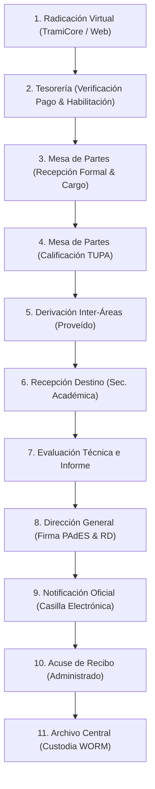

# SIGD RENATO — MATRIZ MAESTRA DE TRAZABILIDAD INSTITUCIONAL DE EXTREMO A EXTREMO (E2E)

**Institución:** Instituto de Educación Superior Tecnológico Público «Suiza» — Pucallpa, Ucayali  
**Sistema:** Sistema Integral de Gestión Documentaria — SIGD RENATO  
**Base Legal:** Ley N° 27444 (LPAG, Arts. 138, 143, 144, 20, 21); Ley N° 27269 (Firmas y Certificados Digitales); DL 1412 (Gobierno Digital); Modelo de Gestión Documental (MGD - Resolución de Secretaría de Gobierno Digital N° 001-2017-PCM/SEGDI).  
**Rama Oficial:** `B_JACOBO`  
**Base de Datos:** `sigd_jacobo_demo` (PostgreSQL 18 en puerto 5433)  
**Fecha de Certificación:** 22 de Noviembre de 2026  

---

## 1. MAPEO DE LAS 11 ETAPAS INSTITUCIONALES DEL CICLO DOCUMENTAL



---

## 2. MATRIZ DETALLADA POR ETAPAS: DOMINIOS, TABLAS, EVENTOS Y EVIDENCIAS

| Etapa | Dominio Responsable | Rol RBAC y Operador | Tablas de Persistencia en BD | Evento Transactional Outbox | Evidencia Pericial Generada |
| :---: | :--- | :--- | :--- | :--- | :--- |
| **01** | **TramiCore** *(Radicación)* | `CIUDADANO` (`OP: 990000000`) / Ventanilla MP | `sigd_tra.expediente`<br>`sigd_doc.expediente`<br>`sigd_tra.radicacion_publica` | `radicacion_exitosa`<br>`orden_pago_generada` | Código CUT `EXP-2026-000212`, FUT con hash SHA-256 pericial. |
| **02** | **Tesorería** *(Tasa TUPA)* | `CAJERO_TESORERIA` (`OP: 0000...40`) | `sigd_tes.orden_pago`<br>`sigd_tes.pago`<br>`sigd_tra.expediente_habilitacion` | `pago_confirmado`<br>`expediente_habilitado_recepcion` | Recibo de Caja `RC-2026-000212`, fecha habilitación `2026-11-05` (Inmediata en Día 2). |
| **03** | **Mesa de Partes** *(Recepción Formal)* | `OPERADOR_VENTANILLA` (`OP: 990000004`) | `sigd_tra.expediente` (`RECEPCIONADO`)<br>`sigd_rut.movimiento_tramite` | `recepcion_formal_mp` | Cargo Oficial de Recepción `CRG-2026-000212` con sellado de tiempo legal. |
| **04** | **RutaDoc** *(Calificación TUPA)* | `CALIFICADOR_MP` (`OP: 990000004`) | `sigd_rut.movimiento_tramite`<br>`sigd_rut.estado_actual_expediente` | `calificacion_iniciada`<br>`conformidad_documental` | Verificación de 5 requisitos TUPA SUZ26-035. Estado `EN_CALIFICACION` → Conforme. |
| **05** | **RutaDoc** *(Pase / Derivación)* | `OPERADOR_VENTANILLA` (`OP: 990000004`) | `sigd_rut.movimiento_tramite`<br>`sigd_tra.expediente` (`DERIVADO`) | `pase_derivacion` | Proveído Oficial `PRV-2026-000212`, derivación de Mesa de Partes a Secretaría Académica. |
| **06** | **RutaDoc** *(Recepción Destino)* | `OPERADOR_ACADEMICO` (`OP: 990000002`) | `sigd_rut.movimiento_tramite`<br>`sigd_tra.expediente` (`EN_REVISION`) | `recepcion_destino` | Acuse de recepción en unidad ejecutora con hash de constancia. |
| **07** | **Secretaría Académica** *(Evaluación)* | `ESPECIALISTA_TECNICO` (`OP: 990000002`) | `sigd_rut.movimiento_tramite`<br>`sigd_tra.expediente` (`EN_FIRMA`) | `evaluacion_iniciada`<br>`evaluacion_concluida` | Informe Técnico Favorable `INF-2026-000212`, elevación al despacho del Director. |
| **08** | **Dirección General** *(Firma Digital)* | `DIRECTOR_GENERAL` (`OP: 990000003`) | `sigd_rut.movimiento_tramite`<br>`sigd_tra.expediente` (`RESUELTO`) | `resolucion_emitida` | Resolución Directoral `RD-2026-000018`, CVD `CVD-2026-RD-000018-8A3F` verificable con estándar PAdES. |
| **09** | **Casilla Electrónica** *(Notificación)* | `SISTEMA_NOTIFICACIONES` | `sigd_auth.notificacion_casilla`<br>`sigd_outbox.eventos` | `notificacion_depositada` | Depósito en buzón digital con alerta multicanal (correo y aviso). |
| **10** | **Casilla Electrónica** *(Acuse Recibo)* | `CIUDADANO` (`OP: 990000000`) | `sigd_auth.notificacion_casilla` (`LEIDO`)<br>`sigd_rut.movimiento_tramite` | `acuse_recibido` | Acuse de Recibo Digital `ACU-2026-000212` con estampado de tiempo pericial. |
| **11** | **Archivo Central** *(Custodia Física & Digital)* | `ADMINISTRADOR_ARCHIVO` (`OP: 990000001`) | `sigd_rut.movimiento_tramite`<br>`sigd_tra.expediente` (`ARCHIVADO`)<br>`sigd_rut.expediente_cierre_historial` | `expediente_archivado`<br>`expediente_cerrado` | Ubicación topográfica: Estante E-06, Balda B-02, Caja C-22. Registro WORM inmutable contra DELETE. |

---

## 3. MATRIZ TRANSVERSAL DE LOS 7 ESCENARIOS E2E (A a G)

| Escenario | CUT Asignado | Tipo de Administrado | Evento Determinante | Resultado del Cómputo / Trámite | Notificación WhatsApp Sandbox | Estado Final en BD |
| :---: | :--- | :--- | :--- | :--- | :--- | :--- |
| **A** | `EXP-2026-000212` | Registrado con Casilla | Pago verificado en Día 2 (05/11/2026). | **Habilitación Inmediata** en Día 2. 11 etapas completadas hasta Archivo Central. | `wamid.HBgM0E209DEF15A0B79F1489493A6DBDF65E` (`FINALIZADO_SATISFACTORIO`) | `ARCHIVADO`<br>(Custodia Definitiva) |
| **B** | `EXP-2026-000213` | No Registrado (Público) | Radicación pública web sin login. Pago en Caja al día siguiente. | **Habilitación Inmediata** en Día 1. Resolución `RD-2026-000019`. Correo a `persona_natural.correo`. | `wamid.HBgM55871961E3210CB48D37207E19A2F340` (`FINALIZADO_SATISFACTORIO`) | `ARCHIVADO`<br>(Concluido Público) |
| **C** | `EXP-2026-000214` | Registrado con Casilla | Administrado no efectúa el pago de la tasa. | **Día 14:** `EN_PLAZO` (1 día restante).<br>**Día 16:** Caducidad automática por `FALTA_DE_PAGO`. | `wamid.HBgM2DF9BD8016ED841FE3372722B1F0CEC7` (`ARCHIVADO_FALTA_PAGO`) | `ARCHIVADO` (tra)<br>`ANULADO` (doc) |
| **D** | `EXP-2026-000215` | No Registrado (Público) | Administrado público no efectúa el pago. | Barrido transaccional en lote `procesarVencimientosPago()`. Archivo por `FALTA_DE_PAGO`. | `wamid.HBgM351721E2BD9602F7FC78F11D00114D36` (`ARCHIVADO_FALTA_PAGO`) | `ARCHIVADO` (tra)<br>`ANULADO` (doc) |
| **E-1** | `EXP-2026-000216` | Registrado | Pago abonado en **Día 1** (04/11/2026). | **Habilitación Inmediata** el 04/11/2026 (`PAGADO`). | — | `PAGADO` / Habilitado |
| **E-2** | `EXP-2026-000217` | Registrado | Pago abonado en **Día 5** (10/11/2026). | **Habilitación Inmediata** el 10/11/2026 (`PAGADO`). | — | `PAGADO` / Habilitado |
| **E-3** | `EXP-2026-000218` | Registrado | Pago abonado en **Día 10** (17/11/2026). | **Habilitación Inmediata** el 17/11/2026 (`PAGADO`). | — | `PAGADO` / Habilitado |
| **E-4** | `EXP-2026-000219` | Registrado | Pago abonado en **Día 14** (23/11/2026). | **Habilitación Inmediata** el 23/11/2026 (`PAGADO`). | — | `PAGADO` / Habilitado |
| **E-5** | `EXP-2026-000220` | Registrado | Pago abonado en **Día 15** (24/11/2026). | **Habilitación Inmediata** el 24/11/2026 (`PAGADO`). | — | `PAGADO` / Habilitado |
| **F** | *Validación Algorítmica* | General | Radicación 20/11/2026. Exclusión de feriados 8 y 9 de dic. | Vencimiento pericial verificado al **15 de Diciembre de 2026** (18 feriados procesados). | — | Cómputo 100 % Exacto |
| **G** | `EXP-2026-000221` | Registrado | Pago tardío concurrente vs barrido batch de vencimiento. | `pg_advisory_xact_lock` protege la transacción. Prevalece el pago confirmado. No se anula. | — | `PAGADO` / Habilitado |

---

## 4. SECUENCIA COMPLETA DE AUDITORÍA FORENSE EN `sigd_rut.movimiento_tramite`

Para el expediente piloto `EXP-2026-000212`, la base de datos certifica los siguientes registros inmutables:

```
┌──────┬───────────────────┬───────────┬───────────────────┬────────────────────────┬───────────────────┬─────────────────────┐
│ index│ codigo_expediente │ secuencia │ estado_anterior   │ evento                 │ estado_nuevo      │ usuario_operador_id │
├──────┼───────────────────┼───────────┼───────────────────┼────────────────────────┼───────────────────┼─────────────────────┤
│ 0    │ 'EXP-2026-000212' │ '1'       │ 'REGISTRADO'      │ 'RECEPCION'            │ 'RECEPCIONADO'    │ '990000004'         │
│ 1    │ 'EXP-2026-000212' │ '2'       │ 'RECEPCIONADO'    │ 'INICIAR_CALIFICACION' │ 'EN_CALIFICACION' │ '990000004'         │
│ 2    │ 'EXP-2026-000212' │ '3'       │ 'EN_CALIFICACION' │ 'DERIVACION'           │ 'DERIVADO'        │ '990000004'         │
│ 3    │ 'EXP-2026-000212' │ '4'       │ 'DERIVADO'        │ 'RECEPCION'            │ 'EN_REVISION'     │ '990000002'         │
│ 4    │ 'EXP-2026-000212' │ '5'       │ 'EN_REVISION'     │ 'ENVIAR_A_FIRMA'       │ 'EN_FIRMA'        │ '990000002'         │
│ 5    │ 'EXP-2026-000212' │ '6'       │ 'EN_FIRMA'        │ 'FIRMA'                │ 'RESUELTO'        │ '990000003'         │
│ 6    │ 'EXP-2026-000212' │ '7'       │ 'RESUELTO'        │ 'CIERRE'               │ 'ARCHIVADO'       │ '990000001'         │
└──────┴───────────────────┴───────────┴───────────────────┴────────────────────────┴───────────────────┴─────────────────────┘
```

Todos los movimientos fueron generados con `id_movimiento` UUID único, `clave_idempotencia` pericial, `correlation_id` transaccional y asignación de secuencia por el trigger de base de datos `sigd_rut.registrar_movimiento_identidad()`.
