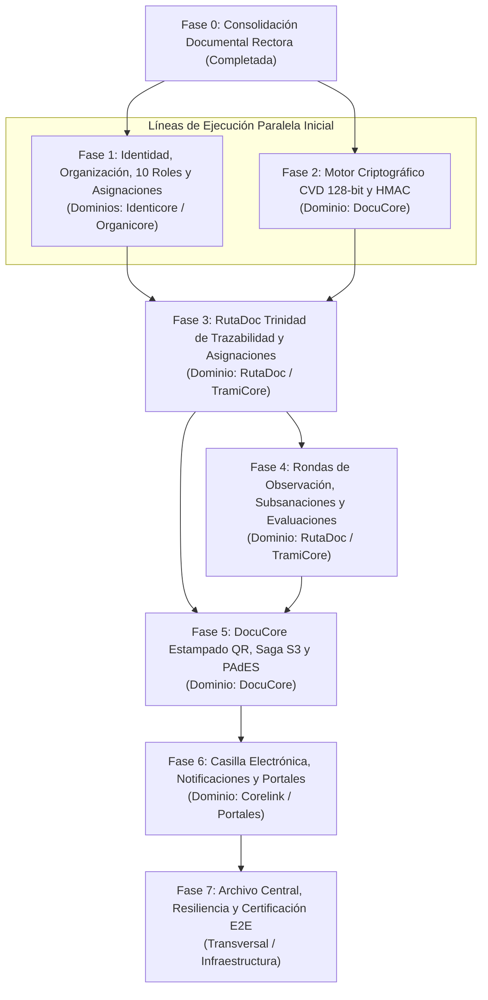

# SIGD RENATO — BACKLOG DE IMPLEMENTACIÓN TÉCNICA V1.2.1
## HOJA DE RUTA DETALLADA, TAREAS ACCIONABLES Y CRITERIOS DE CERTIFICACIÓN
### INSTITUTO DE EDUCACIÓN SUPERIOR TECNOLÓGICO PÚBLICO «SUIZA»
### RAMA OFICIAL: `B_JACOBO` — VERSIÓN ARMONIZADA

---

## 1. ESTRUCTURA Y METODOLOGÍA DEL BACKLOG

El presente backlog operacionaliza el **Plan Maestro V1.2.1 Armonizado** en tareas de ingeniería concretas organizadas por **dependencias técnicas y funcionales**, descartando cronogramas basados en fechas fijas arbitrarias.

Cada tarea incluye:
* **ID y Nombre de Tarea.**
* **Nivel de Riesgo y Dependencias.**
* **Dominio y Archivos Involucrados.**
* **Descripción de la Intervención y Estrategia de Mitigación.**
* **Pruebas Automatizadas Exigibles.**
* **Criterio de Aceptación Objetivo.**

---

## 2. MAPA DE DEPENDENCIAS Y PARALELISMO TÉCNICO

* **Capacidad de Paralelismo:** La **Fase 1** (catálogo de roles y ámbitos organizacionales en base de datos) y la **Fase 2** (algoritmo de generación CVD 128-bit y tokenizador HMAC en backend) son técnicamente ortogonales y pueden avanzar de forma concurrente sin colisiones de código ni dependencias circulares.

---

## 3. DESGLOSE DE TAREAS POR FASES DE IMPLEMENTACIÓN

---

### FASE 0: CONSOLIDACIÓN DOCUMENTAL RECTORA (COMPLETADA)
* **Objetivo:** Armonizar la suite técnica, subsanar contradicciones y establecer el catálogo estricto de 10 roles y capacidades operativas.
* **Entregables:** Los 6 documentos canónicos en `docs/`.
* **Condición de Cierre:** Documentos sincronizados sin discrepancias con dictamen final aprobado.

---

### FASE 1: IDENTIDAD, ORGANIZACIÓN, ROLES, PERMISOS Y ASIGNACIONES
* **Objetivo:** Actualizar el catálogo de roles en base de datos para reflejar exactamente los diez roles institucionales, incorporar la validación de ámbitos (`Scope`), admitir múltiples asignaciones por cuenta y gestionar capacidades operativas.
* **Componentes Reutilizados:** `backend/src/domains/identicore/`, `backend/src/domains/organicore/`, esquemas `sigd_auth` y `sigd_org`.
* **Nivel de Riesgo General:** **MEDIO-ALTO** (Involucra migración de usuarios existentes y restricciones relacionales en PostgreSQL).

#### Tareas de la Fase 1:
* **`TSK-1.0`, `TSK-1.0A` y `TSK-1.0B` (Motor de Autorización RBAC Contextual, Capacidades Normalizadas, Endurecimiento y Conciliación Forense) — [ESTADO: COMPLETADA]:**
  * **Alcance Ejecutado, Endurecido y Conciliado:**
    * Arquitectura contextual de sesión: `UNA PERSONA → UNA CUENTA → MÚLTIPLES ASIGNACIONES → UN CONTEXTO ACTIVO POR SESIÓN`.
    * Cero acumulación automática de permisos entre roles o áreas.
    * **Selector en Login Endurecido (`POST /api/v1/auth/login`):** Selección automática si la cuenta tiene exactamente 1 contexto activo. Si tiene más de 1 contexto disponible, **prohibida la preselección silenciosa**: emite `requiereSeleccionContexto: true`, `contextoActivo: null`, `roles: []` y `permisos: []`, forzando selección explícita.
    * **Seguridad Criptográfica del Contexto:** El contexto activo viaja firmado en el claim `ctx` del JWT. El encabezado `x-contexto-id` se valida contra `claims.ctx`; cualquier discrepancia es rechazada con `403 CONTEXT_HEADER_MISMATCH` y cualquier intento de enviarlo sin contexto en el token es rechazado con `403 CONTEXT_SELECTION_REQUIRED`.
    * **Normalización Relacional de Capacidades:** Eliminación de JSONB en `usuario_capacidad`. Modelo relacional normalizado: `sigd_org.capacidad_sistema`, `sigd_org.capacidad_permiso` y `sigd_org.usuario_capacidad`, reutilizando estrictamente el catálogo `sigd_org.permiso_sistema`.
    * **Historial de Evaluadores (`sigd_rut.expediente_evaluador`):** Campos de desactivación auditada (`desactivado_en`, `desactivado_por`, `motivo_desactivacion`), evidencias JSONB y doble índice único parcial (`WHERE activo = TRUE`), permitiendo reasignar al mismo docente sin perder historial ni duplicar binarios en BD.
    * **Conciliación Forense de Asignaciones ESPECIALISTA:** Desmitificación de cargos ficticios no documentados. De las 6 asignaciones: 2 expiradas por tests H2, 1 perteneciente a cuenta inactiva, y 2 cuentas de sandbox funcional (`operador.demo` y `especialista.demo`) pendientes de confirmación institucional. Cero reasignaciones automáticas no autorizadas.
    * **Conciliación Estricta de Tesorería:** Preservación de los 9 códigos atómicos históricos reales de Tesorería en BD y código (`TESORERIA_PAGO_VERIFICAR`, `TESORERIA_PAGO_REGISTRAR`, `TESORERIA_LEER`, `TESORERIA_REPORTES`, `TESORERIA_DEVOLUCION_EVALUAR`, `TESORERIA_DEVOLUCION_APROBAR`, `TESORERIA_DEVOLUCION_EJECUTAR`, `TESORERIA_TARIFA_PROPONER`, `TESORERIA_TARIFA_VALIDAR`). Permisos documentarios circunscritos estrictamente al área de Tesorería (`ambito = 'AREA'`), sin acceso a expedientes académicos.
    * **Frontend:** Componentes `SelectorContextoModal.tsx` (con modo bloqueante para login), `SelectorContextoPill.tsx`, integración en `HeaderInstitucional.tsx`, `LoginPage.tsx` y `authStore.ts`.
    * **Scripts SQL Canónicos Blindados:** `backend/migraciones/pendientes/20261111_tsk1_0_rbac_contextual.sql` y `20261111_tsk1_0_rbac_contextual_rollback.sql` (con corrección de chequeo relacional condicional para tolerar códigos desactivados y garantizar que el rollback nunca aborte).
    * **Certificación Automatizada:** Suite de 12 escenarios en `backend/tests/unit/rbac-conciliacion-tsk10b.spec.ts`, 17 escenarios en `rbac-contextual-motor.spec.ts`, 20 pruebas en `auth-rbac-persistido.spec.ts` y 131 pruebas en `auth.router.spec.ts` (180 pruebas backend + 16 pruebas frontend), todas pasando al 100% sin mutar la base protegida `sigd_jacobo_demo`.
* **`TSK-1.0C` (Implementación de Revocación Inmediata de Autorizaciones y Sesiones — Política B) — [ESTADO: COMPLETADA]:**
  * **Decisión Institucional Confirmada (DEC-24):** Sustitución expresa de la antigua política de conservación de permisos hasta el cierre de sesión.
  * **Garantías de Seguridad Implementadas:**
    * Retiro de rol o capacidad operativa surte efecto inmediatamente en peticiones protegidas subsiguientes.
    * Cambio de ámbito organizacional (`areaId`) invalida las asignaciones previas y recalcula facultades sobre el nuevo ámbito de forma inmediata.
    * Desactivación de cuenta ejecuta una transacción atómica que: marca `cu.activo = false`, revoca todas las sesiones activas en `sigd_auth.sesion_usuario` (`revocado_en = now()`) en todos los dispositivos y registra la mutación auditada en `sigd_audit.bitacora_auditoria`.
    * Detección dinámica y rechazo con `403 CONTEXT_REVOKED` en middleware centralizado y controllers si el token o encabezado intenta operar con un contexto revocado o desvinculado.
    * Preservación del acceso legítimo para cuentas multirrol con otros contextos válidos activos tras conmutación autorizada.
    * Bloqueo de nuevos inicios de sesión y de renovaciones (`refresh`) para cuentas inactivas o sesiones revocadas.
    * Resiliencia Fail-Safe Closed ante fallos de conexión a PostgreSQL (HTTP 500/503 seguro sin conceder privilegios) y consulta viva contra PostgreSQL sin cachés obsoletas.
    * Control de concurrencia pesimista con `SELECT ... FOR UPDATE` en `sigd_auth.cuenta_usuario` y `sigd_org.usuario_rol` / `sigd_org.usuario_capacidad`.
    * Auditoría inmutable WORM en `sigd_audit.bitacora_auditoria` para toda desactivación, retiro o modificación de facultades, registrando actor, usuario afectado y estado previo/posterior, sin exponer credenciales ni tokens.
    * Métodos de gestión de capacidades operativas añadidos a OrganiCore (`asignarCapacidad`, `revocarCapacidad`).
    * **Certificación Automatizada:** Suite de 17 escenarios obligatorios en `backend/tests/unit/rbac-revocacion-inmediata-tsk10c.spec.ts` (100% aprobada), acumulando 279 pruebas unitarias backend y 34 pruebas frontend de rutas RBAC passing sin mutar la base activa.

#### Reformulación Exhaustiva de la Tarea TSK-1.1:
* **`TSK-1.1` (Migración Segura y Transicional del Catálogo de Roles):**
  * **Nivel de Riesgo:** **ALTO** *(Reclasificado: No es bajo riesgo)*.
  * **Análisis de Impacto en Base de Datos Real (`sigd_jacobo_demo`):**
    * La tabla `sigd_org.rol_sistema` contiene 10 registros históricos.
    * El rol `ESPECIALISTA` posee **6 asignaciones de usuarios activos** vinculadas en `sigd_org.usuario_rol`:
      * `operador.demo` (Secretaría Académica).
      * `especialista.demo` (Secretaría Académica).
      * `trabajador.h2.test` (con doble asignación en Mesa de Partes y Dirección General).
      * `trabajador.h2.5079` (con doble asignación en Mesa de Partes y Dirección General).
    * El constraint `chk_rol_codigo` restringe los códigos admitidos mediante un `CHECK (codigo = ANY (...))`.
    * La clave foránea `usuario_rol_rol_id_fkey` impide eliminar o mutar registros de roles mientras existan referencias en `usuario_rol`.
  * **Estrategia de Ejecución Segura en 5 Pasos:**
    1. *Prueba Previa en Clon Aislado:* Ejecutar el script DDL sobre una base de datos temporal de prueba (`sigd_prueba`) antes de intervenir `sigd_jacobo_demo`.
    2. *Ampliación No Destructiva del CHECK:* Modificar el constraint `chk_rol_codigo` para incluir tanto los roles antiguos como los 4 nuevos roles (`JEFE_UNIDAD_ACADEMICA`, `COORDINADOR_AREA`, `DOCENTE`, `ESTUDIANTE`) sin eliminar `ESPECIALISTA`.
    3. *Inserción de Nuevos Roles:* Insertar los registros para los cuatro nuevos roles con `vigente = true`.
    4. *Reasignación Asistida de Usuarios:* Migrar las 6 asignaciones activas de `ESPECIALISTA` hacia sus roles reales según su área y cargo:
       * `operador.demo` y `especialista.demo` en Secretaría Académica $\rightarrow$ `SECRETARIO` o rol docente/administrativo con capacidad `GESTOR_APOYO_AREA`.
       * Cuentas de prueba H2 $\rightarrow$ roles correspondientes a su área de prueba.
    5. *Deprecación Segura (Soft-Deprecate):* Establecer `vigente = false` para `ESPECIALISTA`, `CAJERO`, `APROBADOR_DEVOLUCIONES` y `SUPERVISOR_TESORERIA`. **No ejecutar DELETE en `rol_sistema`.**
  * **Plan de Reversión (Rollback):** Script de reversión `TSK-1.1-rollback.sql` que restablece las claves foráneas hacia los roles anteriores si se detecta cualquier incompatibilidad.

#### Resto de Tareas de la Fase 1:
* **`TSK-1.2` (Modelo de Capacidades Operativas):** Crear tabla `sigd_org.usuario_capacidad` (`id_usuario`, `capacidad_codigo`, `area_id`, `activo`, `asignado_por`) para soportar `DOCENTE_EVALUADOR` y `GESTOR_APOYO_AREA`.
* **`TSK-1.3` (Gestión de Múltiples Asignaciones Activas):** Adecuar `backend/src/domains/organicore/usuariosAdmin.controller.ts` para permitir asignar múltiples roles a una misma cuenta con ámbitos diferenciados, registrando `asignado_por` e historial.
* **`TSK-1.4` (Middleware de Ámbitos y Contexto):** Actualizar `backend/src/middlewares/auth.middleware.ts` para resolver el scope del usuario (`GLOBAL`, `UNIDAD_ACADEMICA`, `PROGRAMA_ESTUDIOS`, `AREA`, `ASIGNADO`, `INTERNO`, `EXTERNO`) en tiempo real.
* **`TSK-1.5` (Actualización de UI en Frontend):** Adecuar `RolesPermisosPage.tsx` y `UsuariosPage.tsx` para soportar la visualización y gestión de los 10 roles y capacidades operativas.
* **Pruebas:** Suites en Vitest comprobando que la revocación o desactivación de una asignación en PostgreSQL deniega inmediatamente el acceso (HTTP 403).
* **Criterio de Cierre:** Los 10 roles canónicos vigentes en BD, 0 usuarios huérfanos y tests de autorización pasando al 100%.

---

### FASE 2: CVD Y VERIFICACIÓN DOCUMENTAL
* **Objetivo:** Implementar la generación y verificación de Código de Verificación Digital (CVD) de 128 bits con HMAC y modo de contingencia `VERIFICACIÓN PARCIAL`.
* **Componentes Reutilizados:** `validadorCvd.controller.ts`, `ValidadorPublicoCvdPage.tsx`.
* **Nivel de Riesgo:** **BAJO-MEDIO** (Módulo desacoplado en `docucore`).

#### Tareas Implementables:
* **`TSK-2.1` (Generador CSPRNG Crockford Base32 128-bit):** Crear servicio `cvdGenerator.service.ts` en `backend/src/domains/docucore/` con entropía pura de 128 bits (`SZ26-[0-7]...`).
* **`TSK-2.2` (Tokenizador HMAC v1:kid:cvd):** Crear servicio `hmacSigner.service.ts` para firmar y verificar tokens de acceso en el código QR.
* **`TSK-2.3` (Validador Resiliente con Segregación Criptográfica):** Modificar `validadorCvd.controller.ts` para reportar de forma independiente la integridad documental y la firma digital, respondiendo con HTTP 200 en modo `VERIFICACIÓN PARCIAL` ante caída de MinIO.
* **`TSK-2.4` (Actualización de Validador en Frontend):** Adaptar `ValidadorPublicoCvdPage.tsx` con lector de cámara y soporte de URL canónica.
* **Pruebas:** 14 casos de prueba TC-QR-01 a TC-QR-14 ejecutados en verde con Vitest.
* **Criterio de Cierre:** Validación exitosa de documentos tanto en modo normal como con MinIO desconectado.

---

### FASE 3: RUTADOC — MÁQUINA DE ESTADOS, CUSTODIA, MOVIMIENTOS Y RESPONSABLES
* **Objetivo:** Construir la orquestación de flujos en RutaDoc separando estrictamente Estado Procesal, Custodia del Área, Docente Asignado y Estado de Notificación.
* **Componentes Reutilizados:** `sigd_rut.movimiento_tramite`, controladores en `rutadoc`.
* **Nivel de Riesgo:** **MEDIO**.

#### Tareas Implementables:
* **`TSK-3.1` (Esquema de Cuádruple Trazabilidad):** Añadir columnas `area_custodia_id`, `evaluador_asignado_id` y `estado_notificacion` en `sigd_tra.expediente`, y crear tabla `sigd_rut.expediente_evaluador_historial`.
* **`TSK-3.2` (Máquina de Estados Finita No Monolítica):** Implementar `maquinaEstados.service.ts` en `rutadoc` validando transiciones según tipo de trámite TUPA (aprobación automática, evaluación previa, desistimientos, suspensiones).
* **`TSK-3.3` (Endpoint de Reasignación con Motivo):** Crear ruta `POST /api/v1/expedientes/:id/reasignar` obligando a ingresar motivo justificado sin alterar estado ni custodia.
* **`TSK-3.4` (Bandejas Diferenciadas en Frontend):** Reorganizar vistas en `frontend/src/pages/tramite/` separando "Mi Bandeja de Evaluador" de "Bandeja de Despacho del Área".
* **Pruebas:** Pruebas de concurrencia e invariancia de custodia ante reasignaciones.
* **Criterio de Cierre:** Una reasignación actualiza el evaluador pero mantiene el estado `EN_EVALUACION` y la custodia en el área.

---

### FASE 4: OBSERVACIONES, SUBSANACIONES Y EVALUACIONES
* **Objetivo:** Formalizar el ciclo de observaciones técnicas y de admisibilidad con cómputo de términos normativos según TUPA.
* **Componentes Reutilizados:** Módulo de radicación de `tramicore`.
* **Nivel de Riesgo:** **MEDIO**.

#### Tareas Implementables:
* **`TSK-4.1` (Tabla de Rondas de Observación):** Crear `sigd_rut.expediente_observacion` con campos `ronda_numero`, `causal`, `plazo_dias_habiles`, `fecha_vencimiento`.
* **`TSK-4.2` (Calculador de Términos por Procedimiento TUPA):** Servicio para calcular vencimientos descontando días no laborables del calendario del IESTP Suiza según el plazo fijado en la ficha TUPA del trámite.
* **`TSK-4.3` (Portal de Subsanación para Administrados):** Vista en portal Estudiante/Ciudadano para adjuntar evidencias de subsanación dentro del plazo.
* **`TSK-4.4` (Reanudación Automática de Trámite):** Al ingresar subsanación, pasar el estado a `SUBSANADO` y alertar al evaluador asignado.
* **Pruebas:** Pruebas de bloqueo de trámite vencido y reanudación reglamentaria.
* **Criterio de Cierre:** El administrado puede subsanar dentro de plazo y el evaluador recibe el expediente en su bandeja.

---

### FASE 5: DOCUCORE — VERSIONAMIENTO, MINIO, QR Y FIRMA DIGITAL
* **Objetivo:** Emisión documental segura con validez jurídica y consistencia distribuida.
* **Componentes Reutilizados:** `pdf-lib`, `pkijs`, `@aws-sdk/client-s3`.
* **Nivel de Riesgo:** **MEDIO-ALTO**.

#### Tareas Implementables:
* **`TSK-5.1` (Estampador de QR en PDF):** Servicio `pdfStamper.service.ts` para fijar el QR en la esquina inferior izquierda con metadatos adyacentes obligatorios.
* **`TSK-5.2` (Saga PostgreSQL–MinIO con Compensación):** Orquestador transaccional que borra el PDF en MinIO si la base de datos falla al confirmar la emisión.
* **`TSK-5.3` (Reconciliador de Huérfanos en S3):** Script de fondo para auditar y purgar objetos en MinIO sin referencia en PostgreSQL.
* **`TSK-5.4` (Verificador PAdES-B-LT):** Servicio de validación de firma digital verificando integridad del hash SHA-256 e independencia de resultados.
* **Pruebas:** Simulación de fallos de red durante la carga de PDFs para comprobar la compensación atómica.
* **Criterio de Cierre:** Cero archivos huérfanos en MinIO y documentos emitidos con QR verificable externamente.

---

### FASE 6: CASILLA ELECTRÓNICA, NOTIFICACIONES Y SEGUIMIENTO
* **Objetivo:** Notificación formal con evidencias de depósito, acceso y eficacia legal conforme a LPAG.
* **Componentes Reutilizados:** Módulo SMTP `nodemailer`.
* **Nivel de Riesgo:** **MEDIO**.

#### Tareas Implementables:
* **`TSK-6.1` (Módulo de Casilla Electrónica):** Crear `sigd_doc.notificacion_casilla` registrando `fecha_deposito`, `fecha_acceso`, `fecha_eficacia` y `acuse_hash`.
* **`TSK-6.2` (Buzón Digital en Portal Estudiante/Ciudadano):** Vista de buzón de notificaciones oficiales en frontend.
* **`TSK-6.3` (Notificador Outbox en Background):** Worker que envía el correo de cortesía informativo al detectar depósito en casilla.
* **Pruebas:** Verificación del registro de fecha/hora cierta para cómputo de términos legales de apelación.
* **Criterio de Cierre:** El administrado visualiza la resolución en su casilla y el sistema registra el acuse formal de acceso.

---

### FASE 7: ARCHIVO CENTRAL, RESILIENCIA Y CERTIFICACIÓN INTEGRAL
* **Objetivo:** Conservación documental a largo plazo y endurecimiento de seguridad.
* **Componentes Reutilizados:** Vistas materializadas de retención, triggers de auditoría WORM.
* **Nivel de Riesgo:** **MEDIO**.

#### Tareas Implementables:
* **`TSK-7.1` (Módulo de Archivo Central):** Registro de ubicación topográfica (caja, anaquel, tomo) y pase a conservación histórica según TRD.
* **`TSK-7.2` (Pruebas de Concurrencia Extrema):** Prueba de 50 peticiones simultáneas de derivación con `SKIP LOCKED` en PostgreSQL.
* **`TSK-7.3` (Pruebas de Seguridad BOLA/IDOR):** Auditoría automatizada de endpoints para verificar rechazo HTTP 403 ante manipulación de IDs ajenos.
* **`TSK-7.4` (Certificación E2E de los 11 Módulos):** Prueba integral de ciclo de vida completo en frontend real.
* **Criterio de Cierre:** Certificación final y emisión del acta técnica de pase a producción institucional.

---

## 4. PRIMERA TAREA TÉCNICAMENTE SEGURA PARA INICIAR LA FASE 1

$$\mathbf{TAREA\ RECOMENDADA:\ TSK-1.0\ (DISEÑO\ Y\ VALIDACIÓN\ EN\ CLON\ AISLADO\ DE\ MIGRACIÓN\ DE\ ROLES)}$$

### Justificación Técnica de Seguridad:
1. **Evita la Intervención Prematura de `sigd_jacobo_demo`:** No se ejecuta directamente en la base activa. Primero se crea un clon aislado de la base de datos de desarrollo (`sigd_prueba`) para ensayar la migración de los 6 usuarios con rol `ESPECIALISTA`.
2. **Generación del Script Transicional con Reversión:** Se redacta y prueba el script `TSK-1.1_migracion_roles_transicional.sql` verificando que:
   * Se amplíe `chk_rol_codigo` sin romper claves foráneas existentes.
   * Se inserten los 4 nuevos roles (`JEFE_UNIDAD_ACADEMICA`, `COORDINADOR_AREA`, `DOCENTE`, `ESTUDIANTE`).
   * Se migren los 6 usuarios a sus roles correctos.
   * Se desactive de manera segura `ESPECIALISTA` (`vigente = false`).
3. **Certificación de No Regresión:** Se ejecuta `npm test` en backend contra el clon de prueba para certificar que ningún endpoint RBAC se rompa antes de autorizar la aplicación en `sigd_jacobo_demo`.
