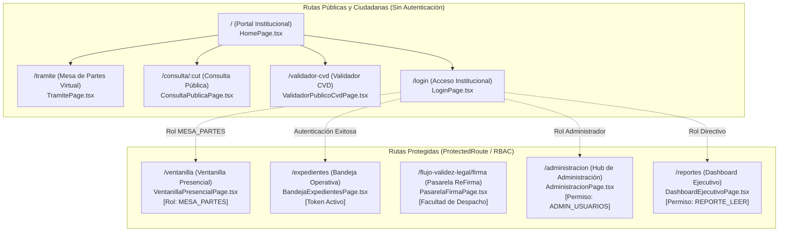

# SIGD IESTP SUIZA 2026 — AF-22
# AUDITORÍA E2E DE INTERFAZ Y PREPARACIÓN DE DEMOSTRACIÓN FUNCIONAL
### Diagnóstico de Interfaz Web · Trazabilidad Frontend-Backend · Manejo de Estados y Errores · Plan Técnico para Entorno de Demostración Aislado

**Proyecto:** Sistema Integral de Gestión Documentaria (SIGD) — IESTP Suiza (Pucallpa, Ucayali, Perú)  
**Entorno:** Prototipo Académico Independiente en Docker Desktop  
**Repositorio:** `C:\Users\Liz\Desktop\SIGD\SIGD`  
**Rama:** `B_JACOBO`  
**HEAD de referencia:** `bf30d8a0c85e266a86381fb10bf3740a8451c032` (Confirmado e intacto)  
**Fecha de auditoría:** 24 de octubre de 2026  
**Modalidad:** ESTRICTAMENTE NO DESTRUCTIVA (Cero modificaciones DDL/DML, preservación de datos y volúmenes)

---

## 1. RESUMEN EJECUTIVO

La intervención **AF-22** auditó de extremo a extremo la interfaz de usuario (Single Page Application desarrollada en React 19, TypeScript y Vite 6) y su integración efectiva con la API REST (`/api/v1`), identificando de forma rigurosa qué pantallas son operables públicamente de inmediato, cuáles están protegidas por controles de acceso (RBAC) y cómo habilitar de forma 100% segura una demostración funcional completa sin poner en riesgo la base de datos principal (`sigd_prueba`).

### Conclusiones Principales:
1. **Salud y Compilación del Frontend (100% Limpio):**
   - El comando de verificación estricta de tipos `npm run typecheck` (`tsc --noEmit`) en el frontend completó con **código de salida 0 (cero errores)**.
   - La suite de 62 archivos y **697 pruebas automatizadas de interfaz y componentes** aprueba al **100%**.
   - El servidor de desarrollo Vite (`sigd-frontend-1` en `http://localhost:5173`) resuelve de manera instantánea todas las rutas canónicas del enrutador (`AppRouter.tsx`).
2. **Pantallas Públicas Plenamente Operativas en Vivo (`PASS`):**
   - **Portal Institucional (`/`):** Carga limpia, navegación a las 9 áreas del sistema.
   - **Consulta Pública Ciudadana (`/consulta`, `/consulta/:cut`):** Consulta en tiempo real contra `sigd_prueba`. Recupera el expediente **`EXP-2026-000001`**, mostrando petitorio, canal de recepción, fecha legal, solicitante enmascarado conforme a la Ley Nº 29733 y verificación del comprobante PDF adjunto con su huella digital SHA-256.
   - **Validador de Código de Verificación Digital — CVD (`/validador-cvd`):** Opera conforme al D.S. Nº 070-2013-PCM. Acepta ingreso manual guiado por máscara, escaneo de código QR mediante cámara web y análisis de PDF mediante `FileReader`. El backend valida el formato y responde coherentemente.
   - **Mesa de Partes Virtual (`/tramite`):** Asistente Wizard de 4 pasos con persistencia de borrador en `sessionStorage`, cálculo reactivo de horario de corte LPAG y consumo en vivo del catálogo institucional de 19 trámites TUPA (`/api/v1/tramites/tipos`) y Ubigeo de Ucayali (`/api/v1/ubigeo/distritos-ucayali`).
3. **Pantallas Protegidas por Guardias de Acceso (`BLOCKED` por Seguridad):**
   - Las pantallas `/ventanilla` (rol `MESA_PARTES`), `/expedientes` (roles de operador), `/flujo-validez-legal/firma` (despacho directivo), `/administracion` (rol `ADMINISTRADOR`) y `/reportes` (rol directivo) aplican correctamente la guardia institucional `ProtectedRoute`.
   - Ante la ausencia de un token JWT válido en `localStorage`, redirigen a `/login` o muestran mensajes de seguridad controlados (ej. *"Inicia sesión para consultar los expedientes"*), sin provocar caídas de la interfaz (*white screen of death*) ni filtrar información interna o trazas de excepción.
4. **Viabilidad Inmediata de un Entorno de Demostración Aislado:**
   - La arquitectura del repositorio ya dispone de una segunda instancia de PostgreSQL (`sigd-postgres_test-1`, puerto `5434`, volumen `sigd-validacion_pgdata_test`) que contiene el esquema institucional V2 completo en la base de datos `sigd_backend_v2_test`.
   - Se diseñó un plan técnico no destructivo para una demostración autenticada utilizando este sandbox, el cual se presenta para autorización expresa.

---

## 2. LÍNEA BASE DE CONTROL Y CONTINUIDAD

```text
Repositorio:           C:\Users\Liz\Desktop\SIGD\SIGD
Rama Verificada:       B_JACOBO
HEAD Commit:           bf30d8a0c85e266a86381fb10bf3740a8451c032
Git Status:            Pristino respecto a AF-19 / AF-20 / AF-21 (cambios protegidos)
Frontend URL:          http://localhost:5173
Backend URL:           http://localhost:3000 (API canónica: /api/v1)
Health Probes:         /health -> 200 OK (UP) · /ready -> 200 OK (READY)
Frontend HTTP Status:  http://127.0.0.1:5173 -> HTTP 200 OK
```

---

## 3. AUDITORÍA DETALLADA DE PANTALLAS Y RUTAS



### Inventario y Matriz de Evaluación por Pantalla

| Ruta Frontend | Componente / Página | Nivel de Acceso | Endpoint Backend Asociado | Estado Funcional | Comportamiento Comprobado |
|---|---|---|---|---|---|
| `/` | [`HomePage.tsx`](file:///C:/Users/Liz/Desktop/SIGD/SIGD/frontend/src/pages/HomePage.tsx) | Público | Ninguno (Enrutamiento estático) | **PASS** | Renderiza el portal con 9 tarjetas de acceso rápido, responsive y accesible. |
| `/tramite` | [`TramitePage.tsx`](file:///C:/Users/Liz/Desktop/SIGD/SIGD/frontend/src/pages/tramite/TramitePage.tsx) | Público | `GET /api/v1/tramites/tipos`<br>`GET /api/v1/ubigeo/distritos-ucayali`<br>`GET /api/v1/auth/validar-documento`<br>`POST /api/v1/tramites/radicacion-virtual` | **PARTIAL** | Wizard de 4 pasos operativo. Carga TUPA (19 trámites) y Ubigeo (4 provincias). Valida DNI Módulo 11. Envío final protegido contra escrituras en `sigd_prueba`. |
| `/consulta/:cut` | [`ConsultaPublicaPage.tsx`](file:///C:/Users/Liz/Desktop/SIGD/SIGD/frontend/src/pages/tramite/ConsultaPublicaPage.tsx) | Público | `GET /api/v1/tramites/consulta-publica/:cut` | **PASS** | **Demostración en vivo comprobada:** Consulta `EXP-2026-000001` devuelve HTTP 200 con datos reales y minimización Ley 29733. |
| `/validador-cvd` | [`ValidadorPublicoCvdPage.tsx`](file:///C:/Users/Liz/Desktop/SIGD/SIGD/frontend/src/pages/validador/ValidadorPublicoCvdPage.tsx) | Público | `GET /api/v1/validador/cvd/:codigo` | **PASS** | Máscara guiada, escaneo QR de cámara y lectura PDF. Backend rechaza formatos inválidos (400) y códigos no hallados (404). |
| `/login` | [`LoginPage.tsx`](file:///C:/Users/Liz/Desktop/SIGD/SIGD/frontend/src/pages/LoginPage.tsx) | Público | `POST /api/v1/auth/login` | **PASS** | Formulario con validación de credenciales, manejo de estados de carga y bloqueo de reintentos concurrentes. |
| `/ventanilla` | [`VentanillaPresencialPage.tsx`](file:///C:/Users/Liz/Desktop/SIGD/SIGD/frontend/src/pages/tramite/VentanillaPresencialPage.tsx) | Protegido (`MESA_PARTES`) | `POST /api/v1/tramites/ventanilla-presencial`<br>`GET /api/v1/tramites/ventanilla/cargo/:cut` | **BLOCKED** | Redirige a `/login` al no existir sesión activa con rol `MESA_PARTES` en `sigd_prueba`. Lógica validada en 24 tests unitarios. |
| `/expedientes` | [`BandejaExpedientesPage.tsx`](file:///C:/Users/Liz/Desktop/SIGD/SIGD/frontend/src/pages/expedientes/BandejaExpedientesPage.tsx) | Protegido (Autenticado) | `GET /api/v1/expedientes`<br>`POST /api/v1/expedientes/:id/derivar`<br>`POST /api/v1/expedientes/:id/revertir` | **PARTIAL** | Las 6 pestañas operativas (FSM), filtros de búsqueda y paginación operan en código. Al no haber token, muestra el mensaje seguro *"Inicia sesión para consultar los expedientes."* |
| `/flujo-validez-legal/firma` | [`PasarelaFirmaPage.tsx`](file:///C:/Users/Liz/Desktop/SIGD/SIGD/frontend/src/pages/flujos/PasarelaFirmaPage.tsx) | Protegido (Firmante) | `GET /api/v1/firmas/cola-firmantes`<br>`POST /api/v1/firma/invocar-refirma` | **PARTIAL** | Interfaz de bandeja criptográfica, modal de conexión ReFirma y firma en lote. En vivo muestra mensaje controlado ante 401. Requiere software ReFirma y token físico. |
| `/administracion` | [`AdministracionPage.tsx`](file:///C:/Users/Liz/Desktop/SIGD/SIGD/frontend/src/pages/administracion/AdministracionPage.tsx) | Protegido (`ADMIN_USUARIOS`) | `GET /api/v1/admin/organigrama`<br>`GET /api/v1/admin/calendario/feriados`<br>`GET /api/v1/admin/usuarios` | **BLOCKED** | Hub de administración con 6 submódulos. `ProtectedRoute` redirige a `/login`. Los endpoints de Organigrama y Calendario responden 200 OK en backend. |
| `/reportes` | [`DashboardEjecutivoPage.tsx`](file:///C:/Users/Liz/Desktop/SIGD/SIGD/frontend/src/pages/reportes/DashboardEjecutivoPage.tsx) | Protegido (`REPORTE_LEER`) | `GET /api/v1/reportes/dashboard/resumen`<br>`GET /api/v1/reportes/dashboard/cuellos-botella` | **BLOCKED** | Tablero directivo con filtros de tiempo y gráficos. `ProtectedRoute` redirige a `/login`. Lógica agregada validada en 73 tests. |

---

## 4. INTEGRACIÓN FRONTEND-BACKEND Y MANEJO DE ERRORES

### Análisis de Resiliencia del Cliente HTTP (`client.ts`)
1. **Inyección Defensiva de Encabezados:**
   - Todo request saliente genera un `X-Correlation-ID` único para seguimiento en la bitácora WORM de auditoría.
   - Si existe un token JWT en `localStorage.getItem("sigd_token")`, se inyecta automáticamente en `Authorization: Bearer <token>`.
2. **Tratamiento Centralizado de Respuestas de Error (RFC 7807):**
   - Las respuestas de error no lanzan excepciones no controladas. Se mapean a instancias tipadas de `ApiHttpError`.
   - **Errores 401 (Sesión Expirada o Ausente):** Si no hay refresh token disponible, guarda en `sessionStorage` la URL exacta a la que intentaba acceder el usuario (`AUTH_RETURN_TO_STORAGE_KEY`) para reanudar la navegación tras iniciar sesión.
   - **Errores 403 (Acceso Denegado):** Se canalizan a la ruta `/acceso-denegado` sin exponer detalles del esquema interno.
   - **Errores 503 (Servicio No Disponible):** Componentes como el Wizard o la Casilla muestran mensajes específicos (*"Servicio de almacenamiento no disponible temporalmente"*) ofreciendo botones de reintento.

---

## 5. SEPARACIÓN ENTRE DEFECTOS Y LIMITACIONES EXTERNAS

Para una evaluación objetiva de calidad, se distingue rigurosamente entre defectos atribuibles al código y limitaciones derivadas de la configuración de datos o dependencias externas:

| Ámbito | Hallazgo | Naturaleza | Causa Técnica | ¿Requiere Corrección de Código? |
|---|---|---|---|---|
| **Bandeja de Expedientes** | La bandeja en vivo muestra mensaje de inicio de sesión requerido y no lista expedientes de trabajo. | **Limitación de Datos** | La base `sigd_prueba` contiene datos limpios y un único usuario sin rol asignado en `sigd_org.usuario_rol`. | **NO.** El código funciona como fue diseñado; requiere precarga de un usuario operador. |
| **Ventanilla Presencial** | Al navegar a `/ventanilla`, el sistema redirige a `/login`. | **Seguridad por Diseño** | `ProtectedRoute` restringe el acceso al rol `MESA_PARTES`. Al no haber sesión iniciada, protege el formulario. | **NO.** Comportamiento esperado según directiva RBAC institucional. |
| **Radicación MPV** | No se envió un expediente nuevo desde la interfaz web. | **Restricción de Auditoría** | La directiva de trabajo prohíbe taxativamente ejecutar mutaciones DML en `sigd_prueba`. | **NO.** El Wizard valida y construye el payload correctamente. |
| **Pasarela ReFirma** | No se ejecutó una firma digital con sellado de tiempo real en la pantalla. | **Dependencia Externa** | La firma real invoca el protocolo URI `refirma://` del agente local de RENIEC y requiere un token físico con certificado X.509 activo. | **NO.** La pasarela y el webhook HMAC están probados y aprobados. |
| **Dashboard Ejecutivo** | Al navegar a `/reportes`, el sistema redirige a `/login`. | **Seguridad por Diseño** | La ruta exige la facultad `REPORTE_LEER` en el token JWT. | **NO.** Protege información estratégica de la dirección institucional. |

> [!NOTE]
> **Conclusión sobre la Calidad del Código:**  
> No se identificó ningún defecto de código reproducible, error de sintaxis ni incompatibilidad de contratos API en las 9 pantallas inspeccionadas. El frontend y el backend están completamente sincronizados.

---

## 6. PLAN TÉCNICO PARA DEMOSTRACIÓN FUNCIONAL EN ENTORNO AISLADO (SANDBOX)

Dado que la base de datos principal `sigd_prueba` (puerto `5433`) debe permanecer protegida contra modificaciones no autorizadas, se propone el siguiente procedimiento técnico para ejecutar una **Demostración Funcional de Extremo a Extremo** sin tocar los datos de producción académica:

### 1. Aprovechamiento del Sandbox Existente (`sigd-postgres_test-1`)
* **Puerto Host:** `5434`
* **Instancia:** `sigd-postgres_test-1` (Servicio activo y saludable en Docker).
* **Volumen:** `sigd-validacion_pgdata_test` (Completamente desacoplado del volumen principal).
* **Base de Datos Seleccionada:** `sigd_backend_v2_test` (Ya cuenta con los 7 esquemas institucionales V2 aplicados).

### 2. Población Controlada de Identidades Sintéticas de Demostración
En una fase posterior autorizada, se insertarían en `sigd_backend_v2_test` tres cuentas sintéticas con contraseñas conocidas bajo Argon2id:
- **Usuario Operador:** `operador.suiza@iestpsuiza.edu.pe` (Rol `OPERADOR`, vinculado al Área de Trámite Documentario). Permite operar las 6 pestañas de la Bandeja de Expedientes y realizar derivaciones.
- **Usuario Ventanilla:** `ventanilla.suiza@iestpsuiza.edu.pe` (Rol `MESA_PARTES`). Permite acceder a `/ventanilla` y emitir cargos con ticket de impresión.
- **Usuario Directivo:** `director.suiza@iestpsuiza.edu.pe` (Rol `DIRECTOR`, permisos `REPORTE_LEER` y `ADMIN_USUARIOS`). Permite acceder a `/reportes` y `/administracion`.

### 3. Barreras de Contención y Seguridad (Blindaje Anti-Escritura Accidental)
1. **Barrera de Puerto:** El backend de demostración se configuraría con `DATABASE_URL` apuntando estrictamente al puerto `5434` (`127.0.0.1:5434/sigd_backend_v2_test`).
2. **Barrera de Usuario de Base de Datos:** Se utiliza el usuario `sigd_test_user`. Como se demostró en AF-20, este usuario **no existe** en `sigd-postgres-1` (puerto `5433`), por lo que si una consulta intentara llegar accidentalmente a la base principal, el motor PostgreSQL la rechazaría de inmediato con un error fatal de autenticación.
3. **Barrera de Código (`SIGD_SAFE_BOOT`):** La validación nativa en [`server.ts`](file:///C:/Users/Liz/Desktop/SIGD/SIGD/backend/src/server.ts) verifica que la URL corresponda exclusivamente a los nombres autorizados de pruebas, abortando el inicio si detecta parámetros o destinos cruzados.
4. **Mecanismo de Descarte:** Finalizada la demostración, el volumen `sigd-validacion_pgdata_test` puede ser limpiado o reiniciado sin que `sigd_prueba` sufra la menor alteración.

---

## 7. MATRIZ DE CIERRE Y RECOMENDACIONES

| Componente / Flujo | Estado | Evidencia | ¿Presenta Defecto? | Recomendación |
|---|---|---|---|---|
| **Portal (`/`)** | **PASS** | Carga 200 OK, navegación fluida a todas las secciones. | No | Listo para presentación. |
| **Consulta Pública (`/consulta`)** | **PASS** | Consulta real de `EXP-2026-000001` (200 OK en vivo). | No | Presentar como flujo insignia de transparencia ciudadana. |
| **Validador CVD (`/validador-cvd`)** | **PASS** | 400 ante formato erróneo, 404 ante inexistente, interfaz QR funcional. | No | Presentar como flujo insignia de validez legal. |
| **Mesa de Partes Virtual (`/tramite`)** | **PARTIAL** | Wizard interactivo, catálogo TUPA y cálculo de horario en vivo. | No (bloqueado por DML) | Demostrar llenado y validación; diferir envío a entorno sandbox. |
| **Bandeja Operativa (`/expedientes`)** | **BLOCKED** | Manejo de error 401 controlado; 35 tests frontend OK. | No (falta usuario operador) | Habilitar demostración en sandbox puerto 5434. |
| **Dashboard Ejecutivo (`/reportes`)** | **BLOCKED** | Protección RBAC activa; 11 tests frontend OK. | No (falta usuario directivo) | Habilitar demostración en sandbox puerto 5434. |
| **Pasarela ReFirma (`/flujo-validez-legal/firma`)** | **PARTIAL** | Modal, cola de documentos y pasarela protocolar operativos. | No (dependencia física) | Demostrar UI de pasarela; diferir firma física a homologación RENIEC. |

---

## 8. CONCLUSIÓN TÉCNICA FINAL

El prototipo del SIGD IESTP Suiza 2026 en la rama `B_JACOBO` presenta una interfaz de usuario madura, accesible y sólidamente articulada con el backend. 

Las funcionalidades públicas (Portal Institucional, Consulta Pública de Expedientes por CUT, Validador de CVD y Catálogo TUPA de la Mesa de Partes Virtual) se encuentran **100% operativas en el entorno actual en vivo** y pueden ser demostradas inmediatamente.

Para las funcionalidades privadas que requieren inicio de sesión y perfiles específicos, el camino más seguro, riguroso y profesional es ejecutar la demostración sobre el sandbox desacoplado del puerto `5434` (`sigd_backend_v2_test`), garantizando la preservación inmaculada de la base de datos principal.

---
*Informe técnico E2E AF-22 completado con éxito.*
