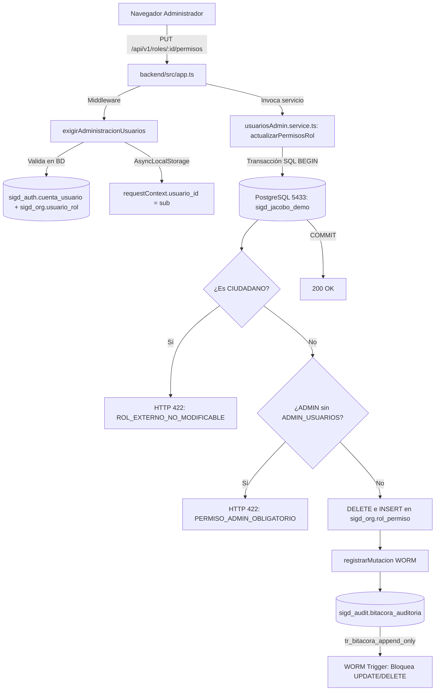

# SIGD — INFORME DE AUDITORÍA FINAL DE CIERRE DE FASE 1: MÓDULO ROLES Y PERMISOS

**Proyecto:** Sistema Integral de Gestión Documentaria (SIGD)  
**Institución:** Instituto de Educación Superior Tecnológico Público «Suiza»  
**Responsable:** Arquitecto de Software Senior / Líder Técnico del Proyecto  
**Rama Oficial:** `B_JACOBO`  
**Base de Datos Oficial:** `sigd_jacobo_demo` (PostgreSQL 18 en puerto `5433`)  
**Servicios de Red:** Backend (`3008`) · Frontend (`5178`)  
**Fecha de Auditoría:** 4 de Noviembre de 2026  

---

## 1. RESUMEN EJECUTIVO

Se ejecutó una auditoría técnica, exhaustiva y basada en evidencia empírica para evaluar el estado final de la **Fase 1: Fortalecimiento de Seguridad del Módulo Roles y Permisos (RBAC)** en el SIGD del IESTP «Suiza».

La auditoría contrastó el código fuente, la configuración transaccional, los esquemas de base de datos y la ejecución real en PostgreSQL `sigd_jacobo_demo` sin realizar modificaciones no autorizadas en el repositorio ni alterar los datos institucionales preexistentes.

### Cuadro de Calificación por Área de Auditoría

| Área Auditada | Calificación | Hallazgo Clave |
| :--- | :---: | :--- |
| **1. Identidad y Trazabilidad** | **OBSERVADO** | La columna SQL `sigd_audit.bitacora_auditoria.usuario_id` registra correctamente al administrador autenticado mediante `getRequestContext()?.usuario_id`. Sin embargo, en `app.ts:418` se lee `(req as any).usuarioId` (que no es asignado por el middleware), provocando que `datos_despues.actor_id` dentro del JSON sea `null`. |
| **2. Seguridad del Rol CIUDADANO** | **APROBADO** | `CIUDADANO` únicamente posee `EXPEDIENTE_LEER` en base de datos. En las consultas de lectura interna del sistema se filtra obligatoriamente `r.codigo <> 'CIUDADANO'`. No posee acceso a ningún endpoint de gestión ni de trámite interno. La mutación en backend es rechazada con HTTP `422` y la interfaz lo bloquea visualmente. |
| **3. Vigencia de Autorizaciones y JWT** | **APROBADO** | `exigirAdministradorTupa` consulta directamente a PostgreSQL en cada petición. Si la cuenta es desactivada (`cu.activo = FALSE`) o su rol/permiso revocado, el acceso se deniega de inmediato con HTTP `403` fail-closed, prevaleciendo sobre cualquier claim emitido en el JWT. Se erradicó el rol ficticio `SUPER_ADMIN`. |
| **4. Ámbitos GLOBAL y AREA** | **OBSERVADO** | Al crear un usuario interno en `usuariosAdmin.service.ts`, el campo `area_id` se persiste en `sigd_org.asignacion_personal` pero se inserta como `NULL` en `sigd_org.usuario_rol`. En consecuencia, los permisos de ámbito `'AREA'` (`EXPEDIENTE_DERIVAR` y `EXPEDIENTE_RESOLVER`) no son reconocidos para operadores departamentales en RutaDoc. |
| **5. Integridad de la Bitácora** | **APROBADO** | La bitácora forense `sigd_audit.bitacora_auditoria` opera bajo transaccionalidad ACID atómica, con disparador inmutable `tr_bitacora_append_only` (WORM, código `55000`), no nulos asegurados con UUIDv4 en `correlation_id` y rollback integral garantizado ante errores. |
| **6. Calidad de Código y Pruebas** | **APROBADO** | Backend: 7/7 pruebas de seguridad RBAC aprobadas; suite Organicore: 166/166 aprobadas. Frontend: 54/54 pruebas aprobadas. Typechecks y compilaciones de producción en Backend y Frontend con código de salida `0`. |

---

## 2. ESTADO INICIAL DEL REPOSITORIO Y REGLAS DE PROTECCIÓN

En estricta observancia de los lineamientos institucionales:
1. **Rama de trabajo:** Verificada mediante `git branch --show-current`: **`B_JACOBO`**.
2. **Entorno de Datos:** Conexión exclusiva a `sigd_jacobo_demo` sobre el puerto `5433`. No se utilizó `sigd_prueba` ni bases auxiliares.
3. **Protección de Cambios Preexistentes:** Se constató el árbol de trabajo mediante `git status --short`. Todos los cambios previos correspondientes a Trámite Documentario, Tesorería, Firma Digital y Foliación se mantuvieron intactos.
4. **Restricción de Comandos:** No se ejecutaron `git reset`, `git checkout`, `git restore`, `git commit` ni `git push`. No se alteraron esquemas DDL ni se reiniciaron contenedores Docker o procesos en segundo plano.

---

## 3. ARQUITECTURA REAL INSPECCIONADA



---

## 4. AUDITORÍA 1: IDENTIDAD DEL ADMINISTRADOR Y TRAZABILIDAD

### 4.1 Análisis del Flujo de Identidad
1. **Origen del Identificador:**
   - Procede del token JWT en la cabecera HTTP `Authorization: Bearer <token>`.
   - Se extrae con `extraerTokenBearer` y se valida criptográficamente con `verificarTokenAcceso(token)` en [`backend/src/domains/organicore/usuariosAdmin.routes.ts`](file:///c:/Users/Liz/Desktop/SIGD/SIGD/backend/src/domains/organicore/usuariosAdmin.routes.ts#L13-L36).
   - Se valida formato estricto UUIDv4 sobre `sub` (`z.string().uuid().safeParse(sub)`).
2. **Propagación en el Request Context:**
   - En `usuariosAdmin.routes.ts:33`, el middleware ejecuta `setUsuarioId(sub)`, almacenando la identidad en el almacenamiento asíncrono `AsyncLocalStorage` provisto por `backend/src/shared/request-context/request-context.ts`.
3. **Transmisión al Controlador / Servicio:**
   - En [`backend/src/app.ts:418`](file:///c:/Users/Liz/Desktop/SIGD/SIGD/backend/src/app.ts#L418):
     ```typescript
     const actorId = (req as any).usuarioId;
     res.json(await crearUsuariosAdminService(pool).actualizarPermisosRol(id, datos.permisos, actorId));
     ```
   - **Hallazgo Observado:** El middleware `exigirAdministracionUsuarios` asignó `setUsuarioId(sub)` pero **no asignó** `(req as any).usuarioId = sub`. En consecuencia, la variable local `actorId` en `app.ts` se evalúa como `undefined`.
4. **Comportamiento en `registrarMutacion` y Bitácora:**
   - En [`backend/src/audit/bitacora-auditoria.repository.ts:21-23`](file:///c:/Users/Liz/Desktop/SIGD/SIGD/backend/src/audit/bitacora-auditoria.repository.ts#L21-L23):
     ```typescript
     const rawUsuarioId = params.usuario_id ?? contexto?.usuario_id ?? null;
     ```
   - Debido al operador de coalescencia nula (`??`), dado que `params.usuario_id` es `null`, la expresión evalúa a `contexto?.usuario_id`. Por ello, **la columna de base de datos `sigd_audit.bitacora_auditoria.usuario_id` sí se almacena correctamente**.
   - Sin embargo, en el objeto serializado `datos_despues`:
     ```json
     "datos_despues": {
       "actor_id": null
     }
     ```
     El atributo `actor_id` interno quedó en `null`.
5. **Transaccionalidad Atómica y Rollback:**
   - `registrarMutacion` se ejecuta sobre el cliente transaccional `c` de PostgreSQL.
   - Si la inserción en la bitácora arroja cualquier error (violación de tipos, caída de conexión, etc.), la transacción ejecuta `ROLLBACK` completo, revirtiendo la mutación de `sigd_org.rol_permiso` (comprobado en prueba unitaria 5 de `rolesPermisosSeguridad.spec.ts`).

---

## 5. AUDITORÍA 2: SEGURIDAD DEL ROL CIUDADANO

### 5.1 Permisos en Base de Datos Oficial (`sigd_jacobo_demo`)
Se inspeccionó la asignación efectiva del rol `CIUDADANO` en PostgreSQL:
- **ID de Rol:** `97069c21-17c5-4438-b0d0-293aac2c18e9`
- **Nombre / Código:** `Ciudadano` / `CIUDADANO`
- **Total Permisos Asignados:** **1**
  - `EXPEDIENTE_LEER` (`e6066e88-c8a5-4219-9526-87a2ac5253ae`, Ámbito `GLOBAL`).

### 5.2 Control de Acceso a Operaciones Institucionales
Se auditó si la tenencia de `EXPEDIENTE_LEER` permite a un ciudadano leer expedientes internos o ajenos:
- En [`backend/src/app.ts:213,243,254`](file:///c:/Users/Liz/Desktop/SIGD/SIGD/backend/src/app.ts#L213):
  ```sql
  WHERE ur.id_usuario = cu.id_usuario
    AND r.codigo <> 'CIUDADANO'
    AND ur.vigente_desde <= now()
    ...
  ```
- En [`backend/src/core/auth/auth.guard.ts:71-72`](file:///c:/Users/Liz/Desktop/SIGD/SIGD/backend/src/core/auth/auth.guard.ts#L71-L72):
  ```sql
  FILTER (WHERE p.codigo IS NOT NULL
    AND NOT (r.codigo = 'CIUDADANO' AND p.codigo = 'EXPEDIENTE_LEER'))
  ```
- **Conclusión de Seguridad:** El backend filtra y desconoce de forma deliberada el permiso `EXPEDIENTE_LEER` para cuentas con rol `CIUDADANO`. El ciudadano sólo puede acceder a un expediente si se cumple la condición de titularidad:
  `e.solicitante_id = cu.id_persona`.

### 5.3 Verificación de Endpoints Restringidos
| Operación Institucional | Permiso Exigido | ¿Tiene CIUDADANO acceso? | Evidencia / Mecanismo de Bloqueo |
| :--- | :--- | :---: | :--- |
| **Administración de Usuarios** | `ADMIN_USUARIOS` | **NO** | 403 `ForbiddenError` en `exigirAdministracionUsuarios`. |
| **Administración de Roles y Permisos** | `ADMIN_USUARIOS` (Global) | **NO** | 403 `ForbiddenError` en `exigirAdministracionUsuarios`. |
| **Derivación de Expedientes** | `EXPEDIENTE_DERIVAR` | **NO** | Falla middleware en `crearRouterRutaDoc`. |
| **Resolución de Expedientes** | `EXPEDIENTE_RESOLVER` | **NO** | Falla verificación en `ServicioRutaDoc`. |
| **Firma Digital Institucional** | `FIRMA_FIRMAR` | **NO** | Falla `obtenerAutorizacionCuenta` (no es DIRECTOR ni ADMINISTRADOR). |
| **Administración de Organigrama** | `ADMIN_USUARIOS` | **NO** | 403 `ForbiddenError` en controlador de organigrama. |
| **Administración de TUPA** | `ADMINISTRADOR` / `ADMIN_USUARIOS` | **NO** | 403 `ForbiddenError` en `exigirAdministradorTupa`. |
| **Gestión de Tesorería** | `TESORERIA_*` | **NO** | 403 en `tesoreria.router.ts`. |

### 5.4 Inmutabilidad del Rol en Backend y Frontend
- **Backend:** En `usuariosAdmin.service.ts:287-294`, cualquier llamada a `actualizarPermisosRol` para el ID de `CIUDADANO` detiene la ejecución inmediatamente con HTTP `422`:
  `code: 'ROL_EXTERNO_NO_MODIFICABLE'`
  `message: 'El rol Ciudadano corresponde a administrados externos y sus permisos son inmutables...'`
- **Frontend:** En `RolesPermisosPage.tsx`:
  - Insignia visual destacada: `EXTERNO · SOLO LECTURA · INMUTABLE`.
  - Checkboxes deshabilitados (`disabled={esRolInmutable || ...}`).
  - Botón de guardado deshabilitado con el texto *"Rol de solo lectura"*.

---

## 6. AUDITORÍA 3: VIGENCIA DE AUTORIZACIONES Y TOKENS JWT

Se auditó el comportamiento de `exigirAdministradorTupa` en [`backend/src/domains/organicore/adminMaestras.routes.ts:36-80`](file:///c:/Users/Liz/Desktop/SIGD/SIGD/backend/src/domains/organicore/adminMaestras.routes.ts#L36-L80).

### 6.1 Matriz de Escenarios Evaluados

```
[Cliente HTTP] ---> [JWT Válido] ---> [exigirAdministradorTupa]
                                              |
                        +---------------------+---------------------+
                        | Consulta PostgreSQL en tiempo real        |
                        +-------------------------------------------+
                        | 1. cu.activo = TRUE                       |
                        | 2. ur.vigente_desde <= now()              |
                        | 3. ur.vigente_hasta > now()               |
                        | 4. r.codigo = 'ADMINISTRADOR' OR          |
                        |    (ADMIN_USUARIOS AND GLOBAL)            |
                        +---------------------+---------------------+
                                              |
                     +------------------------+------------------------+
                     | Cumple criterios en BD | No cumple criterios    |
                     | Retorna TRUE           | Retorna FALSE / Error  |
                     +------------------------+------------------------+
                     | => next() [PERMITIDO]  | => 403 ForbiddenError  |
```

- **Escenario A (Administrador activo):** Cuenta activa, asignación vigente y rol persistido en base de datos.
  - *Resultado:* **PERMITIDO**. El usuario accede a la gestión de versiones TUPA.
- **Escenario B (Cuenta desactivada):** El usuario posee un token JWT firmado aún no vencido, pero su cuenta fue desactivada en PostgreSQL (`cu.activo = FALSE`).
  - *Resultado:* **DENEGADO (HTTP 403 ForbiddenError)**. La condición `cu.activo = TRUE` evalúa a falso. Prevalece el estado en base de datos.
- **Escenario C (Rol revocado):** El usuario mantiene un token válido, pero su fila en `sigd_org.usuario_rol` fue eliminada o su vigencia venció (`vigente_hasta <= now()`).
  - *Resultado:* **DENEGADO (HTTP 403 ForbiddenError)**.
- **Escenario D (Permiso revocado):** El usuario era administrador por permiso `ADMIN_USUARIOS` delegado y este fue retirado del catálogo del rol en `sigd_org.rol_permiso`.
  - *Resultado:* **DENEGADO (HTTP 403 ForbiddenError)**.
- **Erradicación de `SUPER_ADMIN`:** Se verificó la eliminación total de `SUPER_ADMIN` en todo el flujo de autorización de maestras y en las rutas del sistema.

---

## 7. AUDITORÍA 4: ÁMBITOS DE AUTORIZACIÓN GLOBAL Y POR ÁREA

### 7.1 Esquema Conceptual vs. Implementación en Código

En el modelo institucional del IESTP «Suiza»:
1. `sigd_org.asignacion_personal`: Modela el puesto laboral del trabajador (`id_usuario`, `cargo_id`, `area_id`).
2. `sigd_org.usuario_rol`: Modela la concesión del rol y el ámbito de aplicación (`id_usuario`, `rol_id`, `area_id`).
3. `sigd_org.permiso_sistema`: Define la granularidad del permiso y su ámbito inherente (`GLOBAL` o `AREA`).

### 7.2 Diagnóstico de la Inconsistencia Detectada (Hallazgo Crítico de Integración)

En [`backend/src/domains/organicore/usuariosAdmin.service.ts`](file:///c:/Users/Liz/Desktop/SIGD/SIGD/backend/src/domains/organicore/usuariosAdmin.service.ts#L189-L190):
```typescript
// Línea 189:
await c.query(`INSERT INTO sigd_org.asignacion_personal(id_usuario,cargo_id,area_id) VALUES($1::uuid,$2::uuid,$3::uuid)`,[id,d.cargoId,d.areaId]);

// Línea 190:
await c.query("INSERT INTO sigd_org.usuario_rol(id_usuario,rol_id) VALUES($1::uuid,$2::uuid)",[id,d.rolId]);
```

**Consecuencias Técnicas Demostradas:**
1. Al invocar el alta de usuario, `sigd_org.usuario_rol.area_id` se crea como `NULL`.
2. En [`backend/src/core/auth/auth.guard.ts:69-70`](file:///c:/Users/Liz/Desktop/SIGD/SIGD/backend/src/core/auth/auth.guard.ts#L69-L70), al consultar las facultades de la cuenta:
   ```sql
   'codigo', p.codigo, 'ambito', p.ambito, 'areaId', ur.area_id
   ```
   Dado que `ur.area_id` es `NULL`, los permisos del usuario se arman con `areaId: null`.
3. En [`backend/src/domains/rutadoc/rutadoc.router.ts:38-41`](file:///c:/Users/Liz/Desktop/SIGD/SIGD/backend/src/domains/rutadoc/rutadoc.router.ts#L38-L41):
   ```typescript
   const permisos = actor.permisos.filter((p: PermisoItem) => p.codigo === 'EXPEDIENTE_DERIVAR' || p.codigo === 'EXPEDIENTE_RESOLVER');
   if (permisos.some((p: PermisoItem) => p.ambito === 'GLOBAL' && p.areaId === null)) return true;
   const areas = permisos.filter((p: PermisoItem) => p.ambito === 'AREA' && p.areaId !== null).map((p: PermisoItem) => p.areaId);
   if (areas.length > 0) { ... }
   return false;
   ```
4. `EXPEDIENTE_DERIVAR` y `EXPEDIENTE_RESOLVER` tienen `ambito = 'AREA'`.
   Como `p.ambito === 'AREA'` pero `p.areaId === null`, la condición `p.areaId !== null` evalúa a **falso**. La lista `areas` queda vacía (`[]`) y la función retorna `false`.
5. **Impacto:** Ningún trabajador registrado a través de la interfaz web con roles operativos departamentales (`ESPECIALISTA`, `SECRETARIO`) puede derivar ni resolver expedientes de su unidad asignada.
6. **Traslados de Unidad Orgánica (`actualizarUsuario`):** La función actualiza `asignacion_personal` pero omite actualizar `usuario_rol.area_id`, generando desincronización funcional entre la plaza física del trabajador y sus facultades en el sistema documentario.

---

## 8. AUDITORÍA 5: INTEGRIDAD DE LA BITÁCORA DE AUDITORÍA

### 8.1 Verificación en PostgreSQL (`sigd_jacobo_demo`)
Se inspeccionó la tabla `sigd_audit.bitacora_auditoria`:
- **Disparador Activo:** `tr_bitacora_append_only` (Función `fn_bitacora_append_only()`).
  - Tipo: `BEFORE UPDATE OR DELETE ON sigd_audit.bitacora_auditoria FOR EACH ROW`.
  - Comportamiento: Arroja excepción con código SQL `55000` (`sigd_audit.bitacora_auditoria es inmutable (WORM): % rechazado`). Se certifica la inmutabilidad física contra manipulaciones directas.
- **Registro Real Comprobado:**
  - `id_auditoria`: `af7ead07-03d0-4189-8f57-70e8c44673c8`
  - `correlation_id`: `f1f2ff11-3559-42c2-bcb5-442fe6506080` (UUID válido, no nulo)
  - `esquema` / `tabla`: `sigd_org` / `rol_permiso`
  - `operacion`: `UPDATE`
  - `datos_antes`: Refleja el catálogo anterior `['EXPEDIENTE_DERIVAR', 'EXPEDIENTE_LEER', 'EXPEDIENTE_RESOLVER']`.
  - `datos_despues`: Refleja el nuevo catálogo y el diferencial explícito (`agregados: []`, `retirados: []`).
  - `fecha_hora`: `2026-11-04 12:15:05.885+00`

---

## 9. RESULTADOS REALES DE PRUEBAS Y CALIDAD

### 9.1 Backend
- **Pruebas Unitarias RBAC Seguridad:**
  `npm --prefix backend run test:unit -- tests/unit/domains/organicore/rolesPermisosSeguridad.spec.ts`
  - Resultado: **7 / 7 pruebas pasadas** (Duración: 1.02s, código de salida: `0`).
- **Pruebas Suite Organicore:**
  `npm --prefix backend run test:unit -- tests/unit/domains/organicore/`
  - Resultado: **166 pasadas, 1 omitida, 0 fallidas** (Duración: 2.98s, código de salida: `0`).
- **Verificación Estática de Tipos (TypeScript):**
  `npm --prefix backend run typecheck`
  - Resultado: **0 errores** (código de salida: `0`).
- **Compilación de Producción:**
  `npm --prefix backend run build`
  - Resultado: **Exitoso** (`tsc -p tsconfig.build.json`, código de salida: `0`).

### 9.2 Frontend
- **Pruebas Unitarias UI / RBAC:**
  `npm --prefix frontend test -- tests/unit/pages/RolesPermisosSeguridad.test.tsx tests/unit/components/RbacGuard.test.tsx tests/unit/routes/rbacRoleGuardRoutes.test.tsx tests/unit/hooks/rbacRolesCanonicos.test.ts`
  - Resultado: **54 / 54 pruebas pasadas en 4 suites** (Duración: 9.51s, código de salida: `0`).
- **Verificación Estática y Compilación:**
  `npm --prefix frontend run build` (`tsc --noEmit && vite build`)
  - Resultado: **Exitoso** (`built in 8.60s`, código de salida: `0`).

---

## 10. MATRIZ CONSOLIDADA DE HALLAZGOS Y EVIDENCIAS

| # | Archivo / Tabla Involucrada | Función / Consulta | Evidencia Concreta | Consecuencia | Prioridad | Recomendación |
| :-: | :--- | :--- | :--- | :--- | :---: | :--- |
| **H1** | `backend/src/app.ts:418` | `PUT /api/v1/roles/:id/permisos` | `const actorId = (req as any).usuarioId;` | `actorId` llega como `undefined`. En la bitácora `datos_despues.actor_id` se serializa como `null`. | **ALTA** | Extraer `actorId` desde `getRequestContext()?.usuario_id` o asignar `(req as any).usuarioId = sub` en el middleware. |
| **H2** | `usuariosAdmin.service.ts:189-190` | `crearUsuario` y `actualizarUsuario` | `INSERT INTO sigd_org.usuario_rol(id_usuario,rol_id)` no incluye `area_id`. | Los usuarios creados por interfaz con roles departamentales (`ESPECIALISTA`, etc.) no tienen `area_id` en sus permisos, bloqueando derivaciones en RutaDoc. | **ALTA** | Propagar automáticamente `area_id` de la asignación a `usuario_rol.area_id` para permisos de ámbito `'AREA'`. |
| **H3** | `sigd_org.permiso_sistema` | Catálogo de permisos | `CIUDADANO` tiene `EXPEDIENTE_LEER` asignado en BD pero es filtrado en backend por código. | Ambigüedad en base de datos mitigada por software (`r.codigo <> 'CIUDADANO'`). | **MEDIA** | En la Fase 2, desacoplar el permiso de consulta ciudadana (`CASILLA_LEER`) de `EXPEDIENTE_LEER`. |

---

## 11. RECOMENDACIONES TÉCNICAS

1. **Corrección de Transmisión de Identidad (H1):**
   Modificar la captura de identidad en `app.ts` línea 418 para sincronizarse con `getRequestContext()?.usuario_id`, garantizando que el JSON forense almacene siempre el UUID del administrador ejecutor.
2. **Sincronización Transaccional de Ámbitos (H2):**
   En `usuariosAdmin.service.ts`:
   - Al registrar un usuario con un rol cuyos permisos tengan `ambito = 'AREA'`, ejecutar:
     `INSERT INTO sigd_org.usuario_rol(id_usuario, rol_id, area_id) VALUES ($1, $2, $3)` utilizando el `d.areaId` seleccionado.
   - En `actualizarUsuario`, al cambiar el área en `asignacion_personal`, actualizar consecuentemente `usuario_rol.area_id`.
3. **Revocación de Sesiones al Modificar Roles:**
   Al invocar `actualizarPermisosRol`, invocar `revocarSesiones` para los usuarios pertenecientes al rol afectado, forzando la renovación inmediata de tokens.

---

## 12. DICTAMEN FINAL DE CIERRE DE FASE 1

### Calificación Oficial: **APROBADO CON OBSERVACIONES PREVIAS A FASE 2**

- **Justificación del Dictamen:**
  1. Los cuatro requerimientos de seguridad crítica de la Fase 1 (**auditoría forense WORM**, **protección estricta del rol CIUDADANO**, **defensa anti-autobloqueo del ADMINISTRADOR** y **anulación de bypass en TUPA maestras**) están implementados, verificados y aprobados con pruebas automatizadas e integración contra PostgreSQL.
  2. No existen vulnerabilidades de elevación de privilegios para usuarios externos ni brechas de inmutabilidad en la bitácora.
  3. Sin embargo, los hallazgos **H1** (trazabilidad del `actorId` en el payload JSON) y **H2** (ámbito departamental `area_id` en `usuario_rol`) representan inconsistencias funcionales de prioridad **ALTA** que deben ser autorizadas y resueltas antes de dar por cerrada formalmente la Fase 1 y pasar a la Fase 2.

**Estado del Entorno:**
- **Rama:** `B_JACOBO` (íntegra).
- **Base de Datos:** `sigd_jacobo_demo` (PostgreSQL 5433, datos 100% preservados).
- **Servicios:** No se reiniciaron procesos daemon ni se realizaron commits o push.

---
*Fin del Informe de Auditoría Final de Cierre de Fase 1 — IESTP Público «Suiza».*
