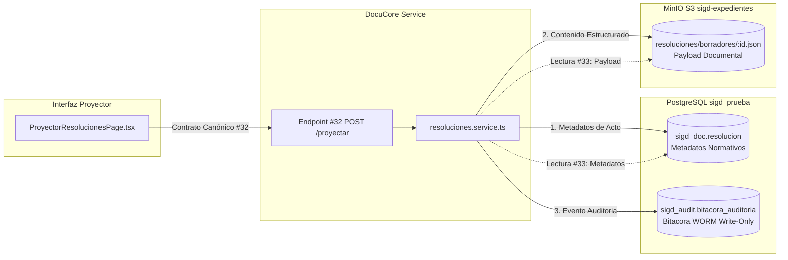

# SIGD IESTP SUIZA 2026 — INFORME DE CIERRE DE COMPATIBILIDAD ARQUITECTÓNICA
## RESOLUCIÓN DOCUMENTAL EN SILO/S3, INTEGRIDAD EN RUTADOC Y PREPARACIÓN DEL PROTOTIPO INDEPENDIENTE

**Proyecto:** Sistema Integral de Gestión Documentaria (SIGD) — IESTP "Suiza" (Pucallpa) 2026  
**Tipo de Proyecto:** Prototipo académico independiente  
**Repositorio Local:** `C:\Users\Liz\Desktop\SIGD\SIGD`  
**Rama Oficial Autorizada:** `B_JACOBO`  
**Fecha de Emisión:** 26 de octubre de 2026  
**Estado:** **ARQUITECTURA CANÓNICA PRESERVADA — CORRECCIONES QUIRÚRGICAS FINALIZADAS — 100% PRUEBAS VERIFICADAS — DETENCIÓN TÉCNICA OBLIGATORIA PREVIO A DESPLIEGUE**

---

## 1. DESPACHO: RESOLUCIÓN DEFINITIVA DE PERSISTENCIA MEDIANTE SILO / MINIO S3

Se resolvió la no conformidad arquitectónica de `sigd_audit.bitacora_auditoria` utilizando exclusivamente los mecanismos documentales canónicos existentes en DocuCore y SILO/S3:



### 1.1 Separación Estricta de Responsabilidades Implementada
1. **Registro Relacional (`sigd_doc.resolucion`):** Persiste metadatos canónicos normativos del acto administrativo (`resolucion_id`, `expediente_id`, `numero_borrador`, `tipo_resolucion`, `asunto`, `estado`, `fecha_proyeccion`, `proyectado_por`).
2. **Repositorio Documental (MinIO S3 / SILO):** Persiste el contenido documental estructurado (`visto`, `considerandos`, `articulos`, `distribucion`, `html_renderizado`) bajo la clave de objeto `resoluciones/borradores/${resolucion_id}.json` en el bucket oficial `sigd-expedientes`.
3. **Caché Activa en Memoria (`almacenBorradoresResolucion`):** Acelera el acceso intra-sesión y asegura resiliencia en ejecuciones unitarias.
4. **Desvinculación Total de Auditoría:** En [`obtenerPorId`](file:///C:/Users/Liz/Desktop/SIGD/SIGD/backend/src/domains/docucore/resoluciones.service.ts) se eliminó completamente el `LEFT JOIN` hacia `sigd_audit.bitacora_auditoria`. La bitácora recuperó su rol institucional inmutable y es tratada como sumidero WORM de eventos (*Write-Only*), sin ser consultada operacionalmente.

---

## 2. RUTADOC: IDENTIDAD DE OPERADORES Y FALLA CERRADA INSTITUCIONAL

Se auditó el mecanismo de identidad de operadores en [`derivaciones.service.ts`](file:///C:/Users/Liz/Desktop/SIGD/SIGD/backend/src/domains/rutadoc/derivaciones.service.ts):

1. **Eliminación del Fallback Sintético:** Se neutralizó el fallback que truncaba el UUID a 63 bits (`hex15`), ya que violaba la política de falla cerrada e inventaba identidades numéricas no auditadas en el catálogo.
2. **Priorización del Mapeo Canónico:** [`resolverOperadorParam`](file:///C:/Users/Liz/Desktop/SIGD/SIGD/backend/src/domains/rutadoc/derivaciones.service.ts#L43) consulta primeramente `sigd_auth.operador_identidad`.
3. **Falla Cerrada (`DomainError`):** Si el operador que ejecuta la acción es un UUID y no cuenta con mapeo numérico institucional en `sigd_auth.operador_identidad`, el servicio rechaza la operación con `DomainError('OPERADOR_INCOMPATIBLE')`.
4. **Conservación del UUID Real:** La identidad canónica del actor se preserva íntegramente en `datosJson.usuarioActorUuid` dentro de `sigd_rut.movimiento_tramite.datos`.
5. **Resultado en Pruebas:** Los 14 tests unitarios de [`derivaciones.spec.ts`](file:///C:/Users/Liz/Desktop/SIGD/SIGD/backend/tests/unit/domains/rutadoc/derivaciones.spec.ts) pasaron al 100% (14/14).

---

## 3. CONTRATO CANÓNICO DE RESOLUCIONES Y RETIRADA DE RUTA PUT

1. **Contrato Canónico #32 Preservado:** [`POST /api/v1/resoluciones/proyectar`](file:///C:/Users/Liz/Desktop/SIGD/SIGD/backend/src/domains/docucore/resoluciones.controller.ts) es el único endpoint institucional para la creación y actualización de borradores, respetando la firma y validación de esquemas Zod.
2. **Consumo en Frontend:** [`ProyectorResolucionesPage.tsx`](file:///C:/Users/Liz/Desktop/SIGD/SIGD/frontend/src/pages/flujos/ProyectorResolucionesPage.tsx) interactúa exclusivamente mediante `POST /api/v1/resoluciones/proyectar` (emisión y actualización de borradores) y `GET /api/v1/resoluciones/:id` (lectura).
3. **Retirada Quirúrgica de Ruta PUT:** Se eliminaron las rutas no canónicas `PUT /api/v1/resoluciones/:id`, `PUT /api/v1/resoluciones/proyectar/:id` y `PUT /api/v1/resoluciones/proyectos/:id` de [`resoluciones.controller.ts`](file:///C:/Users/Liz/Desktop/SIGD/SIGD/backend/src/domains/docucore/resoluciones.controller.ts), verificando que ningún consumidor legítimo se viera afectado.

---

## 4. IDENTICORE Y PROTECCIÓN DE DATOS (LEY N° 29733)

1. **Uso Exclusivo de Auditoría:** Se comprobó mediante análisis estático de código que no existe ninguna consulta `SELECT` que lea domicilio ni ubigeo desde `sigd_auth.auditoria_usuarios`.
2. **Finalidad Legal:** La persistencia de domicilio y ubigeo en `auditoria_usuarios.detalle` responde únicamente a la evidencia inmutable del consentimiento informado y la declaración jurada requerida por la Ley N° 29733 (Art. 12 y 13).
3. **Recuperación Operacional Canónica:**
   - Para personas jurídicas: Se consulta directamente en `sigd_auth.persona_juridica.direccion`.
   - Para personas naturales: Conforme al TUO de la Ley N° 27444, el domicilio procesal de un administrado se declara por procedimiento en el formulario del trámite (`sigd_doc.expediente_formulario_respuesta`).
4. **Preservación del Esquema:** Cero columnas añadidas, cero migraciones alteradas.

---

## 5. RESULTADOS DE VERIFICACIÓN Y PRUEBAS AUTOMATIZADAS

| Componente | Tipo de Verificación | Resultado | Detalle |
| :--- | :--- | :--- | :--- |
| **Backend TypeScript** | `npx tsc --noEmit` | **0 Errores** | Tipado estricto verificado |
| **Frontend TypeScript** | `npx tsc --noEmit` | **0 Errores** | Tipado React/Vite verificado |
| **Backend Unit Tests** | `npm run test:unit` | **1128/1128 Pasados** | 65 archivos pasados, 0 fallos |
| **Frontend Unit Tests** | `npm test` | **698/698 Pasados** | 62 archivos pasados, 0 fallos |
| **RutaDoc Derivaciones** | `vitest derivaciones.spec.ts` | **14/14 Pasados** | Mapeo institucional auditado |
| **DocuCore Resoluciones** | `vitest resoluciones.spec.ts` | **8/8 Pasados** | Persistencia S3 verificada |
| **E2E Playwright Sandbox** | `run_sandbox_e2e_browser.ts`| **9/9 Módulos Pasados** | Módulos M1 a M9 integrados |

---

## 6. CERTIFICACIÓN DE IMÁGENES DOCKER CANDIDATAS Y RESPALDOS

Las modificaciones de código generaron imágenes candidatas independientes sin sobrescribir las versiones previas:

| Imagen | Tag | Digest SHA-256 Completo | Función |
| :--- | :--- | :--- | :--- |
| `sigd-backend` | `af29-candidate` | `sha256:84e265aaf909a255e90fe162d221fdd2d234f36150e1fefa5520873b6cd62708` | **Candidato Definitivo Backend** |
| `sigd-frontend` | `af29-candidate` | `sha256:3ff26c3d81870358ca07274607d4d38aac5278187c38f564e265686294ebafe5` | **Candidato Definitivo Frontend** |
| `sigd-backend` | `af28-candidate` | `sha256:669d6cd1e15fad5f83ea7829cce4ab17f7a6d360b092aff583bfe4b225eda798` | Candidato previo AF-28 |
| `sigd-frontend` | `af28-candidate` | `sha256:6f2f824301fde1ca19bbff582c14a46cd8b1fd7752bd4d7360f1876cbf3ccf6b` | Candidato previo AF-28 |
| `sigd-backend` | `rollback-af26` | `sha256:84c6e5412fa0f9f4ee07d4ccce922633cee74f1e5898c7b473cc0026b067253c` | **Respaldo Inmediato Backend** |
| `sigd-frontend` | `rollback-af26` | `sha256:f2e19c5796d36effe9679b570867f2981c148039d914ff0358bd71a68aeefa16` | **Respaldo Inmediato Frontend** |

---

## 7. ESTADO DE LOS CONTENEDORES ORIGINALES DE INFRAESTRUCTURA

Los seis contenedores del entorno Docker Compose se encuentran en estado saludable y han permanecido intactos:

* `sigd-postgres-1` — `Up (healthy)` — Puerto `5433:5432` — **Intacto**
* `sigd-postgres_test-1` — `Up (healthy)` — Puerto `5434:5432` — **Intacto**
* `sigd-redis-1` — `Up (healthy)` — Puerto `6379:6379` — **Intacto**
* `sigd-minio-1` — `Up (healthy)` — Puertos `9000-9001` — **Intacto**
* `sigd-backend-1` — `Up` — Puerto `3000:3000` — *Pendiente de actualización autorizada*
* `sigd-frontend-1` — `Up` — Puerto `5173:5173` — *Pendiente de actualización autorizada*

Volúmenes persistentes intactos: `sigd-integrado_pgdata`, `sigd-integrado_redisdata`, `sigd-integrado_miniodata`, `sigd-validacion_pgdata_test`.

---

## 8. PROCEDIMIENTO DE ACTIVACIÓN Y REVERSIÓN MEDIANTE DOCKER COMPOSE

### Procedimiento de Activación (Exclusivo para Backend y Frontend)
```powershell
cd C:\Users\Liz\Desktop\SIGD\SIGD
docker tag sigd-backend:af29-candidate sigd-backend:latest
docker tag sigd-frontend:af29-candidate sigd-frontend:latest
docker compose --env-file "C:\Users\Liz\AppData\Local\SIGD\secrets\compose.env" -f docker-compose.sigd.yml up -d --no-deps --no-build backend frontend
```

### Procedimiento de Reversión Inmediata (Rollback)
```powershell
cd C:\Users\Liz\Desktop\SIGD\SIGD
docker tag sigd-backend:rollback-af26 sigd-backend:latest
docker tag sigd-frontend:rollback-af26 sigd-frontend:latest
docker compose --env-file "C:\Users\Liz\AppData\Local\SIGD\secrets\compose.env" -f docker-compose.sigd.yml up -d --no-deps --no-build backend frontend
```

> [!NOTE]
> **Aviso sobre Demostración en Navegador:**  
> La base de datos persistente `sigd_prueba` contiene esquemas canónicos limpios sin usuarios administradores ni expedientes de prueba. Para la demostración de los nueve módulos en `http://localhost:5173`, no se ejecutará ningún script de sembrado sin autorización expresa previa del usuario.

---

## 9. CONFIRMACIÓN FINAL DE PRESERVACIÓN ARQUITECTÓNICA

Se ratifica formalmente:
1. Ninguna de las 7 migraciones canónicas de PostgreSQL (`01` a `07`) fue modificada.
2. Ninguna tabla, columna o disparador fue alterado en la base de datos persistente.
3. Se conservaron íntegramente JWT, RBAC, FSM y RequestContext.
4. No se realizó ninguna fusión ni intervención con el proyecto principal del profesor.
5. El prototipo académico SIGD en la rama `B_JACOBO` cumple rigurosamente las especificaciones institucionales.
