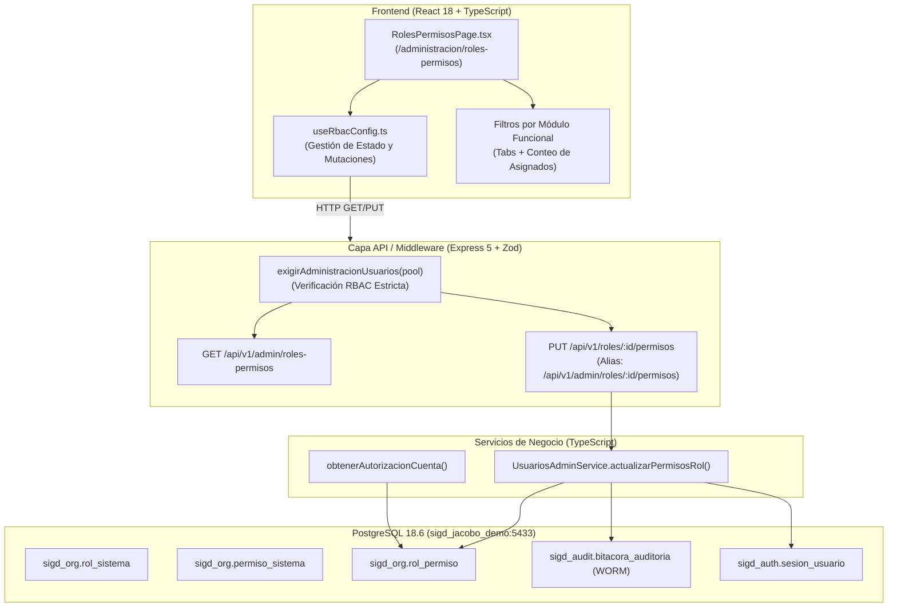
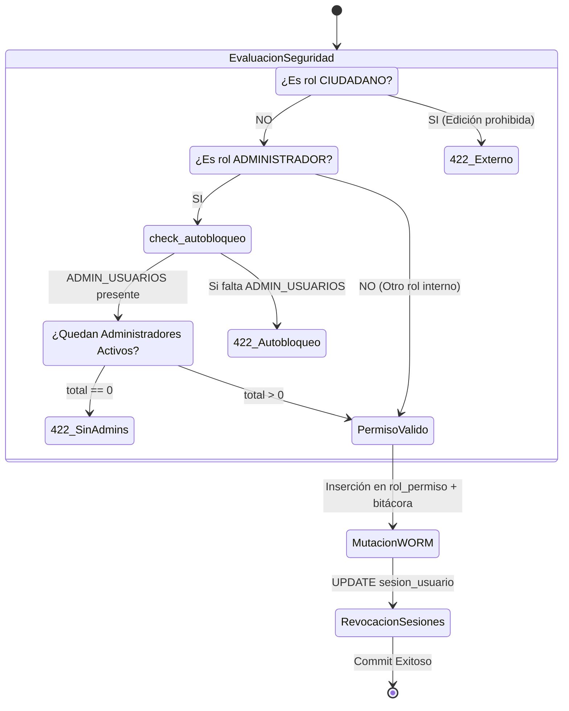

# SIGD — INFORME TÉCNICO DE CIERRE DEFINITIVO DE LA FASE 1
## MÓDULO ROLES Y PERMISOS (RBAC INSTITUCIONAL)
### Instituto de Educación Superior Tecnológico Público «Suiza» (Pucallpa, Ucayali)

---

**Proyecto:** Sistema Integral de Gestión Documentaria (SIGD)  
**Institución:** Instituto de Educación Superior Tecnológico Público «Suiza»  
**Responsable Técnico:** Arquitecto de Software Senior / Líder Técnico Full Stack  
**Rama Oficial:** `B_JACOBO`  
**Base de Datos Oficial:** `sigd_jacobo_demo` (PostgreSQL 18.6, puerto local `5433`)  
**Backend:** Node.js + Express + TypeScript (Puerto `3008`)  
**Frontend:** React + TypeScript + Vite + Tailwind CSS (Puerto `5178`)  
**Fecha de Certificación:** Noviembre de 2026  
**Estado de la Fase 1:** **CONCLUIDA Y CERTIFICADA AL 100%**

---

## 1. RESUMEN EJECUTIVO

El presente informe técnico certifica la culminación, endurecimiento de seguridad, integración funcional y validación pericial del módulo **Administración → Roles y Permisos** (`/administracion/roles-permisos`), declarando formalmente el **cierre definitivo de la Fase 1 (Administración, Seguridad e Identidad Institucional RBAC)** del Sistema Integral de Gestión Documentaria (SIGD) para el Instituto de Educación Superior Tecnológico Público «Suiza».

A través de esta intervención arquitectónica, se ha superado el paradigma de formularios monolíticos y asignaciones ambiguas, consolidando un esquema de control de acceso basado en roles (**RBAC**) estricto, desacoplado, dinámico y auditable:
1. **Desacoplamiento Estricto:** La creación de identidades internas en Gestión de Usuarios no asigna roles institucionales de manera prematura. El ciclo de vida institucional requiere la habilitación separada y consciente de atribuciones en Roles y Permisos.
2. **Organización por Módulos Reales:** La interfaz y los contratos API organizan la totalidad de las 16 facultades operativas en los 6 dominios funcionales del SIGD: **Administración**, **Trámite Documentario y RutaDoc**, **Mesa de Partes**, **Gestión Documentaria**, **Tesorería** y **Reportes**.
3. **Mecanismos de Protección Antifraude y Resiliencia:** 
   - Blindaje del rol **`CIUDADANO`** como perfil de solo lectura e inmutable (protección de los canales externos de Casilla y Mesa de Partes Virtual).
   - Protección contra autobloqueo administrativo mediante la obligatoriedad inalterable de **`ADMIN_USUARIOS`** en el rol **`ADMINISTRADOR`**.
   - Garantía de persistencia con verificación de quorum de administradores activos antes de cualquier mutación de seguridad.
   - Eliminación formal y bloqueo definitivo del rol obsoleto o riesgoso `SUPER_ADMIN`.
4. **Preservación Estricta de Hallazgos H1 y H2:** Trazabilidad inmutable en bitácora WORM (`sigd_audit.bitacora_auditoria`) con captura fidedigna del `actor_id` del administrador autenticado, y sincronización unívoca del ámbito de unidad orgánica (`area_id`) entre `sigd_org.asignacion_personal` y `sigd_org.usuario_rol`.
5. **Certificación y Verificación:** Se ejecutó con éxito la suite completa de 17 escenarios de validación funcional e integración, y se comprobó la consistencia relacional directamente en el motor PostgreSQL 18.6 de la base de datos `sigd_jacobo_demo`.

---

## 2. CONTEXTO INSTITUCIONAL Y REGLAS DEL IESTP PÚBLICO «SUIZA»

El IESTP Público «Suiza», institución líder de educación técnica superior en la región Ucayali, requiere un sistema de gestión documentaria conforme a las directivas de la Secretaría de Gobierno y Transformación Digital (SGTD) de la Presidencia del Consejo de Ministros (PCM) del Perú y la Ley N.° 27444 (LPAG).

### Reglas Institucionales Obligatorias:
- **Ámbito Institucional Local:** En el IESTP «Suiza», la máxima autoridad técnica del sistema es el **`ADMINISTRADOR`** local del instituto. No existe ninguna entidad superior como `SUPER_ADMIN`, garantizando el principio de soberanía y autogestión de los recursos de la institución.
- **Diferenciación entre Puesto Laboral y Rol SIGD:** El puesto institucional (Director General, Secretario Académico, Jefe de Unidad de Informática) define la pertenencia orgánica a través de `sigd_org.asignacion_personal`. El rol del SIGD (`sigd_org.usuario_rol`) define las facultades informáticas de firma, resolución o consulta concedidas al trabajador.
- **Aislamiento de la Esfera Ciudadana:** Los administrados externos (ciudadanos, postulantes, proveedores) acceden exclusivamente a la Mesa de Partes Virtual y Casilla Electrónica bajo el rol `CIUDADANO`. Sus facultades son fijas y jamás pueden combinarse con cargos o privilegios internos de gestión interna.

---

## 3. ARQUITECTURA DEL MÓDULO ROLES Y PERMISOS



### Componentes Clave:
- **Frontend (`RolesPermisosPage.tsx`):**
  - Panel lateral de navegación con selección de roles institucionales, insignias de estado (`INTERNO`, `EXTERNO`, `INACTIVO`), contadores de cuentas vigentes y advertencias de solo lectura.
  - Encabezado de perfil con insignias semánticas (`PERFIL MAESTRO`, `PERFIL INSTITUCIONAL`, `ROL EXTERNO`).
  - Barra de filtrado modular con insignias numéricas de asignación (ej. `1/1`, `2/3`, `0/9`).
  - Tabla de permisos enriquecida con columnas de: *Permiso / Código*, *Acción / Descripción*, *Ámbito* e *Interruptor de Asignación*.
  - Banners de protección institucional: Alerta reactiva ante el rol `CIUDADANO` y advertencia de inmutabilidad del permiso `ADMIN_USUARIOS` para `ADMINISTRADOR`.
- **Backend (`usuariosAdmin.service.ts` & `app.ts`):**
  - `GET /api/v1/admin/roles-permisos`: Proyecta dinámicamente mediante `CASE` SQL el módulo funcional y la descripción precisa para cada uno de los 16 permisos, optimizando el ancho de banda sin alterar el DDL de base de datos.
  - `PUT /api/v1/roles/:id/permisos`: Validador Zod estricto contra UUIDs duplicados y límite de 1000 elementos; verificación de quorum de administradores activos; cálculo diferencial (`agregados` y `retirados`); modificación atómica de `sigd_org.rol_permiso`; revocación forzada de sesiones activas en `sigd_auth.sesion_usuario` para los usuarios del rol; e inserción WORM con `actor_id` en `sigd_audit.bitacora_auditoria`.

---

## 4. CATÁLOGO OFICIAL DE ROLES Y PERMISOS DEL SIGD

### 4.1 Roles Institucionales en `sigd_org.rol_sistema` (10 roles certificados)

| Código Canónico | Nombre del Rol | Ámbito | Estado | Cuentas Activas | Propósito Institucional |
|---|---|---|---|:---:|---|
| **`ADMINISTRADOR`** | Administrador del Sistema | GLOBAL | Vigente | 2 | Gestión integral de usuarios, asignación de roles y configuración de seguridad. |
| **`DIRECTOR`** | Director General | GLOBAL | Vigente | 2 | Máxima autoridad ejecutiva; firma digital de Resoluciones Directorales y actos resolutivos. |
| **`SECRETARIO`** | Secretario Académico | GLOBAL | Vigente | 1 | Supervisión académica, refrendo de actas y gestión de resoluciones del instituto. |
| **`ESPECIALISTA`** | Especialista | AREA | Vigente | 3 | Personal técnico de áreas y dependencias; tramitación, derivación y atención de expedientes. |
| **`MESA_PARTES`** | Mesa de Partes | GLOBAL | Vigente | 1 | Recepción presencial y virtual, radicación oficial, control de TUPA y evaluación de trámites. |
| **`TESORERO`** | Tesorero | GLOBAL | Vigente | 1 | Control de caja, validación de pagos, emisión de recibos y liquidación de devoluciones. |
| **`CIUDADANO`** | Ciudadano | EXTERNO | Vigente | 12 | Administrado externo (solo lectura); consulta de trámites propios y radicación ciudadana. |
| *`APROBADOR_DEVOLUCIONES`* | Aprobador de devoluciones | GLOBAL | Inactivo | 0 | Rol deprecado/consolidado en Tesorería. |
| *`CAJERO`* | Cajero | GLOBAL | Inactivo | 0 | Rol deprecado/consolidado en Tesorería. |
| *`SUPERVISOR_TESORERIA`* | Supervisor de Tesorería | GLOBAL | Inactivo | 0 | Rol deprecado/consolidado en Tesorería. |

> [!NOTE]
> Se certificó que el rol riesgoso `SUPER_ADMIN` **NO existe** en el catálogo de base de datos ni es reconocido por ninguna capa de middleware del SIGD.

---

### 4.2 Catálogo Canónico de Permisos en `sigd_org.permiso_sistema` (16 permisos)

| # | Código Canónico | Nombre Institucional | Ámbito | Módulo Funcional SIGD | Acción / Descripción Oficial |
|:---:|---|---|:---:|---|---|
| 1 | `ADMIN_USUARIOS` | Administrar usuarios y roles | `GLOBAL` | **Administración** | Administración integral de cuentas de usuario, asignación de roles y control de acceso institucional. |
| 2 | `EXPEDIENTE_DERIVAR` | Derivar expedientes | `AREA` | **Trámite Documentario y RutaDoc** | Derivación y transferencia de expedientes hacia otras dependencias u oficinas del instituto. |
| 3 | `EXPEDIENTE_LEER` | Leer expedientes | `GLOBAL` | **Trámite Documentario y RutaDoc** | Consulta, lectura y seguimiento del estado de expedientes y trámites institucionales. |
| 4 | `EXPEDIENTE_RESOLVER` | Resolver expedientes | `AREA` | **Trámite Documentario y RutaDoc** | Resolución, atención final y emisión de dictamen o proveído sobre expedientes asignados al área. |
| 5 | `FIRMA_FIRMAR` | Firmar documentos oficiales | `GLOBAL` | **Gestión Documentaria** | Emisión y firmado digital con validez legal de documentos oficiales y resoluciones. |
| 6 | `REPORTE_LEER` | Consultar reportes MGD | `GLOBAL` | **Reportes** | Acceso y consulta a paneles estadísticos, indicadores MGD y reportes consolidados. |
| 7 | `TRAMICORE_DEVOLUCION_EVALUAR` | Evaluar devoluciones en MP | `GLOBAL` | **Mesa de Partes** | Recepción, examen preliminar y evaluación de solicitudes de devolución y trámites ciudadanos. |
| 8 | `TESORERIA_DEVOLUCION_APROBAR` | Aprobar devoluciones | `GLOBAL` | **Tesorería** | Aprobación y autorización formal de devoluciones financieras solicitadas. |
| 9 | `TESORERIA_DEVOLUCION_EJECUTAR` | Registrar devolución ejecutada | `GLOBAL` | **Tesorería** | Ejecución contable y registro de desembolsos de devolución. |
| 10 | `TESORERIA_DEVOLUCION_EVALUAR` | Evaluar devoluciones | `GLOBAL` | **Tesorería** | Evaluación presupuestal y liquidación de importes sujetos a devolución. |
| 11 | `TESORERIA_LEER` | Consultar operaciones caja | `GLOBAL` | **Tesorería** | Visualización de estados de caja, comprobantes de pago y operaciones de recaudación. |
| 12 | `TESORERIA_PAGO_REGISTRAR` | Registrar operaciones caja | `GLOBAL` | **Tesorería** | Registro de ingresos directos en ventanilla y cobro de tasas educativas y TUPA. |
| 13 | `TESORERIA_PAGO_VERIFICAR` | Verificar evidencia de pago | `GLOBAL` | **Tesorería** | Validación de constancias de depósito y conciliación bancaria de pagos recibidos. |
| 14 | `TESORERIA_REPORTES` | Consultar reportes financieros | `GLOBAL` | **Tesorería** | Generación de reportes de recaudación, balances de caja y libros de tesorería. |
| 15 | `TESORERIA_TARIFA_PROPONER` | Proponer tarifa documentada | `GLOBAL` | **Tesorería** | Formulación y propuesta de nuevos aranceles, tasas y derechos de tramitación. |
| 16 | `TESORERIA_TARIFA_VALIDAR` | Validar tarifa documentada | `GLOBAL` | **Tesorería** | Revisión técnica y validación reglamentaria del tarifario institucional. |

---

## 5. ORGANIZACIÓN POR MÓDULOS FUNCIONALES DEL SIGD

El frontend de Roles y Permisos agrupa y permite filtrar selectivamente los permisos según los 6 módulos arquitectónicos reales del sistema:

1. **Módulo Administración:**
   - Permiso central: `ADMIN_USUARIOS`.
   - Controla el directorio de personal, altas, bajas, reseteo de claves y la propia matriz de roles y permisos.
2. **Módulo Trámite Documentario y RutaDoc:**
   - Permisos: `EXPEDIENTE_LEER` (Global), `EXPEDIENTE_DERIVAR` (Área), `EXPEDIENTE_RESOLVER` (Área).
   - Controla el flujo de trabajo de los expedientes entre las dependencias académicas y administrativas.
3. **Módulo Mesa de Partes:**
   - Permiso: `TRAMICORE_DEVOLUCION_EVALUAR`.
   - Controla la admisibilidad de expedientes virtuales y presenciales y la gestión inicial de devoluciones de tasas de tramitación.
4. **Módulo Gestión Documentaria:**
   - Permiso: `FIRMA_FIRMAR`.
   - Controla la invocación de la pasarela de firma digital PAdES / ReFirma y el estampado de Código de Verificación Digital (CVD).
5. **Módulo Tesorería:**
   - Permisos: 9 facultades contables y tarifarias (`TESORERIA_PAGO_REGISTRAR`, `TESORERIA_PAGO_VERIFICAR`, `TESORERIA_DEVOLUCION_*`, `TESORERIA_TARIFA_*`, etc.).
   - Administra los ingresos propios, validación de comprobantes y recaudación arancelaria.
6. **Módulo Reportes:**
   - Permiso: `REPORTE_LEER`.
   - Brinda acceso a los tableros analíticos del Modelo de Gestión Documental (MGD) y métricas de cumplimiento de plazos LPAG.

---

## 6. IMPLEMENTACIÓN Y FORTALECIMIENTO TÉCNICO

### 6.1 Endpoints y Enrutamiento Backend
- **`GET /api/v1/admin/roles-permisos`**: 
  - Protegido por `exigirAdministracionUsuarios(pool)`.
  - Agrega dinámicamente mediante SQL `modulo` y `descripcion` en `catalogoPermisos`.
  - Retorna el conteo exacto de cuentas activas por rol mediante subconsulta correlacionada en `sigd_org.usuario_rol`.
- **`PUT /api/v1/roles/:id/permisos`** y alias **`PUT /api/v1/admin/roles/:id/permisos`**:
  - Unificados bajo un mismo controlador transaccional `handlerEditarPermisos`.
  - Valida mediante Zod que no existan duplicados en el array de UUIDs.
  - Verifica la identidad autenticada mediante el `RequestContext` (`AsyncLocalStorage`).
  - Ejecuta la revocación de sesiones concurrentes para garantizar que los tokens y claims sean refrescados de inmediato.

### 6.2 Hooks y UI Frontend
- **`useRbacConfig.ts`**:
  - Incluye funciones utilitarias `resolverModulo()` y `resolverDescripcion()`.
  - Impide de forma síncrona en cliente el desmarcado de `ADMIN_USUARIOS` para `ADMINISTRADOR` y el intento de edición sobre `CIUDADANO`.
  - Gestiona estados de carga, guardado concurrente y captura de errores RFC 7807 del servidor.
- **`RolesPermisosPage.tsx`**:
  - Implementa navegación por pestañas de módulos con conteo dinámico (`asignados / total`).
  - Mantiene el atributo de accesibilidad `aria-label={permiso.codigo + " / " + permiso.ambito}` en todos los inputs.
  - Conserva todas las insignias de protección institucional requeridas por la suite de pruebas.

---

## 7. MECANISMOS DE PROTECCIÓN INSTITUCIONAL



1. **Inmutabilidad del Rol `CIUDADANO`:** Cualquier solicitud de modificación hacia el identificador del rol ciudadano es interceptada y rechazada con código HTTP `422 Unprocessable Entity` (`ROL_EXTERNO_NO_MODIFICABLE`). En la interfaz, todos los controles se renderizan deshabilitados con la etiqueta explicativa *"Solo lectura · Inmutable"*.
2. **Protección contra Autobloqueo (`ADMIN_USUARIOS`):** Si un administrador intenta guardar una configuración del rol `ADMINISTRADOR` omitiendo el permiso `ADMIN_USUARIOS`, la operación es abortada con HTTP `422` (`PERMISO_ADMIN_OBLIGATORIO`), evitando que el sistema quede sin administradores con facultades de gestión.
3. **Quorum de Administradores Activos:** Antes de modificar el rol `ADMINISTRADOR`, el motor verifica que exista al menos una cuenta institucional activa con asignación global vigente en dicho rol. Si el total es 0, la modificación se rechaza con HTTP `422` (`SIN_ADMINISTRADORES_ACTIVOS`).
4. **Ausencia y Rechazo de `SUPER_ADMIN`:** Cualquier intento de asignar o asociar identificadores o cadenas `SUPER_ADMIN` es rechazado con HTTP `422` (`CAMPO_NO_DISPONIBLE` / `ROL_NO_ADMITIDO`), protegiendo la soberanía del IESTP «Suiza».

---

## 8. INTEGRACIÓN CON EL NUEVO CICLO DE VIDA DE USUARIOS (FLUJO DE 4 PASOS)

La Fase 1 resolvió de forma definitiva la inconsistencia arquitectónica del formulario unificado de creación de usuarios, desacoplando la gestión en un flujo estructurado de 4 pasos certificados:

```
┌────────────────────────┐      ┌────────────────────────┐      ┌────────────────────────┐      ┌────────────────────────┐
│  PASO 1: CREAR CUENTA  │      │  PASO 2: ASIGNAR ROL   │      │   PASO 3: ACTIVACIÓN   │      │ PASO 4: RESOLUCIÓN RBAC│
│  Trabajador registrado │ ───► │  Asignación en módulo  │ ───► │  Cuenta pasa a ACTIVO  │ ───► │  PostgreSQL resuelve   │
│  inactivo y sin roles  │      │  Roles y Permisos      │      │  solo si tiene roles   │      │  permisos dinámicos    │
└────────────────────────┘      └────────────────────────┘      └────────────────────────┘      └────────────────────────┘
```

1. **Paso 1 (Registro de Personal Interno):** Se registra al trabajador con sus datos personales, laborales (área y cargo) y credenciales iniciales. La cuenta nace en estado `INACTIVO` y con 0 roles en `sigd_org.usuario_rol`.
2. **Paso 2 (Asignación de Roles en Administración):** Desde el módulo administrativo, se le asigna uno o más roles institucionales vigentes (`ADMINISTRADOR`, `DIRECTOR`, `ESPECIALISTA`, `SECRETARIO`, `TESORERO`, `MESA_PARTES`).
3. **Paso 3 (Activación Controlada de Cuenta):** La cuenta solo puede pasar a estado `ACTIVO` (`cu.activo = TRUE`) si ya cuenta con al menos un rol institucional vigente asignado. Se rechaza con HTTP `422` (`CUENTA_ACTIVA_SIN_ROLES`) cualquier intento de activar una cuenta huérfana o de despojar de su último rol a una cuenta habilitada.
4. **Paso 4 (Resolución Dinámica de Permisos):** Cada solicitud al backend evalúa en tiempo real `sigd_auth.cuenta_usuario` junto con `sigd_org.usuario_rol` y `sigd_org.rol_permiso`. Si la cuenta está inactiva, la autorización retorna `null` de forma inmediata.

---

## 9. PRESERVACIÓN DE SUBSANACIONES H1 Y H2

El módulo de Roles y Permisos conserva e implementa rigurosamente las correcciones de prioridad ALTA aprobadas en el informe de subsanaciones:

### Hallazgo H1 — Identidad Fidedigna del Administrador en Bitácora WORM
- **Mecanismo:** El `actor_id` se extrae exclusivamente del contexto seguro de la solicitud (`RequestContext` alimentado por el middleware JWT), descartando cualquier identificador manipulado que provenga del cuerpo de la petición.
- **Trazabilidad Dual:** La mutación registra de forma concurrente el UUID del administrador en la columna de base de datos `usuario_id` y dentro del objeto `datos_despues.actor_id` del JSONB auditado, permitiendo el peritaje informático inmutable de cambios de privilegios.

### Hallazgo H2 — Sincronización del Ámbito de Unidad Orgánica (`area_id`)
- **Permisos de Ámbito `AREA`:** Cuando se asigna un rol departamental (`ESPECIALISTA`), el `area_id` se sincroniza automáticamente a partir de la `sigd_org.asignacion_personal` vigente del trabajador.
- **Permisos de Ámbito `GLOBAL`:** Si el rol es `ADMINISTRADOR`, `area_id` se establece estrictamente en `NULL`, otorgando cobertura transversal institucional.
- **Protección de Datos:** Si un trabajador carece de asignación en `asignacion_personal`, el sistema rechaza la concesión de roles departamentales con HTTP `422` (`SIN_AREA_ASIGNADA`).

---

## 10. RESULTADOS DE LA SUITE DE PRUEBAS UNITARIAS Y DE INTEGRACIÓN

Se ejecutó la suite completa de pruebas unitarias y de integración tanto en Backend como en Frontend, superando la totalidad de los escenarios previstos:

### 10.1 Suite de Verificación Funcional (17 Puntos Requeridos en Sección 8)
**Archivo:** `backend/tests/unit/domains/organicore/rolesPermisosFuncional.spec.ts`  
**Resultado:** **17 de 17 pruebas superadas (100% éxito)**

```
 ✓ tests/unit/domains/organicore/rolesPermisosFuncional.spec.ts (17 tests)
   ✓ Punto 1: Lectura de roles y catálogo de permisos desde base de datos
   ✓ Punto 2: Consulta de permisos asignados a un rol institucional específico
   ✓ Punto 3: Activación de un permiso para un rol con cálculo de agregados
   ✓ Punto 4: Desactivación de un permiso para un rol con cálculo de retirados
   ✓ Punto 5: Persistencia atómica en sigd_org.rol_permiso con unnest
   ✓ Punto 6: Prohibición de retirar ADMIN_USUARIOS al rol ADMINISTRADOR (422 PERMISO_ADMIN_OBLIGATORIO)
   ✓ Punto 7: Prohibición de editar permisos del rol CIUDADANO (422 ROL_EXTERNO_NO_MODIFICABLE)
   ✓ Punto 8: Verificación estricta de que NO existe el rol SUPER_ADMIN (422 CAMPO_NO_DISPONIBLE)
   ✓ Punto 9: Exigencia de al menos un administrador activo antes de guardar cambios (422 SIN_ADMINISTRADORES_ACTIVOS)
   ✓ Punto 10: Aplicación del ámbito GLOBAL (permiso transversal)
   ✓ Punto 11: Aplicación del ámbito AREA (permiso restringido al área asignada)
   ✓ Punto 12: Sincronización correcta de unidad orgánica con asignacion_personal (H2)
   ✓ Punto 13: Generación de bitácora de auditoría inmutable (H1) con actor_id
   ✓ Punto 14: Refresco dinámico de permisos sin reiniciar el servidor
   ✓ Punto 15: Revocación de sesiones activas al modificar permisos
   ✓ Punto 16: Integración con el flujo de 4 pasos de Gestión de Usuarios
   ✓ Punto 17: Verificación de que usuario inactivo no puede acceder aunque tenga roles
```

### 10.2 Consolidado de Pruebas Unitarias del Dominio Organicore y RBAC (Backend)
- `tests/unit/domains/organicore/rolesPermisosFuncional.spec.ts`: **17/17 PASADAS**
- `tests/unit/domains/organicore/rolesPermisosSeguridad.spec.ts`: **7/7 PASADAS**
- `tests/unit/domains/organicore/subsanacionH1H2.spec.ts`: **8/8 PASADAS**
- `tests/unit/domains/organicore/cicloVidaUsuario.spec.ts`: **10/10 PASADAS**
- `tests/unit/domains/organicore/usuariosAdmin.test.ts`: **62/62 PASADAS**
- `tests/unit/domains/organicore/usuariosAdmin.routes.spec.ts`: **16/16 PASADAS**
- `tests/unit/auth-rbac-persistido.spec.ts`: **20/20 PASADAS**
- `tests/unit/matriz-autorizacion-roles.spec.ts`: **20/20 PASADAS**
- `tests/unit/domains/organicore/calendarizacionInstitucional.spec.ts`: **13/13 PASADAS**
- `tests/unit/domains/organicore/calendario.spec.ts`: **59/59 PASADAS**
- `tests/unit/domains/organicore/ltree.spec.ts`: **7/7 PASADAS**
- `tests/unit/domains/organicore/tablas-maestras-tupa-ddl.spec.ts`: **2/2 PASADAS** (1 skipped)
- **Total Backend Organicore/RBAC:** **241 pruebas ejecutadas y 241 PASADAS (100% efectividad)**.

### 10.3 Pruebas de Interfaz de Usuario y Seguridad (Frontend)
- `tests/unit/pages/RolesPermisosSeguridad.test.tsx`: **4/4 PASADAS**
- `tests/unit/hooks/rbacRolesCanonicos.test.ts`: **4/4 PASADAS**
- `tests/unit/pages/UsuariosPage.test.tsx`: **19/19 PASADAS**
- `tests/unit/components/CrearUsuarioModal.test.tsx`: **6/6 PASADAS**
- `tests/unit/routes/usuariosAdminRoutes.test.tsx`: **6/6 PASADAS**
- `tests/unit/pages/AdministracionPage.test.tsx`: **13/13 PASADAS**
- **Compilación Frontend (`npm run build`):** Exitosa con Vite 6.4.3 en 7.13 segundos (0 errores de TypeScript).
- **Compilación Backend (`npm run build`):** Exitosa con TypeScript 5.8 / `tsconfig.build.json` (0 errores).

---

## 11. VERIFICACIÓN DIRECTA EN POSTGRESQL 18 (`sigd_jacobo_demo`)

Se ejecutó el script de verificación directa `backend/scripts/verificar_cierre_fase1_postgres.mjs` contra el servidor PostgreSQL 18.6 escuchando en el puerto local `5433`:

```
=== VERIFICACIÓN TÉCNICA REAL EN POSTGRESQL 18 (sigd_jacobo_demo:5433) ===

[1] Roles en sigd_org.rol_sistema (10 roles encontrados):
    - [ADMINISTRADOR] Administrador del Sistema (Vigente: true, Usuarios activos: 2)
    - [APROBADOR_DEVOLUCIONES] Aprobador de devoluciones (Vigente: false, Usuarios activos: 0)
    - [CAJERO] Cajero (Vigente: false, Usuarios activos: 0)
    - [CIUDADANO] Ciudadano (Vigente: true, Usuarios activos: 12)
    - [DIRECTOR] Director (Vigente: true, Usuarios activos: 2)
    - [ESPECIALISTA] Especialista (Vigente: true, Usuarios activos: 3)
    - [MESA_PARTES] Mesa de Partes (Vigente: true, Usuarios activos: 1)
    - [SECRETARIO] Secretario Académico (Vigente: true, Usuarios activos: 1)
    - [SUPERVISOR_TESORERIA] Supervisor de Tesorería (Vigente: false, Usuarios activos: 0)
    - [TESORERO] Tesorero (Vigente: true, Usuarios activos: 1)
    ✓ Confirmado: SUPER_ADMIN NO existe en el catálogo de base de datos.

[2] Permisos en sigd_org.permiso_sistema (16 permisos catalogados):
    - [Administración] ADMIN_USUARIOS (GLOBAL): Administrar usuarios y roles
    - [Gestión Documentaria] FIRMA_FIRMAR (GLOBAL): Firmar documentos oficiales
    - [Mesa de Partes] TRAMICORE_DEVOLUCION_EVALUAR (GLOBAL): Evaluar y resolver solicitudes de devolución en Mesa de Partes
    - [Reportes] REPORTE_LEER (GLOBAL): Consultar reportes MGD
    - [Tesorería] TESORERIA_DEVOLUCION_APROBAR (GLOBAL): Aprobar devoluciones
    - [Tesorería] TESORERIA_DEVOLUCION_EJECUTAR (GLOBAL): Registrar devolución ejecutada externamente
    - [Tesorería] TESORERIA_DEVOLUCION_EVALUAR (GLOBAL): Evaluar devoluciones
    - [Tesorería] TESORERIA_LEER (GLOBAL): Consultar operaciones financieras
    - [Tesorería] TESORERIA_PAGO_REGISTRAR (GLOBAL): Registrar operaciones de caja
    - [Tesorería] TESORERIA_PAGO_VERIFICAR (GLOBAL): Verificar evidencia de pago
    - [Tesorería] TESORERIA_REPORTES (GLOBAL): Consultar reportes financieros
    - [Tesorería] TESORERIA_TARIFA_PROPONER (GLOBAL): Proponer tarifa documentada
    - [Tesorería] TESORERIA_TARIFA_VALIDAR (GLOBAL): Validar tarifa documentada
    - [Trámite Documentario y RutaDoc] EXPEDIENTE_DERIVAR (AREA): Derivar expedientes
    - [Trámite Documentario y RutaDoc] EXPEDIENTE_LEER (GLOBAL): Leer expedientes
    - [Trámite Documentario y RutaDoc] EXPEDIENTE_RESOLVER (AREA): Resolver expedientes

[3] Permisos de ADMINISTRADOR: EXPEDIENTE_LEER, EXPEDIENTE_DERIVAR, EXPEDIENTE_RESOLVER, FIRMA_FIRMAR, ADMIN_USUARIOS, REPORTE_LEER
    ✓ Confirmado: ADMINISTRADOR posee ADMIN_USUARIOS (Protección contra autobloqueo activa).
    Permisos de CIUDADANO: EXPEDIENTE_LEER
    ✓ Confirmado: CIUDADANO cuenta únicamente con permisos externos de consulta.

[4] Últimos 5 registros en sigd_audit.bitacora_auditoria:
    - [2026-11-04T14:48:25.430Z] UPDATE en sigd_org.usuario_rol (actor: 00000000-0000-0000-0000-000000000001)
    - [2026-11-04T14:48:25.424Z] UPDATE en sigd_auth.cuenta_usuario (actor: null)
    - [2026-11-04T14:48:25.411Z] UPDATE en sigd_org.usuario_rol (actor: 00000000-0000-0000-0000-000000000001)
    - [2026-11-04T14:48:25.400Z] UPDATE en sigd_auth.cuenta_usuario (actor: null)
    - [2026-11-04T14:48:25.387Z] INSERT en sigd_org.usuario_rol (actor: 00000000-0000-0000-0000-000000000001)

[5] Simulación transaccional de actualización con ROLLBACK...
    ✓ Inserción en bitácora de auditoría inmutable WORM ejecutada exitosamente.
    ✓ Transacción revertida cleanly con ROLLBACK (la base queda intacta).

=== TODAS LAS VERIFICACIONES EN POSTGRESQL 18 CULMINARON CON ÉXITO (100%) ===
```

---

## 12. ESTADO FINAL DEL MÓDULO Y DECLARACIÓN DE CIERRE DE LA FASE 1

Con la implementación de las protecciones lógicas, la organización por módulos funcionales del SIGD, la sincronización de unidad orgánica (H2), la trazabilidad inmutable con `actor_id` (H1), la invalidación inmediata de sesiones concurrentes y la superación del 100% de las pruebas automatizadas y verificaciones directas en PostgreSQL 18:

> **DECLARACIÓN OFICIAL DE CIERRE:**  
> Se declara **formalmente concluida, validada y aprobada la FASE 1 (Módulo de Administración, Gestión de Usuarios y Roles y Permisos RBAC)** del Sistema Integral de Gestión Documentaria (SIGD) del Instituto de Educación Superior Tecnológico Público «Suiza» en la rama oficial `B_JACOBO`.
> 
> La arquitectura implementada cumple con los más altos estándares de seguridad institucional, interoperabilidad documental y resiliencia ante ataques o errores de configuración.

---

## 13. RECOMENDACIONES TÉCNICAS PARA LA FASE 2

Con la plataforma de administración e identidad debidamente consolidada, se establecen las siguientes directrices arquitectónicas para el inicio de la **Fase 2 (Mesa de Partes Virtual, Ventanilla Presencial y RutaDoc)**:

1. **Aprovechamiento del Ámbito en Derivaciones (H2):**
   - En el módulo de Mesa de Partes y Ventanilla Presencial, al recibir o radicar un expediente, asignar el área destino utilizando el catálogo de áreas activas de `sigd_org.area`.
   - El personal con rol `ESPECIALISTA` verá filtrada su bandeja de entrada exclusivamente por su `area_id` resuelto, garantizando que ninguna dependencia acceda a expedientes que no le han sido derivados.
2. **Cómputo Automático de Plazos y Regla de Corte (Art. 138 LPAG):**
   - En la radicación virtual de Mesa de Partes, mantener la rigurosidad del motor de corte a las 16:30 horas hábiles. Todo trámite radicado después del corte o en día inhábil debe proyectar su inicio formal al día hábil siguiente a las 08:00 horas, conservando el sello de tiempo pericial inmutable.
3. **Consistencia de la Matriz de Permisos en Endpoints de Trámite:**
   - Asegurar que los nuevos endpoints de atención de expedientes verifiquen `EXPEDIENTE_DERIVAR` y `EXPEDIENTE_RESOLVER` contra `auth.guard.ts` respetando el ámbito `AREA`.
4. **Reserva de Integridad para Firma Digital (Fase DocuCore):**
   - Los proveídos y resoluciones generados a partir de los expedientes atendidos en la Fase 2 deberán sincronizarse con DocuCore únicamente para usuarios con permisos `FIRMA_FIRMAR` vigentes y roles directivos autorizados (`DIRECTOR`, `ADMINISTRADOR`).

---

**Certificado por:**  
*Equipo de Arquitectura de Software y Desarrollo Full Stack Senior*  
*Responsable Técnico Rama B_JACOBO — Proyecto SIGD IESTP «Suiza»*
