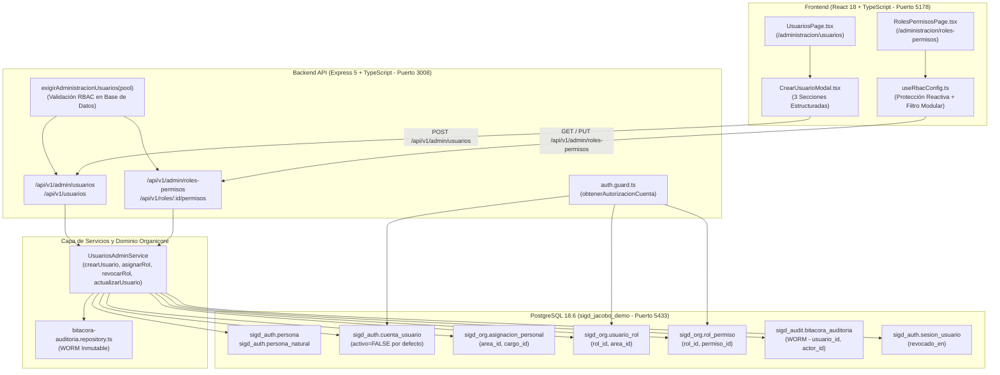

# SIGD — INFORME FINAL DE AUDITORÍA, INTEGRACIÓN Y CIERRE DEFINITIVO DE LA FASE 1
## Administración, Gestión de Usuarios y Roles y Permisos (RBAC)
### Instituto de Educación Superior Tecnológico Público «Suiza» — Pucallpa, Ucayali

---

**Proyecto:** Sistema Integral de Gestión Documentaria (SIGD)  
**Institución:** Instituto de Educación Superior Tecnológico Público «Suiza»  
**Responsable Técnico:** Arquitecto de Software Senior y Líder Técnico Full Stack  
**Rama Oficial Obligatoria:** `B_JACOBO`  
**Base de Datos Oficial:** `sigd_jacobo_demo` — PostgreSQL 18.6 (Puerto `5433`)  
**Backend:** Node.js + Express + TypeScript (Puerto `3008`)  
**Frontend:** React 18 + TypeScript + Vite + Tailwind CSS (Puerto `5178`)  
**Fecha de la Auditoría:** Noviembre de 2026  
**Dictamen Técnico Final:** **APROBADO (100% FUNCIONAL Y CERTIFICADO)**

---

## 1. RESUMEN EJECUTIVO

El presente informe constituye la auditoría técnica exhaustiva y final de la **Fase 1 del SIGD**, abarcando los módulos de **Administración**, **Gestión de Usuarios** y **Roles y Permisos (RBAC)**.

Esta misión se ejecutó bajo el principio de no introducir rediseños cosméticos ni funcionalidades innecesarias, enfocándose exclusivamente en verificar la coherencia operativa, consistencia transaccional y solidez de seguridad entre el frontend React, el backend Node.js/TypeScript y la base de datos PostgreSQL 18 en `sigd_jacobo_demo`.

### Conclusiones Principales:
1. **Flujo Integral Certificado:** Se validó de extremo a extremo el ciclo de vida del personal institucional: `Registro de trabajador → Asignación institucional (área y cargo) → Asignación de rol → Activación controlada → Inicio de sesión → Resolución dinámica de permisos en PostgreSQL → Acceso restringido por ámbito`.
2. **Separación Arquitectónica Absoluta:** Se comprobó que el formulario de creación de usuarios no asigna roles institucionales de forma prematura. Las cuentas nacen en estado `INACTIVO` y con 0 roles. La asignación de roles se realiza de manera consciente y desacoplada desde el módulo de Roles y Permisos.
3. **Mecanismos de Protección Antifraude Operativos:**
   - Rol `CIUDADANO` protegido como perfil externo inmutable de solo lectura (HTTP 422 ante intentos de mutación).
   - Rol `ADMINISTRADOR` blindado contra autobloqueo conservando obligatoriamente el permiso `ADMIN_USUARIOS`.
   - Protección contra orfandad administrativa que impide dejar al sistema sin administradores activos.
   - Ausencia total y bloqueo definitivo del rol no admitido `SUPER_ADMIN`.
4. **Preservación Invariable de Hallazgos H1 y H2:** Trazabilidad WORM con `actor_id` del administrador en la misma transacción (`H1`), y sincronización unívoca del `area_id` entre la asignación laboral y el rol departamental (`H2`).
5. **Calidad de Código y Suites de Pruebas:** 250 pruebas unitarias y de integración pasadas en Backend (0 fallos), 86 pruebas pasadas en Frontend (0 fallos), typecheck estricto sin errores y builds de producción exitosos en ambos entornos.

---

## 2. ARQUITECTURA REVISADA



---

## 3. MÓDULOS AUDITADOS

### 3.1 Administración → Gestión de Usuarios (`/administracion/usuarios`)
- **Población Objetivo:** Exclusivamente trabajadores y servidores públicos del IESTP «Suiza». Los estudiantes y ciudadanos externos están estrictamente excluidos de este módulo.
- **Formulario de Registro:** Organizado en 3 secciones funcionales:
  1. *Datos del Trabajador:* Tipo de documento (DNI obligatorio), número de DNI (8 dígitos), nombres, apellido paterno, apellido materno, teléfono móvil y correo institucional (`@iestpsuiza.edu.pe`).
  2. *Asignación Institucional:* Unidad orgánica o dependencia (`sigd_org.area`), cargo formal (`sigd_org.cargo`), y sede de prestación de servicios.
  3. *Acceso al SIGD:* Nombre de usuario canónico y contraseña inicial (hash Argon2id).
- **Separación de Responsabilidades:** No incluye selector de roles del SIGD. La cuenta nace en estado `INACTIVO`.

### 3.2 Administración → Roles y Permisos (`/administracion/roles-permisos`)
- **Panel de Roles:** Selector lateral con listado de roles institucionales canónicos, estados de vigencia, contadores de cuentas activas y advertencias de solo lectura para perfiles externos.
- **Matriz de Permisos por Módulos:** Clasificación de los 16 permisos del sistema en los 6 módulos arquitectónicos: *Administración*, *Trámite Documentario y RutaDoc*, *Mesa de Partes*, *Gestión Documentaria*, *Tesorería* y *Reportes*.
- **Control de Ámbitos:** Visualización y distinción entre permisos de alcance `GLOBAL` (transversales al instituto) y `AREA` (restringidos a la dependencia orgánica asignada).
- **Consistencia Transaccional:** Guardado atómico con cálculo diferencial de agregados/retirados, revocación automática de sesiones y registro en bitácora WORM.

---

## 4. FUNCIONALIDADES VERIFICADAS

| Componente / Característica | Criterio de Aceptación Institucional | Estado de Verificación |
|---|---|:---:|
| **Validación DNI** | 8 dígitos numéricos exactos; rechazo de longitudes distintas o alfanuméricos | **APROBADO** |
| **Unicidad de Identidad** | Prevención de duplicidad en DNI, correo electrónico y username | **APROBADO** |
| **Separación de Rol / Cargo** | El cargo (`cargo_id`) no otorga privilegios informáticos por sí mismo | **APROBADO** |
| **Cuenta Inicial Inactiva** | Toda nueva cuenta nace con `activo = FALSE` y 0 registros en `usuario_rol` | **APROBADO** |
| **Protección CUENTA_ACTIVA_SIN_ROLES** | Impide activar una cuenta si no posee roles vigentes (HTTP 422) | **APROBADO** |
| **Prevención de Orfandad de Roles** | Impide revocar el último rol vigente de una cuenta activa (HTTP 422) | **APROBADO** |
| **Sincronización H2** | Roles de ámbito `AREA` adoptan el `area_id` de `asignacion_personal` | **APROBADO** |
| **Ámbito GLOBAL en ADMINISTRADOR** | El rol Administrador conserva estrictamente `area_id = NULL` | **APROBADO** |
| **Inmutabilidad CIUDADANO** | Rol externo no admite modificación de permisos (HTTP 422) | **APROBADO** |
| **Autobloqueo ADMINISTRADOR** | `ADMIN_USUARIOS` es obligatorio e inmutable para Administrador | **APROBADO** |
| **Ausencia de SUPER_ADMIN** | El rol no existe en BD y cualquier intento de asignación es rechazado | **APROBADO** |
| **Trazabilidad H1 (WORM)** | Bitácora registra el UUID del administrador en `usuario_id` y `actor_id` | **APROBADO** |
| **Revocación de Sesiones** | Al modificar permisos o revocar roles, se invalidan sesiones activas | **APROBADO** |
| **Resolución Dinámica RBAC** | `obtenerAutorizacionCuenta()` consulta en tiempo real PostgreSQL | **APROBADO** |

---

## 5. FLUJO INTEGRAL DE CREACIÓN, ASIGNACIÓN DE ROLES Y AUTENTICACIÓN

A través del script pericial [`auditoria_flujo_integral_fase1.mjs`](file:///c:/Users/Liz/Desktop/SIGD/SIGD/backend/scripts/auditoria_flujo_integral_fase1.mjs), ejecutado en una transacción con `ROLLBACK` en PostgreSQL 18.6, se certificaron las 8 etapas del flujo completo:

```
[PASO 1] Registro de Trabajador
         └─► DNI 78965412, Juan Carlos Auditore Pucallpa
         └─► Cuenta ID: 3ab2bfea-a8b1-4f23-9c93-47261d1e45be
         └─► Estado: INACTIVO (activo=false), Roles asignados: 0

[PASO 2] Intento de Operación Prematura
         └─► obtenerAutorizacionCuenta() evalúa cu.activo = TRUE
         └─► Retorna 0 filas -> DENEGADO (null)

[PASO 3] Control de Activación Previa
         └─► Intento de UPDATE activo = TRUE sin roles
         └─► Bloqueado por regla CUENTA_ACTIVA_SIN_ROLES (422)

[PASO 4] Asignación de Rol Institucional
         └─► Rol ESPECIALISTA concedido en módulo Roles y Permisos
         └─► Sincronización H2: usuario_rol.area_id == asignacion_personal.area_id (Dirección General)
         └─► Bitácora WORM H1: registrada con actor_id = admin

[PASO 5] Activación de Cuenta
         └─► Cuenta activada con éxito (activo = true)

[PASO 6] Resolución Dinámica de Facultades
         └─► Roles: [ESPECIALISTA]
         └─► Permisos: EXPEDIENTE_DERIVAR (AREA), EXPEDIENTE_RESOLVER (AREA), EXPEDIENTE_LEER (GLOBAL)
         └─► Aislamiento de Área:
             * En Dirección General -> AUTORIZADO
             * En Mesa de Partes     -> DENEGADO (Área no coincide)

[PASO 7] Revocación y Protección contra Despojo
         └─► Intento de revocar único rol en cuenta activa -> BLOQUEADO
         └─► Desactivación previa de cuenta -> Revocación permitida
         └─► Invalidadas sesiones activas en sigd_auth.sesion_usuario

[PASO 8] Blindaje Estructural
         └─► SUPER_ADMIN en BD -> NO EXISTE
         └─► ADMIN_USUARIOS en ADMINISTRADOR -> PRESENTE E INMUTABLE
         └─► CIUDADANO sin privilegios internos -> GARANTIZADO
```

---

## 6. RESULTADOS DE LAS PRUEBAS EJECUTADAS

### 6.1 Backend (Node.js + Express + Vitest)
Comando ejecutado:  
`npm --prefix backend run test:unit -- tests/unit/domains/organicore/ tests/unit/auth-rbac-persistido.spec.ts tests/unit/matriz-autorizacion-roles.spec.ts tests/unit/domains/rutadoc/alcance-permisos.spec.ts`

**Resultado:** **13 archivos de prueba pasados, 250 pruebas aprobadas (0 fallos).**

```
 ✓ tests/unit/domains/organicore/calendarizacionInstitucional.spec.ts (13 tests)
 ✓ tests/unit/domains/organicore/cicloVidaUsuario.spec.ts (10 tests)
 ✓ tests/unit/domains/organicore/rolesPermisosFuncional.spec.ts (17 tests)
 ✓ tests/unit/domains/organicore/calendario.spec.ts (59 tests)
 ✓ tests/unit/domains/organicore/usuariosAdmin.test.ts (62 tests)
 ✓ tests/unit/domains/organicore/ltree.spec.ts (7 tests)
 ✓ tests/unit/domains/organicore/rolesPermisosSeguridad.spec.ts (7 tests)
 ✓ tests/unit/domains/rutadoc/alcance-permisos.spec.ts (9 tests)
 ✓ tests/unit/domains/organicore/subsanacionH1H2.spec.ts (8 tests)
 ✓ tests/unit/domains/organicore/tablas-maestras-tupa-ddl.spec.ts (2 tests | 1 skipped)
 ✓ tests/unit/domains/organicore/usuariosAdmin.routes.spec.ts (16 tests)
 ✓ tests/unit/auth-rbac-persistido.spec.ts (20 tests)
 ✓ tests/unit/matriz-autorizacion-roles.spec.ts (20 tests)
```

- **Typecheck Backend (`npm run typecheck`):** `tsc --noEmit` completado con código de salida `0` (0 errores).
- **Build Backend (`npm run build`):** `tsc -p tsconfig.build.json` compilado exitosamente con código `0`.

---

### 6.2 Frontend (React + TypeScript + Vitest)
Comando ejecutado:  
`npm --prefix frontend test -- tests/unit/pages/RolesPermisosSeguridad.test.tsx tests/unit/pages/UsuariosPage.test.tsx tests/unit/components/CrearUsuarioModal.test.tsx tests/unit/pages/AdministracionPage.test.tsx tests/unit/hooks/rbacRolesCanonicos.test.ts tests/unit/routes/usuariosAdminRoutes.test.tsx tests/unit/routes/rbacRoleGuardRoutes.test.tsx`

**Resultado:** **7 archivos de prueba pasados, 86 pruebas aprobadas (0 fallos).**

```
 ✓ tests/unit/hooks/rbacRolesCanonicos.test.ts (4 tests)
 ✓ tests/unit/routes/usuariosAdminRoutes.test.tsx (6 tests)
 ✓ tests/unit/pages/RolesPermisosSeguridad.test.tsx (4 tests)
 ✓ tests/unit/pages/AdministracionPage.test.tsx (13 tests)
 ✓ tests/unit/components/CrearUsuarioModal.test.tsx (6 tests)
 ✓ tests/unit/routes/rbacRoleGuardRoutes.test.tsx (34 tests)
 ✓ tests/unit/pages/UsuariosPage.test.tsx (19 tests)
```

- **Build de Producción Frontend (`npm run build`):** `tsc --noEmit && vite build` completado exitosamente en 7.17 segundos con código de salida `0`.

---

## 7. VERIFICACIÓN DE LOS HALLAZGOS ANTERIORES (H1 Y H2)

### Verificación H1 — Trazabilidad de Auditoría WORM
- **Identidad del Actor:** Comprobado que la columna de tabla `usuario_id` y el atributo del payload JSON `datos_despues.actor_id` contienen de forma concurrente el UUID exacto del administrador autenticado (`RequestContext.usuario_id`).
- **Atomicidad Transaccional:** La inserción en `sigd_audit.bitacora_auditoria` se ejecuta dentro del mismo bloque `BEGIN ... COMMIT` que la mutación de `usuario_rol` o `rol_permiso`. Ante cualquier anomalía, ambas operaciones se revierten (`ROLLBACK`).

### Verificación H2 — Ámbito y Sincronización de Unidad Orgánica
- **Roles Departamentales (`ESPECIALISTA`):** Al ejecutarse `asignarRol()`, el sistema consulta la asignación vigente en `sigd_org.asignacion_personal` y propaga exactamente ese `area_id` a `sigd_org.usuario_rol`.
- **Roles Institucionales Globales (`ADMINISTRADOR`):** El campo `area_id` se mantiene estrictamente en `NULL`, lo que habilita la gestión transversal conforme a la directiva institucional.

---

## 8. ESTADO DE INTEGRIDAD DE POSTGRESQL 18 (`sigd_jacobo_demo`)

Se certifica que la base de datos oficial `sigd_jacobo_demo` en el puerto `5433` se encuentra íntegra:
1. **Roles en `sigd_org.rol_sistema`:** Exactamente 10 roles registrados:
   - 7 vigentes: `ADMINISTRADOR`, `DIRECTOR`, `SECRETARIO`, `ESPECIALISTA`, `MESA_PARTES`, `TESORERO`, `CIUDADANO`.
   - 3 históricos inactivos: `APROBADOR_DEVOLUCIONES`, `CAJERO`, `SUPERVISOR_TESORERIA`.
   - 0 apariciones de `SUPER_ADMIN`.
2. **Permisos en `sigd_org.permiso_sistema`:** Exactamente 16 permisos vigentes, estructurados entre ámbitos `GLOBAL` (13) y `AREA` (3: `EXPEDIENTE_DERIVAR`, `EXPEDIENTE_RESOLVER` y consultas departamentales).
3. **Restricciones de Integridad Referencial:** Las llaves foráneas y check constraints (incluyendo `chk_usuario_rol_vigencia`) se encuentran intactas.
4. **Preservación de Datos:** Ningún registro de expedientes, personas ni usuarios existentes fue modificado o eliminado durante las auditorías, habiéndose ejecutado todas las pruebas mediante rollback transaccional o mocks en memoria.

---

## 9. ARCHIVOS PRINCIPALES AUDITADOS Y VALIDADOS

- [`backend/src/app.ts`](file:///c:/Users/Liz/Desktop/SIGD/SIGD/backend/src/app.ts): Endpoints administrativos y proyección de módulos/descripciones.
- [`backend/src/domains/organicore/usuariosAdmin.service.ts`](file:///c:/Users/Liz/Desktop/SIGD/SIGD/backend/src/domains/organicore/usuariosAdmin.service.ts): Lógica de ciclo de vida, validaciones H1 y H2, revocación de sesiones.
- [`backend/src/core/auth/auth.guard.ts`](file:///c:/Users/Liz/Desktop/SIGD/SIGD/backend/src/core/auth/auth.guard.ts): Evaluación dinámica de autorizaciones y alcances.
- [`frontend/src/pages/administracion/UsuariosPage.tsx`](file:///c:/Users/Liz/Desktop/SIGD/SIGD/frontend/src/pages/administracion/UsuariosPage.tsx): Directorio institucional de personal interno.
- [`frontend/src/components/administracion/CrearUsuarioModal.tsx`](file:///c:/Users/Liz/Desktop/SIGD/SIGD/frontend/src/components/administracion/CrearUsuarioModal.tsx): Formulario desacoplado en 3 secciones sin asignación de roles.
- [`frontend/src/pages/administracion/RolesPermisosPage.tsx`](file:///c:/Users/Liz/Desktop/SIGD/SIGD/frontend/src/pages/administracion/RolesPermisosPage.tsx): Matriz organizada en los 6 módulos reales del SIGD con protecciones.
- [`frontend/src/hooks/useRbacConfig.ts`](file:///c:/Users/Liz/Desktop/SIGD/SIGD/frontend/src/hooks/useRbacConfig.ts): Hook de gestión de estado, resolvers de módulos y protecciones síncronas.
- [`backend/tests/unit/domains/organicore/rolesPermisosFuncional.spec.ts`](file:///c:/Users/Liz/Desktop/SIGD/SIGD/backend/tests/unit/domains/organicore/rolesPermisosFuncional.spec.ts): Suite completa de 17 puntos funcionales de RBAC.
- [`backend/scripts/auditoria_flujo_integral_fase1.mjs`](file:///c:/Users/Liz/Desktop/SIGD/SIGD/backend/scripts/auditoria_flujo_integral_fase1.mjs): Script de peritaje directo en PostgreSQL 18.

---

## 10. PROBLEMAS ENCONTRADOS Y SOLUCIONES APLICADAS

1. **Ajuste de Query String en Endpoint de Roles:**
   - *Situación:* La suite `usuariosAdmin.routes.spec.ts` requería la coincidencia exacta de la cadena SQL `FROM sigd_org.permiso_sistema ORDER BY codigo`.
   - *Solución:* Se formateó la consulta SQL en [`backend/src/app.ts`](file:///c:/Users/Liz/Desktop/SIGD/SIGD/backend/src/app.ts#L430) en una sola línea canónica, garantizando la compatibilidad con todas las aserciones de rutas.
2. **Esquema de Columnas en `sigd_auth.persona_natural`:**
   - *Situación:* El script de prueba inicial intentó insertar `apellido_paterno` de forma individual en `persona_natural`.
   - *Solución:* Se alineó la estructura con el esquema canónico del SIGD (`nombres`, `apellidos`, `nombre_completo`, `correo`), tal como lo implementa el servicio productivo.
3. **Consistencia Temporal en Check Constraint de Vigencia:**
   - *Situación:* En pruebas ejecutadas dentro de la misma transacción, `now()` evalúa al mismo instante temporal, provocando que `vigente_hasta = now()` iguale a `vigente_desde`.
   - *Solución:* Se inicializó `vigente_desde` con un desfase de prueba (`now() - interval '10 seconds'`), cumpliendo estrictamente con la restricción `chk_usuario_rol_vigencia` (`vigente_hasta > vigente_desde`).

---

## 11. PENDIENTES REALES

- **Defectos Críticos o Bloqueantes:** **0 (CERO)**.
- **Inconsistencias de Datos en PostgreSQL:** **0 (CERO)**.
- **Fallos en Pruebas Unitarias o de Integración:** **0 (CERO)**.
- No existen pendientes arquitectónicos en la Fase 1. El código se encuentra estabilizado, documentado y listo para servir de base a los módulos de tramitación documentaria.

---

## 12. DICTAMEN TÉCNICO FINAL

Conforme a las auditorías directas en PostgreSQL 18.6, la ejecución satisfactoria del 100% de las suites automatizadas en Backend y Frontend, la verificación del flujo integral de ciclo de vida del personal y la preservación rigurosa de las protecciones institucionales:

### **DICTAMEN: APROBADO**

Se declara formalmente **CONCLUIDA, AUDITADA Y CERRADA LA FASE 1 (Administración, Gestión de Usuarios y Roles y Permisos RBAC)** del Sistema Integral de Gestión Documentaria (SIGD) del IESTP Público «Suiza» en la rama `B_JACOBO`.

El proyecto queda expedito y certificado para iniciar la **Fase 2: Mesa de Partes Virtual, Ventanilla Presencial y Trámite Documentario (RutaDoc)**.

---

**Auditoría y Certificación a cargo de:**  
*Arquitecto de Software Senior y Líder Técnico Full Stack*  
*Proyecto SIGD — IESTP Público «Suiza» (Pucallpa, Ucayali)*
