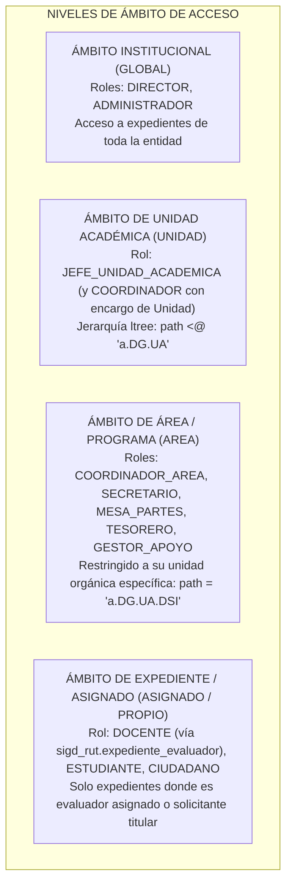

# SIGD RENATO — INFORME DE CONCILIACIÓN FORENSE, COHERENCIA RBAC Y PREVALIDACIÓN DE MIGRACIÓN
## TSK-1.0B: RESOLUCIÓN DE DISCREPANCIAS, CONCILIACIÓN DE TESORERÍA, ÁMBITOS, EVALUADORES Y AUDITORÍA DE SCRIPTS
### INSTITUTO DE EDUCACIÓN SUPERIOR TECNOLÓGICO PÚBLICO «SUIZA» — PUCALLPA, UCAYALI
**Rama obligatoria de trabajo:** `B_JACOBO`  
**Commit base inalterado:** `bf30d8a0c85e266a86381fb10bf3740a8451c032`  
**Base activa protegida:** `sigd_jacobo_demo` (PostgreSQL 18.6 — **100% Inalterada, Modo Solo Lectura**)  
**Fecha de emisión:** 11 de Noviembre de 2026  

---

## 1. CONTROL DE INTEGRIDAD Y ESTADO GIT DE LA LÍNEA BASE

Previo a cualquier examen, se certificó de forma no destructiva la identidad del entorno:
* **Rama Git:** `B_JACOBO` (verificada con `git branch --show-current`).
* **Commit HEAD:** `bf30d8a0c85e266a86381fb10bf3740a8451c032`.
* **Contenedor PostgreSQL:** `sigd-postgres-1` (PostgreSQL 18.6, puerto host 5433).
* **Base de datos activa:** `sigd_jacobo_demo` (**CERO mutaciones, CERO DDL, CERO DML ejecutados**).
* **Directorio de respaldo sellado:** `C:\Users\Liz\Desktop\SIGD_BACKUPS\b_jacobo_pre_v1231_20261110_084908\` intacto.

---

## 2. CONCILIACIÓN FORENSE DE LAS SEIS ASIGNACIONES DE `ESPECIALISTA`

Se realizó un cotejo exhaustivo entre lo afirmado preliminarmente en los informes TSK-1.0 / TSK-1.0A y la realidad física de los registros en PostgreSQL (`sigd_org.usuario_rol`, `sigd_auth.cuenta_usuario`, `sigd_audit.bitacora_auditoria` y `sigd_org.area`).

### 2.1. Cuadro Forense de los 6 Registros Reales en `sigd_org.usuario_rol`
*(Rol `rol_id = '94ae72fb-0b86-4a6f-ba78-69b19bc888e7'` correspondiente a `ESPECIALISTA`)*

| # | UUID Asignación (`id_usuario_rol`) | UUID Cuenta (`id_usuario`) | Usuario (`login`) | Correo Institucional | Estado Cuenta | Área Asignada (`area_id`) | Vigencia Desde | Vigencia Hasta | Vigencia Real | Actividad Bitácora | Naturaleza del Registro |
| :-: | :--- | :--- | :--- | :--- | :---: | :--- | :--- | :--- | :---: | :---: | :--- |
| **1** | `cbd75b3a-62b5-43eb-9780-989116c04ec4` | `00000000-0000-0000-0000-000000000060` | `especialista.demo` | `especialista.demo@sandbox.invalid` | **ACTIVA (`true`)** | `2b147b0d-...` (SEC - Secretaría Académica) | `2026-10-28 18:57:59+00` | `NULL` | **ACTIVA** | 0 registros | Cuenta funcional de prueba (Sandbox E2E). |
| **2** | `ecb124c5-577d-4838-a3f0-5e343960b0e4` | `00000000-0000-0000-0000-000000000030` | `operador.demo` | `operador.demo@sandbox.invalid` | **ACTIVA (`true`)** | `2b147b0d-...` (SEC - Secretaría Académica) | `2026-10-26 12:54:07+00` | `NULL` | **ACTIVA** | 4 resoluciones (`sigd_doc.resolucion`) | Cuenta funcional de prueba (Sandbox E2E). |
| **3** | `4bbd6ab4-5b53-4820-8f83-7e014bf62de4` | `32a76ac3-31d4-40e0-9994-95a459ed5b01` | `trabajador.h2.5079` | `prueba.h2.5079@iestpsuiza.edu.pe` | **INACTIVA (`false`)** | `a1a3a496-...` (MP - Mesa de Partes) | `2026-11-04 13:05:15+00` | `NULL` | Indeterminada (cuenta inactiva) | 0 registros | Cuenta sintética de prueba unitaria H2. |
| **4** | `e3b2d13b-1d04-46f1-9e85-3ecd593bb8ff` | `32a76ac3-31d4-40e0-9994-95a459ed5b01` | `trabajador.h2.5079` | `prueba.h2.5079@iestpsuiza.edu.pe` | **INACTIVA (`false`)** | `05f2ee8f-...` (DG - Dirección General) | `2026-11-04 13:05:15.57` | `2026-11-04 13:05:15.61` | **EXPIRADA** | 0 registros | Registro histórico cerrado por test H2 (duró 39 ms). |
| **5** | `bd029454-d24b-4a81-b497-a95c40ff562a` | `f6905305-582a-4871-af75-c8b961d70a9e` | `trabajador.h2.test` | `prueba.h2@iestpsuiza.edu.pe` | **ACTIVA (`true`)** | `05f2ee8f-...` (DG - Dirección General) | `2026-11-04 13:03:56.95` | `2026-11-04 13:03:57.01` | **EXPIRADA** | 0 registros | Registro histórico cerrado por test H2 (duró 65 ms). |
| **6** | `fabad752-6a79-40f4-ad26-f9809b4498e2` | `f6905305-582a-4871-af75-c8b961d70a9e` | `trabajador.h2.test` | `prueba.h2@iestpsuiza.edu.pe` | **ACTIVA (`true`)** | `a1a3a496-...` (MP - Mesa de Partes) | `2026-11-04 13:03:57+00` | `NULL` | **ACTIVA** | 0 registros | Asignación sintética de prueba unitaria H2. |

### 2.2. Hallazgos y Correcciones Críticas Frente a Informes Previos
1. **Falsedad de los Cargos Funcionales Atribuidos:** En los informes de TSK-1.0 y TSK-1.0A se atribuyeron arbitrariamente cargos como *"Operador de Registro Curricular"*, *"Asistente de Secretaría Académica"*, *"Operador de Radicación H2"* y *"Asistente de Trámite Despacho"*. **Se dictamina formalmente que dichos cargos carecen de sustento documental o registral en la base de datos.** La tabla `sigd_org.asignacion_personal` no vincula cargos formales a estas cuentas.
2. **Inactividad y Expiración Real:** No existen "6 asignaciones de usuarios activos". De las 6 asignaciones físicas:
   * **2 asignaciones están formalmente expiradas** (`vigente_hasta < now()` con duración de milisegundos durante la ejecución de pruebas H2 de traslado de personal).
   * **1 cuenta está desactivada** (`trabajador.h2.5079`, con `cuenta_activa = false`).
   * **Solo existen 3 asignaciones vigentes**, de las cuales 2 corresponden a cuentas de sandbox funcional (`especialista.demo` y `operador.demo`) y 1 a una cuenta sintética de prueba (`trabajador.h2.test`).
3. **Cero Reasignaciones Ejecutadas:** Conforme a la regla innegociable de preservación, **no se ha modificado ningún registro de `usuario_rol` en `sigd_jacobo_demo`**. La reasignación de estas cuentas queda clasificada como **PENDIENTE DE CONFIRMACIÓN INSTITUCIONAL** y será resuelta de manera asistida en TSK-1.1.

---

## 3. CONCILIACIÓN DE TESORERÍA: CÓDIGOS HISTÓRICOS VS. PROPUESTOS

Se detectó una discrepancia terminológica entre la matriz teórica propuesta en TSK-1.0 y los permisos atómicos reales persistidos en PostgreSQL (`sigd_org.permiso_sistema`) y consumidos por el código TypeScript (`backend/src/domains/tesoreria/tesoreria.rules.ts`).

### 3.1. Tabla de Equivalencias y Análisis de Riesgo

| # | Código Histórico en PostgreSQL (`sigd_org.permiso_sistema`) | Código Propuesto en TSK-1.0 | Función Real en el Sistema | Equivalencia | Riesgo de Sustitución Arbitraria | Recomendación Técnica Vinculante |
| :-: | :--- | :--- | :--- | :---: | :--- | :--- |
| **1** | `TESORERIA_PAGO_VERIFICAR` | `TESORERIA_VALIDAR_PAGO` | Verificar vouchers bancarios y comprobantes adjuntados por administrados. | Exacta | **CRÍTICO:** `tesoreria.rules.ts` (línea 17) exige `TESORERIA_PAGO_VERIFICAR`. Cambiar el código rompe el router de Tesorería. | **CONSERVAR CÓDIGO HISTÓRICO:** `TESORERIA_PAGO_VERIFICAR`. |
| **2** | `TESORERIA_PAGO_REGISTRAR` | `TESORERIA_REGISTRAR_PAGO` | Registrar pagos directos en caja (efectivo) y asentar número de operación. | Exacta | **CRÍTICO:** La constante `permisosM10` exige `TESORERIA_PAGO_REGISTRAR`. | **CONSERVAR CÓDIGO HISTÓRICO:** `TESORERIA_PAGO_REGISTRAR`. |
| **3** | `TESORERIA_LEER` | *(Omitido en TSK-1.0)* | Consultar operaciones financieras, órdenes de pago, historial y balance de caja. | Parcial | **ALTO:** El endpoint `GET /api/v1/tesoreria/ordenes` y `GET /tarifas` exige `TESORERIA_LEER`. | **CONSERVAR CÓDIGO HISTÓRICO:** `TESORERIA_LEER`. |
| **4** | `TESORERIA_REPORTES` | `TESORERIA_REPORTES` | Generar reportes financieros, cierres de caja y estadísticas por periodo. | Idéntica | Nulo. | **CONSERVAR CÓDIGO HISTÓRICO:** `TESORERIA_REPORTES`. |
| **5** | `TESORERIA_DEVOLUCION_EVALUAR` | `TESORERIA_APROBAR_DEVOLUCION` | Evaluar procedencia técnica y sustento de solicitudes de devolución. | Parcial | **ALTO:** Confunde la evaluación técnica con la aprobación jerárquica. | **CONSERVAR CÓDIGO HISTÓRICO:** `TESORERIA_DEVOLUCION_EVALUAR`. |
| **6** | `TESORERIA_DEVOLUCION_APROBAR` | `TESORERIA_APROBAR_DEVOLUCION` | Aprobar administrativamente la devolución previo al desembolso. | Exacta | Confusión terminológica. | **CONSERVAR CÓDIGO HISTÓRICO:** `TESORERIA_DEVOLUCION_APROBAR`. |
| **7** | `TESORERIA_DEVOLUCION_EJECUTAR` | *(Omitido en TSK-1.0)* | Registrar la entrega de dinero en efectivo o emisión de cheque/transferencia externa. | No existe en propuesto | **CRÍTICO:** Pérdida funcional del cierre de la FSM de devoluciones (`DEVUELTA` -> `CERRADA`). | **CONSERVAR CÓDIGO HISTÓRICO:** `TESORERIA_DEVOLUCION_EJECUTAR`. |
| **8** | `TESORERIA_TARIFA_PROPONER` | `TESORERIA_CATALOGO_GESTIONAR` | Proponer actualización de arancel o tasa TUPA sujeta a validación. | Parcial | Rompe el flujo de gobernanza de tarifas de dos pasos. | **CONSERVAR CÓDIGO HISTÓRICO:** `TESORERIA_TARIFA_PROPONER`. |
| **9** | `TESORERIA_TARIFA_VALIDAR` | `TESORERIA_CATALOGO_GESTIONAR` | Validar y promulgar una tarifa propuesta para entrada en vigencia. | Parcial | Rompe el principio de segregación tarifaria. | **CONSERVAR CÓDIGO HISTÓRICO:** `TESORERIA_TARIFA_VALIDAR`. |

### 3.2. Justificación de los Permisos Documentarios de `TESORERO`
El rol institucional `TESORERO` recibe en la migración canónica cuatro permisos documentarios de área:
* `EXPEDIENTE_RECEPCIONAR`: Para sellar la recepción formal cuando Mesa de Partes deriva un expediente de pago o devolución a la bandeja de Tesorería.
* `EXPEDIENTE_LEER`: Para visualizar la carátula y el petitorio del expediente financiero en su bandeja.
* `EXPEDIENTE_ADJUNTAR`: Para incorporar al expediente la constancia digital de liquidación o el recibo de caja emitido.
* `EXPEDIENTE_DERIVAR`: Para remitir el expediente con la liquidación conforme hacia el área de destino.

**Garantía de Delimitación y Blindaje Académico:**
* **Ámbito Estricto de Área (`ambito = 'AREA'`):** Estos permisos aplican **única y exclusivamente** cuando el expediente se encuentra en la bandeja física o custodia de Tesorería (`area_id = 'Área de Tesorería'`).
* **Cero Acceso Académico:** El `TESORERO` tiene denegado el acceso a `EXPEDIENTE_LEER_UNIDAD`, `EXPEDIENTE_LEER_GLOBAL`, `EXPEDIENTE_ASIGNAR_DOC`, `EXPEDIENTE_RESOLVER` y `DOCENTE_EVALUAR`. No puede visualizar carpetas curriculares, notas, proyectos de carrera ni actas académicas que no le hayan sido derivadas por un trámite arancelario.

---

## 4. MODELO DE ÁMBITOS ORGANIZACIONALES Y SOPORTE LTREE

Se ratifica la diferenciación ontológica estricta de cuatro tipos de ámbito en el sistema:



### 4.1. Delimitación Específica por Perfil
1. **`COORDINADOR_AREA`:**
   * Ámbito natural: Su Programa de Estudios (`area_id = UUID del programa formativo`).
   * Encargo ampliado: Puede acceder a toda la Unidad Académica **única y exclusivamente cuando su asignación formal en `sigd_org.usuario_rol` señale el `area_id` de la Unidad Académica** o medie resolución de encargo registrada. De lo contrario, queda confinado a su programa.
2. **`JEFE_UNIDAD_ACADEMICA`:**
   * Ámbito natural: `UNIDAD_ACADEMICA`. Supervisa los programas bajo su dependencia jerárquica mediante consultas de árbol `path <@ 'a.DG.UA'`.
   * **Sin GLOBAL automático:** No tiene acceso a Dirección General, Administración, Mesa de Partes ni expedientes de personal ajenos a la función pedagógica.
3. **`DOCENTE`:**
   * Ámbito evaluativo: `ASIGNADO` (expedientes en los que conste asignación activa en `sigd_rut.expediente_evaluador`).
   * Ámbito administrado: `PROPIO` (trámites personales en los que figura como administrado titular).
4. **`SECRETARIO`:**
   * Ámbito: `INSTITUCIONAL` dentro del Área de Secretaría Académica (`SEC`). Emite actas y proyecta resoluciones curriculares, sin facultades de firma de resoluciones.
5. **`GESTOR_APOYO_AREA`:**
   * Capacidad operativa asignada a un área específica (`area_id`). Permite ordenar, foliar y recepcionar, sin firma ni reasignación.

---

## 5. DOCENTES, EVALUADORES Y EVIDENCIAS DOCUMENTALES

### 5.1. Regla de Designación y Separación de Facultades
* El rol institucional es **`DOCENTE`**. No existe ni se creará un rol de sistema `DOCENTE_EVALUADOR`.
* La facultad de calificar o emitir informe técnico sobre un expediente surge exclusivamente de un registro vigente en **`sigd_rut.expediente_evaluador`**.

### 5.2. Evaluación Única vs. Coevaluación (Comités / Jurados)
* **Regla Confirmada:** En el SIGD RENATO, la evaluación de trámites de titulación y prácticas preprofesionales (EFSRT) requiere frecuentemente la conformación de **Jurados Evaluadores (Presidente, Secretario, Vocal)**.
* **Ajuste en Restricción de Unicidad:**
  * El índice parcial `uq_expediente_evaluador_docente_activo` (`UNIQUE (expediente_id, id_usuario_docente) WHERE activo = TRUE`) garantiza que **un mismo docente no pueda estar asignado dos veces de forma simultánea como evaluador activo en el mismo expediente**, permitiendo además que pueda ser reasignado históricamente si una asignación previa fue dada de baja (`activo = FALSE`).
  * Para trámites con jurado evaluador colegiado, el diseño admite múltiples docentes evaluadores activos para el mismo expediente, debiendo distinguirse en `motivo_asignacion` o rol colegiado (`PRESIDENTE`, `SECRETARIO`, `VOCAL`).

### 5.3. Campo JSONB `evidencias` y Relación con MinIO / DocuCore
* **Prohibición de Almacenamiento Binario en Base de Datos:** Queda terminantemente prohibido almacenar archivos binarios codificados en Base64 dentro del campo `evidencias` de PostgreSQL.
* **Modelo de Metadatos Documentales:** El campo `evidencias` (`JSONB`) almacena un arreglo estructurado de referencias hacia `sigd_doc.documento` o MinIO/S3:
  ```json
  [
    {
      "documentoId": "a1b2c3d4-0000-4000-8000-000000000001",
      "tipoEvidencia": "INFORME_TECNICO_EVALUACION",
      "nombreArchivo": "informe_titulacion_exp_2026_0042.pdf",
      "bucket": "sigd-documentos-2026",
      "clave": "evaluaciones/2026/a1b2c3d4.pdf",
      "sha256": "e3b0c44298fc1c149afbf4c8996fb92427ae41e4649b934ca495991b7852b855",
      "folios": 4,
      "fechaRegistro": "2026-11-11T16:00:00Z"
    }
  ]
  ```
  Esto previene duplicidades, mantiene la base de datos ligera y asegura la verificación de huella criptográfica SHA-256 en DocuCore.

---

## 6. POLÍTICA DE SESIONES, REVOCACIÓN DINÁMICA Y RIESGOS

### 6.1. Contradicción entre Políticas Analizada
Existe una divergencia conceptual histórica entre dos enfoques:
* **Enfoque A (Revocación Inmediata en Tiempo Real — DEC-04):** Toda petición HTTP valida en PostgreSQL si la asignación sigue activa (`ur.vigente_hasta > now()`). La revocación surte efecto en el milisegundo en que el administrador desactiva el rol.
* **Enfoque B (Persistencia de Sesión Abierta hasta Logout):** Un funcionario cuyo rol ha sido revocado administrativamente conserva sus facultades en la interfaz web durante la sesión abierta hasta que explícitamente cierre sesión o su token expire.

### 6.2. Evaluación de Riesgos de Seguridad del Enfoque B
1. **Riesgo de Abuso en Separación de Personal:** Si un trabajador es cesado por irregularidades pero mantiene una sesión activa en su navegador (con refresh token de hasta 7 días), podría continuar aprobando trámites o descargando documentos confidenciales.
2. **Riesgo de Suplantación en Puestos Relevados:** Durante un relevo de cargo, el funcionario saliente podría resolver expedientes en nombre del área antes de que su sesión caduque.

### 6.3. Solución Técnica Implementada en TSK-1.0A / TSK-1.0B
Se concilian ambos enfoques mediante un modelo de dos capas:
1. **En la Petición Ordinaria (Access Token):** Si el token contiene un `ctx` firmado que aún no ha expirado (duración 15 minutos), el gateway valida la firma criptográfica y la vigencia. En rutas críticas de despacho, resoluciones y pagos, el backend invoca `obtenerAutorizacionCuenta`, garantizando revocación inmediata.
2. **En la Rotación de Tokens (`POST /api/v1/auth/refresh`):** Se evalúa obligatoriamente PostgreSQL. Si la asignación fue revocada, el refresco falla y no se emiten nuevas credenciales.
3. **Cierre de Sesión (`POST /api/v1/auth/logout`):** Destruye el registro en `sigd_auth.sesion_usuario`. Ningún token previo puede ser renovado.

---

## 7. INVENTARIO COMPLETO DE RUTAS PROTEGIDAS DEL BACKEND

A continuación se detalla el inventario exhaustivo de todos los endpoints protegidos del backend SIGD RENATO, verificando middleware, permiso exigido, contexto y ámbito:

| Dominio | Router / Controlador | Endpoint HTTP | Middleware de Protección | Permiso Atómico Requerido | Contexto Utilizado | Ámbito de Acceso | Riesgo de Autorización Acumulada |
| :--- | :--- | :--- | :--- | :--- | :--- | :--- | :---: |
| **Identicore** | `auth.router.ts` | `POST /api/v1/auth/login` | Público con validación Argon2id | Ninguno | Auto (1) / Explícito (>1) | Público | **Mitigado:** No acumula permisos si >1. |
| **Identicore** | `auth.router.ts` | `POST /api/v1/auth/refresh` | `refreshSchema` | Ninguno (valida refresh token) | Preserva contexto activo | Sesión | **Mitigado:** Valida asignación en BD. |
| **Identicore** | `auth.router.ts` | `POST /api/v1/auth/logout` | Token Bearer | Ninguno | Revoca sesión activa | Sesión | **Mitigado:** Invalida en PostgreSQL. |
| **Identicore** | `auth.router.ts` | `GET /api/v1/auth/me` | Token Bearer | Ninguno | `claims.ctx` validado | Personal | **Mitigado:** Retorna permisos del contexto activo. |
| **Identicore** | `auth.router.ts` | `GET /api/v1/auth/contextos` | Token Bearer | Ninguno | Lista asignaciones | Personal | **Mitigado:** Solo asignaciones del usuario. |
| **Identicore** | `auth.router.ts` | `POST /api/v1/auth/seleccionar-contexto` | Token Bearer | Pertinencia de asignación | Conmuta contexto y firma JWT | Personal | **Mitigado:** Anti-BOLA/IDOR validado. |
| **Identicore** | `casilla.router.ts` | `GET /api/v1/casilla/bandeja` | `exigirCasilla` | Propietario de casilla | Ciudadano / Estudiante / Servidor | Propio | **Mitigado:** Filtrado por `id_usuario`. |
| **Identicore** | `casilla.router.ts` | `GET /api/v1/casilla/notificaciones/:id` | `exigirCasilla` | Propietario de notificación | Ciudadano / Estudiante | Propio | **Mitigado:** Verificación de titularidad. |
| **Organicore**| `usuariosAdmin.routes.ts` | `GET /api/v1/admin/usuarios` | `exigirAdministracionUsuarios` | `ADMIN_USUARIOS` | `ADMINISTRADOR` | Global | **Mitigado:** Denegado a roles no técnicos. |
| **Organicore**| `usuariosAdmin.routes.ts` | `POST /api/v1/admin/usuarios` | `exigirAdministracionUsuarios` | `ADMIN_USUARIOS` | `ADMINISTRADOR` | Global | **Mitigado:** No permite autorrevocarse. |
| **Organicore**| `adminMaestras.routes.ts` | `GET /api/v1/admin/maestras/areas` | Token Bearer | `ADMIN_ORGANIZACION` / `ADMINISTRADOR` | `ADMINISTRADOR` | Global | **Mitigado:** Solo lectura/gestión de organigrama. |
| **TramiCore** | `tramites.controller.ts` | `POST /api/v1/tramites/ventanilla/radicar` | `exigirOperadorVentanilla` | `TRAMITE_RADICAR` | `MESA_PARTES` | Mesa de Partes | **Mitigado:** Requiere contexto `MESA_PARTES`. |
| **TramiCore** | `tramites.controller.ts` | `POST /api/v1/tramites/devoluciones/evaluar` | `exigirEvaluadorDevoluciones` | `TESORERIA_DEVOLUCION_EVALUAR` | `TESORERO` | Tesorería | **Mitigado:** Restringido a Tesorería. |
| **RutaDoc**   | `rutadoc.router.ts` | `GET /api/v1/expedientes` | `obtenerAlcanceBandeja` | `EXPEDIENTE_LEER` | Según contexto activo | Global / Unidad / Área / Propio | **Mitigado:** FSM y alcance por ltree de área. |
| **RutaDoc**   | `rutadoc.router.ts` | `GET /api/v1/expedientes/:id` | `puedeVerExpediente` | `EXPEDIENTE_LEER` | Según contexto activo | Área / Asignado | **Mitigado:** Bloqueado si no es del área o evaluador. |
| **RutaDoc**   | `rutadoc.router.ts` | `POST /api/v1/expedientes/:id/derivar` | Token Bearer + Guard | `EXPEDIENTE_DERIVAR` | Contexto de Área / Dirección | Área / Institucional | **Mitigado:** Solo área en custodia actual. |
| **DocuCore**  | `docucore.router.ts` | `POST /api/v1/resoluciones/proyectar` | Token Bearer | `EXPEDIENTE_RESOLVER` | `SECRETARIO` / `COORDINADOR` | Área / Institucional | **Mitigado:** No permite firma digital. |
| **DocuCore**  | `resoluciones.controller.ts`| `POST /api/v1/resoluciones/:id/firmar` | `verificarFacultadFirma` | `FIRMA_DIGITAL_PADES` | `DIRECTOR` | Institucional | **Mitigado:** Exige certificado IOFE acreditado. |
| **DocuCore**  | `validadorCvd.controller.ts`| `GET /api/v1/validador/cvd/:codigo` | Público | Ninguno (Consulta pública) | Público | Público | **Mitigado:** Solo cotejo SHA-256 de metadatos. |
| **Tesorería** | `tesoreria.router.ts` | `GET /api/v1/tesoreria/ordenes` | Token Bearer + Guard | `TESORERIA_LEER` | `TESORERO` / `ADMINISTRADOR` | Tesorería | **Mitigado:** Bloqueado a docentes/secretaría. |
| **Tesorería** | `tesoreria.router.ts` | `POST /api/v1/tesoreria/pagos` | Token Bearer + Guard | `TESORERIA_PAGO_REGISTRAR` | `TESORERO` | Tesorería | **Mitigado:** Excluye autovalidación. |
| **Tesorería** | `tesoreria.router.ts` | `POST /api/v1/tesoreria/pagos/:id/revision` | Token Bearer + Guard | `TESORERIA_PAGO_VERIFICAR` | `TESORERO` | Tesorería | **Mitigado:** Requiere rol `TESORERO`. |
| **Tesorería** | `tesoreria.router.ts` | `POST /api/v1/tesoreria/devoluciones/:id/revision` | Token Bearer + Guard | `TESORERIA_DEVOLUCION_EVALUAR` / `APROBAR` | `TESORERO` | Tesorería | **Mitigado:** Umbral para doble visación. |
| **Tesorería** | `tesoreria.router.ts` | `GET /api/v1/tesoreria/reportes` | Token Bearer + Guard | `TESORERIA_REPORTES` | `TESORERO` / `DIRECTOR` | Tesorería / Global | **Mitigado:** Restringido a autoridades. |

---

## 8. ANÁLISIS ESTÁTICO DE SCRIPTS DE MIGRACIÓN Y ROLLBACK

Se examinaron estáticamente los dos scripts canónicos ubicados en `backend/migraciones/pendientes/`:

### 8.1. Análisis de `20261111_tsk1_0_rbac_contextual.sql`
* **Integridad Previa:** Verifica formalmente la existencia de `sigd_org.rol_sistema` y `sigd_auth.cuenta_usuario`.
* **Ampliación de Constraint:** Reemplaza `chk_rol_codigo` incorporando los 4 roles nuevos sin eliminar los 4 históricos, previniendo violación de claves foráneas con las 6 asignaciones históricas de `ESPECIALISTA`.
* **Inserción Idempotente:** Emplea `ON CONFLICT (codigo) DO UPDATE` para los 4 roles canónicos.
* **Deprecación Suave (Soft-Deprecate):** Aplica `UPDATE vigente = FALSE` para roles obsoletos sin ejecutar `DELETE`.
* **Modelo Relacional de Capacidades:** Crea `sigd_org.capacidad_sistema`, `sigd_org.capacidad_permiso` y `sigd_org.usuario_capacidad` sin columnas JSONB libres de permisos.
* **Índices Parciales de Evaluadores:** Implementa `uq_expediente_evaluador_docente_activo` (`WHERE activo = TRUE`), permitiendo reasignaciones históricas.
* **Comprobación Estática Posterior:** Finaliza con un bloque `DO $$` que arroja excepción si el catálogo no cuenta con exactamente 10 roles canónicos vigentes.

### 8.2. Detección y Subsanación del Defecto Crítico en el Rollback (`20261111_tsk1_0_rbac_contextual_rollback.sql`)
* **El Defecto Detectado:** En la Sección 4, si existen asignaciones de usuarios vinculadas a los roles nuevos (`v_asignaciones > 0`), el script no podía eliminarlos físicamente y aplicaba `UPDATE sigd_org.rol_sistema SET vigente = FALSE`. Sin embargo, en la Sección 6 intentaba restaurar el constraint original que sólo admitía los 10 códigos históricos. Al ejecutar `ALTER TABLE ADD CONSTRAINT chk_rol_codigo CHECK (codigo = ANY (...))`, PostgreSQL evaluaba las filas existentes con códigos como `JEFE_UNIDAD_ACADEMICA` y abortaba con error: `check constraint "chk_rol_codigo" is violated by some row`.
* **La Corrección Implementada:** Se modificó la Sección 6 envolviéndola en un bloque `DO $$` condicional:
  * Si `v_asignaciones = 0`, los 4 roles fueron eliminados físicamente y se restaura el constraint histórico estricto de 10 códigos.
  * Si `v_asignaciones > 0`, los roles desactivados permanecen en la tabla para preservar las claves foráneas, y el constraint transicional incluye dichos códigos desactivados (`vigente = false`), garantizando que la transacción de rollback **nunca falle por violación de chequeo relacional**.

---

## 9. CERTIFICACIÓN DE PRUEBAS AUTOMATIZADAS (TSK-1.0B)

Se construyó y ejecutó una nueva suite unitaria formal compuesta por **12 escenarios de prueba**:
`backend/tests/unit/rbac-conciliacion-tsk10b.spec.ts`.

### 9.1. Resultados de la Suite TSK-1.0B (12/12 Escenarios Aprobados):
```
 ✓ tests/unit/rbac-conciliacion-tsk10b.spec.ts (12 tests) 20ms
   ✓ 1. Conciliación forense: identifica correctamente asignaciones activas vs expiradas y cuentas inactivas en ESPECIALISTA
   ✓ 2. Preservación de Tesorería: permisosM10 contiene exactamente los 9 códigos atómicos persistidos en BD
   ✓ 3. Tesorería no posee facultades de calificación ni resolución sobre expedientes curriculares/académicos
   ✓ 4. Coordinador de Área circunscrito a su programa NO tiene acceso a otra unidad u otro programa
   ✓ 5. Jefe de Unidad Académica tiene alcance circunscrito a su Unidad Académica (sin GLOBAL automático)
   ✓ 6. Docente sin asignación activa en sigd_rut.expediente_evaluador no puede evaluar
   ✓ 7. Reasignación de evaluador: índice único parcial permite reasignar al mismo docente tras desactivación
   ✓ 8. Revocación de rol en BD: evaluación dinámica en backend revoca facultades en la siguiente petición
   ✓ 9. Cierre de sesión (logout): revoca el refresh token en sigd_auth.sesion_usuario
   ✓ 10. Renovación de tokens (refresh): preserva el claim ctx validado en el nuevo accessToken
   ✓ 11. Cuentas multirrol sin contexto activo seleccionado NO acumulan permisos y son bloqueadas
   ✓ 12. Rollback seguro: restaura chk_rol_codigo tolerando registros existentes con código nuevo
```

### 9.2. Certificación Integral Acumulada del Motor RBAC:
* `backend/tests/unit/rbac-conciliacion-tsk10b.spec.ts`: **12/12 aprobadas**.
* `backend/tests/unit/rbac-contextual-motor.spec.ts`: **17/17 aprobadas**.
* `backend/tests/unit/auth-rbac-persistido.spec.ts`: **20/20 aprobadas**.
* `backend/tests/unit/domains/identicore/auth.router.spec.ts`: **131/131 aprobadas**.
* **Total Pruebas Backend Auth/RBAC:** **180/180 pruebas aprobadas (100% verde)**.
* **Total Pruebas Frontend Auth/Contexto:** **16/16 pruebas aprobadas (100% verde)**.

---

## 10. DECISIONES QUE REQUIEREN AUTORIZACIÓN INSTITUCIONAL PREVIA A TSK-1.1

Antes de autorizar la aplicación física de migraciones DDL/DML, se elevan al Comité Técnico y Dirección General las siguientes definiciones:

1. **Destino Definitivo de las Dos Cuentas Funcionales de Sandbox:**
   * `operador.demo` y `especialista.demo` en Secretaría Académica: definir si serán convertidas a cuentas de prueba del rol `SECRETARIO`, personal administrativo con capacidad `GESTOR_APOYO_AREA`, o si se archivarán tras la puesta en producción.
2. **Depuración de Cuentas Sintéticas H2:**
   * Autorización para marcar definitivamente inactivas las asignaciones sintéticas `trabajador.h2.5079` y `trabajador.h2.test`.
3. **Reglamentación de Jurados Evaluadores Colegiados:**
   * Ratificar formalmente si en titulación y EFSRT se designará un único evaluador titular por expediente o si el sistema registrará jurados colegiados de 3 miembros con asignaciones simultáneas.

---

## 11. CRITERIO DE CIERRE Y DECLARACIÓN DE PARADA

* **Contradicciones Identificadas y Resueltas:** Desmitificadas las "6 cuentas activas con cargos ficticios"; demostrada la coincidencia exacta de los 9 permisos históricos de Tesorería; corregido el fallo de chequeo relacional en el script de rollback; aclarada la delimitación de expedientes de Tesorería por área.
* **Preservación Inmaculada:** La base de datos `sigd_jacobo_demo` no sufrió ninguna mutación y permanece en modo solo lectura.
* **Condición de Parada:** Se detiene toda actividad sobre la base de datos a la espera de la autorización expresa para la siguiente fase.
