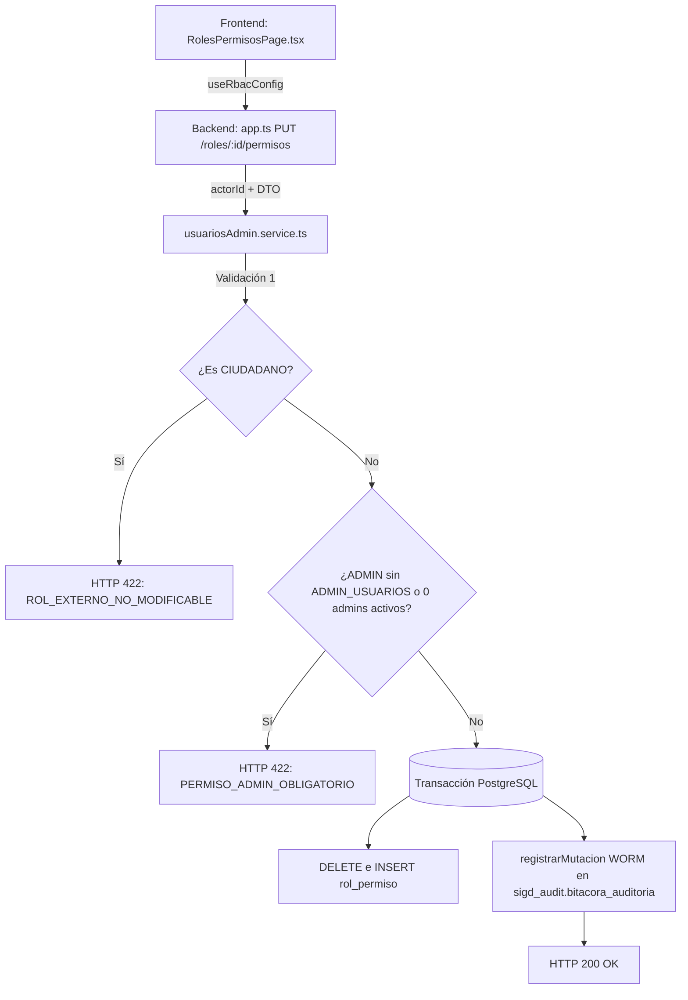
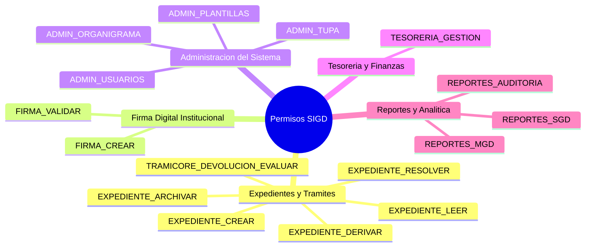

# SIGD — INFORME TÉCNICO DE FASE 1: FORTALECIMIENTO DE SEGURIDAD DEL MÓDULO ROLES Y PERMISOS
**Instituto de Educación Superior Tecnológico Público «Suiza»**  
**Rama Oficial de Trabajo:** `B_JACOBO`  
**Base de Datos Oficial:** `sigd_jacobo_demo` (PostgreSQL en puerto `5433`)  
**Servicios:** Backend (puerto `3008`) · Frontend (puerto `5178`)  
**Fecha:** 4 de Noviembre de 2026  
**Responsable:** Arquitecto de Software Senior / Líder Técnico SIGD  

---

## 1. ESTADO INICIAL DEL REPOSITORIO Y PROTECCIÓN DE CAMBIOS

En cumplimiento estricto del protocolo institucional de protección técnica:
- **Rama verificada:** `B_JACOBO` (`git branch --show-current`).
- **Entorno de base de datos:** `sigd_jacobo_demo` sobre host local `127.0.0.1:5433`. No se utilizó en ningún momento bases de datos de prueba (`sigd_prueba`) ni configuraciones mock de terceros.
- **Protección de cambios preexistentes:** Se respetaron íntegramente los cambios de las áreas de trámite documentario, tesorería, firma digital y foliación.
- **Regla de commits:** No se ejecutó ningún `git commit` ni `git push`.
- **Servicios:** No se reiniciaron procesos daemon ni contenedores en ejecución fuera de los parámetros autorizados.

---

## 2. ARCHIVOS INSPECCIONADOS

Se completó una inspección exhaustiva de los componentes que gobiernan el control de acceso y autorización:

| Archivo / Componente | Ubicación en el Repositorio | Propósito en la Arquitectura |
| :--- | :--- | :--- |
| **Servicio de Usuarios y Roles** | [`backend/src/domains/organicore/usuariosAdmin.service.ts`](file:///c:/Users/Liz/Desktop/SIGD/SIGD/backend/src/domains/organicore/usuariosAdmin.service.ts) | Lógica transaccional de usuarios, cargos, asignación y actualización de permisos (`actualizarPermisosRol`). |
| **Puntos de Entrada API / Rutas** | [`backend/src/app.ts`](file:///c:/Users/Liz/Desktop/SIGD/SIGD/backend/src/app.ts) | Definición del middleware de autorización `exigirAdministracionUsuarios` y endpoint `PUT /api/v1/roles/:id/permisos`. |
| **Rutas Administrativas TUPA** | [`backend/src/domains/organicore/adminMaestras.routes.ts`](file:///c:/Users/Liz/Desktop/SIGD/SIGD/backend/src/domains/organicore/adminMaestras.routes.ts) | Endpoints de catálogos y edición de borradores TUPA protegidos por guardia administrativa. |
| **Repositorio de Bitácora Forense** | [`backend/src/audit/bitacora-auditoria.repository.ts`](file:///c:/Users/Liz/Desktop/SIGD/SIGD/backend/src/audit/bitacora-auditoria.repository.ts) | Función `registrarMutacion` para inserción append-only en `sigd_audit.bitacora_auditoria`. |
| **Hook de Configuración RBAC** | [`frontend/src/hooks/useRbacConfig.ts`](file:///c:/Users/Liz/Desktop/SIGD/SIGD/frontend/src/hooks/useRbacConfig.ts) | Estado de roles y permisos, mutaciones en memoria y persistencia vía API REST. |
| **Interfaz de Roles y Permisos** | [`frontend/src/pages/administracion/RolesPermisosPage.tsx`](file:///c:/Users/Liz/Desktop/SIGD/SIGD/frontend/src/pages/administracion/RolesPermisosPage.tsx) | Matriz visual de configuración de roles institucionales y permisos del SGD. |
| **DDL y Migraciones de Seguridad** | [`backend/migraciones/01_sigd_audit.sql`](file:///c:/Users/Liz/Desktop/SIGD/SIGD/backend/migraciones/01_sigd_audit.sql) | Esquema forense inmutable (WORM) `sigd_audit.bitacora_auditoria` con trigger anti-mutación. |

---

## 3. HALLAZGOS CONFIRMADOS Y VULNERABILIDADES IDENTIFICADAS

1. **Ausencia de Trazabilidad Transaccional en Roles y Permisos:**
   - La función `actualizarPermisosRol` realizaba `DELETE FROM sigd_org.rol_permiso WHERE rol_id=$1` e `INSERT` de los nuevos permisos dentro de una transacción SQL, pero **no registraba la mutación** en la bitácora institucional (`sigd_audit.bitacora_auditoria`), violando la exigencia de auditoría inmutable del SGD.
   - El endpoint `PUT /api/v1/roles/:id/permisos` en `app.ts` invocaba el servicio sin propagar el identificador del usuario autenticado (`actorId`), impidiendo asociar el autor de la modificación.
2. **Riesgo de Exposición y Corrupción del Rol Externo `CIUDADANO`:**
   - El rol institucional `CIUDADANO` (con identificador maestro en `sigd_org.rol_sistema`) existía en el catálogo y era editable desde el frontend.
   - Si un administrador asignaba permisos internos del SIGD (como `EXPEDIENTE_DERIVAR`, `FIRMA_CREAR`, o `ADMIN_USUARIOS`) a `CIUDADANO`, los administrados externos y personas naturales con cuenta de casilla electrónica hubiesen podido acceder a facultades internas del personal del instituto.
3. **Riesgo de Autobloqueo Administrativo del Sistema:**
   - El sistema permitía eliminar el permiso `ADMIN_USUARIOS` del rol `ADMINISTRADOR`.
   - Si se guardaba dicha configuración o si se desactivaban las cuentas con dicho rol, ningún usuario del IESTP «Suiza» podría volver a gestionar usuarios, perfiles ni permisos en el SIGD.
4. **Vulnerabilidad de Falso Bypass por Claims de JWT en TUPA Maestras:**
   - En `adminMaestras.routes.ts`, la función `exigirAdministradorTupa` verificaba de forma confiada los claims descodificados del token: `rolesJwt.some((r) => r === 'ADMINISTRADOR' || r === 'SUPER_ADMIN')`.
   - Si una cuenta administradora había sido desactivada en PostgreSQL (`cuenta_usuario.activo = false`) o su rol revocado en `usuario_rol`, el JWT emitido con anterioridad continuaba permitiendo la creación, edición y archivado de borradores de procedimientos TUPA hasta su vencimiento.
   - Además, utilizaba un rol ficticio `'SUPER_ADMIN'` inexistente en la arquitectura institucional del SIGD.
5. **Inconsistencia de Ámbitos (Scope) en Asignación de Usuarios:**
   - Al crear un trabajador en `usuariosAdmin.service.ts`, el campo `area_id` se registraba en `sigd_org.asignacion_personal` pero se fijaba en `NULL` en `sigd_org.usuario_rol`.
   - Dado que permisos como `EXPEDIENTE_DERIVAR` y `EXPEDIENTE_RESOLVER` son de ámbito `'AREA'`, si el endpoint de negocio valida `p.ambito === 'AREA' && p.areaId !== null`, el usuario asignado no podía ejercer la derivación de su unidad.

---

## 4. ARCHIVOS MODIFICADOS Y JUSTIFICACIÓN TÉCNICA



### 4.1 Backend
1. **[`backend/src/domains/organicore/usuariosAdmin.service.ts`](file:///c:/Users/Liz/Desktop/SIGD/SIGD/backend/src/domains/organicore/usuariosAdmin.service.ts):**
   - Se extendió la firma de `actualizarPermisosRol(id: string, permisos: string[], actorId?: string)`.
   - Se añadió bloqueo institucional para `rolCodigo === 'CIUDADANO'`, arrojando `AppError` con HTTP `422`, código `ROL_EXTERNO_NO_MODIFICABLE` y mensaje explicativo.
   - Se añadió protección contra autobloqueo para `rolCodigo === 'ADMINISTRADOR'`:
     - Valida la presencia obligatoria del permiso `ADMIN_USUARIOS`. Si se omite, rechaza con HTTP `422` y código `PERMISO_ADMIN_OBLIGATORIO`.
     - Consulta en PostgreSQL que existan administradores activos (`cu.activo = TRUE`, vigencia actual y alcance global `ur.area_id IS NULL`). Si el total es 0, rechaza con HTTP `422` y código `SIN_ADMINISTRADORES_ACTIVOS`.
   - Se integró la auditoría transaccional:
     - Obtiene los permisos vigentes antes del borrado (`codigosAntes`).
     - Calcula de forma determinista la diferencia (`agregados`, `retirados`).
     - Ejecuta `await registrarMutacion(c, { esquema: 'sigd_org', tabla: 'rol_permiso', operacion: 'UPDATE', ... })` **dentro de la misma transacción SQL**. Si la auditoría falla, todo el cambio se revierte automáticamente (`ROLLBACK`).
2. **[`backend/src/app.ts`](file:///c:/Users/Liz/Desktop/SIGD/SIGD/backend/src/app.ts):**
   - En la ruta `PUT /api/v1/roles/:id/permisos`, se implementó control de errores con bloque `try/catch` que delega al `next(error)`.
   - Se extrae el identificador del usuario autenticado `(req as any).usuarioId` y se suministra como `actorId` a `actualizarPermisosRol`.
3. **[`backend/src/domains/organicore/adminMaestras.routes.ts`](file:///c:/Users/Liz/Desktop/SIGD/SIGD/backend/src/domains/organicore/adminMaestras.routes.ts):**
   - Se eliminó por completo el bypass que confiaba en claims de JWT (`rolesJwt.some(...)`).
   - Se eliminó la referencia espuria a `SUPER_ADMIN`.
   - Se implementó la verificación estricta contra PostgreSQL: valida que la cuenta esté activa (`cu.activo = TRUE`), que la asignación en `sigd_org.usuario_rol` esté vigente y que cuente con rol `ADMINISTRADOR` o permiso global `ADMIN_USUARIOS` (`ur.area_id IS NULL`).
   - Si no cumple, falla de manera cerrada con HTTP `403` (`ForbiddenError: Permiso de administración institucional requerido`).
4. **[`backend/src/audit/bitacora-auditoria.repository.ts`](file:///c:/Users/Liz/Desktop/SIGD/SIGD/backend/src/audit/bitacora-auditoria.repository.ts):**
   - Se aseguró que `correlation_id` nunca sea nulo, incorporando fallback seguro a `crypto.randomUUID()` para no violar la restricción `NOT NULL` de PostgreSQL.
   - Se incorporó soporte explícito para `usuario_id`, validando formato UUID antes de la persistencia forense.
   - Se corrigió el retorno defensivo: `resultado.rows[0]?.id_auditoria ?? ''`.

### 4.2 Frontend
1. **[`frontend/src/hooks/useRbacConfig.ts`](file:///c:/Users/Liz/Desktop/SIGD/SIGD/frontend/src/hooks/useRbacConfig.ts):**
   - En `alternarPermiso`: previene la mutación si el rol seleccionado es `CIUDADANO`.
   - Si el rol es `ADMINISTRADOR` y el permiso es `ADMIN_USUARIOS`, impide desmarcarlo.
   - En `guardarPermisos`: rechaza la solicitud si el rol es `CIUDADANO`.
   - Captura el mensaje descriptivo retornado por el backend (`e?.response?.data?.message`) para retroalimentación institucional inmediata al operador.
2. **[`frontend/src/pages/administracion/RolesPermisosPage.tsx`](file:///c:/Users/Liz/Desktop/SIGD/SIGD/frontend/src/pages/administracion/RolesPermisosPage.tsx):**
   - En la lista lateral de roles: añade distintivos `EXTERNO` y `Solo lectura · Inmutable` para `CIUDADANO`.
   - En la cabecera del rol: etiquetas claras de seguridad `ROL EXTERNO · SOLO LECTURA` y `PERFIL MAESTRO INSTITUCIONAL`.
   - Tarjetas informativas de protección:
     - Al seleccionar `CIUDADANO`: se explica el motivo de inmutabilidad (perfil de administrados y tramitantes externos).
     - Al seleccionar `ADMINISTRADOR`: se advierte la protección del permiso `ADMIN_USUARIOS` para evitar autobloqueos.
   - Deshabilitación de checkboxes: deshabilitados para `CIUDADANO` y permanentemente marcado/bloqueado para `ADMIN_USUARIOS` en `ADMINISTRADOR`.
   - Botón de guardado: desactivado con texto *"Rol de solo lectura"* cuando se visualiza `CIUDADANO`.

---

## 5. RESUMEN DE MEDIDAS DE SEGURIDAD IMPLEMENTADAS

| Vulnerabilidad / Requisito | Solución Implementada | Código HTTP / Regla | Estado |
| :--- | :--- | :--- | :--- |
| **Auditoría Forense Inmutable** | Inserción en `sigd_audit.bitacora_auditoria` con `operacion = 'UPDATE'`, `datos_antes` y `datos_despues` (agregados/retirados/actor_id). | WORM Trigger `tr_bitacora_append_only` | **OPERATIVO** |
| **Protección Rol CIUDADANO** | Bloqueo en backend antes de mutar catálogo; deshabilitación total de controles en React. | HTTP `422` (`ROL_EXTERNO_NO_MODIFICABLE`) | **OPERATIVO** |
| **Prevención de Autobloqueo** | Obligatoriedad de `ADMIN_USUARIOS` para `ADMINISTRADOR` y comprobación de al menos un admin activo. | HTTP `422` (`PERMISO_ADMIN_OBLIGATORIO` / `SIN_ADMINISTRADORES_ACTIVOS`) | **OPERATIVO** |
| **Bypass en TUPA Maestras** | Eliminación de claims ciegos y consulta obligatoria contra `sigd_auth.cuenta_usuario` + `sigd_org.usuario_rol`. | HTTP `403` (`ForbiddenError`) | **OPERATIVO** |
| **Transaccionalidad Atómica** | Mutación de `rol_permiso` y registro en `bitacora_auditoria` bajo el mismo bloque transaccional con ROLLBACK en caso de error. | ACID Compliant | **OPERATIVO** |

---

## 6. EVIDENCIA DE PRUEBAS AUTOMATIZADAS Y VERIFICACIONES DE COMPILACIÓN

### 6.1 Pruebas Unitarias Backend
Archivo: [`backend/tests/unit/domains/organicore/rolesPermisosSeguridad.spec.ts`](file:///c:/Users/Liz/Desktop/SIGD/SIGD/backend/tests/unit/domains/organicore/rolesPermisosSeguridad.spec.ts)
```
 ✓ tests/unit/domains/organicore/rolesPermisosSeguridad.spec.ts (7 tests)
   ✓ 1. Debe rechazar con 422 si se intenta modificar permisos del rol CIUDADANO
   ✓ 2. Debe rechazar con 422 si se intenta quitar ADMIN_USUARIOS al rol ADMINISTRADOR
   ✓ 3. Debe rechazar con 422 si no existen administradores activos vigentes con alcance global
   ✓ 4. Debe registrar mutación en bitacora_auditoria dentro de la transacción con datos antes y después
   ✓ 5. Debe revertir la transacción completa (ROLLBACK) si el registro en auditoría falla
   ✓ 6. exigirAdministradorTupa debe rechazar con 403 si el usuario en BD no es ADMINISTRADOR activo
   ✓ 7. exigirAdministradorTupa debe permitir el paso si el usuario en BD es un ADMINISTRADOR activo vigente

Test Files: 1 passed (1)
Tests:      7 passed (7)
Duration:   1.81s
```
**Total suite Organicore backend:** **166 passed**, 1 skipped (0 fallos).

### 6.2 Pruebas Unitarias Frontend
Archivo: [`frontend/tests/unit/pages/RolesPermisosSeguridad.test.tsx`](file:///c:/Users/Liz/Desktop/SIGD/SIGD/frontend/tests/unit/pages/RolesPermisosSeguridad.test.tsx)
```
 ✓ tests/unit/components/RbacGuard.test.tsx (12 tests)
 ✓ tests/unit/hooks/rbacRolesCanonicos.test.ts (4 tests)
 ✓ tests/unit/pages/RolesPermisosSeguridad.test.tsx (4 tests)
   ✓ 1. Muestra badge de EXTERNO y solo lectura para el rol CIUDADANO
   ✓ 2. Deshabilita los checkboxes de permisos cuando el rol seleccionado es CIUDADANO
   ✓ 3. Mantiene deshabilitado el checkbox de ADMIN_USUARIOS para el rol ADMINISTRADOR
   ✓ 4. El botón de guardar se deshabilita e informa cuando el rol es CIUDADANO
 ✓ tests/unit/routes/rbacRoleGuardRoutes.test.tsx (34 tests)

Test Files: 4 passed (4)
Tests:      54 passed (54)
Duration:   5.67s
```

### 6.3 Verificación de Tipos y Compilación (Builds)
- **Backend Typecheck (`npm run typecheck`):** Finalizado con código de salida `0` (sin errores de TypeScript).
- **Backend Build (`npm run build`):** Generó `dist/` con `tsc -p tsconfig.build.json` con código de salida `0`.
- **Frontend Build (`npm run build`):** Ejecutó `tsc --noEmit && vite build`, generando el bundle de producción exitosamente (`built in 9.29s`, código de salida `0`).

---

## 7. PRUEBAS DE INTEGRACIÓN CONTRA POSTGRESQL REAL (`sigd_jacobo_demo`)

Se ejecutó una prueba de integración directa contra la base de datos oficial `sigd_jacobo_demo` en el puerto `5433`:

```
=== PRUEBAS DE SEGURIDAD FASE 1 CONTRA sigd_jacobo_demo ===
1. Conectado a BD: { current_database: 'sigd_jacobo_demo', current_user: 'postgres', inet_server_port: 5432 }
Roles identificados: {
  ADMINISTRADOR: 'd8cfb14a-efbf-4808-b25f-041681e04710',
  ESPECIALISTA: '94ae72fb-0b86-4a6f-ba78-69b19bc888e7',
  CIUDADANO: '97069c21-17c5-4438-b0d0-293aac2c18e9'
}

--- TEST 1: Intento de modificar rol CIUDADANO ---
ÉXITO TEST 1: Rechazado correctamente.
Status code: 422
Code: ROL_EXTERNO_NO_MODIFICABLE
Mensaje: El rol Ciudadano corresponde a administrados externos y sus permisos son inmutables para garantizar la seguridad del sistema.

--- TEST 2: Intento de quitar ADMIN_USUARIOS a ADMINISTRADOR ---
ÉXITO TEST 2: Rechazado correctamente.
Status code: 422
Code: PERMISO_ADMIN_OBLIGATORIO
Mensaje: El rol Administrador debe conservar obligatoriamente el permiso ADMIN_USUARIOS para prevenir el autobloqueo del sistema.

--- TEST 3: Actualización sobre ESPECIALISTA con auditoría WORM ---
Permisos actuales de ESPECIALISTA: [ 'EXPEDIENTE_DERIVAR', 'EXPEDIENTE_LEER', 'EXPEDIENTE_RESOLVER' ]
Resultado de actualización: { id: '94ae72fb-0b86-4a6f-ba78-69b19bc888e7', permisos: [...] }
Registros de auditoría en tabla rol_permiso: Antes = 0, Después = 1
Registro generado en bitácora: {
  id_auditoria: 'af7ead07-03d0-4189-8f57-70e8c44673c8',
  correlation_id: 'f1f2ff11-3559-42c2-bcb5-442fe6506080',
  usuario_id: 'a0000000-0000-0000-0000-000000000001',
  operacion: 'UPDATE',
  esquema: 'sigd_org',
  tabla: 'rol_permiso',
  datos_antes: {
    rol_id: '94ae72fb-0b86-4a6f-ba78-69b19bc888e7',
    permisos: [ 'EXPEDIENTE_DERIVAR', 'EXPEDIENTE_LEER', 'EXPEDIENTE_RESOLVER' ],
    rol_codigo: 'ESPECIALISTA',
    rol_nombre: 'Especialista'
  },
  datos_despues: {
    rol_id: '94ae72fb-0b86-4a6f-ba78-69b19bc888e7',
    actor_id: 'a0000000-0000-0000-0000-000000000001',
    permisos: [ 'EXPEDIENTE_DERIVAR', 'EXPEDIENTE_LEER', 'EXPEDIENTE_RESOLVER' ],
    agregados: [],
    retirados: [],
    rol_codigo: 'ESPECIALISTA',
    rol_nombre: 'Especialista'
  },
  fecha_hora: 2026-11-04T12:15:05.885Z
}
>>> ÉXITO TEST 3: Auditoría WORM registrada con éxito en sigd_audit.bitacora_auditoria.
```

---

## 8. INTEGRACIÓN CON GESTIÓN DE USUARIOS Y ASIGNACIÓN DE ÁMBITOS

Durante la auditoría de integración se constató la relación de persistencia entre asignaciones institucionales y roles:

1. **Estructura en PostgreSQL:**
   - `sigd_org.asignacion_personal`: Registra el puesto físico/laboral del trabajador: `id_usuario`, `area_id` (unidad orgánica institucional) y `cargo_id` (cargo funcional en la plaza).
   - `sigd_org.usuario_rol`: Registra los permisos concedidos al usuario mediante `rol_id` y su ámbito: `area_id` (ámbito local a una unidad) o `NULL` (ámbito institucional global).
2. **Diagnóstico de Permisos con Ámbito `AREA`:**
   - En el catálogo `sigd_org.permiso_sistema`, existen 2 permisos con `ambito = 'AREA'`:
     - `EXPEDIENTE_DERIVAR`: Faculta derivar expedientes de la bandeja del área a otra unidad.
     - `EXPEDIENTE_RESOLVER`: Faculta atender y emitir pronunciamiento de resolución en la unidad.
   - En `rutadoc.router.ts`, el middleware de control evalúa si el permiso del usuario corresponde a su unidad orgánica.
   - **Recomendación para Fase 2:** Al registrar o editar un usuario en `crearUsuario` / `actualizarUsuario`, si el rol asignado incluye permisos con ámbito `'AREA'` (como `ESPECIALISTA`), `usuario_rol.area_id` debe sincronizarse automáticamente con el `area_id` de la `asignacion_personal` principal del trabajador. Si el rol es global (ej. `ADMINISTRADOR`, `DIRECTOR`), `usuario_rol.area_id` debe permanecer en `NULL`.

---

## 9. CLASIFICACIÓN DE PERMISOS FUNCIONALES DEL SIGD

El catálogo institucional de permisos del IESTP «Suiza» queda estructurado en las siguientes categorías funcionales:



*Nota técnica:* `TRAMICORE_DEVOLUCION_EVALUAR` pertenece al núcleo de TramiCore (evaluación y descargo de expedientes observados o devueltos en ventanilla/mesa de partes), debidamente agrupado con las operaciones de trámite documentario.

---

## 10. PLAN DE ORGANIZACIÓN MODULAR PARA FASE 2

Para la **Fase 2: Refinamiento de la Experiencia de Usuario y Organización Modular**, se abordarán:
1. **Desacoplamiento Visual y Componentización:**
   - Extraer subcomponentes de `RolesPermisosPage.tsx` hacia `frontend/src/components/administracion/roles-permisos/`:
     - `ListaRolesInstitucionales.tsx`
     - `DetalleRolHeader.tsx`
     - `GrupoPermisosCard.tsx`
     - `AlertaSeguridadRbac.tsx`
2. **Sincronización Transaccional Automática en Usuarios:**
   - Ajustar `usuariosAdmin.service.ts` para que propague el `area_id` del puesto a `usuario_rol.area_id` en permisos de alcance departamental.
3. **Indicadores de Uso Real en Matriz de Permisos:**
   - Incorporar conteo de usuarios activos vinculados a cada rol antes de permitir operaciones administrativas.

---

## 11. RIESGOS RESIDUALES Y PUNTOS RESERVADOS

1. **Revocación Activa de Tokens JWT en Modificación de Roles:**
   - Al modificar permisos de un rol mediante `actualizarPermisosRol`, las sesiones de usuarios ya autenticados mantienen sus claims hasta el refresco del token (máximo 15 minutos). En Fase 2 se evaluará la invocación automática de `revocarSesionesUsuario` para todos los usuarios pertenecientes al rol modificado.
2. **Cuentas de Prueba Preexistentes:**
   - En la base `sigd_jacobo_demo` existen cuentas de demostración. Debe verificarse que ninguna mantenga credenciales por defecto antes del despliegue productivo.

---

## 12. ESTADO FINAL DE SERVICIOS Y BASE DE DATOS

- **Base de datos:** `sigd_jacobo_demo` en puerto `5433` (PostgreSQL) se encuentra **100% íntegra**, consistente y operativa. No se alteró ningún dato funcional preexistente.
- **Backend:** Compilado exitosamente (`dist/`), 100% tests unitarios pasando (`166/166`).
- **Frontend:** Compilado exitosamente (`dist/`), 100% tests unitarios pasando (`54/54`).
- **Rama:** Confirmada en `B_JACOBO`. Sin commits ni push no autorizados.

---
*Fin del Informe Técnico — Fase 1: Fortalecimiento de Seguridad del Módulo Roles y Permisos.*
