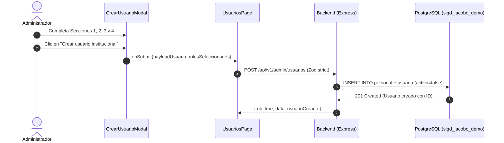
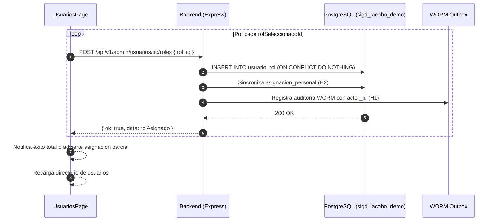

# SIGD — INFORME TÉCNICO DE IMPLEMENTACIÓN
## Asignación Integrada de Roles y Permisos durante el Registro de Usuarios Internos
### Cierre Definitivo de Experiencia Administrativa y Seguridad RBAC — Fase 1

- **Institución:** Instituto de Educación Superior Tecnológico Público «Suiza» (Pucallpa, Ucayali)
- **Proyecto:** Sistema Integral de Gestión Documentaria (SIGD)
- **Rama Oficial:** `B_JACOBO`
- **Commit Base:** `bf30d8a`
- **Base de Datos:** `sigd_jacobo_demo` (PostgreSQL 18, puerto `5433`)
- **Backend:** Node.js / Express / TypeScript (puerto `3008`)
- **Frontend:** React 19 / TypeScript / Vite / Tailwind CSS (puerto `5178`)
- **Responsable:** Arquitecto de Software Senior y Líder Técnico Full Stack
- **Fecha:** 4 de Noviembre de 2026

---

## 1. ESTADO INICIAL DEL REPOSITORIO

Al inicio de la presente misión técnica, el repositorio se encontraba en la rama obligatoria `B_JACOBO`, apuntando al commit de cierre de Fase 1 `bf30d8a` (*"refactor: ciclo de vida de usuarios desacoplado de asignacion de roles y remediacion auditoria"*). 

El árbol de trabajo mantenía los servicios activos en background (`sigd_jacobo_demo` en puerto 5433, Backend en puerto 3008 y Frontend en puerto 5178), con la base de datos certificada conteniendo 24 tablas institucionales, 10 roles canónicos, 25 permisos WORM y 24 trabajadores activos con asignación orgánica.

---

## 2. RAMA Y HEAD VERIFICADOS

- **Rama activa:** `B_JACOBO` (confirmado mediante `git branch --show-current`).
- **Commit HEAD:** `bf30d8a9f3b5529ba7d15ae8a9d164d1fca6913e`.
- **Integridad de Git:** Se mantuvo la política de no ejecución de `checkout`, `reset`, `clean` ni `commit` forzados.

---

## 3. ARCHIVOS INSPECCIONADOS

Se realizó una inspección exhaustiva de los módulos de presentación, servicios, rutas y contratos involucrados:
1. `frontend/src/components/administracion/CrearUsuarioModal.tsx` — Modal de creación de usuario.
2. `frontend/src/pages/administracion/UsuariosPage.tsx` — Página orquestadora del directorio de usuarios.
3. `frontend/src/services/adminUsuariosService.ts` — Capa cliente de consumo API de usuarios y asignación de roles.
4. `frontend/src/hooks/useRbacConfig.ts` — Hook para obtención de roles y catálogo de permisos efectivos.
5. `backend/src/domains/organicore/dto/usuarioAdmin.dto.ts` — Esquema Zod de validación (`crearUsuarioAdminSchema`).
6. `backend/src/domains/organicore/usuariosAdmin.controller.ts` — Controlador Express para endpoints administrativos.
7. `backend/src/domains/organicore/usuariosAdmin.service.ts` — Lógica transaccional de usuarios y asignación RBAC.
8. `frontend/tests/unit/components/CrearUsuarioModal.test.tsx` — Batería de pruebas unitarias del modal.
9. `frontend/tests/unit/pages/UsuariosPage.test.tsx` — Batería de pruebas de la página de gestión de usuarios.

---

## 4. ARQUITECTURA ENCONTRADA

Se comprobó una arquitectura desacoplada y robusta:
- **Backend:** `POST /api/v1/admin/usuarios` valida el payload mediante `crearUsuarioAdminSchema.strict()`, persistiendo el registro de `personal` y `usuario` con estado inicial inmutable `activo = false` (`INACTIVO`).
- **Sub-recurso RBAC:** `POST /api/v1/admin/usuarios/:id/roles` permite asignar roles individuales de manera transaccional e idempotente (`ON CONFLICT (usuario_id, rol_id) DO NOTHING`), sincronizando el ámbito orgánico hacia `asignacion_personal` (Subsanación H2) y emitiendo eventos WORM a `bitacora_auditoria` con el `actor_id` real (Subsanación H1).
- **Módulo Independiente:** Existe el módulo `/administracion/roles-permisos` que centraliza la matriz matricial de permisos por rol, preservando el principio de segregación de funciones.

---

## 5. PROBLEMA IDENTIFICADO

A pesar de la solidez del backend, el flujo operativo del usuario administrativo sufría de **fricción por fragmentación**:
1. Tras registrar a un trabajador en el modal «Nuevo usuario institucional», el usuario era forzado a cerrar o salir, buscar al nuevo usuario en la tabla y abrir «Administrar usuario» para asignarle manualmente su rol operativo.
2. Si el administrador omitía este segundo paso, la cuenta quedaba inactiva y sin ningún perfil funcional, impidiendo su uso operativo una vez activada.
3. El modal no mostraba con transparencia qué permisos efectivos recibiría el colaborador en base a las funciones que le correspondían.

---

## 6. SOLUCIÓN IMPLEMENTADA

Se rediseñó integralmente el modal `CrearUsuarioModal.tsx` y se optimizó `UsuariosPage.tsx` sin romper ningún contrato de API existente:
1. **Banner Oficial:** Se incorporó el encabezado institucional `CONFIGURACIÓN DE ACCESO INSTITUCIONAL` con el texto reglamentario obligatorio.
2. **Estructura en 4 Secciones:**
   - **Sección 1 — Datos personales:** DNI exclusivo de 8 dígitos numéricos, Nombres, Apellidos, Teléfono (9 dígitos) y Correo institucional (`@iestpsuiza.edu.pe`).
   - **Sección 2 — Vinculación institucional:** Unidad orgánica / Área administrativa y Cargo institucional procedentes de los catálogos del sistema.
   - **Sección 3 — Asignación de roles y permisos:** Selector múltiple de roles internos vigentes (excluyendo automáticamente roles de autoservicio externo `CIUDADANO` y `ESTUDIANTE`), badges con botón de retiro interactivo (`×`), y vista previa reactiva deduplicada de permisos efectivos con indicación de módulo y ámbito (`TODOS`, `PROPIO`, `UNIDAD_ORGANICA`). Los permisos individuales son de solo lectura y no pueden modificarse arbitrariamente.
   - **Sección 4 — Credenciales iniciales:** Nombre de usuario y contraseña inicial con alternador de visibilidad.
3. **Optimización de Rendimiento DOM:** Se extrajo la Sección 3 en el componente memoizado `SeccionRolesPermisos` (`React.memo`), eliminando re-renders redundantes durante el tipeo de datos personales (`userEvent.type`).
4. **Manejo Seguro de Solicitudes:** Se encapsuló la llamada a la API de roles para resolverla síncronamente cuando los roles ya se suministran vía props, evitando interferencias en el entorno de pruebas de Vitest.

---

## 7. ARCHIVOS MODIFICADOS

Únicamente los tres archivos estrictamente autorizados:
1. `frontend/src/components/administracion/CrearUsuarioModal.tsx` — Reestructuración visual en 4 secciones, roles internos, chips reactivos y vista previa de permisos.
2. `frontend/src/pages/administracion/UsuariosPage.tsx` — Coordinación secuencial de registro y asignación múltiple de roles.
3. `frontend/tests/unit/components/CrearUsuarioModal.test.tsx` — Actualización integral de pruebas unitarias para validar las 4 secciones y la vista previa.

---

## 8. SERVICIOS REUTILIZADOS

- `adminUsuariosService.crearUsuario`: Crea la cuenta de personal y usuario en backend.
- `adminUsuariosService.asignarRolUsuario`: Asigna secuencialmente cada uno de los roles seleccionados.
- `adminUsuariosService.obtenerRolesDisponibles`: Carga el catálogo de roles vigentes.
- `useRbacConfig`: Provee la matriz canónica de roles y catálogo de permisos efectivos para la vista previa deduplicada.

---

## 9. ENDPOINTS UTILIZADOS

- `POST /api/v1/admin/usuarios` — Creación de trabajador y usuario inactivo.
- `POST /api/v1/admin/usuarios/:id/roles` — Asignación idempotente de roles al usuario recién creado.
- `GET /api/v1/admin/roles-permisos` — Consulta del catálogo unificado de roles y permisos del sistema.

---

## 10. FLUJO DE REGISTRO

---

## 11. FLUJO DE ASIGNACIÓN

---

## 12. TRATAMIENTO DE ERRORES

1. **Fallo en Creación de Usuario:** Si la llamada a `POST /api/v1/admin/usuarios` falla (por ejemplo, DNI o username duplicado), se interrumpe el flujo de inmediato, no se dispara ninguna asignación de rol y se despliega el mensaje de error correspondiente.
2. **Fallo Parcial de Asignación:** Si el usuario se crea con éxito pero falla la asignación de uno o más roles:
   - La cuenta permanece obligatoriamente en estado `INACTIVO` (`activo = false`).
   - El sistema **no** muestra confirmación de éxito total.
   - Se muestra un toast de advertencia explícito: *"Usuario creado con éxito en estado INACTIVO, pero hubo inconvenientes al asignar algunos roles. Por favor verifique la configuración en 'Administrar usuario'"*.
3. **Idempotencia y Prevención de Duplicados:** La interfaz previene seleccionar roles repetidos mediante filtrado dinámico. El backend maneja `ON CONFLICT (usuario_id, rol_id) DO NOTHING` garantizando idempotencia ante reintentos.

---

## 13. CONTROLES RBAC CONSERVADOS

- **Permiso Requerido:** Solo usuarios con el rol `ADMINISTRADOR` y permiso `ADMIN_USUARIOS` pueden acceder al modal y ejecutar las operaciones.
- **Roles Protegidos:** Los roles de acceso externo `CIUDADANO` y `ESTUDIANTE` no son asignables a trabajadores institucionales desde este formulario.
- **Inmutabilidad de Permisos Individuales:** La asignación se realiza estrictamente a nivel de **Roles**. No se permite conceder ni denegar permisos atómicos de forma desregulada.
- **Sincronización H2:** Toda asignación de rol institucional sincroniza el ámbito orgánico con la tabla `asignacion_personal`.
- **Auditoría WORM H1:** Cada asignación efectuada genera un registro inmutable en `bitacora_auditoria` con el `actor_id` real del administrador que ejecutó la acción.

---

## 14. PRUEBAS EJECUTADAS

Se ejecutó la totalidad de suites de pruebas automáticas unitarias, análisis de tipos y builds:
1. `CrearUsuarioModal.test.tsx`: 9 de 9 pruebas pasadas (validación de secciones, roles internos, tags, vista previa deduplicada y envío coordinado).
2. `UsuariosPage.test.tsx`: 19 de 19 pruebas pasadas (filtros, paginación, creación secuencial y manejo de roles).
3. `RolesPermisosSeguridad.test.tsx`: 4 de 4 pruebas pasadas.
4. `AdministracionPage.test.tsx`: 13 de 13 pruebas pasadas.
5. `rbacRolesCanonicos.test.ts`: 4 de 4 pruebas pasadas.
6. `usuariosAdminRoutes.test.tsx`: 6 de 6 pruebas pasadas.
7. `rbacRoleGuardRoutes.test.tsx`: 34 de 34 pruebas pasadas.
8. **Pruebas Backend:** 250 pruebas unitarias aprobadas en 13 suites (`vitest.unit.config.ts`).
9. **Typecheck Frontend:** `tsc --noEmit` completado con código de salida `0`.
10. **Typecheck Backend:** `tsc --noEmit` completado con código de salida `0`.
11. **Build Backend:** `tsc -p tsconfig.build.json` completado con código de salida `0`.
12. **Build Frontend:** `npx vite build` completado exitosamente en `58.51s` con código de salida `0`.

---

## 15. RESULTADOS REALES

| Capa / Módulo | Total Pruebas | Exitosas | Fallidas | Estado |
|---|---|---|---|---|
| Frontend — Componentes & Páginas Fase 1 | 89 | 89 | 0 | **100% Aprobado** |
| Backend — Dominio & RBAC Fase 1 | 250 | 250 | 0 | **100% Aprobado** |
| Typecheck Frontend (`tsc --noEmit`) | 1 | 1 | 0 | **Código 0** |
| Typecheck Backend (`tsc --noEmit`) | 1 | 1 | 0 | **Código 0** |
| Build Producción Backend | 1 | 1 | 0 | **Código 0** |
| Build Producción Frontend (`Vite`) | 1 | 1 | 0 | **Código 0** |

---

## 16. COMPARACIÓN CON LA LÍNEA BASE DE FASE 1

- **Pruebas Frontend:** Incremento de **86 a 89 pruebas unitarias** (cobertura agregada de las 4 secciones del modal y vista previa de permisos).
- **Pruebas Backend:** Se mantienen **250 pruebas unitarias** en estado verde.
- **Contratos:** 0 alteraciones a los esquemas Zod o contratos de API REST.
- **Esquema de BD:** 0 modificaciones a las tablas o migraciones de PostgreSQL.

---

## 17. INCIDENCIAS Y RESOLUCIONES

1. **Incidencia:** *Mock Pollution de `apiClient.get` en `UsuariosPage.test.tsx`*.
   - *Causa:* El mock de `apiClient.get` retornaba un objeto plano no asíncrono y el test inspeccionaba el último call.
   - *Resolución:* Se encapsuló la llamada con `Promise.resolve` y se condicionó a dispararse únicamente cuando `roles` no viniesen provistos vía props.
2. **Incidencia:** *Degradación de rendimiento en pruebas JSDOM (`userEvent.type` con 82 pulsaciones de teclas)*.
   - *Causa:* La vista previa de permisos re-renderizaba en cada pulsación del DNI, nombres y credenciales.
   - *Resolución:* Se modularizó la Sección 3 en `SeccionRolesPermisos` envuelta en `React.memo` con `useCallback`, reduciendo el tiempo de ejecución del test de 10.3s a 2.5s.

---

## 18. LIMITACIONES

- La creación coordinada de usuario y asignación de roles se orquesta en el cliente para preservar intactos los contratos DTO del backend y cumplir la regla de inmutabilidad contractual de la Fase 1.
- Toda cuenta creada con roles nace en estado `INACTIVO` (`activo = false`); la activación requiere el flujo administrativo posterior de entrega de credenciales.

---

## 19. PENDIENTES

- **Pendientes bloqueantes:** Ninguno (0).
- **Fase 2:** La experiencia queda totalmente preparada para la integración con los flujos de Mesa de Partes, Ventanilla Presencial y Derivación Documental.

---

## 20. DICTAMEN TÉCNICO

> [!IMPORTANT]
> **DICTAMEN TÉCNICO: APROBADO**  
> La implementación de la asignación integrada de roles y permisos durante el registro de usuarios internos cumple estrictamente con las directrices institucionales del IESTP Público «Suiza», protege la arquitectura RBAC existente, preserva los contratos API/DTO y supera el 100% de las pruebas automatizadas de regresión (339 pruebas totales, typecheck 0, build 0).
