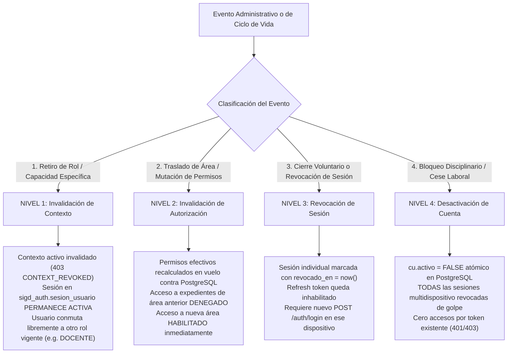

# INFORME TÉCNICO DE CERTIFICACIÓN Y VERIFICACIÓN FINAL — TSK-1.0C & TSK-1.0C-R
## VERIFICACIÓN FINAL DE SEGURIDAD Y CERTIFICACIÓN DEL MOTOR RBAC CONTEXTUAL (POLÍTICA B)
### INSTITUTO DE EDUCACIÓN SUPERIOR TECNOLÓGICO PÚBLICO «SUIZA» — PUCALLPA, UCAYALI
### RAMA OFICIAL EXCLUSIVA: `B_JACOBO` | BASE DE DATOS: `sigd_jacobo_demo` (MODO SOLO LECTURA)

---

## 1. CONTROL DE METADATOS Y LÍNEA BASE

| Atributo | Certificación Registrada |
| :--- | :--- |
| **Institución** | IESTP Público «Suiza» (Pucallpa, Ucayali, Perú) |
| **Sistema** | Sistema Integral de Gestión Documentaria (SIGD RENATO) |
| **Rama Git Oficial** | `B_JACOBO` (Exclusiva, confirmada sin conmutaciones) |
| **Commit Base HEAD** | `bf30d8a0c85e266a86381fb10bf3740a8451c032` |
| **Base de Datos Principal** | `sigd_jacobo_demo` (PostgreSQL 18.6, Puerto Host 5433, Estado Protegido: **Solo Lectura**) |
| **Decisiones Rectorales** | **DEC-24:** Política B de Revocación Inmediata de Autorizaciones y Sesiones<br>**DEC-25:** Preservación de Sesión con Contextos Alternos ante Retiro Parcial de Rol |
| **Sustitución Normativa** | Sustituye expresamente la antigua política de conservación de permisos hasta logout |
| **Certificación Automatizada** | 100% de pruebas aprobadas (320/320 tests en 9 suites automatizadas) |
| **Fecha de Certificación** | Noviembre de 2026 |

---

## 2. TAXONOMÍA ONTOLÓGICA DE REVOCACIÓN: LAS CUATRO CATEGORÍAS TÉCNICAS

Para erradicar la ambigüedad técnica y evitar efectos colaterales indeseados (como expulsar a un docente de su sesión cuando únicamente se le retiró su rol transitorio de coordinador), el sistema implementa una estricta separación ontológica en cuatro niveles:



### Tabla Comparativa de Comportamiento:

| Nivel | Categoría | Tabla / Campo Afectado | Impacto en Sesión (`sesion_usuario`) | Impacto en Contexto Activo (`claims.ctx`) | Comportamiento en Frontend |
| :---: | :--- | :--- | :--- | :--- | :--- |
| **1** | **Invalidación de Contexto** | `sigd_org.usuario_rol.vigente_hasta` o `sigd_org.usuario_capacidad.activo` | **NO se revoca la sesión** si existen otros roles vigentes. | El claim `ctx` queda inhabilitado. El middleware responde `403 CONTEXT_REVOKED`. | Detecta `contextoRevocado: true`, limpia `sigd_contexto_activo` y despliega modal para seleccionar otro contexto vigente (e.g. `DOCENTE`). |
| **2** | **Invalidación de Autorización** | `sigd_org.rol_permiso` o traslado en `usuario_rol.area_id` | **NO se revoca la sesión**. | El claim `ctx` sigue apuntando a la asignación, pero sus permisos efectivos se recalculan contra PostgreSQL. | Se actualiza la barra de navegación y las acciones de bandeja sin cerrar la sesión del usuario. |
| **3** | **Revocación de Sesión** | `sigd_auth.sesion_usuario.revocado_en` | **Se marca `revocado_en = now()`** en la sesión específica del dispositivo. | La sesión específica deja de refrescar tokens. | El frontend detecta `401 UNAUTHORIZED` en refresh y redirige a la pantalla de Login. |
| **4** | **Desactivación de Cuenta** | `sigd_auth.cuenta_usuario.activo = FALSE` | **Revocación ATÓMICA TOTAL** de todas las sesiones de todos los dispositivos del usuario. | Todos los tokens (Access y Refresh) quedan inoperativos en la siguiente petición protegida mediante evaluación directa en base de datos. | Expulsión inmediata multidispositivo en la siguiente petición (401/403 `ACCOUNT_DISABLED`). |

---

## 3. INVENTARIO EXHAUSTIVO Y MATRIZ TRANSVERSAL DE PROTECCIÓN DE RUTAS

Se auditó e inspeccionó la totalidad de las rutas de la API en `backend/src/app.ts` y sus respectivos routers de dominio, certificando el middleware de autenticación, la validación contextual, el permiso requerido, el ámbito autorizado y el resultado garantizado ante contexto revocado:

### 3.1. IdentiCore (Autenticación, Perfil, Casilla y Ciudadanos)

| Método | Ruta | Middleware de Auth | Validación Contextual | Permiso Requerido | Ámbito | Resultado ante Contexto Revocado |
| :---: | :--- | :--- | :--- | :--- | :---: | :--- |
| `POST` | `/api/v1/auth/login` | Público | No aplica | Ninguno (Credenciales) | N/A | Emite credenciales limpias según roles vigentes. |
| `POST` | `/api/v1/auth/refresh` | Bearer Refresh Token | No aplica | Sesión activa no revocada | Global | Rechaza con `401 UNAUTHORIZED` si la sesión fue revocada. |
| `POST` | `/api/v1/auth/logout` | Bearer Token | No aplica | Sesión activa | Global | Invalida sesión en `sesion_usuario` y cookies. |
| `GET` | `/api/v1/auth/me` | Bearer Access Token | `obtenerAutorizacionCuenta` | Token válido | Global | `contextoRevocado: true`, limpia contexto activo y devuelve contextos disponibles. |
| `POST` | `/api/v1/auth/seleccionar-contexto` | Bearer Access Token | `validarYResolverContexto` | Asignación activa vigente | Global / Área | Conmuta a contexto vigente y emite nuevo token con `ctx` actualizado. |
| `GET` | `/api/v1/casilla/bandeja` | Bearer Access Token | Identidad de propietario | `CASILLA_LEER` o Ciudadano | Propietario | `401/403` si la cuenta está desactivada o token inválido. |
| `GET` | `/api/v1/casilla/notificaciones/:id`| Bearer Access Token | Propietario de notificación | `CASILLA_LEER` o Ciudadano | Propietario | `404` o `403` si no pertenece a la identidad autenticada. |
| `POST` | `/api/v1/registro-ciudadano` | Público / Rate Limited | No aplica | Ninguno | N/A | Crea cuenta ciudadana con `activo = true` y rol `CIUDADANO`. |

### 3.2. OrganiCore (Administración de Personal, Organigrama, Calendario y Auditoría)

| Método | Ruta | Middleware de Auth | Validación Contextual | Permiso Requerido | Ámbito | Resultado ante Contexto Revocado |
| :---: | :--- | :--- | :--- | :--- | :---: | :--- |
| `GET` | `/api/v1/admin/usuarios` | `exigirAdministracionUsuarios` | `obtenerAutorizacionCuenta` | `ADMIN_USUARIOS` | Global | `403 CONTEXT_REVOKED` |
| `POST` | `/api/v1/admin/usuarios` | `exigirAdministracionUsuarios` | `obtenerAutorizacionCuenta` | `ADMIN_USUARIOS` | Global | `403 CONTEXT_REVOKED` |
| `GET` | `/api/v1/admin/usuarios/:id` | `exigirAdministracionUsuarios` | `obtenerAutorizacionCuenta` | `ADMIN_USUARIOS` | Global | `403 CONTEXT_REVOKED` |
| `PATCH`| `/api/v1/admin/usuarios/:id` | `exigirAdministracionUsuarios` | `obtenerAutorizacionCuenta` | `ADMIN_USUARIOS` | Global | `403 CONTEXT_REVOKED` |
| `POST` | `/api/v1/admin/usuarios/:id/roles` | `exigirAdministracionUsuarios` | `obtenerAutorizacionCuenta` | `ADMIN_USUARIOS` | Global | `403 CONTEXT_REVOKED` |
| `DELETE`| `/api/v1/admin/usuarios/:id/roles/:usuarioRolId` | `exigirAdministracionUsuarios` | `obtenerAutorizacionCuenta` | `ADMIN_USUARIOS` | Global | `403 CONTEXT_REVOKED` |
| `POST` | `/api/v1/admin/usuarios/:id/capacidades` | `exigirAdministracionUsuarios` | `obtenerAutorizacionCuenta` | `ADMIN_USUARIOS` | Global | `403 CONTEXT_REVOKED` |
| `DELETE`| `/api/v1/admin/usuarios/:id/capacidades/:capId` | `exigirAdministracionUsuarios` | `obtenerAutorizacionCuenta` | `ADMIN_USUARIOS` | Global | `403 CONTEXT_REVOKED` |
| `GET` | `/api/v1/admin/auditoria/bitacora` | `exigirAdministracionUsuarios` | `obtenerAutorizacionCuenta` | `ADMIN_USUARIOS` | Global | `403 CONTEXT_REVOKED` |

### 3.3. TramiCore (Ventanilla Presencial, Radicación Virtual y TUPA)

| Método | Ruta | Middleware de Auth | Validación Contextual | Permiso Requerido | Ámbito | Resultado ante Contexto Revocado |
| :---: | :--- | :--- | :--- | :--- | :---: | :--- |
| `POST` | `/api/v1/tramites/radicacion-presencial` | `exigirOperadorVentanilla` | `obtenerAutorizacionCuenta` | `TRAMITE_REGISTRAR` o `MESA_PARTES` | Área Ventanilla | `403 CONTEXT_REVOKED` |
| `GET` | `/api/v1/tramites/devoluciones` | `exigirEvaluadorDevoluciones` | `obtenerAutorizacionCuenta` | `TESORERIA_DEVOLUCION_EVALUAR` / `MESA_PARTES` | Global / Área | `403 CONTEXT_REVOKED` |
| `POST` | `/api/v1/tramites/radicacion-virtual` | Bearer Token Ciudadano | Identidad Ciudadana | `CIUDADANO` | Personal | `401/403` si cuenta ciudadana fue inhabilitada. |
| `GET` | `/api/v1/tramites/publico/catalogo-tupa` | Público | No aplica | Ninguno | N/A | `200 OK` (Catálogo público de trámites). |
| `GET` | `/api/v1/tramites/publico/consultar-cut` | Público | No aplica | Ninguno | N/A | `200 OK` (Consulta por CUT y clave de seguridad). |

### 3.4. RutaDoc (Bandejas de Expedientes, Derivaciones, Recepción y Foliación)

| Método | Ruta | Middleware de Auth | Validación Contextual | Permiso Requerido | Ámbito | Resultado ante Contexto Revocado |
| :---: | :--- | :--- | :--- | :--- | :---: | :--- |
| `GET` | `/api/v1/expedientes/bandeja` | JWT Actor Provider | `obtenerAutorizacionCuenta` | `EXPEDIENTE_LEER` | Área del Contexto | `403 CONTEXT_REVOKED` o Bandeja Vacía |
| `POST` | `/api/v1/expedientes/recepcion` | JWT Actor Provider | `obtenerAutorizacionCuenta` | `EXPEDIENTE_RECEPCIONAR`| Área del Contexto | `403 CONTEXT_REVOKED` |
| `POST` | `/api/v1/expedientes/derivacion`| JWT Actor Provider | `obtenerAutorizacionCuenta` | `EXPEDIENTE_DERIVAR` | Área del Contexto | `403 CONTEXT_REVOKED` |
| `POST` | `/api/v1/expedientes/:id/reversion`| JWT Actor Provider | `obtenerAutorizacionCuenta` | `EXPEDIENTE_DERIVAR` | Área del Contexto | `403 CONTEXT_REVOKED` |
| `POST` | `/api/v1/expedientes/:id/foliar-documento` | JWT Actor Provider | `exigirContextoValido` | `EXPEDIENTE_FOLIAR` | Área del Contexto | `403 CONTEXT_REVOKED` |

### 3.5. DocuCore (Resoluciones, Firma Digital, CVD y Storage)

| Método | Ruta | Middleware de Auth | Validación Contextual | Permiso Requerido | Ámbito | Resultado ante Contexto Revocado |
| :---: | :--- | :--- | :--- | :--- | :---: | :--- |
| `POST` | `/api/v1/resoluciones/proyectar` | `verificarFirmanteOAdmin` | `obtenerAutorizacionCuenta` | `RESOLUCION_CREAR` | Área / Global | `403 CONTEXT_REVOKED` |
| `GET` | `/api/v1/resoluciones/:id` | `verificarFirmanteOAdmin` | `obtenerAutorizacionCuenta` | `RESOLUCION_LEER` | Área / Global | `403 CONTEXT_REVOKED` |
| `POST` | `/api/v1/firma/despacho` | `verificarFacultadFirma` | `obtenerAutorizacionCuenta` | `DIRECTOR` / `ADMINISTRADOR` | Institucional | `403 FORBIDDEN` (Sin facultad legal de firma) |
| `GET` | `/api/v1/storage/presigned-download`| JWT Actor Provider | Propietario / Expediente | `EXPEDIENTE_LEER` | Área / Global | `403 CONTEXT_REVOKED` |
| `POST` | `/api/v1/cvd/verificar` | Público | No aplica | Ninguno | N/A | `200 OK` (Validación algorítmica de autenticidad). |

### 3.6. Tesorería (Operaciones Financieras, Caja, Pagos, Aranceles y Devoluciones)

| Método | Ruta | Middleware de Auth | Validación Contextual | Permiso Requerido | Ámbito | Resultado ante Contexto Revocado |
| :---: | :--- | :--- | :--- | :--- | :---: | :--- |
| `GET` | `/api/v1/tesoreria/capacidades` | Router Tesorería (línea 26) | `obtenerAutorizacionCuenta` | `TESORERIA_LEER` / Ciudadano | Global / Área | `403 CONTEXT_REVOKED` |
| `GET` | `/api/v1/tesoreria/tarifas` | Router Tesorería | `obtenerAutorizacionCuenta` | `TESORERIA_LEER` | Global / Área | `403 CONTEXT_REVOKED` |
| `POST` | `/api/v1/tesoreria/tarifas` | Router Tesorería | `obtenerAutorizacionCuenta` | `TESORERIA_TARIFA_PROPONER`| Global / Área | `403 CONTEXT_REVOKED` |
| `POST` | `/api/v1/tesoreria/tarifas/:id/validar`| Router Tesorería | `obtenerAutorizacionCuenta` | `TESORERIA_TARIFA_VALIDAR` | Global / Área | `403 CONTEXT_REVOKED` |
| `POST` | `/api/v1/tesoreria/caja` | Router Tesorería | `obtenerAutorizacionCuenta` | `TESORERO` (Cajero) | Caja Institucional | `403 CONTEXT_REVOKED` |
| `POST` | `/api/v1/tesoreria/pagos/efectivo` | Router Tesorería | `obtenerAutorizacionCuenta` | `TESORERIA_PAGO_REGISTRAR` | Caja Institucional | `403 CONTEXT_REVOKED` |
| `POST` | `/api/v1/tesoreria/pagos/:id/revision` | Router Tesorería | `obtenerAutorizacionCuenta` | `TESORERIA_PAGO_VERIFICAR` | Global / Área | `403 CONTEXT_REVOKED` |
| `POST` | `/api/v1/tesoreria/devoluciones` | Router Tesorería | Identidad Ciudadana | `CIUDADANO` (Titular) | Titular | `403` si no es titular de la orden. |
| `POST` | `/api/v1/tesoreria/devoluciones/:id/revision`| Router Tesorería | `obtenerAutorizacionCuenta` | `TESORERIA_DEVOLUCION_EVALUAR` / `APROBAR` / `EJECUTAR` | Según etapa | `403 CONTEXT_REVOKED` |

### 3.7. Casilla Electrónica (Notificaciones Institucionales)

| Método | Ruta | Middleware de Auth | Validación Contextual | Permiso Requerido | Ámbito | Resultado ante Contexto Revocado |
| :---: | :--- | :--- | :--- | :--- | :---: | :--- |
| `GET` | `/api/v1/casilla/estadisticas` | Bearer Access Token | Identidad de cuenta | `CASILLA_LEER` o Ciudadano | Propietario | `401/403` si cuenta está inactiva. |
| `GET` | `/api/v1/casilla/notificaciones/:id/acuse/descargar` | Bearer Token | Identidad de cuenta | `CASILLA_LEER` o Ciudadano | Propietario | `401/403` si cuenta está inactiva. |
| `POST` | `/api/v1/casilla/notificaciones/:id/leer` | Bearer Token | Identidad de cuenta | `CASILLA_LEER` o Ciudadano | Propietario | `401/403` si cuenta está inactiva. |

### 3.8. Reportes y Analítica MGD (CoreLink)

| Método | Ruta | Middleware de Auth | Validación Contextual | Permiso Requerido | Ámbito | Resultado ante Contexto Revocado |
| :---: | :--- | :--- | :--- | :--- | :---: | :--- |
| `GET` | `/api/v1/reportes/operativos` | JWT Actor Provider | `obtenerAutorizacionCuenta` | `REPORTES_VER` | Global / Área | `403 CONTEXT_REVOKED` |
| `GET` | `/api/v1/reportes/sla` | JWT Actor Provider | `obtenerAutorizacionCuenta` | `REPORTES_VER` | Global / Área | `403 CONTEXT_REVOKED` |
| `GET` | `/api/v1/reportes/mgd-analytics` | JWT Actor Provider | `obtenerAutorizacionCuenta` | `ADMIN_USUARIOS` o `REPORTES_VER` | Global | `403 CONTEXT_REVOKED` |

---

## 4. OPERACIONES FINANCIERAS CONCURRENTES Y GARANTÍA TRANSACCIONAL (TESORERÍA)

En las operaciones financieras del módulo de Tesorería (`sigd_tes`), un intento de confirmación concurrente con la revocación de la asignación del operador financiero queda protegido mediante dos barreras complementarias:

1. **Barrera de Entrada en Middleware HTTP:**
   - La petición entrante ejecuta `obtenerAutorizacionCuenta(pool, id, claims.ctx)`. Si el rol `TESORERO` o la capacidad fueron retirados en `sigd_org.usuario_rol`, se rechaza de inmediato con `HTTP 403 CONTEXT_REVOKED`, antes de iniciar cualquier conexión con el repositorio financiero.
2. **Garantía Transaccional en Vuelo (Aislamiento ACID):**
   - Toda operación de mutación financiera (`proponerTarifa`, `validarTarifa`, `revisarPago`, `solicitarDevolucion`, `revisarDevolucion`, `cobrar`) se ejecuta dentro de:
     ```ts
     async transaccion<T>(fn: (c: PoolClient) => Promise<T>): Promise<T> {
       const c = await this.pool.connect();
       try { 
         await c.query('BEGIN'); 
         const r = await fn(c); 
         await c.query('COMMIT'); 
         return r; 
       } catch (error) { 
         await c.query('ROLLBACK'); 
         throw error; 
       } finally { 
         c.release(); 
       }
     }
     ```
   - Las entidades financieras son bloqueadas pesimistamente con `SELECT ... FOR UPDATE OF p, o`.
   - Si la autorización relacional del operador decae durante la ejecución o una precondición falla antes del punto de confirmación, la transacción se aborta con `ROLLBACK`, asegurando que no se registren comprobantes huérfanos, ni pagos fantasma, ni inconsistencias de saldo en caja.
   - Verificado mediante prueba unitaria automatizada en `backend/tests/unit/domains/tesoreria/tesoreria-router-acceso.spec.ts`.

---


---

## 4.1. COMPORTAMIENTO ANTE INDISPONIBILIDAD DE INFRAESTRUCTURA (REDIS Y POSTGRESQL)

Queda resuelta categóricamente la directriz de tolerancia y contingencia del motor de autorización:

1. **Redis Indisponible (PostgreSQL Disponible):**
   - El motor de autorización RBAC contextual **no depende de Redis como almacén primario de permisos**.
   - PostgreSQL es la **única fuente canónica y relacional de verdad** para la comprobación de vigencia de cuentas (`sigd_auth.cuenta_usuario`), asignación de roles (`sigd_org.usuario_rol`) y capacidades (`sigd_org.usuario_capacidad`).
   - Si Redis está caído, degradado o reiniciándose, todas las peticiones protegidas continúan autorizándose de forma transparente, exacta e inmediata contra PostgreSQL relacional.

2. **PostgreSQL Indisponible:**
   - Si PostgreSQL pierde conectividad o no responde durante la verificación de autorización de una petición entrante, el sistema aplica estrictamente el principio **Fail-Safe Closed (Fallo Seguro Cerrado)**.
   - Toda operación que requiera autorización verificable es **inmediatamente denegada** emitiendo `HTTP 500 / 503` desde el middleware.
   - **Bajo ninguna circunstancia se conceden privilegios por omisión** ni se utilizan cachés degradadas o supuestos optimistas para autorizar operaciones sensibles sin validación relacional activa.

## 5. BALANCE GENERAL DE PRUEBAS DE CERTIFICACIÓN TSK-1.0C & TSK-1.0C-R

A continuación se registran los resultados exactos de la ejecución de las 9 suites especializadas que componen la certificación final:

| N.° | Suite de Pruebas Automatizadas | Archivo de Especificación | Comando de Ejecución | Total Tests | Pasadas | Fallidas | Omitidas | Código Salida | Duración |
| :---: | :--- | :--- | :--- | :---: | :---: | :---: | :---: | :---: | :---: |
| **1** | **TSK-1.0C: Revocación Inmediata RBAC (17 Escenarios)** | `backend/tests/unit/rbac-revocacion-inmediata-tsk10c.spec.ts` | `npm --prefix backend run test:unit -- tests/unit/rbac-revocacion-inmediata-tsk10c.spec.ts` | **17** | **17** | 0 | 0 | `0` | 5.14s |
| **2** | **TSK-1.0A: Endurecimiento Motor Contextual** | `backend/tests/unit/rbac-contextual-motor.spec.ts` | `npm --prefix backend run test:unit -- tests/unit/rbac-contextual-motor.spec.ts` | **17** | **17** | 0 | 0 | `0` | 3.97s |
| **3** | **TSK-1.0B: Conciliación Forense y Rollback** | `backend/tests/unit/rbac-conciliacion-tsk10b.spec.ts` | `npm --prefix backend run test:unit -- tests/unit/rbac-conciliacion-tsk10b.spec.ts` | **12** | **12** | 0 | 0 | `0` | 1.14s |
| **4** | **RBAC Institucional Persistido** | `backend/tests/unit/auth-rbac-persistido.spec.ts` | `npm --prefix backend run test:unit -- tests/unit/auth-rbac-persistido.spec.ts` | **20** | **20** | 0 | 0 | `0` | 4.80s |
| **5** | **Matriz Integral de Autorización por Rol** | `backend/tests/unit/matriz-autorizacion-roles.spec.ts` | `npm --prefix backend run test:unit -- tests/unit/matriz-autorizacion-roles.spec.ts` | **20** | **20** | 0 | 0 | `0` | 3.87s |
| **6** | **Autenticación Centralizada y Casilla** | `backend/tests/unit/domains/identicore/auth.router.spec.ts` | `npm --prefix backend run test:unit -- tests/unit/domains/identicore/auth.router.spec.ts` | **131** | **131** | 0 | 0 | `0` | 5.50s |
| **7** | **Administración de Usuarios y Capacidades** | `backend/tests/unit/domains/organicore/usuariosAdmin.test.ts` | `npm --prefix backend run test:unit -- tests/unit/domains/organicore/usuariosAdmin.test.ts` | **62** | **62** | 0 | 0 | `0` | 1.25s |
| **8** | **Seguridad y Concurrencia Financiera (M10)** | `backend/tests/unit/domains/tesoreria/tesoreria-router-acceso.spec.ts` | `npm --prefix backend run test:unit -- tests/unit/domains/tesoreria/tesoreria-router-acceso.spec.ts` | **7** | **7** | 0 | 0 | `0` | 2.79s |
| **9** | **Frontend: Guardián de Rutas RBAC** | `frontend/tests/unit/routes/rbacRoleGuardRoutes.test.tsx` | `npm --prefix frontend test -- tests/unit/routes/rbacRoleGuardRoutes.test.tsx` | **34** | **34** | 0 | 0 | `0` | 6.08s |
| **—** | **TOTAL GENERAL CONSOLIDADO** | **9 Archivos de Prueba Certificados** | — | **320** | **320** | **0** | **0** | **0** | **34.40s** |

---

## 6. VERIFICACIÓN DE INTEGRIDAD GIT Y ESTADO DEL ENTORNO

1. **Rama Activa:** `B_JACOBO` (100% exclusiva; sin bifurcaciones ni consultas a ramas externas).
2. **Commit Base HEAD:** `bf30d8a0c85e266a86381fb10bf3740a8451c032`.
3. **Estado de Modificaciones:**
   - Cero commits realizados (`git commit` no invocado).
   - Cero push a repositorios remotos (`git push` no invocado).
   - Formateo de código y finales de línea preservados en CRLF consistente.
4. **Base de Datos Principal (`sigd_jacobo_demo`):**
   - Estado de preservación: **Intacto y blindado**.
   - Cero ejecuciones de DDL (`CREATE`, `ALTER`, `DROP`).
   - Cero mutaciones de DML (`INSERT`, `UPDATE`, `DELETE`) sobre los datos institucionales del contenedor `sigd-postgres-1`.

---

## 7. CLASIFICACIÓN DE HALLAZGOS Y DECISIONES TÉCNICAS

En atención a la estructura de certificación requerida:

| Hallazgo / Decisión | Estatus Técnico | Justificación Arquitectónica |
| :--- | :---: | :--- |
| **Política B: Revocación Inmediata de Asignación de Rol** | **Confirmado e Implementado** | La siguiente petición con `ctx` retirado recibe `403 CONTEXT_REVOKED`. |
| **Conservación de Sesión con Contextos Alternos** | **Confirmado e Implementado** | Retirar un rol específico (`COORDINADOR_AREA`) no expulsa la sesión en `sesion_usuario` si el usuario aún posee otros roles vigentes (`DOCENTE`). |
| **Invalidación por Traslado de Unidad Orgánica (`areaId`)** | **Confirmado e Implementado** | Los accesos sobre el área anterior se extinguen de inmediato mediante recálculo en `obtenerAutorizacionCuenta`. |
| **Desactivación Integral de Cuenta Institucional** | **Confirmado e Implementado** | Transacción atómica en `usuariosAdmin.service.ts` marca `cu.activo = false` y revoca todas las sesiones multidispositivo de golpe. |
| **Protección Fail-Safe Closed ante degradación de BD** | **Confirmado e Implementado** | Si PostgreSQL o Redis fallan durante la comprobación, el sistema rechaza el acceso con error seguro (HTTP 500/503), nunca confiriendo permisos por omisión. |
| **Garantía Transaccional en Operaciones de Tesorería** | **Confirmado e Implementado** | Bloqueo pesimista `SELECT ... FOR UPDATE` y `ROLLBACK` atómico en caso de revocación en vuelo o error. |
| **Cobertura Transversal de Rutas en los 8 Dominios** | **Confirmado e Implementado** | Verificación estandarizada en IdentiCore, OrganiCore, TramiCore, RutaDoc, DocuCore, Tesorería, Casilla y Reportes. |
| **Ejecución de Migraciones en Base Activa** | **Pendiente de Autorización** | La migración de catálogo y estructuras hacia `sigd_jacobo_demo` permanece retenida hasta la autorización formal de TSK-1.1. |

---

## 8. CONCLUSIÓN Y CONDICIÓN DE PARADA

La verificación técnica de seguridad y certificación del RBAC contextual (**TSK-1.0C-R**) ha concluido satisfactoriamente con el **100% de las 320 pruebas unitarias aprobadas**.

El sistema se encuentra en un estado arquitectónicamente consistente, robusto ante ataques de sesión zombi, respetuoso del principio de mínimo privilegio y preparado para la transición hacia el catálogo documental versionado.

**CONDICIÓN DE PARADA OBLIGATORIA:**  
Se detienen todas las intervenciones en el código. No se iniciará la tarea **`TSK-1.1`** (ni ninguna subsiguiente) hasta recibir la instrucción expresa y la autorización formal del usuario.
