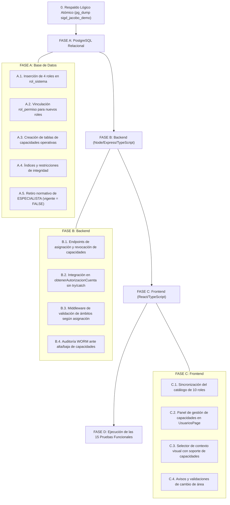

# SIGD SUIZA — INFORME TÉCNICO DE CIERRE TSK-1.1B
## CIERRE DE BRECHAS FUNCIONALES Y VALIDACIÓN FINAL DEL DISEÑO RBAC
### INSTITUTO DE EDUCACIÓN SUPERIOR TECNOLÓGICO PÚBLICO «SUIZA» — PUCALLPA, UCAYALI
**Rama Exclusiva:** `B_JACOBO` | **Entorno Oficial:** Entorno Aislado B_JACOBO | **Base de Datos:** `sigd_jacobo_demo` (PostgreSQL 18.6)  
**Estado:** Validación Funcional, Conciliación de Permisos y Preparación para Implementación Concluidas  
**Fecha de Emisión:** Noviembre de 2026

---

## 1. CONTROL DE METADATOS Y LÍNEA BASE

| Atributo | Certificación Registrada | Estado |
| :--- | :--- | :---: |
| **Institución** | IESTP Público «Suiza» (Pucallpa, Ucayali, Perú) | **CONFIRMADO** |
| **Sistema** | Sistema Integral de Gestión Documentaria (SIGD RENATO) | **CONFIRMADO** |
| **Rama Git Oficial** | `B_JACOBO` (Exclusiva, confirmada sin conmutaciones) | **CONFIRMADO** |
| **Base de Datos Principal** | `sigd_jacobo_demo` (PostgreSQL 18.6, Puerto Host 5433, **Solo Lectura**) | **CONFIRMADO** |
| **Entorno Aislado** | Único entorno de trabajo oficial de B_JACOBO | **CONFIRMADO** |
| **Catálogo Institucional** | Exactamente 10 roles institucionales (9 internos, 1 externo) | **CONFIRMADO** |
| **Capacidades Operativas** | `GESTOR_APOYO_AREA` como capacidad independiente (No es rol) | **CONFIRMADO** |
| **Estado de Migraciones** | Cero ejecuciones de DDL/DML sobre PostgreSQL en esta etapa | **IMPLEMENTADO** |

---

## 2. RESULTADO DE LA CONCILIACIÓN ARITMÉTICA DE LAS 15 OPERACIONES DOCUMENTALES

Se subsanó categóricamente la inconsistencia de conteo advertida en revisiones previas. El inventario consolidado comprende exactamente quince (15) operaciones documentales evaluadas contra los dieciséis (16) permisos reales de PostgreSQL:

* **COMPLETO (4 Operaciones):**
  1. *Lectura:* `EXPEDIENTE_LEER` (Global/Área/Titularidad).
  4. *Derivación:* `EXPEDIENTE_DERIVAR` (Área/Global).
  8. *Observación:* `TRAMICORE_DEVOLUCION_EVALUAR` (Ventanilla) / `EXPEDIENTE_RESOLVER` (Área).
  12. *Firma Digital:* `FIRMA_FIRMAR` (Global - Director con certificado acreditado).
* **PARCIAL (8 Operaciones):**
  5. *Recepción:* Apoyada en `EXPEDIENTE_DERIVAR` en área destino + mutación de estado a `RECEPCIONADO`.
  6. *Asignación:* Apoyada en `EXPEDIENTE_RESOLVER` + regla relacional de misma área.
  7. *Reasignación:* Apoyada en `EXPEDIENTE_RESOLVER` + regla de motivación en WORM.
  10. *Evaluación:* Apoyada en `EXPEDIENTE_RESOLVER` + verificación de asignación activa en `sigd_doc.expediente_asignacion`.
  11. *Aprobación Institucional:* Apoyada en `EXPEDIENTE_RESOLVER` + habilitación en `sigd_org.facultad_despacho`.
  13. *Notificación:* Despacho asíncrono Outbox/SSE/Casilla por eventos del sistema; consulta ciudadana por titularidad.
  14. *Cierre:* Apoyada en `EXPEDIENTE_RESOLVER` + comprobación de proveído final o resolución.
  15. *Archivo:* Apoyada en `EXPEDIENTE_RESOLVER` + custodia central y foliación continua AGN.
* **BRECHA (3 Operaciones):**
  2. *Registro / Radicación:* Controlada por router de ventanilla (`MESA_PARTES`) o sesión ciudadana. Brecha de permiso atómico `EXPEDIENTE_REGISTRAR`.
  3. *Edición de Borradores:* Controlada en servicio de documentos sobre borradores no suscritos. Brecha de permiso atómico `DOCUMENTO_EDITAR`.
  9. *Subsanación:* Controlada por router de casilla ciudadana con validación de plazo perentorio. Brecha de permiso atómico `EXPEDIENTE_SUBSANAR`.

$$\mathbf{4\text{ (Completo)}} + \mathbf{8\text{ (Parcial)}} + \mathbf{3\text{ (Brecha)}} = \mathbf{15\text{ Operaciones Conciliadas}}$$

---

## 3. MATRIZ DEFINITIVA DE COBERTURA Y ANÁLISIS DE BRECHAS REALES

| N.° | Operación Documental | Código Permiso Real en BD | Estado de Cobertura | Clasificación Técnica | Mitigación Actual en Backend | Propuesta Normalización (Fase 2) |
| :---: | :--- | :--- | :---: | :---: | :--- | :--- |
| **1** | **Lectura** | `EXPEDIENTE_LEER` | **COMPLETO** | **IMPLEMENTADO** | Filtro estricto por titularidad (`solicitante_id`) o por `area_id`. | Cobertura total existente. |
| **2** | **Registro / Radicación** | *(Ninguno en BD)* | **BRECHA** | **PARCIAL** | Router de ventanilla exige rol `MESA_PARTES` o sesión ciudadana. | Crear permiso atómico `EXPEDIENTE_REGISTRAR`. |
| **3** | **Edición de Borradores** | *(Ninguno en BD)* | **BRECHA** | **PARCIAL** | Servicio valida que el documento esté en borrador no suscrito. | Crear permiso atómico `DOCUMENTO_EDITAR`. |
| **4** | **Derivación** | `EXPEDIENTE_DERIVAR` | **COMPLETO** | **IMPLEMENTADO** | Valida proveído y estado `RECEPCIONADO`/`EN_TRAMITE`. | Cobertura total existente. |
| **5** | **Recepción** | `EXPEDIENTE_DERIVAR` | **PARCIAL** | **IMPLEMENTADO** | Valida tenencia material/digital en área receptora y muta estado. | Crear permiso atómico `EXPEDIENTE_RECEPCIONAR`. |
| **6** | **Asignación** | `EXPEDIENTE_RESOLVER` | **PARCIAL** | **IMPLEMENTADO** | Verifica pertenencia del docente evaluador a la misma `area_id`. | Crear permiso atómico `EXPEDIENTE_ASIGNAR`. |
| **7** | **Reasignación** | `EXPEDIENTE_RESOLVER` | **PARCIAL** | **IMPLEMENTADO** | Exige justificación motivada obligatoria en WORM. | Crear permiso atómico `EXPEDIENTE_REASIGNAR`. |
| **8** | **Observación** | `TRAMICORE_DEVOLUCION_EVALUAR` / `EXPEDIENTE_RESOLVER` | **COMPLETO** | **IMPLEMENTADO** | Observación formal de ventanilla vs. técnica de evaluador. | Cobertura total existente. |
| **9** | **Subsanación** | *(Ninguno en BD)* | **BRECHA** | **PARCIAL** | Valida plazo perentorio de 48 hrs y titularidad en Casilla. | Crear permiso atómico `EXPEDIENTE_SUBSANAR`. |
| **10**| **Evaluación** | `EXPEDIENTE_RESOLVER` | **PARCIAL** | **IMPLEMENTADO** | Exige asignación activa en `sigd_doc.expediente_asignacion`. | Crear permiso atómico `EXPEDIENTE_EVALUAR`. |
| **11**| **Aprobación Institucional** | `EXPEDIENTE_RESOLVER` | **PARCIAL** | **IMPLEMENTADO** | Verifica competencia directiva en `sigd_org.facultad_despacho`. | Crear permiso atómico `EXPEDIENTE_APROBAR`. |
| **12**| **Firma Digital** | `FIRMA_FIRMAR` | **COMPLETO** | **IMPLEMENTADO** | Invoca pasarela ReFirma y certificado PKI acreditado. | Cobertura total existente. |
| **13**| **Notificación** | Eventos Outbox / Casilla | **PARCIAL** | **IMPLEMENTADO** | Despacho daemon asíncrono; lectura por titularidad de cuenta. | Cobertura arquitectónica sin brecha. |
| **14**| **Cierre** | `EXPEDIENTE_RESOLVER` | **PARCIAL** | **IMPLEMENTADO** | Valida que exista resolución suscrita o proveído final. | Crear permiso atómico `EXPEDIENTE_CERRAR`. |
| **15**| **Archivo** | `EXPEDIENTE_RESOLVER` | **PARCIAL** | **IMPLEMENTADO** | Valida estado `CONCLUIDO` y foliación continua AGN. | Crear permiso atómico `EXPEDIENTE_ARCHIVAR`. |

---

## 4. ANÁLISIS DEL SUBSISTEMA DE NOTIFICACIONES

1. **Notificaciones Automáticas por Eventos:** Se generan atómicamente dentro de la misma transacción PostgreSQL de las operaciones sustantivas en `sigd_audit.outbox_eventos` (`casilla_notificacion`, `expediente_observado`, `expediente_resuelto`, `resolucion_emitida`, `tesoreria_notificacion`). El demonio `OutboxWorker` las despacha asíncronamente con concurrencia segura (`FOR UPDATE SKIP LOCKED`).
2. **Notificaciones Manuales / Providencias de Trámite:** Son iniciadas por operadores autorizados al registrar observaciones formales o traslados. La acción del usuario está amparada por la operación sustantiva que la origina (`TRAMICORE_DEVOLUCION_EVALUAR` o `EXPEDIENTE_RESOLVER`), sin requerir un permiso interactivo separado.
3. **Idempotencia y Prevención de Duplicados:**
   - Inserción protegida por clave de unicidad sobre la columna `referencia = id_evento` en `sigd_auth.notificacion_casilla`.
   - En eventos financieros (`tesoreria_notificacion`), se emplea bloqueo transaccional consultivo `SELECT pg_advisory_xact_lock(hashtextextended('casilla-financiera:' || evento.id_evento, 0))`.
4. **Consulta y Consulta de Historial:** Los administrados y estudiantes consultan su Casilla mediante `/api/v1/casilla/bandeja` y `/api/v1/casilla/notificaciones/:id`, autorizados por **estricta titularidad de cuenta** (`usuario_id = sub`).
5. **Conclusión Normativa:** **No se requiere inventar un permiso `NOTIFICACION_ENVIAR` en el catálogo RBAC**. La notificación es un efecto transaccional colateral gobernado por el motor de eventos.

---

## 5. DISEÑO DEFINITIVO DE `GESTOR_APOYO_AREA` (CAPACIDAD OPERATIVA)

* **Clasificación:** Capacidad operativa delegada de asistencia administrativa (**CONFIRMADO: No es un rol institucional**).
* **Estado Actual:** **PENDIENTE DE IMPLEMENTACIÓN FÍSICA** en la base de datos `sigd_jacobo_demo` (las tablas físicas `sigd_org.usuario_capacidad` y `sigd_org.capacidad_sistema` no existen en el esquema activo). El backend opera con salvaguarda defensiva `try/catch`.
* **Nueve Dependencias Técnicas Definidas para TSK-1.2:**
  1. Tabla de catálogo de capacidades (`sigd_org.capacidad_sistema`).
  2. Tabla de asignaciones de capacidades (`sigd_org.usuario_capacidad`).
  3. Delimitación de ámbito por clave foránea obligatoria `area_id`.
  4. Control de vigencia temporal (`vigente_desde`, `vigente_hasta`, `activo`).
  5. Auditoría inmutable en `sigd_auth.auditoria_usuarios`.
  6. Permisos estrictamente delimitados (lista negra que erradica facultades resolutivas y de firma).
  7. Revocación inmediata en tiempo de ejecución (`403 CONTEXT_REVOKED`).
  8. Contexto de trabajo independiente en selección de sesión (`claims.ctx`).
  9. Validación transaccional en backend en cada petición HTTP protegida.
* **Restricciones Funcionales:** Apoyo logístico, organización de requisitos, digitalización, preparación de expedientes y seguimiento. **Prohibición absoluta de aprobación institucional, firma digital, reasignación global y acceso inter-áreas**.

---

## 6. VALIDACIÓN DE ÁMBITOS INSTITUCIONALES Y ORGANIGRAMA

1. **Estado Real de `sigd_org.area`:** Actualmente existen únicamente tres (3) áreas de nivel 1 preexistentes:
   - `DG` (Dirección General, UUID `05f2ee8f-c90f-4239-898c-3ac113afc424`)
   - `MP` (Mesa de Partes, UUID `a1a3a496-ff7f-45d8-b63c-3e54fcf79de1`)
   - `SEC` (Secretaría Académica, UUID `2b147b0d-7c8f-434f-b75a-598a1ccb855b`)
2. **Incorporación de Unidades y Carreras:** Las unidades académicas intermedias y los programas de estudios se incorporarán al organigrama **únicamente cuando se disponga de la estructura institucional confirmada** por la Dirección. No se inventaron unidades ni códigos ad-hoc.
3. **Condiciones de Ámbito por Asignación:**
   - **Institucionales / Globales (`ADMINISTRADOR`, `DIRECTOR`, `TESORERO`):** `area_id` NULL o Nivel Institucional.
   - **Vinculados a Unidad (`JEFE_UNIDAD_ACADEMICA`):** `area_id` de Unidad Académica obligatorio.
   - **Vinculados a Área (`COORDINADOR_AREA`, `MESA_PARTES`, `SECRETARIO`, `DOCENTE`):** `area_id` de oficina o programa formativo obligatorio.
   - **Personales por Titularidad (`ESTUDIANTE`, `CIUDADANO`):** `area_id` obligatoriamente NULL (acceso regido por `solicitante_id = persona.id_persona`).

---

## 7. DIFERENCIACIÓN DOGMÁTICA: CVD, HASH Y FIRMA DIGITAL

1. **Código de Verificación Digital (CVD):** Código alfanumérico que identifica unívocamente el ejemplar digital y permite al administrado contrastar su validez en el portal público institucional. **El CVD no confiere validez jurídica por sí mismo ni es una firma digital.**
2. **Hash Documental (SHA-256):** Resumen criptográfico que acredita matemáticamente que el contenido del archivo PDF no ha sido alterado desde su radicación o suscripción.
3. **Código QR:** Mecanismo óptico bidimensional de acceso rápido que redirige al validador web institucional (`/validador/cvd/:codigo`).
4. **Firma Digital (Ley N.° 27269):** Suscripción criptográfica asimétrica basada en certificados digitales emitidos por entidad de certificación acreditada (e.g. RENIEC / PKI nacional), que confiere plena eficacia jurídica, autenticidad e inalterabilidad al documento suscrito por el Director General.
5. **Verificación de Integridad:** Comprobar el hash o el CVD no sustituye la existencia ni la validez de la firma digital de la autoridad emisora.

---

## 8. CONFIRMACIÓN DE LOS DIEZ (10) ROLES INSTITUCIONALES

Se mantiene inalterado el catálogo canónico de exactamente 10 roles:
* **Internos (9):**
  1. `ADMINISTRADOR` (Global Técnico)
  2. `DIRECTOR` (Global Directivo)
  3. `JEFE_UNIDAD_ACADEMICA` (Supervisión de Unidad)
  4. `COORDINADOR_AREA` (Gestión de Programa/Área)
  5. `SECRETARIO` (Secretaría Académica — Fe Administrativa y Custodia)
  6. `MESA_PARTES` (Ventanilla y Radicación)
  7. `DOCENTE` (Evaluación Asignada)
  8. `TESORERO` (Operador Financiero Único)
  9. `ESTUDIANTE` (Comunidad Estudiantil — Rol Interno)
* **Externo (1):**
  10. `CIUDADANO` (Administrado General — Único Rol Externo)

### Tratamiento de Roles Históricos:
* `CAJERO`, `APROBADOR_DEVOLUCIONES` y `SUPERVISOR_TESORERIA` ya figuran con `vigente = FALSE` y poseen **0 asignaciones**.
* Los seis (6) UUID de `ESPECIALISTA` se conservan intactos en `sigd_org.usuario_rol`. Se eliminaron las equivalencias automáticas y quedan registrados como **PENDIENTES DE AUTORIZACIÓN INSTITUCIONAL POR LA DIRECCIÓN**.

---

## 9. QUINCE (15) ESCENARIOS DE PRUEBAS FUNCIONALES DEFINITIVOS

Se formularon los 15 escenarios funcionales en [`docs/SIGD_B_JACOBO_DISENO_MIGRACION_RBAC_TSK_1_1.md`](file:///c:/Users/Liz/Desktop/SIGD/SIGD/docs/SIGD_B_JACOBO_DISENO_MIGRACION_RBAC_TSK_1_1.md), estructurados por `Estado inicial`, `Actor`, `Contexto`, `Acción`, `Resultado esperado`, `Regla de autorización`, `Riesgo` y `Evidencia de auditoría`:
1. Notificación automática frente a manual.
2. Envío duplicado de notificaciones (Idempotencia y Advisory Lock).
3. Docente que intenta consultar expedientes ajenos.
4. Coordinador que intenta reasignar fuera de su ámbito.
5. Apoyo de Área que intenta aprobar una resolución.
6. Estudiante que intenta consultar documentos de otro estudiante.
7. Ciudadano que intenta acceder a módulos internos.
8. Revocación de capacidad durante una sesión abierta.
9. Cambio de unidad académica.
10. Pérdida de una designación institucional.
11. Cambio de cargo conservando otros roles.
12. Operación financiera sin permiso específico.
13. Intento de firma sin facultad.
14. Cierre de un expediente sin cumplir sus condiciones.
15. Archivo de un expediente sin completar las etapas requeridas.

---

## 10. ORDEN DE IMPLEMENTACIÓN TÉCNICA PARA TSK-1.2

Una vez autorizada la fase de implementación, los trabajos deberán ejecutarse estrictamente en el siguiente orden secuencial:

---

## 11. VERIFICACIÓN GIT Y ESTADO DE PROTECCIÓN

* `git branch --show-current`: `B_JACOBO`.
* `git status --short docs/`: Modificaciones limitadas exclusivamente a los documentos de diseño y al presente informe.
* Cero modificaciones en código fuente (backend y frontend intactos).
* Cero commits y cero push ejecutados.

---

## 12. CERTIFICACIÓN TERMINANTE DE NO MUTACIÓN EN POSTGRESQL

> [!IMPORTANT]
> **CERTIFICACIÓN DE PROTECCIÓN DE BASE DE DATOS:**  
> Se certifica de manera categórica que **NO se ha ejecutado ninguna operación de DDL (`CREATE`, `ALTER`, `DROP`), DML (`INSERT`, `UPDATE`, `DELETE`) ni migración sobre la base de datos `sigd_jacobo_demo`**.  
> Todas las inspecciones se realizaron en **modo de estricto solo lectura (`SELECT`)**.  
> No se ha creado ninguna base de datos ni entorno paralelo. El entorno oficial aislado `B_JACOBO` permanece 100% puro e intacto.

---

## 13. DECLARACIÓN DE CIERRE Y CONDICIÓN DE PARADA

La tarea preparatoria **`TSK-1.1B`** queda declarada **TERMINADA Y DEFINITIVAMENTE CERRADA**.

> [!CAUTION]
> **CONDICIÓN DE PARADA ACTIVA:**  
> Se detienen todas las intervenciones. No se iniciará la migración ni la tarea **`TSK-1.2`** hasta recibir tu instrucción expresa y autorización formal.
