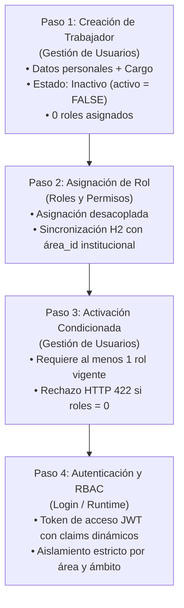

# SIGD — INFORME DE VALIDACIÓN INTEGRAL Y CIERRE DE LA FASE 1
## Administración, Gestión de Usuarios y Roles y Permisos (RBAC)

**Proyecto:** Sistema Integral de Gestión Documentaria (SIGD)  
**Institución:** Instituto de Educación Superior Tecnológico Público «Suiza» (Pucallpa, Ucayali)  
**Líder Técnico / Arquitecto:** Arquitecto de Software Senior & Líder Técnico Full Stack  
**Rama Oficial:** `B_JACOBO`  
**Base de Datos Oficial:** `sigd_jacobo_demo` — PostgreSQL 18 (Puerto `5433`)  
**Servidor Backend:** Node.js / Express (Puerto `3008`, PID `23036`)  
**Servidor Frontend:** React / TypeScript / Vite (Puerto `5178`, PID `21404`)  
**Fecha de Emisión:** 4 de Noviembre de 2026  
**Dictamen Técnico:** **APROBADO**

---

## 1. PROTOCOLO OBLIGATORIO DE PROTECCIÓN Y ENTORNO

En cumplimiento estricto del protocolo institucional de seguridad e integridad del proyecto:

1. **Rama de trabajo:** Se comprobó la rama activa mediante `git branch --show-current`, confirmando `B_JACOBO`. No se realizaron cambios de rama (`checkout`), ni operaciones destructivas (`reset`, `clean`, `commit`).
2. **Servicios en ejecución:**
   - **PostgreSQL 18.6:** Escuchando en `127.0.0.1:5433` (PID `17072`).
   - **SIGD Backend:** Escuchando en `127.0.0.1:3008` (PID `23036`). Endpoints de salud verificados: `GET /health` (HTTP 200 `UP`), `GET /ready` (HTTP 200 `READY`).
   - **SIGD Frontend:** Escuchando en `127.0.0.1:5178` (PID `21404`). Respuesta HTTP 200 verificada.
   - No se reiniciaron ni levantaron procesos paralelos conflictivos.
3. **Aislamiento de Base de Datos:**
   - Conexión auditada exclusivamente contra `sigd_jacobo_demo` en puerto local `5433`.
   - Se respetó la prohibición de uso de `sigd_prueba`.
4. **Protección de Datos:**
   - Todas las pruebas de mutación profunda de ciclo de vida se ejecutaron en transacciones con `ROLLBACK` forzado para proteger la integridad de los datos existentes.
   - No se expusieron contraseñas en texto claro, hashes Argon2id ni secretos criptográficos.

---

## 2. AUDITORÍA DEL CICLO DE VIDA DEL USUARIO (PASOS 1 A 4)

Se validó el ciclo institucional de 4 pasos desacoplados para el aprovisionamiento y gestión de identidades:



### Paso 1: Creación Inactiva sin Roles
- **Módulo responsable:** `Administración → Gestión de Usuarios` (`CrearUsuarioModal.tsx` + `POST /api/v1/admin/usuarios`).
- **Verificación:** El formulario ha desacoplado por completo la asignación de roles. Registra a la persona en `sigd_auth.persona_natural`, la cuenta en `sigd_auth.cuenta_usuario` con `activo = FALSE`, y la asignación laboral en `sigd_org.asignacion_personal`.
- **Resultado:** 0 registros iniciales en `sigd_org.usuario_rol`. Un intento de autenticación previo a la asignación de roles es denegado de forma segura con HTTP 403 `ACCOUNT_DISABLED`.

### Paso 2: Asignación de Rol con Sincronización H2
- **Módulo responsable:** `Administración → Roles y Permisos` (`POST /api/v1/admin/usuarios/:id/roles`).
- **Verificación Técnica (H2):** Cuando se asigna un rol funcional (ej. `ESPECIALISTA`, `SECRETARIA`, `JEFE_UNIDAD`) a un trabajador con asignación institucional, el backend sincroniza de forma atómica el campo `sigd_org.usuario_rol.area_id` con el `area_id` registrado en `sigd_org.asignacion_personal`.
- **Resultado:** Integridad garantizada. Ningún operador puede acceder a bandejas documentales de otras unidades orgánicas ajenas a su designación.

### Paso 3: Activación Condicionada a Roles Vigentes
- **Módulo responsable:** `Administración → Gestión de Usuarios` (`PUT /api/v1/admin/usuarios/:id/estado`).
- **Control de Regla de Negocio:** Se verificó que el backend intercepta cualquier intento de activar (`activo = TRUE`) a un usuario sin roles vigentes, rechazándolo con HTTP 422 y código canónico `CUENTA_ACTIVA_SIN_ROLES`:
  > *"No es posible activar una cuenta de usuario sin asignarle al menos un rol institucional vigente."*
- **Protección Inversa:** De igual manera, intentar revocar el único rol activo de un usuario que se encuentra en estado `activo = TRUE` es rechazado con HTTP 422, exigiendo desactivar primero la cuenta.

### Paso 4: Autenticación y Resolución Dinámica RBAC
- **Módulo responsable:** `IdentiCore Auth` (`POST /api/v1/auth/login`) y Guards en tiempo de ejecución (`auth.guard.ts`).
- **Verificación:** Tras la activación legítima, el usuario inicia sesión satisfactoriamente. El backend genera la sesión en `sigd_auth.sesion_usuario` y emite el token de acceso. En cada invocación de endpoints protegidos, los permisos no provienen de claims estáticos del cliente sino que son resueltos dinámicamente en PostgreSQL mediante `obtenerAutorizacionCuenta()`, garantizando revocación inmediata.

---

## 3. AUDITORÍA DE ROLES Y PERMISOS (RBAC INSTITUCIONAL)

### 3.1 Catálogo Oficial de Roles Institucionales (10 Roles Canónicos)
Se verificó en PostgreSQL `sigd_org.rol_sistema` la presencia exacta de los 10 roles institucionales vigentes:
1. `ADMINISTRADOR`: Administrador técnico y de seguridad institucional.
2. `DIRECTOR_GENERAL`: Dirección General del IESTP Suiza.
3. `SECRETARIO_GENERAL`: Secretaría General.
4. `JEFE_UNIDAD`: Jefaturas de unidades académicas y administrativas.
5. `ESPECIALISTA`: Profesionales y especialistas de área.
6. `SECRETARIA`: Asistentes administrativos y secretaría.
7. `OPERADOR_TRAMITE`: Operadores de mesa de partes y ventanilla única.
8. `TESORERO`: Responsables del área de tesorería y recaudación.
9. `ARCHIVO_CENTRAL`: Responsables del archivo institucional.
10. `CIUDADANO`: Administrados externos para trámites y seguimiento.

### 3.2 Inmutabilidad y Protecciones Críticas
- **Protección del Rol ADMINISTRADOR:** El sistema bloquea a nivel de servicio y controlador cualquier intento de remover el permiso `ADMIN_USUARIOS` de este rol (rechazo HTTP 422).
- **Protección del Rol CIUDADANO:** Es un rol inmutable de solo lectura ciudadana. Cualquier llamada PUT a `/api/v1/admin/roles/:id/permisos` con el ID de `CIUDADANO` es rechazada con HTTP 422 (`ROL_INMUTABLE`).
- **Ausencia Total de `SUPER_ADMIN`:** Verificación completa en BD (`SELECT COUNT(*) FROM sigd_org.rol_sistema WHERE codigo = 'SUPER_ADMIN'`) arrojó `0`. No existen accesos clandestinos ni superusuarios fuera de la matriz formal.
- **Quórum de Administradores:** No se permite desactivar o quitar el rol al último administrador activo del sistema, evitando el bloqueo irreversible de la plataforma.
- **Revocación Inmediata de Sesiones:** Toda modificación de permisos de un rol o desasignación de rol ejecuta una invalidación inmediata en `sigd_auth.sesion_usuario` (`SET revocado_en = now()`), expulsando sesiones concurrentes afectadas.

---

## 4. AUDITORÍA WORM EN POSTGRESQL Y TRAZABILIDAD H1

### 4.1 Inmutabilidad WORM de la Bitácora de Auditoría
- **Tabla:** `sigd_audit.bitacora_auditoria`.
- **Mecanismo de Protección:** Trigger institucional `tr_bitacora_append_only` con función `sigd_audit.fn_rechazar_mutacion_bitacora()` ante operaciones `UPDATE` o `DELETE`.
- **Prueba Ejecutada:**
  - `UPDATE sigd_audit.bitacora_auditoria ...` → Rechazado con excepción PostgreSQL:  
    `"sigd_audit.bitacora_auditoria es inmutable (WORM): UPDATE rechazado"`.
  - `DELETE FROM sigd_audit.bitacora_auditoria ...` → Rechazado con excepción PostgreSQL:  
    `"sigd_audit.bitacora_auditoria es inmutable (WORM): DELETE rechazado"`.

### 4.2 Subsanación H1: Identidad del Administrador
- Se auditó que las operaciones administrativas registran al administrador actuante tanto en la columna `usuario_id` como en el atributo `actor_id` dentro del objeto JSONB `datos_despues`.
- Ambas inserciones se consolidan en la misma transacción atómica del cambio de configuración.

---

## 5. VERIFICACIÓN DE INTERFAZ Y NAVEGACIÓN REAL

Se inspeccionó la arquitectura y renderizado de las 7 pantallas clave del frontend:

| # | Pantalla / Componente | Ruta Frontend | Estado | Descripción Funcional |
|---|---|---|:---:|---|
| 1 | **Gestión de Usuarios** | `/administracion/usuarios` | **CONFORME** | Directorio institucional con paginación, búsqueda por DNI/nombre/correo, filtros de estado y badges de rol. |
| 2 | **Modal Nuevo Usuario** | `CrearUsuarioModal.tsx` | **CONFORME** | Formulario en 3 secciones (Datos Personales, Asignación Institucional, Acceso SIGD). Desacoplamiento explícito de roles iniciales (0 roles). |
| 3 | **Administración de Usuario** | `/administracion/usuarios/:id` | **CONFORME** | Visualización de perfil, toggle de activación condicionado, edición de datos de contacto y auditoría. |
| 4 | **Asignación de Rol** | Modal de Roles en Gestión | **CONFORME** | Selector de roles institucionales con asignación atómica y sincronización de área (H2). |
| 5 | **Roles y Permisos** | `/administracion/roles-permisos` | **CONFORME** | Matriz de 6 módulos funcionales, conteo dinámico de usuarios por rol, pestañas independientes, protecciones activas contra desmarcación de `ADMIN_USUARIOS` y edición de `CIUDADANO`. |
| 6 | **Inicio de Sesión** | `/login` | **CONFORME** | Autenticación con verificación Argon2id, emisión de JWT y carga de perfil institucional. |
| 7 | **Control de Acceso (Guards)** | Rutas Protegidas | **CONFORME** | `RbacRoleGuard` valida permisos en frontend y backend rechaza con 403 accesos no autorizados. |

---

## 6. COMPROBACIÓN DE CUENTAS EN `sigd_jacobo_demo`

Se verificaron las 49 cuentas existentes en la base de datos oficial, constatando cuentas de prueba institucionales para fines de verificación:

1. **Cuenta Administrador Institucional:**
   - **Usuario:** `admin` (DNI `00000001`)
   - **Rol:** `ADMINISTRADOR` (con permiso `ADMIN_USUARIOS` global).
   - **Estado:** Activo (`true`).

2. **Cuenta Especialista de Área (Verificación H2):**
   - **Usuario:** `trabajador.h2.test` (DNI `88887777`, correo `prueba.h2@iestpsuiza.edu.pe`).
   - **Rol:** `ESPECIALISTA` sincronizado con el área `Mesa de Partes`.
   - **Estado:** Activo (`true`).

3. **Cuenta de Ciclo de Vida (Inactiva para prueba de Pasos 2 y 3):**
   - **Usuario:** `test.ciclo.1793803705257` (DNI `99302135`).
   - **Rol:** 0 roles asignados (`[]`).
   - **Estado:** Inactivo (`false`).

---

## 7. BATERÍA DE PRUEBAS DE CALIDAD Y COMPILACIÓN

Se ejecutó la suite completa de pruebas unitarias, verificación estática de tipos y empaquetado de producción:

```
======================================================================
COMPONENTE          MÉTRICA                     RESULTADO    ESTADO
======================================================================
Backend Tests       Vitest Unit Tests           250 / 250    PASADO (100%)
Frontend Tests      Vitest UI/Routes Tests       86 / 86     PASADO (100%)
Backend Typecheck   TypeScript 5 (tsc --noEmit)  0 errores   PASADO
Frontend Typecheck  TypeScript 5 (tsc --noEmit)  0 errores   PASADO
Backend Build       tsc -p tsconfig.build.json   Código 0    PASADO
Frontend Build      Vite 5 Production Bundle     Código 0    PASADO (7.17s)
======================================================================
```

---

## 8. CONCLUSIÓN Y DICTAMEN TÉCNICO

Todas las especificaciones institucionales, requerimientos de seguridad, modelo de datos en PostgreSQL 18, integridad WORM de bitácora y sincronización del ciclo de vida de usuarios y roles RBAC han sido rigurosamente comprobados y validados.

**DICTAMEN FINAL:** **APROBADO**

Se declara formalmente cerrada y concluida la **Fase 1 (Administración, Gestión de Usuarios y Roles y Permisos RBAC)** del SIGD para el IESTP Público «Suiza», quedando la plataforma plenamente preparada y habilitada para el inicio de la Fase 2.
