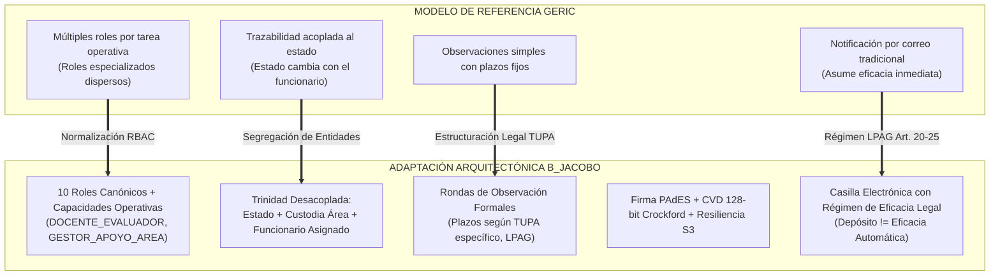

# SIGD RENATO — MATRIZ DE ADAPTACIÓN FUNCIONAL Y TRAZABILIDAD
## CONSOLIDACIÓN TÉCNICA: DISEÑO GERIC (FASES 5G–5K) $\rightarrow$ ARQUITECTURA `B_JACOBO`
### INSTITUTO DE EDUCACIÓN SUPERIOR TECNOLÓGICO PÚBLICO «SUIZA»
### RAMA OFICIAL: `B_JACOBO` — VERSIÓN V1.2.1

---

## 1. OBJETIVO DEL ANÁLISIS COMPARATIVO

Este documento formaliza la adaptación funcional de los avances conceptuales y de diseño desarrollados por **Geric** (fases 5G a 5K) hacia la arquitectura de software real de nuestra rama principal **`B_JACOBO`**.

El principio director es: **aprovechar la riqueza de flujos y trazabilidad de Geric sin realizar copias indiscriminadas de código, preservando la base tecnológica probada en TypeScript, Express y PostgreSQL 18.**

---

## 2. MATRIZ DE CORRESPONDENCIA DE FASES GERIC $\rightarrow$ ARQUITECTURA B_JACOBO

| Fase Geric | Concepto Central en Geric | Adaptación Funcional en B_JACOBO | Dominio Destino en B_JACOBO | Estado de Implementación |
| :--- | :--- | :--- | :--- | :--- |
| **Fase 5G** | **Trazabilidad Documental y Flujogramas:** Registro de movimientos, proveídos de derivación y confirmación de recepción. | Implementación de `sigd_rut.movimiento_tramite` como libro append-only con estados segregados de la custodia y responsable. | `RutaDoc` | **IMPLEMENTADO PARCIALMENTE** |
| **Fase 5H** | **Asignaciones y Roles Temporales:** Designación de evaluadores de carrera y encargaturas con vigencia. | Capacidad operativa `DOCENTE_EVALUADOR` y `GESTOR_APOYO_AREA`; múltiples roles por cuenta con asignación activa/inactiva. | `Organicore` / `RutaDoc` | **PROPUESTA / PENDIENTE DE CODIFICACIÓN** |
| **Fase 5I** | **Observaciones y Subsanaciones:** Cédulas de observación, plazo legal perentorio, congelamiento y reanudación. | Módulo de rondas de observación (`ronda_numero`) con plazos específicos por procedimiento TUPA y portal de subsanación. | `RutaDoc` / `TramiCore` | **PROPUESTA / PENDIENTE DE CODIFICACIÓN** |
| **Fase 5J** | **Resoluciones y Firma Digital PAdES:** Generación de proyectos de resolución, visación y firma de Director. | Motor de plantillas con `pdf-lib`, CVD Crockford 128-bit, QR con HMAC rotativo, hash SHA-256 y verificación PAdES-B-LT. | `DocuCore` | **IMPLEMENTADO PARCIALMENTE** |
| **Fase 5K** | **Notificaciones y Casilla Electrónica:** Depósito fehaciente de resoluciones y cómputo de términos legales. | Servicio de Casilla Electrónica institucional con evidencias segregadas de depósito, acceso y eficacia legal según LPAG. | `Corelink` | **PROPUESTA / PENDIENTE DE CODIFICACIÓN** |

---

## 3. ADAPTACIONES ARQUITECTÓNICAS DETALLADAS

### 3.1. Dimensión 1: Identidad, Organización y Responsabilidades
* **Enfoque de Geric:** Proponía crear roles institucionales para cada función operativa emergente (ej. evaluador, personal de apoyo, cajero).
* **Adaptación en B_JACOBO:**
  * Catálogo formal fijado en **exactamente diez (10) roles**.
  * Las tareas operativas especializadas se absorben mediante **Capacidades Operativas**:
    * `DOCENTE_EVALUADOR`: Permite al docente calificar expedientes curriculares o de titulación donde conste su designación.
    * `GESTOR_APOYO_AREA`: Habilita al personal administrativo (o docente en apoyo) para la recepción, foliación y armado de carpetas de programa o secretaría, **sin constituir un rol independiente y sin facultades de firma ni reasignación**.
  * **Múltiples Asignaciones por Cuenta:** Una persona puede tener más de un rol asignado (ej. Docente y Coordinador de Área) bajo una misma cuenta de usuario (`id_usuario`), con estado `activo/inactivo` y ámbito delimitado.
  * **Ámbito del Coordinador:** El `COORDINADOR_AREA` puede abarcar un Programa de Estudios o una Unidad Académica completa si media designación formal, sin concederle acceso global institucional.

### 3.2. Dimensión 2: Trazabilidad, Estados y Custodia
* **Enfoque de Geric:** Trazabilidad en la que el estado del expediente se vinculaba a la persona que lo procesaba.
* **Adaptación en B_JACOBO:**
  * Separación estricta de:
    1. **`estado_actual`:** Situación del trámite en la máquina de estados (`REGISTRADO`, `EN_CALIFICACION`, `DERIVADO`, `EN_EVALUACION`, `OBSERVADO`, `SUBSANADO`, `EN_PROYECCION`, `FIRMADO`, `NOTIFICADO`, `ATENDIDO`, `ARCHIVADO`, `DESISTIDO`, `SUSPENDIDO`).
    2. **`area_custodia_id`:** Unidad orgánica responsable de la tenencia legal del trámite.
    3. **`evaluador_asignado_id`:** Servidor o docente específico que ejecuta la tarea.
    4. **`estado_notificacion`:** Estado legal de la comunicación del acto resolutivo.
  * **Reasignación Justificada:** Cuando un coordinador reasigna un expediente entre evaluadores, se registra el evento en `sigd_rut.expediente_evaluador_historial` con motivo obligatorio, **sin alterar el estado `EN_EVALUACION` ni trasladar la custodia del área**.

### 3.3. Dimensión 3: Ciclo de Observaciones y Subsanaciones (Fase 5I)
* **Enfoque de Geric:** Asumía plazos fijos universales de 48 horas y 10 días para todas las observaciones.
* **Adaptación en B_JACOBO:**
  * Se elimina la universalidad de plazos. Los términos de subsanación y calificación se rigen por la **ficha específica de cada procedimiento TUPA** (aprobación automática, evaluación previa positiva o negativa).
  * Los plazos no verificados en el TUPA 2026 vigente se clasifican como **`PENDIENTE`**.
  * Las observaciones se organizan en rondas secuenciales con cédula formal y bloqueo operativo durante el plazo otorgado.

### 3.4. Dimensión 4: Criptografía, CVD, QR y Firma Digital (Fase 5J)
* **Enfoque de Geric:** Trató el código QR y el CVD como elementos equivalentes a la autenticidad documental.
* **Adaptación en B_JACOBO:**
  * Separación nítida de los 5 elementos de seguridad documental:
    1. **CVD (128-bit Crockford Base32):** Identificador alfanumérico para localización rápida. **No sustituye la firma digital.**
    2. **QR:** Mecanismo gráfico de captura de la URL canónica. **Su presencia no acredita autenticidad.**
    3. **Hash SHA-256:** Huella digital criptográfica de los bytes del PDF.
    4. **Token HMAC (`v1:kid:cvd`):** Autorización de acceso seguro para el documento completo en el QR (Nivel 2).
    5. **Firma Digital PAdES-B-LT:** Presunción legal de autoría bajo la IOFE / Indecopi.
  * **Verificación Independiente:** La API y el portal público reportan de forma separada la validez de la firma digital (PKI) y la integridad del documento (hash y metadatos).
  * **Resiliencia S3:** En caso de caída de MinIO, el validador emite `VERIFICACIÓN PARCIAL` (HTTP 200) consultando PostgreSQL, sin fallar con 503.

### 3.5. Dimensión 5: Notificaciones y Casilla Electrónica (Fase 5K)
* **Enfoque de Geric:** Asumía que enviar un correo electrónico o depositar en casilla constituía notificación inmediata y eficaz.
* **Adaptación en B_JACOBO:**
  * Desacoplamiento del estado procesal respecto al régimen de notificación legal conforme a la LPAG (art. 20-25):
    * **Depósito:** Fecha y hora en que la resolución ingresa a la casilla.
    * **Puesta a Disposición:** Aviso por correo electrónico informando del depósito.
    * **Acceso:** Momento en que el administrado abre y lee la notificación.
    * **Eficacia Legal:** Inicio del cómputo de términos legales a partir del día hábil siguiente al que adquiere eficacia.

---

## 4. MATRIZ DE DECISIONES: QUÉ SE ADOPTA, QUÉ SE ADAPTA Y QUÉ SE DESCARTA

| Componente | Decisión de Arquitectura | Justificación Técnica en B_JACOBO |
| :--- | :---: | :--- |
| **Separación de Custodia y Responsable** | **SE ADOPTA ÍNTEGRAMENTE** | Garantiza la trazabilidad en reasignaciones, suplencias y rotaciones. |
| **Rondas de Observación Formales** | **SE ADAPTA SEGÚN TUPA** | Plazos no universales; correspondencia con la ficha del procedimiento en TUPA 2026. |
| **Roles Múltiples Dispersos de Geric** | **SE ADAPTA COMO CAPACIDADES** | Mantiene el catálogo en exactamente 10 roles limpios y gobernables en PostgreSQL. |
| **Verificación QR Simple de Geric** | **SE EVOLUCIONA A CVD 128-BIT + HMAC** | Otorga resistencia contra colisiones y permite verificación resiliente ante caída de MinIO. |
| **Subdivisiones de Tesorería de Geric** | **SE DESCARTA DEFINITIVAMENTE** | `CAJERO` y `SUPERVISOR` quedan prohibidos; todas las funciones recaen en `TESORERO`. |
| **Rol `ESPECIALISTA` Genérico** | **SE DESCARTA DEFINITIVAMENTE** | Reemplazado por los cargos orgánicos reales: `JEFE_UNIDAD_ACADEMICA`, `COORDINADOR_AREA` y `DOCENTE`. |
| **Exigencia de Correo Institucional para Estudiante**| **SE DESCARTA COMO OBLIGATORIA** | El perfil `ESTUDIANTE` se rige por su identidad académica, sin excluir a quienes carezcan de dominio `@iestpsuiza.edu.pe`. |
