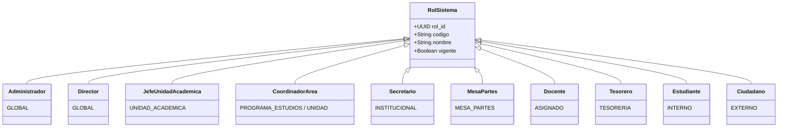
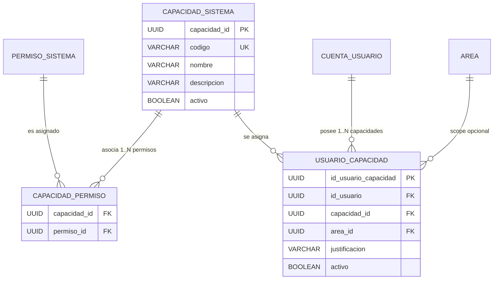

# SIGD RENATO — MATRIZ DE ROLES, RESPONSABILIDADES Y PERMISOS V1.2.1
## MODELO DE AUTORIZACIÓN, SEGREGACIÓN FUNCIONAL Y CAPACIDADES OPERATIVAS
### INSTITUTO DE EDUCACIÓN SUPERIOR TECNOLÓGICO PÚBLICO «SUIZA»
### RAMA OFICIAL: `B_JACOBO`

---

## 1. INTRODUCCIÓN Y PRINCIPIOS DE AUTORIZACIÓN

El presente documento define la matriz definitiva de control de acceso basado en roles (RBAC) y capacidades operativas para el SIGD RENATO del IESTP Público «Suiza», consolidada y endurecida conforme a la especificación técnica **TSK-1.0A**.

El modelo se rige por los siguientes principios normativos y de seguridad:
1. **Catálogo Canónico de Exactamente Diez Roles:** El sistema reconoce única y exclusivamente diez roles institucionales. Ningún cargo temporal, vínculo laboral ni apoyo operativo constituye un nuevo rol.
2. **Capacidades Operativas Desacopladas y Relacionalmente Normalizadas:** Las facultades operativas especializadas (ej. calificar un expediente específico, apoyo administrativo de secretaría de programa) se modelan mediante tablas relacionales normalizadas (`sigd_org.capacidad_sistema`, `sigd_org.capacidad_permiso`, `sigd_org.usuario_capacidad`), reutilizando estrictamente el catálogo institucional de permisos atómicos `sigd_org.permiso_sistema`, sin columnas JSONB arbitrarias.
3. **Múltiples Roles por Cuenta:** Una misma persona natural conserva una sola cuenta institucional (`id_usuario`) y puede poseer múltiples asignaciones de roles independientes, cada una con su ámbito organizacional, estado (`activo/inactivo`), justificación de designación y auditoría.
4. **Principio Rector de Sesión Contextual:**
   $$\text{UNA PERSONA} \longrightarrow \text{UNA CUENTA} \longrightarrow \text{MÚLTIPLES ASIGNACIONES} \longrightarrow \text{UN CONTEXTO ACTIVO POR SESIÓN}$$
   **Cero acumulación automática de permisos:** Cuando un usuario posee múltiples asignaciones activas, el login **NO preselecciona silenciosamente** ninguna. Emite una sesión con `requiereSeleccionContexto: true`, `contextoActivo: null`, `roles: []` y `permisos: []`. Las rutas operativas deniegan el acceso hasta que el usuario seleccione explícitamente su contexto.
5. **Criptografía y Vinculación Estricta de Contexto:** El contexto activo viaja firmado en el claim `ctx` del JWT. El encabezado `x-contexto-id` es verificado en cada petición; si difiere de `claims.ctx`, se rechaza con `403 CONTEXT_HEADER_MISMATCH`. Si una sesión sin contexto intenta enviar el encabezado, se rechaza con `403 CONTEXT_SELECTION_REQUIRED`.
6. **Resolución Dinámica de Autoridad:** El backend Express evalúa la vigencia y el estado activo de cada rol directamente en PostgreSQL (`sigd_org.usuario_rol`) en cada petición HTTP, garantizando la revocación inmediata.

---

## 2. EL CATÁLOGO INSTITUCIONAL DE EXACTAMENTE DIEZ ROLES



### 2.1. Fichas Descriptivas de los Diez Roles

#### 1. `ADMINISTRADOR`
* **Naturaleza:** Administrador técnico-funcional de la plataforma.
* **Ámbito (Scope):** `GLOBAL`.
* **Funciones Principales:** Gestión del ciclo de vida de usuarios, registro de personas, configuración del organigrama (áreas y sedes), asignación de cargos, asignación de roles y consulta de bitácoras de auditoría.
* **Restricciones Absolutas:** No radica trámites como funcionario, no califica requisitos de negocio, no firma documentos oficiales ni anula resoluciones. No puede revocar su propio acceso a `ADMIN_USUARIOS` (protección contra autobloqueo).

#### 2. `DIRECTOR`
* **Naturaleza:** Máxima autoridad legal y ejecutiva del IESTP Suiza.
* **Ámbito (Scope):** `GLOBAL`.
* **Funciones Principales:** Despacho general de la institución, revisión de informes finales, emisión y firma digital de Resoluciones Directorales (PAdES-B-LT), decretos y proveídos superiores.
* **Restricciones Absolutas:** La firma requiere certificado digital emitido por entidad acreditada en la IOFE; no puede eludir la visación previa de Secretaría Académica en trámites curriculares.

#### 3. `JEFE_UNIDAD_ACADEMICA`
* **Naturaleza:** Conducción pedagógica y académica del Instituto.
* **Ámbito (Scope):** `UNIDAD_ACADEMICA` (abarca todos los programas de estudios).
* **Funciones Principales:** Supervisión general de los planes formativos, resolución de demoras en trámites académicos, validación de convalidaciones complejas, emisión de dictámenes y elevación de proyectos de resolución a Dirección.
* **Delimitación Estricta:** Sus facultades están circunscritas a su Unidad Académica; no posee acceso global institucional automático. No asigna directamente docentes evaluadores en el día a día (facultad del Coordinador de Área), pero supervisa el cumplimiento de los plazos.

#### 4. `COORDINADOR_AREA`
* **Naturaleza:** Responsable del Programa de Estudios o Unidad de Coordinación.
* **Ámbito (Scope):** `PROGRAMA_ESTUDIOS` o `UNIDAD_ACADEMICA` (según designación formal).
* **Funciones Principales:** Recepción de expedientes derivados de Mesa de Partes o Secretaría, asignación y reasignación justificada de docentes evaluadores, supervisión de carpetas de titulación y prácticas preprofesionales (EFSRT), y emisión del informe técnico de programa.
* **Restricciones Absolutas:** Cero visibilidad y cero facultades sobre expedientes de áreas o programas fuera de su ámbito asignado.

#### 5. `SECRETARIO`
* **Naturaleza:** **Secretario Académico Institucional.**
* **Ámbito (Scope):** `INSTITUCIONAL` (Área de Secretaría Académica).
* **Funciones Principales:** Custodia oficial de actas de notas, emisión de certificados oficiales, convalidaciones de ingreso, carnés de estudiante, proyección de resoluciones de titulación y visación previa a la firma del Director.
* **Restricciones Absolutas:** No firma resoluciones (facultad exclusiva del Director). No ejerce evaluación técnica de proyectos de carrera (recae en el docente/coordinador).

#### 6. `MESA_PARTES`
* **Naturaleza:** Ventanilla única de atención al administrado (presencial y virtual).
* **Ámbito (Scope):** `MESA_PARTES`.
* **Funciones Principales:** Recepción de solicitudes, comprobación formal de requisitos TUPA, asignación obligatoria de Código Único de Trámite (CUT), foliación, emisión de cédulas de observación por inadmisibilidad y derivación al área competente.
* **Restricciones Absolutas:** No califica aspectos técnicos ni de fondo; no aprueba ni deniega trámites.

#### 7. `DOCENTE`
* **Naturaleza:** Personal docente del Instituto.
* **Ámbito (Scope):** `ASIGNADO` (para evaluación técnica) y `PROPIO` (para trámites personales).
* **Funciones Principales:**
  1. *Como Evaluador Técnico:* Calificación técnica de expedientes en los que fue formalmente designado (vía `sigd_rut.expediente_evaluador`).
  2. *Como Administrado:* Presentación de solicitudes personales (licencias, informes de fin de ciclo, justificaciones).
* **Restricciones Absolutas:** No tiene acceso a la bandeja general del programa ni a expedientes donde no conste su designación activa (`activo = TRUE`).

#### 8. `TESORERO`
* **Naturaleza:** Responsable de la gestión financiera, caja y recaudación.
* **Ámbito (Scope):** `TESORERIA`.
* **Funciones Principales:** Validación de comprobantes de pago (banco/caja), registro de liquidaciones, arqueos, conciliaciones y generación de reportes de recaudación. Conserva íntegros sus 9 permisos históricos sin omisión.
* **Restricciones y Controles:** No puede validar sus propios pagos ni tramitar devoluciones en las que figure como titular. Las devoluciones sobre montos umbral quedan sujetas a doble aprobación.

#### 9. `ESTUDIANTE`
* **Naturaleza:** **Administrado Interno** de la comunidad académica.
* **Ámbito (Scope):** `INTERNO` (vinculado a su identidad académica: código de estudiante / DNI).
* **Funciones Principales:** Presentación de solicitudes curriculares, seguimiento en línea por CUT, recepción de notificaciones formales en su Casilla Electrónica institucional y subsanación de observaciones.
* **Condición de Acceso:** Su acceso se fundamenta en su identidad académica y matrícula, sin exigir obligatoriamente cuenta institucional `@iestpsuiza.edu.pe`.
* **Restricciones Absolutas:** Cero visibilidad de trámites de otros estudiantes; acceso bloqueado a bandejas internas de gestión.

#### 10. `CIUDADANO`
* **Naturaleza:** **Administrado Externo** (postulantes, público en general, proveedores, personas jurídicas).
* **Ámbito (Scope):** `EXTERNO` (vinculado a DNI/RUC y correo personal).
* **Funciones Principales:** Radicación a través del portal de Mesa de Partes Virtual, consulta pública de estado por CUT y subsanación de observaciones.
* **Restricciones Absolutas:** Perfil inmutable; denegación estricta de acceso a cualquier interfaz administrativa o académica interna.

---

## 3. CATÁLOGO DE CAPACIDADES OPERATIVAS Y MODELO RELACIONAL NORMALIZADO

Las facultades especializadas que no justifican la creación de un nuevo rol se implementan como **Capacidades Operativas**, bajo una estructura estrictamente relacional y normalizada:



### 3.1. Capacidades Operativas Normalizadas

1. **`GESTOR_APOYO_AREA`**
   * **Naturaleza:** Capacidad operativa asignable a personal administrativo o docente en funciones de secretaría o asistencia de un Programa de Estudios / Área Orgánica.
   * **No es un Rol:** Es una facultad complementaria asociada a un área orgánica (`area_id`).
   * **Permisos Heredados (Normalizados):** Hereda permisos atómicos de `sigd_org.permiso_sistema`: `EXPEDIENTE_RECEPCIONAR`, `EXPEDIENTE_ADJUNTAR`, `EXPEDIENTE_LEER`.
   * **Prohibiciones Absolutas:** Prohibido incluir `EXPEDIENTE_FIRMAR`, `EXPEDIENTE_RESOLVER`, `DOCENTE_EVALUAR`, `ADMIN_USUARIOS`, `FIRMA_FIRMAR`.

2. **`DOCENTE_EVALUADOR` (Historial de Evaluadores)**
   * **Naturaleza:** Facultad técnica de evaluación vinculada a un expediente específico (`sigd_rut.expediente_evaluador`).
   * **Requisitos:** Requiere que el usuario cuente con el rol base `DOCENTE`.
   * **Control de Reasignación e Historial:**
     * Campos de control: `desactivado_en`, `desactivado_por`, `motivo_desactivacion`, `evidencias` (`JSONB`).
     * Permite desactivar una asignación previa sin borrar el registro ni perder evidencias de evaluaciones anteriores.
     * **Índices únicos parciales:**
       - `uq_expediente_evaluador_docente_activo`: `UNIQUE (expediente_id, id_usuario_docente) WHERE activo = TRUE` (permite que un mismo docente vuelva a ser asignado al mismo expediente tras una reasignación histórica).
       - `uq_expediente_evaluador_activo`: `UNIQUE (expediente_id) WHERE activo = TRUE` (garantiza que sólo exista un evaluador titular activo por expediente a la vez).

3. **`RECEPTOR_AREA` (Tratamiento como Permiso Institucional)**
   * Se descarta como capacidad separada. Se adopta formalmente como el permiso institucional de área **`EXPEDIENTE_RECEPCIONAR`**, asignado a los roles operativos del área (`COORDINADOR_AREA`, `SECRETARIO`, `MESA_PARTES`, `TESORERO`).

---

## 4. POLÍTICA DE MÚLTIPLES ASIGNACIONES Y SELECTOR DE CONTEXTO ENDURECIDO

### 4.1. Reglas de Selección en Autenticación (`POST /api/v1/auth/login`)

1. **Un Único Contexto Asignado:** Si la cuenta tiene exactamente 1 rol activo asignado, se activa automáticamente, emitiendo el JWT con el claim `ctx` y concediendo las facultades operativas del rol.
2. **Múltiples Contextos Asignados:** Si la cuenta tiene 2 o más contextos disponibles:
   * **PROHIBIDO preseleccionar silenciosamente el primero.**
   * La respuesta retorna:
     ```json
     {
       "requiereSeleccionContexto": true,
       "contextoActivo": null,
       "usuario": { "rol": "", "roles": [], "permisos": [] }
     }
     ```
   * El JWT emitido no incluye el claim `ctx`.
   * El frontend despliega un modal bloqueante (`SelectorContextoModal`) impidiendo la navegación hasta la selección explícita.
3. **Conmutación de Contexto (`POST /api/v1/auth/seleccionar-contexto`):**
   * Valida existencia en `sigd_org.usuario_rol` o `sigd_org.usuario_capacidad`.
   * Valida propiedad (`id_usuario = claims.sub`), estado activo y vigencia temporal.
   * Genera nuevo token de acceso con `ctx: idAsignacion` y `rol: codigoRol`.
   * Registra auditoría inmutable WORM en `sigd_audit.bitacora_auditoria`.
4. **Protección Contra Manipulación de Cabecera (`x-contexto-id`):**
   * El backend rechaza peticiones con `403 CONTEXT_HEADER_MISMATCH` si `x-contexto-id` difiere del claim `ctx` firmado en el token.
   * Rechaza con `403 CONTEXT_SELECTION_REQUIRED` si se envía `x-contexto-id` pero el token no tiene `ctx` firmado.

---

## 5. MATRIZ DEFINITIVA DE PERMISOS ATÓMICOS POR ROL

| Código de Permiso | ADM | DIR | JUA | COA | SEC | MP | DOC | TES | EST | CIU |
| :--- | :---: | :---: | :---: | :---: | :---: | :---: | :---: | :---: | :---: | :---: |
| `ADMIN_USUARIOS` | **X** | - | - | - | - | - | - | - | - | - |
| `ADMIN_ORGANIZACION` | **X** | - | - | - | - | - | - | - | - | - |
| `ADMIN_CATALOGOS` | **X** | - | - | - | - | - | - | - | - | - |
| `AUDITORIA_LEER` | **X** | **X** | - | - | - | - | - | - | - | - |
| `TRAMITE_RADICAR` | - | - | - | - | - | **X** | - | - | - | - |
| `EXPEDIENTE_LEER_GLOBAL` | - | **X** | - | - | - | - | - | - | - | - |
| `EXPEDIENTE_LEER_UNIDAD` | - | - | **X** | **X***| - | - | - | - | - | - |
| `EXPEDIENTE_LEER_AREA` | - | - | - | **X** | **X** | **X** | - | **X** | - | - |
| `EXPEDIENTE_LEER_ASIGNADO` | - | - | - | - | - | - | **X** | - | - | - |
| `EXPEDIENTE_LEER_PROPIO` | - | - | - | - | - | - | **X** | - | **X** | **X** |
| `EXPEDIENTE_RECEPCIONAR` | - | - | - | **X** | **X** | **X** | - | **X** | - | - |
| `EXPEDIENTE_DERIVAR` | - | **X** | **X** | **X** | **X** | **X** | - | **X** | - | - |
| `EXPEDIENTE_ADJUNTAR` | - | - | - | **X** | **X** | **X** | - | **X** | - | - |
| `EXPEDIENTE_ASIGNAR_DOC` | - | - | - | **X** | - | - | - | - | - | - |
| `EXPEDIENTE_OBSERVAR` | - | - | **X** | **X** | **X** | **X** | **X***| - | - | - |
| `EXPEDIENTE_SUBSANAR` | - | - | - | - | - | - | - | - | **X** | **X** |
| `EXPEDIENTE_RESOLVER` | - | **X** | **X** | **X** | - | - | - | - | - | - |
| `FIRMA_DIGITAL_PADES` | - | **X** | - | - | - | - | - | - | - | - |
| `FIRMA_VISACION` | - | - | **X** | **X** | **X** | - | - | - | - | - |
| `TESORERIA_PAGO_VERIFICAR` | - | - | - | - | - | - | - | **X** | - | - |
| `TESORERIA_PAGO_REGISTRAR` | - | - | - | - | - | - | - | **X** | - | - |
| `TESORERIA_LEER` | **X** | **X** | - | - | - | - | - | **X** | - | - |
| `TESORERIA_REPORTES` | **X** | **X** | - | - | - | - | - | **X** | - | - |
| `TESORERIA_DEVOLUCION_EVALUAR` | - | - | - | - | - | - | - | **X** | - | - |
| `TESORERIA_DEVOLUCION_APROBAR` | - | - | - | - | - | - | - | **X** | - | - |
| `TESORERIA_DEVOLUCION_EJECUTAR` | - | - | - | - | - | - | - | **X** | - | - |
| `TESORERIA_TARIFA_PROPONER` | - | - | - | - | - | - | - | **X** | - | - |
| `TESORERIA_TARIFA_VALIDAR` | - | - | - | - | - | - | - | **X** | - | - |
| `CASILLA_NOTIFICAR` | - | **X** | - | - | **X** | **X** | - | - | - | - |

*\*Notas de Exclusividad:*
1. `EXPEDIENTE_LEER_UNIDAD` para `COORDINADOR_AREA` aplica exclusivamente cuando cuenta con designación formal a nivel de la Unidad Académica.
2. `EXPEDIENTE_OBSERVAR` para `DOCENTE` aplica exclusivamente cuando cuenta con asignación activa en `sigd_rut.expediente_evaluador`.
3. `SECRETARIO` no posee `EXPEDIENTE_RESOLVER` ni `FIRMA_DIGITAL_PADES`.
4. `ADMINISTRADOR` posee facultades puramente técnicas y de auditoría; no firma actos resolutivos ni radica expedientes de ventanilla.
5. `TESORERO` recibe los permisos documentarios `EXPEDIENTE_RECEPCIONAR`, `EXPEDIENTE_LEER_AREA`, `EXPEDIENTE_ADJUNTAR` y `EXPEDIENTE_DERIVAR` estrictamente circunscritos al área de Tesorería (`ambito = 'AREA'`). Tiene **terminantemente denegado el acceso a expedientes académicos, planes formativos, actas curriculares o resoluciones pedagógicas** ajenas a trámites de pago o devolución.

---

## 6. SEGREGACIÓN DE CONTROLES EN TESORERÍA

Se preserva unívocamente el rol institucional **`TESORERO`**, manteniendo con absoluta fidelidad los nueve permisos operacionales históricos persistidos en `sigd_org.permiso_sistema` y consumidos por `backend/src/domains/tesoreria/tesoreria.rules.ts`:
1. `TESORERIA_PAGO_VERIFICAR`: Verificación de vouchers y comprobantes de depósito bancario.
2. `TESORERIA_PAGO_REGISTRAR`: Registro de transacciones directas en caja y cobranzas en efectivo.
3. `TESORERIA_LEER`: Consulta de balance de caja, órdenes de pago y movimientos financieros.
4. `TESORERIA_REPORTES`: Reportes consolidados de recaudación por periodo y TUPA.
5. `TESORERIA_DEVOLUCION_EVALUAR`: Evaluación técnica de peticiones de devolución arancelaria.
6. `TESORERIA_DEVOLUCION_APROBAR`: Aprobación administrativa de devoluciones bajo su competencia.
7. `TESORERIA_DEVOLUCION_EJECUTAR`: Asiento del desembolso y liquidación efectiva de la devolución.
8. `TESORERIA_TARIFA_PROPONER`: Propuesta motivada de fijación o ajuste de tarifas TUPA.
9. `TESORERIA_TARIFA_VALIDAR`: Validación y promulgación de tarifas institucionales.

Controles de seguridad:
* **Anti-Autovalidación:** Bloqueo en backend de validación de recibos propios (`p.usuario <> a.usuario`).
* **Doble Aprobación de Devoluciones:** Las devoluciones que superen el umbral monetario institucional requieren visación de Dirección General antes del desembolso.
* **Trazabilidad WORM:** Asiento de `actor_id` y firma de bitácora en toda operación de caja.
* **Confinamiento Documentario:** Cero facultades de lectura o resolución sobre expedientes académicos.

---

## 7. POLÍTICA DE REVOCACIÓN INMEDIATA DE AUTORIZACIONES Y SESIONES (POLÍTICA B — DEC-24)

Se establece y certifica la **Política B de Revocación Inmediata**, que sustituye con carácter vinculante la antigua práctica de conservar permisos en sesión hasta el logout explícito:

1. **Retiro Inmediato de Rol:** Cuando un administrador retira una asignación de rol (`vigente_hasta = now()`), la siguiente petición protegida que presente el token con dicho contexto es rechazada de inmediato (`403 CONTEXT_REVOKED`).
2. **Retiro Inmediato de Capacidad:** La revocación de una capacidad operativa (`activo = FALSE` o `vigente_hasta = now()`) surte efecto instantáneo en peticiones concurrentes y posteriores.
3. **Recálculo Inmediato de Ámbito:** Los traslados o modificaciones de área (`areaId`) invalidan las facultades asignadas sobre el área previa y recalculan las nuevas sobre el área destino de manera atómica.
4. **Desactivación Integral y Cierre Multidispositivo:** La desactivación de una cuenta institucional (`activo = FALSE`) revoca en la misma transacción PostgreSQL todas las sesiones abiertas en `sigd_auth.sesion_usuario` (`revocado_en = now()`) en todos los navegadores y dispositivos, e invalida la rotación de refresh tokens.
5. **Preservación de Contextos Alternos:** Cuentas con múltiples asignaciones legítimas que sufran el retiro de uno de sus roles conservan íntegro el acceso a sus otros roles vigentes previa conmutación autorizada (`POST /api/v1/auth/seleccionar-contexto`).
6. **Inmutabilidad y Auditoría:** Toda mutación de estado o facultades se asienta en la bitácora WORM `sigd_audit.bitacora_auditoria` con actor, timestamps, motivos y diferenciales, sin exponer credenciales ni tokens en los metadatos.
