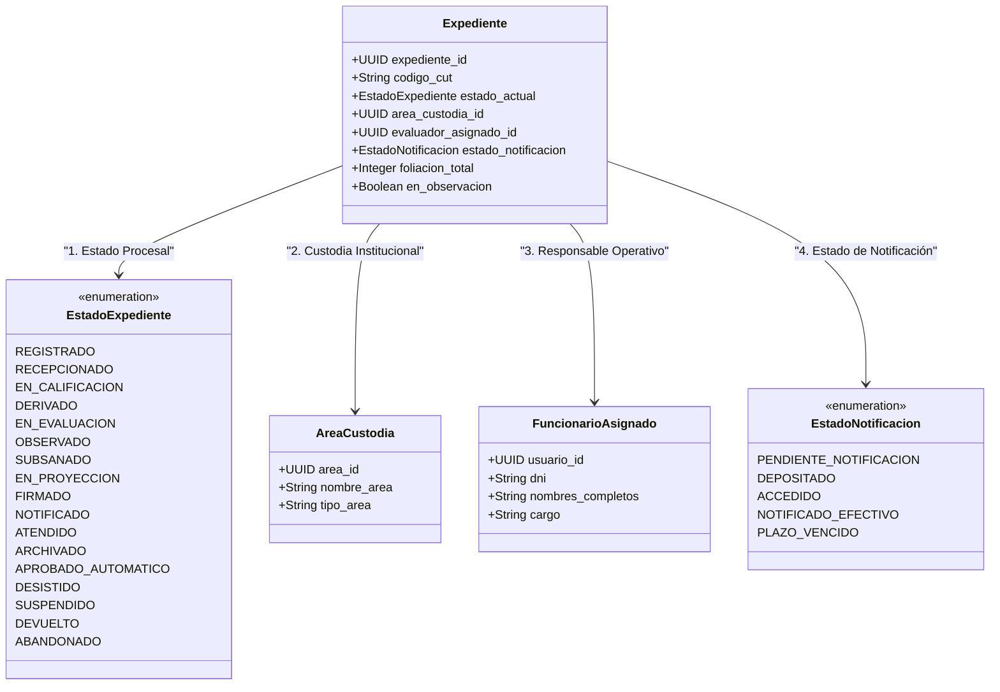
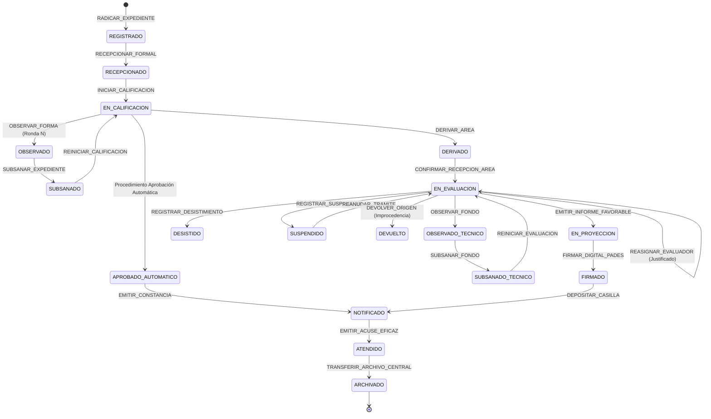
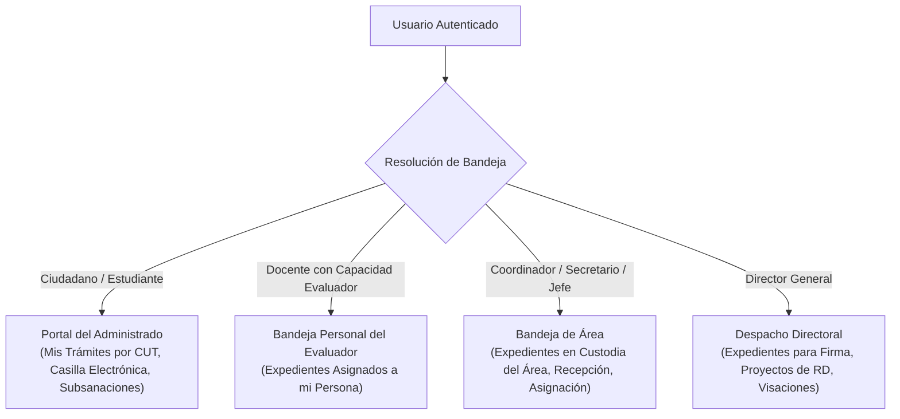

# SIGD RENATO — MODELO FUNCIONAL Y ARQUITECTURA DE RUTADOC
## ESPECIFICACIÓN DEL MOTOR DE TRAMITACIÓN, MÁQUINA DE ESTADOS Y TRAZABILIDAD
### INSTITUTO DE EDUCACIÓN SUPERIOR TECNOLÓGICO PÚBLICO «SUIZA»
### RAMA OFICIAL: `B_JACOBO` — VERSIÓN V1.2.1

---

## 1. PROPÓSITO Y PRINCIPIOS DE DISEÑO

RutaDoc es el motor de orquestación y flujogramas del SIGD RENATO. Su función es garantizar que cada expediente administrativo cuente con una historia completa, cronológica, verificable y no repudiable desde su radicación hasta su conclusión y archivo.

### Principios Fundamentales:
1. **La Cuádruple Separación de Trazabilidad:** El estado procesal, la custodia institucional, el servidor asignado y el estado de notificación son entidades completamente independientes.
2. **Historial Append-Only Inmutable:** La tabla de movimientos (`sigd_rut.movimiento_tramite`) no admite modificaciones (`UPDATE`) ni eliminaciones (`DELETE`). Toda corrección de error material o revocación se registra como un nuevo movimiento con motivo explícito.
3. **Flujos Adaptados a TUPA (No Monolíticos):** El sistema soporta procedimientos de aprobación automática, evaluación previa con silencio positivo o negativo, desistimientos, suspensiones y devoluciones reglamentarias.
4. **Reasignación Auditada con Causa Obligatoria:** La reasignación de evaluadores conserva la autoría de informes previos y no altera el estado ni la custodia del área.
5. **Plazos Normativos Específicos:** Los términos de atención y subsanación se rigen por la ficha del procedimiento en el TUPA 2026.

---

## 2. LA CUÁDRUPLE SEPARACIÓN EN TRAZABILIDAD



* **Estado Procesal (`estado_actual`):** Refleja la situación jurídica del trámite en la máquina de estados.
* **Custodia Institucional (`area_custodia_id`):** Identifica qué dependencia del IESTP Suiza tiene la tenencia administrativa del expediente (Mesa de Partes, Coordinación de Carrera, Secretaría Académica, Dirección, etc.).
* **Responsable Operativo (`evaluador_asignado_id`):** Identifica al docente o servidor público asignado a evaluar, dictaminar o proyectar.
* **Estado de Notificación (`estado_notificacion`):** Trazabilidad legal independiente de la eficacia de la comunicación al administrado.

---

## 3. MÁQUINA DE ESTADOS FINITA (FSM) ADAPTADA A TUPA



### 3.1. Matriz de Eventos y Transiciones Formales

| Evento de Transición | Estado Origen | Estado Destino | Custodia Resultante | Responsable Resultante | Reglas de Validación de Negocio |
| :--- | :--- | :--- | :--- | :--- | :--- |
| `RADICAR_EXPEDIENTE` | `INICIO` | `REGISTRADO` | Mesa de Partes | Operador MP | Genera CUT anual único; emite cargo inicial. |
| `RECEPCIONAR_FORMAL` | `REGISTRADO` | `RECEPCIONADO` | Mesa de Partes | Operador MP | Foliación física/digital inicial; crea asiento. |
| `INICIAR_CALIFICACION`| `RECEPCIONADO` | `EN_CALIFICACION` | Mesa de Partes | Operador MP | Inicia checklist de requisitos según ficha TUPA. |
| `OBSERVAR_FORMA` | `EN_CALIFICACION` | `OBSERVADO` | Mesa de Partes | Operador MP | Emite cédula formal con ronda; fija plazo según TUPA; congela términos. |
| `SUBSANAR_EXPEDIENTE`| `OBSERVADO` | `SUBSANADO` | Mesa de Partes | Administrado | Valida presentación dentro de plazo legal; adjunta anexos. |
| `DERIVAR_AREA` | `EN_CALIFICACION` | `DERIVADO` | Área Destino | Jefe/Coordinador Destino | Genera proveído de remisión; emite guía de entrega. |
| `CONFIRMAR_RECEPCION`| `DERIVADO` | `EN_EVALUACION` | Área Destino | Coordinador de Área | Detiene tiempo de traslado; notifica al área receptora. |
| `ASIGNAR_EVALUADOR` | `EN_EVALUACION` | `EN_EVALUACION` | Área Destino | Docente Evaluador Designado | Solo docentes con capacidad operativa `DOCENTE_EVALUADOR`. |
| `REASIGNAR_EVALUADOR`| `EN_EVALUACION` | `EN_EVALUACION` | Área Destino | Nuevo Docente Designado | **Exige motivo obligatorio; asienta en historial; no altera custodia ni estado.** |
| `DESISTIMIENTO` | Cualquier estado | `DESISTIDO` | Área Actual | Coordinador / Director | Petición formal del administrado; concluye el trámite sin resolución de fondo. |
| `SUSPENSION` | `EN_EVALUACION` | `SUSPENDIDO` | Área Actual | Coordinador / Director | Por mandato judicial, arbitral o causal reglamentaria expresa. |
| `EMITIR_INFORME` | `EN_EVALUACION` | `EN_PROYECCION` | Área / Secretaría | Secretario Académico | Sube informe técnico favorable visado. |
| `FIRMAR_DIGITAL_PADES`| `EN_PROYECCION` | `FIRMADO` | Dirección General | Director General | Estampa CVD 128-bit, QR y firma PAdES válida. |
| `DEPOSITAR_CASILLA` | `FIRMADO` | `FIRMADO` | Casilla Electrónica | Sistema Automático | Actualiza `estado_notificacion = DEPOSITADO`; no equivale a eficacia inmediata. |
| `NOTIFICAR_EFICAZ` | `FIRMADO` | `NOTIFICADO` | Casilla Electrónica | Sistema Automático | Cómputo de acceso del administrado o plazo de ley (art. 20-25 LPAG). |
| `ATENDER_EXPEDIENTE` | `NOTIFICADO` | `ATENDIDO` | Área Resolutoria | Funcionario Responsable | Verificación de conclusión del procedimiento. |
| `ARCHIVAR_EXPEDIENTE`| `ATENDIDO` | `ARCHIVADO` | Archivo Central | Encargado de Archivo | Asignación de serie documental TRD y ubicación topográfica. |

---

## 4. MECANISMOS DE REASIGNACIÓN Y RONDAS DE OBSERVACIÓN

### 4.1. Reasignación de Evaluadores con Motivo Obligatorio
Cuando un docente no puede continuar evaluando un expediente:
1. El `COORDINADOR_AREA` ejecuta la acción `POST /api/v1/expedientes/:id/reasignar`.
2. Se exige en el payload:
   ```json
   {
     "nuevo_evaluador_id": "018f3a5b-7b2c-74a1-b8d9-3e5f2a1b0c9d",
     "motivo_reasignacion": "Docente titular con licencia por salud concedida mediante RD-045",
     "plazo_adicional_dias": 3
   }
   ```
3. El sistema realiza una transacción atómica:
   * Inserta en `sigd_rut.expediente_evaluador_historial` el registro con `evaluador_anterior_id`, `nuevo_evaluador_id`, `motivo_reasignacion`, `actor_id` y `fecha`.
   * Actualiza `evaluador_asignado_id` en el registro activo del expediente.
   * **El estado del expediente permanece inalterado en `EN_EVALUACION` y la custodia en el Programa de Estudios.**

### 4.2. Rondas de Observación y Plazos TUPA
* Las observaciones se organizan en rondas secuenciales (`ronda_numero: 1, 2...`).
* Cada observación genera una cédula que detalla los requisitos no conformes y el plazo perentorio legal establecido en la ficha TUPA correspondiente.
* **Plazos no Universales:** Se descarta la fijación arbitraria de 48 horas o 10-15 días como regla universal. Los plazos se extraen del catálogo TUPA vigente; aquellos no formalizados se clasifican como **`PENDIENTE`**.
* Al ser observado, el expediente congela su avance hasta la recepción de la subsanación o el vencimiento del plazo reglamentario.
* Al ingresar los anexos por el portal del administrado, el estado pasa a `SUBSANADO` y retorna a la bandeja de calificación del evaluador asignado.

---

## 5. BANDEJAS DE ATENCIÓN Y CONTROL DE ACCESO EN FRONTEND

El frontend React organiza la atención en cuatro bandejas diferenciadas según el rol y la asignación:



1. **Bandeja Personal del Evaluador:** Muestra exclusivamente los expedientes donde `evaluador_asignado_id = current_user_id` y la asignación está activa.
2. **Bandeja de Área (Coordinación / Secretaría / Unidad Académica):** Muestra los expedientes donde `area_custodia_id = user_area_id`. Permite recepcionar derivaciones entrantes, asignar evaluadores del programa y reasignar con causa justificada.
3. **Despacho Directoral:** Muestra expedientes en estado `EN_PROYECCION` listos para firma digital con token PAdES.
4. **Portal del Administrado (Estudiante / Ciudadano):** Vista restringida a sus propios expedientes (`solicitante_id = current_user_id`), seguimiento de estado, consulta de cédulas de notificación y formulario de subsanación durante el plazo legal.
