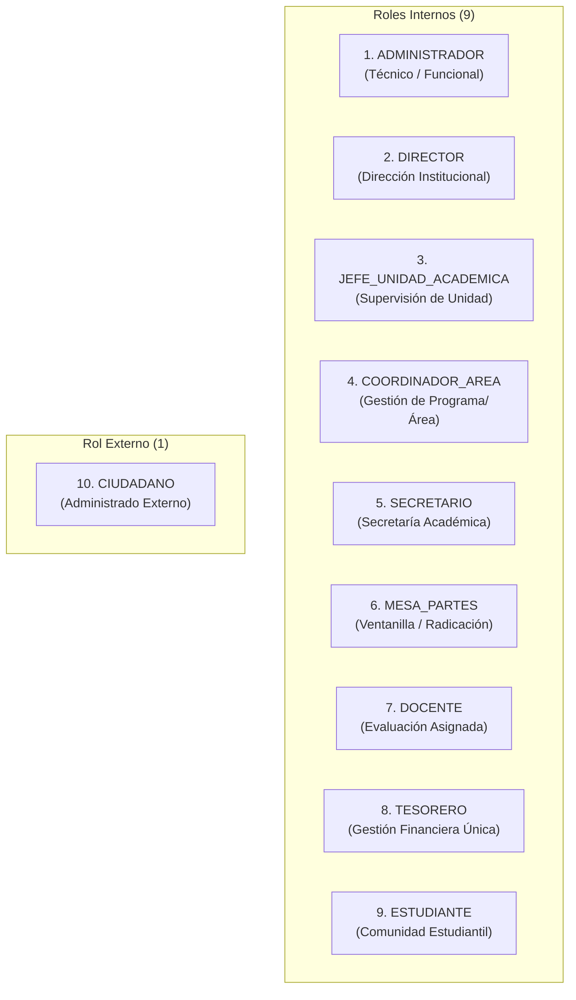

# SIGD SUIZA — CATÁLOGO INSTITUCIONAL DE ROLES V1.1
## ESPECIFICACIÓN CANÓNICA DE LOS DIEZ ROLES INSTITUCIONALES DEL SIGD
### INSTITUTO DE EDUCACIÓN SUPERIOR TECNOLÓGICO PÚBLICO «SUIZA» — PUCALLPA, UCAYALI
**Rama Exclusiva:** `B_JACOBO` | **Entorno Oficial:** Entorno Aislado B_JACOBO | **Base de Datos:** `sigd_jacobo_demo`  
**Estado:** Corrección y Consolidación de Diseño (TSK-1.1A) — Sin ejecución de migraciones en BD  
**Fecha:** Noviembre de 2026

---

## 1. INTRODUCCIÓN Y PRINCIPIOS RECTORES

El Sistema Integral de Gestión Documentaria (SIGD RENATO) del IESTP Público «Suiza» adopta un modelo de autorización por control de acceso basado en roles contextuales (Contextual RBAC).

Para garantizar la estabilidad jurídica, la trazabilidad documental, la seguridad de la información y la coherencia institucional, el sistema establece un catálogo cerrado de **exactamente diez (10) roles institucionales**, divididos en nueve (9) roles internos y un (1) único rol externo.

Queda terminantemente prohibido incorporar roles adicionales o crear variantes ad-hoc sin previa autorización rectoral expresa.

---

## 2. DIFERENCIACIÓN DOGMÁTICA DE ATRIBUCIONES INSTITUCIONALES

Para evitar confusiones doctrinales o atribuir indebidamente facultades que la ley no confiere, se establecen cinco conceptos diferenciados que gobiernan las responsabilidades de los roles:

1. **Proyección Documental:** Redacción, formulación técnica y estructuración de borradores de proveídos, informes o proyectos resolutivos (e.g., labor técnica preparatoria de Secretaría Académica o Coordinación). No tiene validez resolutiva vinculante.
2. **Certificación Administrativa:** Expedición formal de constancias de autenticidad documental, copias certificadas o transcripción de actuaciones registradas en el acervo institucional, conforme a las atribuciones reglamentarias conferidas por la Dirección o estatuto institucional.
3. **Aprobación Institucional:** Acto administrativo sustantivo de decisión jerárquica que da conformidad formal y aprueba el fondo de un procedimiento o proyecto de resolución (facultad de la autoridad institucional competente: Director General).
4. **Firma Digital:** Mecanismo criptográfico asimétrico amparado en certificados digitales emitidos por entidad acreditada en el marco de la Ley N.° 27269 (Ley de Firmas y Certificados Digitales), que garantiza de forma plena la autoría, integridad y no repudio del documento suscrito.
5. **Verificación Criptográfica (CVD / Hash):** Mecanismo tecnológico automatizado de validación de integridad mediante algoritmos seguros (e.g. SHA-256 o Código de Verificación Digital alfanumérico) que permite contrastar si el documento electrónico descargado o impreso coincide exactamente con el original custodiado. **El CVD es un medio de comprobación criptográfica posterior; bajo ningún concepto equivale a una firma digital.**

---

## 3. CATÁLOGO DETALLADO DE ROLES INTERNOS

### 3.1. Rol 1: ADMINISTRADOR (`ADMINISTRADOR`)
* **Nombre Visible Institucional:** Administrador del Sistema.
* **Naturaleza:** Rol interno técnico y de soporte administrativo.
* **Responsabilidad:** Administración técnica y funcional de la plataforma SIGD, ciclo de vida de usuarios, configuración del organigrama, calendario laboral y auditoría de seguridad.
* **Facultades Previstas:**
  - Administrar cuentas de usuarios institucionales (alta, edición, desactivación).
  - Gestionar asignaciones de roles y capacidades operativas autorizadas.
  - Activar y desactivar cuentas ante contingencias o ceses laborales.
  - Administrar parámetros de tablas maestras institucionales (TUPA, feriados, sedes).
  - Consultar y auditar la bitácora WORM de seguridad y eventos del sistema.
* **Restricciones Taxativas:**
  - **No adquiere automáticamente autoridad para aprobar expedientes académicos** ni resolver trámites de graduación o titulación.
  - **No adquiere facultad para firmar digitalmente resoluciones directorales** ni actos administrativos.
  - **No debe confundirse la administración técnica con la autoridad jerárquica del Director**. El Administrador opera la plataforma, pero no emite pronunciamientos documentales sustantivos.

---

### 3.2. Rol 2: DIRECTOR (`DIRECTOR`)
* **Nombre Visible Institucional:** Director General.
* **Naturaleza:** Rol interno jerárquico de máxima autoridad del instituto.
* **Responsabilidad:** Dirección institucional, despacho rectoral, aprobación formal de actos administrativos y suscripción de resoluciones institucionales conforme a la Ley de Institutos y Escuelas de Educación Superior y estatuto institucional.
* **Facultades Previstas:**
  - Consultar expedientes documentarios en ámbito global institucional correspondientes a sus competencias.
  - Supervisar el flujo integral y cumplimiento de plazos del trámite documentario institucional.
  - Emitir providencias de despacho y decretos de derivación hacia dependencias subordinadas.
  - **Aprobar institucionalmente** resoluciones directorales y acuerdos institucionales.
  - **Firmar digitalmente** resoluciones, certificaciones y documentos oficiales con certificado digital acreditado.
  - Consultar reportes institucionales consolidados, tableros de control e indicadores MGD.
* **Restricciones y Salvaguardas:**
  - La consulta, la aprobación institucional y la firma digital **son facultades separadas en el motor relacional**. El rol confiere la titularidad institucional, pero cada acto requiere validación de permisos específicos en la transacción (`EXPEDIENTE_RESOLVER`, `FIRMA_FIRMAR`).
  - La validez de sus actos resolutivos depende de su designación rectoral oficial vigente.

---

### 3.3. Rol 3: JEFE_UNIDAD_ACADEMICA (`JEFE_UNIDAD_ACADEMICA`)
* **Nombre Visible Institucional:** Jefe de Unidad Académica.
* **Naturaleza:** Rol interno de supervisión técnico-pedagógica transversal.
* **Responsabilidad:** Supervisión, monitoreo y gestión académica de todos los programas formativos y áreas pertenecientes a su Unidad Académica designada.
* **Facultades Previstas:**
  - Consultar todos los expedientes y trámites de los programas y áreas que componen su Unidad Académica.
  - Supervisar el flujo y tiempos de atención de expedientes dentro de su unidad.
  - Revisar y monitorear las actuaciones, asignaciones y providencias de los coordinadores de área bajo su dependencia.
  - Distribuir y reasignar responsabilidades documentales dentro del ámbito de su unidad cuando esté formalmente autorizado por resolución.
  - Monitorear expedientes observados, pendientes y fuera de plazo reglamentario.
* **Restricciones Taxativas:**
  - **No debe acceder a expedientes de otras unidades académicas** ajenas a su designación institucional.
  - **No es equivalente a `COORDINADOR_AREA`**; su función es de supervisión y gestión jerárquica de unidad, no de coordinación formativa directa de un programa de estudios específico.

---

### 3.4. Rol 4: COORDINADOR_AREA (`COORDINADOR_AREA`)
* **Nombre Visible Institucional:** Coordinador de Área Académica / Programa de Estudios.
* **Naturaleza:** Rol interno de gestión formativa de carrera o área pedagógica.
* **Responsabilidad:** Gestión operativa y seguimiento de expedientes académicos del programa formativo o área a su cargo.
* **Facultades Previstas:**
  - Consultar y gestionar la bandeja de expedientes correspondientes a su área o programa formativo.
  - Supervisar los trámites presentados por los docentes y solicitudes estudiantiles de su carrera.
  - Asignar expedientes a docentes evaluadores específicos para dictamen técnico pedagógico.
  - Reasignar expedientes con justificación obligatoria y registro en bitácora de trazabilidad.
  - Consultar expedientes observados, pendientes y subsanaciones de su programa.
  - Formular dictámenes de área, informes técnicos y proveídos hacia Secretaría Académica o Dirección General.
* **Condición Especial de Ámbito:**
  - El coordinador podrá acceder al ámbito de toda una Unidad Académica **únicamente si su resolución o designación institucional le confiere formalmente dicho encargo de confianza o encargatura**. Por defecto, su ámbito queda confinado estrictamente a su `area_id`.

---

### 3.5. Rol 5: SECRETARIO (`SECRETARIO`)
* **Nombre Visible Institucional:** Secretario Académico.
* **Naturaleza:** Rol interno de gestión de trámites académicos, certificación administrativa y custodia del acervo institucional.
* **Responsabilidad:** Gestión de procedimientos académicos y de certificación, preparación y sustanciación de expedientes de grados y títulos, y proyección de resoluciones conforme a la normativa institucional aplicable.
* **Facultades Previstas:**
  - Gestionar expedientes documentarios correspondientes a Secretaría Académica.
  - Organizar, cotejar y sustanciar expedientes para titulación, convalidaciones y certificados de estudios.
  - **Proyectar y formular borradores de resoluciones** académicas y administrativas para consideración y eventual aprobación de Dirección.
  - Emitir **certificaciones administrativas** de copias y transcripciones del acervo custodiado, en la medida en que las normas institucionales y sus facultades de delegación lo habiliten expresamente.
  - Derivar documentación sustanciada hacia Dirección General u otras dependencias.
  - Consultar el historial integral de actuaciones y foliación continua AGN.
* **Restricciones Taxativas:**
  - **No se le atribuye automáticamente fe pública institucional**; sus atribuciones certificadoras emanan estrictamente de la normativa y de las resoluciones de delegación específicas.
  - **No adquiere automáticamente la facultad de aprobar ni firmar resoluciones directorales**. Proyecta el acto resolutivo, pero la aprobación sustantiva y la firma digital corresponden a la Dirección General.
  - **Diferenciación estricta frente a Mesa de Partes:** No opera como ventanilla de recepción ciudadana indiscriminada; atiende procedimientos reglamentados y custodia documental.

---

### 3.6. Rol 6: MESA_PARTES (`MESA_PARTES`)
* **Nombre Visible Institucional:** Mesa de Partes / Operador de Ventanilla.
* **Naturaleza:** Rol interno de puerta de entrada, radicación y control formal de admisibilidad.
* **Responsabilidad:** Recepción presencial y virtual, radicación, examen formal de admisibilidad, foliación inicial y derivación primaria de expedientes hacia las áreas competentes.
* **Facultades Previstas:**
  - Recibir y radicar solicitudes presenciales de ciudadanos, estudiantes y trabajadores.
  - Registrar asientos de radicación generando el Código Único de Trámite (CUT) inmutable.
  - Cargar anexos, requisitos digitales y comprobantes de pago.
  - Verificar requisitos de admisibilidad formal conforme al TUPA institucional vigente.
  - Identificar omisiones formales y registrar observaciones en el asiento de ventanilla.
  - Notificar devoluciones formales para subsanación en plazo reglamentario.
  - Derivar expedientes radicados hacia las unidades orgánicas destinatarias.
  - Registrar fechas ciertas, sellos de tiempo y emitir cargos de recepción con comprobación CVD.
* **Restricciones Taxativas:**
  - No califica el fondo sustantivo de las peticiones académicas o técnicas; su calificación es estrictamente de admisibilidad formal y requisitos documentarios.
  - No sustituye la función de un evaluador docente o técnico.

---

### 3.7. Rol 7: DOCENTE (`DOCENTE`)
* **Nombre Visible Institucional:** Docente Institucional.
* **Naturaleza:** Rol interno de cuerpo docente / evaluador técnico.
* **Responsabilidad:** Presentación de documentos pedagógicos e institucionales, y evaluación técnica de expedientes académicos que le hayan sido expresamente asignados por su Coordinación.
* **Facultades Previstas:**
  - Presentar solicitudes académicas, informes pedagógicos y proyectos.
  - Consultar el estado y trazabilidad de sus propios trámites institucionales.
  - Recibir en su bandeja personal expedientes derivados para su conocimiento o atención.
  - Consultar expedientes que le hayan sido asignados individualmente mediante providencia de coordinación.
  - Evaluar expedientes asignados emitiendo informe técnico pedagógico o dictamen.
  - Registrar observaciones técnicas y recomendaciones de aprobación o desaprobación.
* **Restricciones Taxativas:**
  - **No accede automáticamente a todos los expedientes del área o carrera** a la que pertenece.
  - **No puede evaluar ningún expediente sin contar con asignación formal y vigente**.
  - **No hereda permisos de coordinación ni jefatura** por el mero hecho de formar parte de la unidad.

---

### 3.8. Rol 8: TESORERO (`TESORERO`)
* **Nombre Visible Institucional:** Tesorero Institucional.
* **Naturaleza:** Rol interno único y especializado de gestión financiera y de caja.
* **Responsabilidad:** Control integral de la recaudación institucional, operaciones de caja, verificación de pagos bancarios, evaluación y aprobación de devoluciones financieras y tarifas.
* **Facultades Previstas:**
  - Consultar todas las operaciones financieras, órdenes de pago y movimientos de caja.
  - Registrar pagos presenciales en efectivo en ventanilla de tesorería emitiendo recibo.
  - Verificar y conciliar vouchers y constancias de pago bancarias/digitales.
  - Evaluar solicitudes de devolución financiera por cobros indebidos o trámites no procedentes.
  - Aprobar devoluciones financieras fundadas mediante resolución transaccional.
  - Registrar la ejecución contable de devoluciones en el sistema.
  - Proponer y validar actualizaciones documentadas del tarifario institucional TUPA.
  - Consultar y emitir reportes financieros, libros de caja y balances de recaudación.
* **Restricciones Taxativas:**
  - **Es el único rol financiero del instituto**. Concentra las facultades que anteriormente estaban dispersas en roles auxiliares no vigentes (`CAJERO`, `APROBADOR_DEVOLUCIONES`, `SUPERVISOR_TESORERIA`).
  - Todas sus confirmaciones financieras exigen bloqueo pesimista en base de datos (`FOR SHARE` / `FOR UPDATE`), trazabilidad WORM y conciliación atómica.
  - No accede a expedientes académicos sustantivos ajenos a trámites con arancel o devolución.

---

### 3.9. Rol 9: ESTUDIANTE (`ESTUDIANTE`)
* **Nombre Visible Institucional:** Estudiante Institucional.
* **Naturaleza:** Rol interno de la comunidad educativa (NO EXTERNO).
* **Responsabilidad:** Acceso institucional de los alumnos matriculados para la tramitación de solicitudes académicas, seguimiento de matrícula, convalidaciones, certificados y titulación.
* **Facultades Previstas:**
  - Presentar solicitudes y trámites académicos a través de la plataforma institucional.
  - Consultar el historial, estado y hoja de ruta de sus propios expedientes.
  - Recibir notificaciones oficiales en su Casilla Electrónica institucional.
  - Subir requisitos, subsanaciones y anexos solicitados por las dependencias evaluadoras.
  - Acceder al catálogo institucional de trámites educativos y emitir órdenes de pago asociadas a su condición de alumno.
* **Restricciones Taxativas:**
  - **Es un rol interno**, perteneciente a la comunidad del instituto; no debe asimilarse ni equipararse a un tercero administrado (`CIUDADANO`).
  - **Acceso confinado estrictamente a su titularidad:** Consulta únicamente expedientes donde figura como solicitante o titular (`solicitante_id = cu.id_persona`).
  - No accede a expedientes de otros estudiantes ni a módulos internos de gestión administrativa o docente.

---

## 4. CATÁLOGO DEL ROL EXTERNO

### 4.1. Rol 10: CIUDADANO (`CIUDADANO`)
* **Nombre Visible Institucional:** Ciudadano / Administrado Externo.
* **Naturaleza:** Rol externo general (único rol externo del SIGD).
* **Responsabilidad:** Acceso de administrados externos al instituto (proveedores, egresados sin matrícula activa, postulantes, empresas y público en general).
* **Facultades Previstas:**
  - Registrar solicitudes a través de la Mesa de Partes Virtual institucional.
  - Consultar el estado y hoja de ruta de sus propios trámites mediante CUT y código de verificación.
  - Acceder a su Casilla Electrónica ciudadana y recibir notificaciones oficiales.
  - Presentar subsanaciones a observaciones formuladas dentro de los plazos legales.
* **Restricciones Taxativas:**
  - **Cero acceso a módulos internos:** No puede acceder a bandejas de área, organigrama, reportes MGD, tesorería interna, ni administración.
  - Sus permisos de lectura se evalúan por **estricta titularidad de cuenta**, denegando cualquier consulta global o institucional.
  - No puede adquirir capacidades operativas internas (`GESTOR_APOYO_AREA`) ni actuar como operador institucional.

---

## 5. CAPACIDAD OPERATIVA INDEPENDIENTE: `GESTOR_APOYO_AREA` (NO ES UN ROL)

* **Código:** `GESTOR_APOYO_AREA`
* **Nombre Visible Propuesto:** Apoyo de Área.
* **Naturaleza:** Capacidad operativa delegada de asistencia administrativa dentro de un área específica.
* **Estado Actual:** **Pendiente de implementación física** en la base de datos `sigd_jacobo_demo` (la tabla `sigd_org.usuario_capacidad` no existe actualmente en el esquema activo).
* **Diferenciación:** No es un rol del catálogo de 10 roles. No confiere condición laboral, jerárquica ni estatutaria; se asigna para tareas instrumentales de organización documental, preparación de anexos y seguimiento dentro de un `area_id` determinado, sin facultades resolutivas ni de firma digital.

---

## 6. CUADRO RESUMEN CANÓNICO DEL CATÁLOGO DE 10 ROLES

| N.° | Código Canónico | Nombre Visible | Tipo de Rol | Ámbito Típico | Nivel Jerárquico |
| :---: | :--- | :--- | :---: | :---: | :---: |
| **1** | `ADMINISTRADOR` | Administrador del Sistema | Interno | Institucional (`GLOBAL`) | Técnico / Soporte |
| **2** | `DIRECTOR` | Director General | Interno | Institucional (`GLOBAL`) | Directivo Máximo |
| **3** | `JEFE_UNIDAD_ACADEMICA` | Jefe de Unidad Académica | Interno | Unidad Académica (`UNIDAD`) | Directivo Medio |
| **4** | `COORDINADOR_AREA` | Coordinador de Área / Programa | Interno | Área / Programa (`AREA`) | Operativo / Coordinación |
| **5** | `SECRETARIO` | Secretario Académico | Interno | Institucional / Secretaría (`SEC`) | Fe Administrativa / Custodia |
| **6** | `MESA_PARTES` | Mesa de Partes / Ventanilla | Interno | Mesa de Partes (`MP`) | Operador Documental |
| **7** | `DOCENTE` | Docente Institucional | Interno | Área / Asignación Expresa | Evaluador Pedagógico |
| **8** | `TESORERO` | Tesorero Institucional | Interno | Institucional (`GLOBAL`) | Operador Financiero Único |
| **9** | `ESTUDIANTE` | Estudiante Institucional | Interno | Titularidad Personal (`PROPIO`) | Miembro de la Comunidad |
| **10** | `CIUDADANO` | Ciudadano / Administrado | Externo | Titularidad Personal (`PROPIO`) | Público General Externo |

---

## 7. CONCLUSIÓN Y CONFORMIDAD NORMATIVA

Este catálogo institucional de exactamente diez (10) roles representa la taxonomía definitiva del IESTP Público «Suiza». Los roles deprecados históricos (`ESPECIALISTA`, `CAJERO`, `APROBADOR_DEVOLUCIONES`, `SUPERVISOR_TESORERIA`) no forman parte del catálogo vigente y quedan preservados exclusivamente para fines de auditoría histórica.
