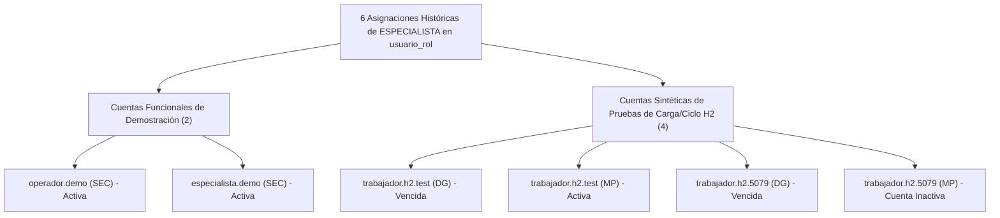

# SIGD SUIZA — CONCILIACIÓN DE ROLES HISTÓRICOS Y ASIGNACIONES V1.1
## AUDITORÍA FORENSE, PRESERVACIÓN DE TRAZABILIDAD Y REGISTRO DE DECISIONES PENDIENTES
### INSTITUTO DE EDUCACIÓN SUPERIOR TECNOLÓGICO PÚBLICO «SUIZA» — PUCALLPA, UCAYALI
**Rama Exclusiva:** `B_JACOBO` | **Entorno Oficial:** Entorno Aislado B_JACOBO | **Base de Datos:** `sigd_jacobo_demo`  
**Estado:** Corrección y Consolidación de Diseño (TSK-1.1A) — Modo Solo Lectura, Cero Mutaciones en BD  
**Fecha:** Noviembre de 2026

---

## 1. PRINCIPIOS DE AUDITORÍA FORENSE Y PRESERVACIÓN INMUTABLE

El presente documento realiza la conciliación exhaustiva de los roles preexistentes en la base de datos `sigd_jacobo_demo` que **no formarán parte del catálogo institucional vigente de diez (10) roles**.

Para garantizar la estricta integridad procesal y dar cumplimiento a los estándares de auditoría y normas del Archivo General de la Nación (AGN), se aplican las siguientes directrices obligatorias:
1. **Inmutabilidad Absoluta:** Ningún registro de rol histórico ni asignación preexistente será borrado físicamente (`DELETE` terminantemente prohibido).
2. **Prohibición de Equivalencias Automáticas:** No se realizarán migraciones ni conversiones automáticas de roles para los usuarios históricos sin previa autorización institucional formal.
3. **No Exposición en Interfaces:** Los roles deprecados no se ofrecerán como opciones vigentes en las pantallas de administración ni endpoints de asignación.
4. **Preservación de Trazabilidad Histórica:** Todo trámite, proveído o derivación ejecutada en el pasado por cuentas bajo roles históricos conservará intacta su validez y auditoría forense.

---

## 2. ESTADO DEL CATÁLOGO DE ROLES HISTÓRICOS EN `sigd_org.rol_sistema`

De la inspección técnica directa sobre `sigd_jacobo_demo`, se evidencia el siguiente estado de los roles no contemplados en el catálogo canónico vigente:

| Código de Rol | UUID en `rol_sistema` | Nombre en BD | Estado `vigente` | Asignaciones Históricas | Diagnóstico y Situación Institucional |
| :--- | :--- | :--- | :---: | :---: | :--- |
| `CAJERO` | `aa1a372e-296c-487f-9f0a-86ef68d45741` | Cajero | `FALSE` | 0 | **Deprecado e inactivo.** Cero asignaciones huérfanas. No se expone en UI/API. Sus facultades quedan consolidadas en `TESORERO`. |
| `APROBADOR_DEVOLUCIONES` | `444b6f5d-6c69-4edd-b641-c6b2c357d268` | Aprobador de devoluciones | `FALSE` | 0 | **Deprecado e inactivo.** Cero asignaciones huérfanas. No se expone en UI/API. Sus facultades quedan consolidadas en `TESORERO`. |
| `SUPERVISOR_TESORERIA` | `c86ad9e6-1391-4a5f-b2b6-d447826914a8` | Supervisor de Tesorería | `FALSE` | 0 | **Deprecado e inactivo.** Cero asignaciones huérfanas. No se expone en UI/API. Sus facultades quedan consolidadas en `TESORERO`. |
| `ESPECIALISTA` | `94ae72fb-0b86-4a6f-ba78-69b19bc888e7` | Especialista | `TRUE` | 6 | **Rol histórico en proceso de desincorporación.** Conserva 6 asignaciones en `usuario_rol` que deben mantenerse intactas hasta que la autoridad institucional defina la reasignación de cada cuenta. |
| `TESORERO` | `9b5471ec-6901-4d92-893f-ed51a90fe9d4` | Tesorero | `TRUE` | 1 | **Único rol institucional de Tesorería vigente.** Concentra recaudación, pagos, tarifas y devoluciones con control transaccional pesimista. |

---

## 3. AUDITORÍA DETALLADA DE LOS SEIS UUID HISTÓRICOS DE `ESPECIALISTA`

La tabla `sigd_org.usuario_rol` contiene exactamente seis (6) registros vinculados al rol `ESPECIALISTA`. A continuación se presenta su inventario forense fidedigno:

### Inventario Forense de Asignaciones:

| N.° | UUID Asignación (`id_usuario_rol`) | UUID Usuario (`id_usuario`) | Usuario / Login | Correo Electrónico | Área Asignada (`area_id`) | Vigencia Temporal Registrada | Estado Cuenta | Tipo de Cuenta | Situación y Propuesta de Reasignación |
| :---: | :--- | :--- | :--- | :--- | :---: | :---: | :---: | :---: | :--- |
| **1** | `ecb124c5-577d-4838-a3f0-5e343960b0e4` | `00000000-0000-0000-0000-000000000030` | `operador.demo` | `operador.demo@sandbox.invalid` | Secretaría Académica (`SEC`) | Desde `2026-10-26 12:54:07 UTC` (Sin fin) | **Activa** | Funcional Demo | **PENDIENTE DE AUTORIZACIÓN INSTITUCIONAL.** Se conserva intacta. Se evaluará por la Dirección si se asigna a `SECRETARIO` o apoyo en `SEC`. |
| **2** | `cbd75b3a-62b5-43eb-9780-989116c04ec4` | `00000000-0000-0000-0000-000000000060` | `especialista.demo` | `especialista.demo@sandbox.invalid` | Secretaría Académica (`SEC`) | Desde `2026-10-28 18:57:59 UTC` (Sin fin) | **Activa** | Funcional Demo | **PENDIENTE DE AUTORIZACIÓN INSTITUCIONAL.** Se conserva intacta. Se evaluará por la Dirección si corresponde a `DOCENTE` o capacidad de apoyo. |
| **3** | `bd029454-d24b-4a81-b497-a95c40ff562a` | `f6905305-582a-4871-af75-c8b961d70a9e` | `trabajador.h2.test` | `prueba.h2@iestpsuiza.edu.pe` | Dirección General (`DG`) | `2026-11-04 13:03:56` a `2026-11-04 13:03:57` (Vencida) | **Activa** | Sintética Test | **Asignación Histórica Vencida.** Se conserva inalterable como evidencia histórica de traslado de área. |
| **4** | `fabad752-6a79-40f4-ad26-f9809b4498e2` | `f6905305-582a-4871-af75-c8b961d70a9e` | `trabajador.h2.test` | `prueba.h2@iestpsuiza.edu.pe` | Mesa de Partes (`MP`) | Desde `2026-11-04 13:03:57 UTC` (Sin fin) | **Activa** | Sintética Test | **PENDIENTE DE AUTORIZACIÓN INSTITUCIONAL.** Asignación de prueba en MP. No se muta automáticamente. |
| **5** | `e3b2d13b-1d04-46f1-9e85-3ecd593bb8ff` | `32a76ac3-31d4-40e0-9994-95a459ed5b01` | `trabajador.h2.5079` | `prueba.h2.5079@iestpsuiza.edu.pe` | Dirección General (`DG`) | `2026-11-04 13:05:15.57` a `13:05:15.61` (Vencida) | Inactiva | Sintética Test | **Asignación Histórica Vencida.** Cuenta desactivada. Se conserva inalterable. |
| **6** | `4bbd6ab4-5b53-4820-8f83-7e014bf62de4` | `32a76ac3-31d4-40e0-9994-95a459ed5b01` | `trabajador.h2.5079` | `prueba.h2.5079@iestpsuiza.edu.pe` | Mesa de Partes (`MP`) | Desde `2026-11-04 13:05:15.61 UTC` (Sin fin) | Inactiva | Sintética Test | Cuenta desactivada (`cu.activo = FALSE`). Se conserva inalterable sin mutaciones. |

---

## 4. REGISTRO DE DECISIONES Y REGLAS DE TRATAMIENTO

1. **Cero Eliminaciones Físicas:** Queda terminantemente prohibido ejecutar sentencias `DELETE` sobre `sigd_org.usuario_rol` o `sigd_org.rol_sistema`.
2. **Sin Mutaciones Automáticas ni Asunciones:** Ninguna cuenta pasará a ostentar un nuevo rol de forma implícita o automática. La asignación de los nuevos roles canónicos (`SECRETARIO`, `DOCENTE`, etc.) requerirá la aprobación expresa y formal de la Dirección del Instituto y se registrará como un nuevo asiento de asignación justificado documentalmente.
3. **Cierre de Vigencia Controlado (En Futura Migración):** Cuando la migración sea formalmente autorizada (TSK-1.2), el rol `ESPECIALISTA` será marcado con `vigente = FALSE` en `sigd_org.rol_sistema`, y las asignaciones activas que hayan sido formalmente autorizadas para migrar serán concluidas fijando `vigente_hasta = now()`.
4. **Preservación Pericial:** Los identificadores UUID, sellos de tiempo de inserción y áreas asignadas permanecen blindados como patrimonio histórico del desarrollo del sistema.
