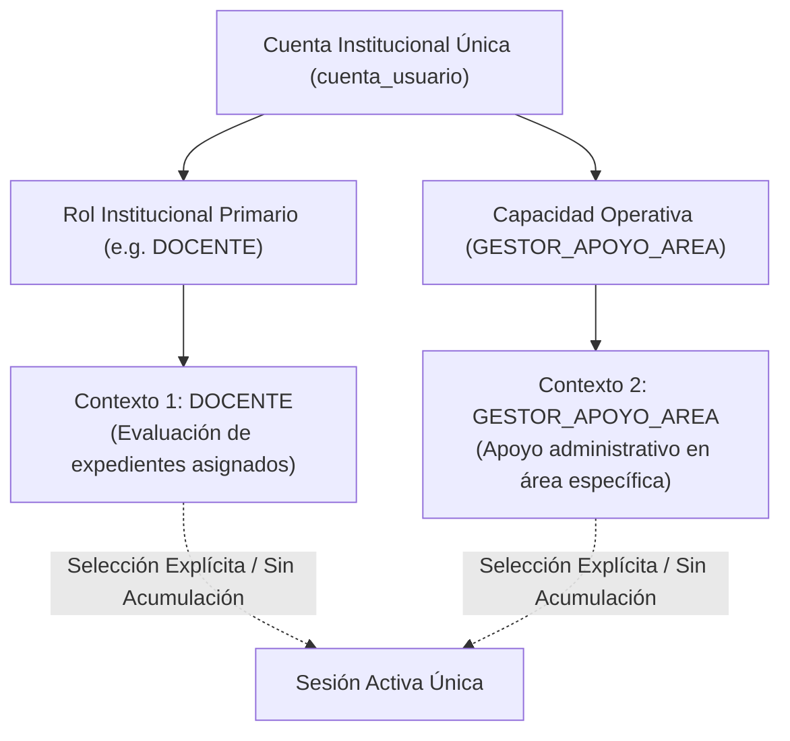

# SIGD SUIZA — MATRIZ DE CAPACIDADES OPERATIVAS V1.2
## ESPECIFICACIÓN TÉCNICA Y NORMATIVA DE CAPACIDADES OPERATIVAS INDEPENDIENTES
### INSTITUTO DE EDUCACIÓN SUPERIOR TECNOLÓGICO PÚBLICO «SUIZA» — PUCALLPA, UCAYALI
**Rama Exclusiva:** `B_JACOBO` | **Entorno Oficial:** Entorno Aislado B_JACOBO | **Base de Datos:** `sigd_jacobo_demo` (PostgreSQL 18.6)  
**Estado:** Cierre de Brechas Funcionales (TSK-1.1B) — Sin ejecución de migraciones en BD  
**Fecha:** Noviembre de 2026

---

## 1. DISTINCIÓN ONTOLÓGICA: ROLES INSTITUCIONALES VS. CAPACIDADES OPERATIVAS

Para preservar la pureza del modelo relacional y evitar la proliferación desordenada de roles institucionales, el SIGD Suiza establece una separación ontológica categórica entre:

1. **Rol Institucional:** Vinculado a la posición orgánica formal, cargo o condición estatutaria de la persona dentro de la institución (e.g. `DIRECTOR`, `COORDINADOR_AREA`, `DOCENTE`, `ESTUDIANTE`, `CIUDADANO`). Confiere la identidad institucional primaria y habilita los flujos documentales macro. Pertenece al catálogo cerrado de 10 roles.
2. **Capacidad Operativa:** Habilitación administrativa independiente y transitoria para ejecutar tareas auxiliares de soporte y asistencia documental dentro de un ámbito orgánico estrictamente delimitado. **No constituye un rol institucional**, no altera el vínculo laboral ni estatutario, y se evalúa como un contexto de trabajo independiente.



---

## 2. ESPECIFICACIÓN DE `GESTOR_APOYO_AREA` (APOYO DE ÁREA)

* **Código del Sistema:** `GESTOR_APOYO_AREA`
* **Nombre Visible Propuesto:** Apoyo de Área / Asistente Administrativo de Carrera.
* **Naturaleza Jurídica:** Capacidad operativa delegada de asistencia administrativa.
* **Ámbito Obligatorio:** `AREA` (Confinado estrictamente a una unidad orgánica específica, e.g. Mesa de Partes, Secretaría Académica, o programa formativo cuando se formalice).
* **Estado Actual de Implementación:** **PENDIENTE DE IMPLEMENTACIÓN FÍSICA EN BASE DE DATOS**. La tabla `sigd_org.usuario_capacidad` y `sigd_org.capacidad_sistema` no existen actualmente en el esquema activo `sigd_jacobo_demo`. El backend actual gestiona su ausencia defensivamente mediante un bloque `try/catch` en `auth.guard.ts`. **Bajo ninguna circunstancia debe considerarse operativa hasta que se ejecute la migración formal autorizada.**

### 2.1. Funciones y Tareas Previstas (Diseño Funcional)
Cuando se complete su implementación física, el personal que asuma el contexto de `GESTOR_APOYO_AREA` estará facultado exclusivamente para:
1. **Organización Documental:** Recepcionar expedientes físicos o electrónicos derivados al área y cotejar sus requisitos materiales.
2. **Preparación de Expedientes:** Digitalizar, foliar preventivamente, indexar y adjuntar anexos o requisitos adicionales.
3. **Gestión Administrativa Interna:** Redactar proveídos preliminares de mero trámite y notas informativas internas del área.
4. **Seguimiento y Control de Plazos:** Monitorear el tablero de expedientes pendientes del área y alertar al Coordinador o responsable sobre vencimientos perentorios.
5. **Derivación de Mero Trámite:** Trasladar expedientes formalmente instruidos hacia otras dependencias cuando medie providencia expresa del Coordinador.

### 2.2. Restricciones Críticas de Seguridad
* **Prohibición Total de Aprobación Institucional:** No puede resolver expedientes ni aprobar solicitudes académicas de alumnos ni de docentes.
* **Prohibición Total de Firma Digital:** No puede suscribir documentos oficiales, proveídos sustantivos ni resoluciones.
* **Aislamiento Inter-Áreas:** Carece de acceso a expedientes o actuaciones de otras áreas académicas o dependencias administrativas.
* **Sin Privilegios Globales:** Carece de acceso al módulo de administración de usuarios (`ADMIN_USUARIOS`), bitácora WORM, organigrama institucional o configuración de tablas maestras.
* **No Acumulación de Facultades:** Cuando un usuario con rol `DOCENTE` opera bajo el contexto de `GESTOR_APOYO_AREA`, **sus facultades de evaluación docente quedan suspendidas en esa sesión**; actúa estrictamente como personal de apoyo administrativo.

---

## 3. DEPENDENCIAS TÉCNICAS REQUERIDAS PARA SU IMPLEMENTACIÓN FÍSICA

Para que la capacidad operativa `GESTOR_APOYO_AREA` pase de la etapa de diseño a la operación real en base de datos (previsto para TSK-1.2), se requiere implementar las siguientes nueve (9) dependencias técnicas:

1. **Tabla de Catálogo de Capacidades (`sigd_org.capacidad_sistema`):** Entidad canónica que registre el código `GESTOR_APOYO_AREA`, denominación, descripción, ámbito permitido (`AREA`) y vigencia.
2. **Tabla de Asignaciones (`sigd_org.usuario_capacidad`):** Tabla relacional que vincule la cuenta de usuario (`id_usuario`), la capacidad (`id_capacidad`), el área orgánica (`area_id`), el estado (`activo`) y el rango de vigencia temporal.
3. **Delimitación Estricta de Ámbito (`area_id`):** Clave foránea obligatoria `REFERENCES sigd_org.area(area_id)` que impida que una capacidad de apoyo sea asignada sin área o con alcance global.
4. **Control de Vigencia Temporal:** Columnas `vigente_desde` y `vigente_hasta` evaluadas en tiempo real contra `now()`.
5. **Auditoría Inmutable:** Registro obligatorio en `sigd_auth.auditoria_usuarios` ante cada evento de alta, baja o expiración de la capacidad, detallando el administrador responsable y la fecha.
6. **Delimitación de Permisos (Lista Negra Estricta):** Exclusión programática garantizada de permisos sensibles en `auth.guard.ts`:
   - `PERMISOS_PROHIBIDOS_GESTOR_APOYO = {'EXPEDIENTE_RESOLVER', 'FIRMA_FIRMAR', 'ADMIN_USUARIOS', 'REPORTE_LEER'}`.
7. **Revocación Inmediata de Contexto:** Al desactivar la capacidad en BD (`activo = FALSE` o `vigente_hasta = now()`), la siguiente petición protegida con ese `ctx` debe emitir `403 CONTEXT_REVOKED` en tiempo real.
8. **Contexto de Trabajo en Sesión:** Inclusión de la asignación en la lista de contextos elegibles (`/api/v1/auth/me`), emisión del claim `ctx` en el JWT y selección explícita sin acumulación automática.
9. **Validación Backend Transaccional:** Comprobación relacional en cada solicitud HTTP protegida sin confiar en el estado del cliente frontend.

---

## 4. ASIGNACIÓN PLURAL SIN DUPLICACIÓN DE CUENTAS

El modelo permite que una persona que ostenta un rol institucional (como `DOCENTE` o `COORDINADOR_AREA`) pueda recibir la capacidad `GESTOR_APOYO_AREA` sin requerir la creación de cuentas de correo o usuarios duplicados:

### Caso Práctico Institucional:
* Un docente nombrado asume temporalmente funciones de apoyo administrativo en la Secretaría Académica (`area_id = SEC`).
* **Mecanismo:**
  1. Mantiene su cuenta institucional única (`cuenta_usuario`).
  2. Posee su asignación activa al rol `DOCENTE` en `sigd_org.usuario_rol`.
  3. Recibe la asignación de la capacidad `GESTOR_APOYO_AREA` vinculada a `SEC` en `sigd_org.usuario_capacidad`.
  4. Al ingresar, el selector de contexto le permite elegir entre:
     - Contexto A: Docente Institucional (evaluación de trámites asignados).
     - Contexto B: Apoyo de Área en Secretaría Académica (organización y despacho auxiliar).
  5. Al concluir su designación de apoyo, se desactiva la capacidad; el docente mantiene su cuenta y rol ordinario sin alteración alguna.

---

## 5. PROPUESTA DDL DE ESTRUCTURA RELACIONAL (ANEXO DE DISEÑO NO EJECUTABLE)

```sql
-- ESTRUCTURA RELACIONAL PENDIENTE DE MIGRACIÓN AUTORIZADA
CREATE TABLE IF NOT EXISTS sigd_org.capacidad_sistema (
    id_capacidad UUID PRIMARY KEY DEFAULT gen_random_uuid(),
    codigo VARCHAR(60) NOT NULL UNIQUE,
    nombre VARCHAR(150) NOT NULL,
    descripcion TEXT,
    ambito_permitido VARCHAR(20) NOT NULL DEFAULT 'AREA',
    vigente BOOLEAN NOT NULL DEFAULT TRUE,
    creado_en TIMESTAMPTZ NOT NULL DEFAULT now()
);

CREATE TABLE IF NOT EXISTS sigd_org.usuario_capacidad (
    id_usuario_capacidad UUID PRIMARY KEY DEFAULT gen_random_uuid(),
    id_usuario UUID NOT NULL REFERENCES sigd_auth.cuenta_usuario(id_usuario) ON DELETE RESTRICT,
    id_capacidad UUID NOT NULL REFERENCES sigd_org.capacidad_sistema(id_capacidad) ON DELETE RESTRICT,
    codigo VARCHAR(60) NOT NULL DEFAULT 'GESTOR_APOYO_AREA',
    area_id UUID NOT NULL REFERENCES sigd_org.area(area_id) ON DELETE RESTRICT,
    activo BOOLEAN NOT NULL DEFAULT TRUE,
    vigente_desde TIMESTAMPTZ NOT NULL DEFAULT now(),
    vigente_hasta TIMESTAMPTZ,
    asignado_por UUID REFERENCES sigd_auth.cuenta_usuario(id_usuario),
    creado_en TIMESTAMPTZ NOT NULL DEFAULT now()
);

CREATE INDEX IF NOT EXISTS idx_usuario_capacidad_activo 
ON sigd_org.usuario_capacidad (id_usuario, id_usuario_capacidad) 
WHERE activo = TRUE;
```

---

## 6. CONCLUSIÓN TÉCNICA

Queda formalmente aclarado que `GESTOR_APOYO_AREA` se concibe exclusivamente como una capacidad operativa transitoria de área y que **su entrada en vigencia operativa se encuentra supeditada a la creación física de sus tablas en la base de datos y a la ejecución de la migración en la etapa autorizada (TSK-1.2)**.
