# SIGD SUIZA — MATRIZ DE ROLES, PERMISOS Y ÁMBITOS V1.2
## EVALUACIÓN Y CONCILIACIÓN DEFINITIVA DE LAS 15 OPERACIONES DOCUMENTALES Y 16 PERMISOS REALES
### INSTITUTO DE EDUCACIÓN SUPERIOR TECNOLÓGICO PÚBLICO «SUIZA» — PUCALLPA, UCAYALI
**Rama Exclusiva:** `B_JACOBO` | **Entorno Oficial:** Entorno Aislado B_JACOBO | **Base de Datos:** `sigd_jacobo_demo` (PostgreSQL 18.6)  
**Estado:** Cierre de Brechas Funcionales (TSK-1.1B) — Sin ejecución de migraciones en BD  
**Fecha:** Noviembre de 2026

---

## 1. PRINCIPIOS DE AUTORIZACIÓN Y SEPARACIÓN DE RESPONSABILIDADES

La matriz de autorización del SIGD Suiza se rige por los siguientes principios rectores de ingeniería de seguridad y coherencia institucional:

1. **Principio de Mínimo Privilegio (PoLP):** Ningún rol adquiere facultades superiores a las estrictamente requeridas para su función reglamentaria.
2. **Diferenciación Dogmática Estricta:**
   - **Lectura $\neq$ Edición:** Visualizar un expediente o historial no otorga facultades para modificar datos, folios ni proveídos.
   - **Gestión / Proyección $\neq$ Aprobación:** Instruir un expediente o elaborar un proyecto de resolución no equivale a aprobar el fondo del asunto.
   - **Aprobación Institucional $\neq$ Firma Digital:** Dar visto bueno o emitir un acto resolutivo no sustituye la suscripción con certificado digital acreditado (Ley N.° 27269).
   - **Firma Digital $\neq$ Verificación Criptográfica (CVD):** El CVD es un mecanismo tecnológico de verificación de integridad documental a posteriori; no es la firma digital en sí misma.
   - **Permiso de Usuario $\neq$ Autorización de Proceso Automático:** Las notificaciones generadas por eventos del sistema son procesadas por un demonio transaccional interno (Transactional Outbox) y no requieren permisos interactivos de usuario.
3. **Control por Ámbito y Tipo de Asignación:**
   - `GLOBAL`: Ámbito institucional transversal (Dirección General, Administración, Tesorería).
   - `UNIDAD`: Confinado a la Unidad Académica designada y sus dependencias (cuando se incorporen en el organigrama).
   - `AREA`: Confinado estrictamente a la oficina o programa formativo (`area_id`).
   - `PROPIO` / `ASIGNADO`: Confinado al titular del trámite (`solicitante_id = persona.id_persona`) o al docente evaluador con asignación activa registrada.

---

## 2. CATÁLOGO REAL DE LOS DIECISÉIS (16) PERMISOS EN POSTGRESQL (`sigd_org.permiso_sistema`)

El esquema relacional `sigd_org.permiso_sistema` en la base institucional contiene exactamente **16 permisos reales y vigentes**, sin invención de códigos:

| Permiso UUID | Código Canónico Real | Nombre Registrado en BD | Ámbito Predeterminado | Dominio del Sistema |
| :--- | :--- | :--- | :---: | :--- |
| `ef5b2eff-caff-4479-a88a-c497eed32a2f` | `ADMIN_USUARIOS` | Administrar usuarios y roles | `GLOBAL` | OrganiCore / Administración |
| `e6066e88-c8a5-4219-9526-87a2ac5253ae` | `EXPEDIENTE_LEER` | Leer expedientes | `GLOBAL` / `AREA` | RutaDoc / TramiCore |
| `0c89fdb7-687c-4e0d-ab70-9423e3c9a05f` | `EXPEDIENTE_DERIVAR` | Derivar expedientes | `AREA` | RutaDoc |
| `797a084e-6c20-491d-83bf-e5c9fddaa6ab` | `EXPEDIENTE_RESOLVER` | Resolver expedientes | `AREA` | RutaDoc / DocuCore |
| `ce9e31be-9118-4960-b4ea-7c3e4340fb95` | `FIRMA_FIRMAR` | Firmar documentos oficiales | `GLOBAL` | DocuCore / Firma Digital |
| `20be03cf-f5b5-47dd-85ff-05456284e56f` | `REPORTE_LEER` | Consultar reportes MGD | `GLOBAL` | CoreLink / Reportes |
| `ef2d638c-a0a2-41b2-9047-e9b8a9f320ea` | `TRAMICORE_DEVOLUCION_EVALUAR` | Evaluar devoluciones en Mesa de Partes | `GLOBAL` | TramiCore / Ventanilla |
| `922f42fa-a7ee-45b0-a568-ffa57e210714` | `TESORERIA_LEER` | Consultar operaciones financieras | `GLOBAL` | Tesorería |
| `35945cdd-401f-4582-b7fa-c3d19275a576` | `TESORERIA_PAGO_REGISTRAR` | Registrar operaciones de caja | `GLOBAL` | Tesorería |
| `b0c26b70-fc34-4359-b3b1-96a1c17f9202` | `TESORERIA_PAGO_VERIFICAR` | Verificar evidencia de pago | `GLOBAL` | Tesorería |
| `ec5d0774-b080-458e-8862-acec3cd8e7ef` | `TESORERIA_DEVOLUCION_EVALUAR` | Evaluar devoluciones | `GLOBAL` | Tesorería |
| `b622ee1f-8a4a-48c8-9d60-6a5ebf0c7594` | `TESORERIA_DEVOLUCION_APROBAR` | Aprobar devoluciones | `GLOBAL` | Tesorería |
| `0c93586b-1758-4710-8999-7eb8994a9913` | `TESORERIA_DEVOLUCION_EJECUTAR`| Registrar devolución ejecutada | `GLOBAL` | Tesorería |
| `dff4e592-1299-49ad-a860-9eab151be203` | `TESORERIA_TARIFA_PROPONER` | Proponer tarifa documentada | `GLOBAL` | Tesorería |
| `a06cdc2b-3ffb-420e-961c-ef2a5899d944` | `TESORERIA_TARIFA_VALIDAR` | Validar tarifa documentada | `GLOBAL` | Tesorería |
| `9a71a1fe-0c2e-4c13-9c65-067a2bb6bf4b` | `TESORERIA_REPORTES` | Consultar reportes financieros | `GLOBAL` | Tesorería |

---

## 3. CONCILIACIÓN ARITMÉTICA Y EVALUACIÓN DE LAS 15 OPERACIONES DOCUMENTALES

Se subsana la discrepancia de cómputo detectada en la revisión de TSK-1.1A. El inventario canónico comprende exactamente quince (15) operaciones documentales clasificadas rigurosamente de la siguiente manera:

* **COMPLETO (4 Operaciones):** Cuentan con un permiso atómico específico en base de datos y middleware directo en el backend.
* **PARCIAL (8 Operaciones):** Se autorizan mediante un permiso más amplio (`EXPEDIENTE_RESOLVER`, `EXPEDIENTE_DERIVAR` o arquitectura de eventos), pero están delimitadas por **estrictas reglas de negocio relacionales** en la capa de servicios.
* **BRECHA (3 Operaciones):** Se gestionan mediante endpoints dedicados y validación de rol o titularidad en Express, sin existir aún un permiso atómico directo en `permiso_sistema`.

$$\mathbf{4\text{ (Completo)}} + \mathbf{8\text{ (Parcial)}} + \mathbf{3\text{ (Brecha)}} = \mathbf{15\text{ Operaciones Conciliadas}}$$

```mermaid
flowchart TD
    subgraph Operaciones["Inventario de 15 Operaciones Documentales"]
        O1["1. Lectura"]
        O2["2. Registro / Radicación"]
        O3["3. Edición de Borradores"]
        O4["4. Derivación"]
        O5["5. Recepción"]
        O6["6. Asignación"]
        O7["7. Reasignación"]
        O8["8. Observación"]
        O9["9. Subsanación"]
        O10["10. Evaluación"]
        O11["11. Aprobación Institucional"]
        O12["12. Firma Digital"]
        O13["13. Notificación"]
        O14["14. Cierre"]
        O15["15. Archivo"]
    end

    subgraph Cobertura["Clasificación Conciliada"]
        C_COMP["COMPLETO (4)"]
        C_PARC["PARCIAL (8)"]
        C_BREC["BRECHA (3)"]
    end

    O1 --> C_COMP
    O4 --> C_COMP
    O8 --> C_COMP
    O12 --> C_COMP
    
    O5 --> C_PARC
    O6 --> C_PARC
    O7 --> C_PARC
    O10 --> C_PARC
    O11 --> C_PARC
    O13 --> C_PARC
    O14 --> C_PARC
    O15 --> C_PARC
    
    O2 --> C_BREC
    O3 --> C_BREC
    O9 --> C_BREC
```

### Tabla Exhaustiva de Cobertura y Reglas de Autorización:

| N.° | Operación Documental | Código de Permiso Existente | Dominio Responsable | Middleware / Mecanismo | Ámbito Requerido | Rol(es) Autorizado(s) | Regla de Negocio y Restricciones | Estado de Cobertura |
| :---: | :--- | :--- | :---: | :--- | :---: | :--- | :--- | :---: |
| **1** | **Lectura** | `EXPEDIENTE_LEER` | RutaDoc | `jwtActorProvider` / `puedeVerExpediente` | `GLOBAL` / `UNIDAD` / `AREA` / `PROPIO` | Todos según contexto; `CIUDADANO` y `ESTUDIANTE` por titularidad. | Ciudadano y Estudiante solo acceden si `solicitante_id = persona.id_persona`. Operador de área solo accede a expedientes radicados o derivados a su `area_id`. Tesorero solo accede a trámites con arancel. | **COMPLETO** |
| **2** | **Registro / Radicación** | *(Ninguno específico en BD)* | TramiCore | Router de radicación presencial / virtual | Mesa de Partes / `PROPIO` | `MESA_PARTES` (Presencial), `CIUDADANO` / `ESTUDIANTE` (Virtual). | Valida requisitos TUPA, genera CUT inmutable y hash SHA-256 de adjuntos. Brecha de permiso atómico `EXPEDIENTE_REGISTRAR`. | **BRECHA** |
| **3** | **Edición de Borradores** | *(Ninguno específico en BD)* | DocuCore | Controlador de resoluciones / documentos | `AREA` / `GLOBAL` | `SECRETARIO` (Proyección), `COORDINADOR_AREA`. | Permitida exclusivamente sobre borradores no suscritos ni radicados. Los documentos suscritos son inmutables. Brecha de permiso atómico `DOCUMENTO_EDITAR`. | **BRECHA** |
| **4** | **Derivación** | `EXPEDIENTE_DERIVAR` | RutaDoc | Middleware de derivación en router | `AREA` / `UNIDAD` / `GLOBAL` | `MESA_PARTES`, `SECRETARIO`, `COORDINADOR_AREA`, `JEFE_UNIDAD_ACADEMICA`, `DIRECTOR`. | Exige proveído obligatorio. Valida que el expediente se encuentre en estado `RECEPCIONADO` o `EN_TRAMITE` en el área emisora y que el área destino esté activa en `sigd_org.area`. | **COMPLETO** |
| **5** | **Recepción** | `EXPEDIENTE_DERIVAR` *(por extensión)* | RutaDoc | Endpoint de recepción en router | `AREA` | Operador del área de destino (`COORDINADOR_AREA`, `MESA_PARTES`, `SECRETARIO`). | Confirma la tenencia formal en el área destinataria y muta el estado a `RECEPCIONADO`. No existe permiso atómico `EXPEDIENTE_RECEPCIONAR`; se autoriza por `EXPEDIENTE_DERIVAR` en el área destino. | **PARCIAL** |
| **6** | **Asignación** | `EXPEDIENTE_RESOLVER` *(por extensión)* | RutaDoc | Servicio de expedientes | `AREA` / `UNIDAD` | `COORDINADOR_AREA`, `JEFE_UNIDAD_ACADEMICA`. | Vincula el expediente a un docente evaluador de su misma carrera formativa en `sigd_doc.expediente_asignacion`. No existe permiso atómico `EXPEDIENTE_ASIGNAR`. | **PARCIAL** |
| **7** | **Reasignación** | `EXPEDIENTE_RESOLVER` *(por extensión)* | RutaDoc | Servicio de expedientes | `AREA` / `UNIDAD` | `COORDINADOR_AREA`, `JEFE_UNIDAD_ACADEMICA`. | Exige justificación motivada obligatoria en el payload. Registra traza inmutable en bitácora WORM. No existe permiso atómico `EXPEDIENTE_REASIGNAR`. | **PARCIAL** |
| **8** | **Observación** | `TRAMICORE_DEVOLUCION_EVALUAR` / `EXPEDIENTE_RESOLVER` | TramiCore / RutaDoc | Endpoint de observaciones formales y técnicas | Mesa de Partes / `AREA` / `ASIGNADO` | `MESA_PARTES` (Ventanilla), `COORDINADOR_AREA` / `DOCENTE` (Área/Asignado). | Observaciones formales en ventanilla por requisitos TUPA faltantes; observaciones técnicas por evaluador. Dispara evento Outbox y otorga plazo perentorio de 48 horas al administrado. | **COMPLETO** |
| **9** | **Subsanación** | *(Ninguno específico en BD)* | TramiCore | Router de casilla ciudadana | `PROPIO` | `CIUDADANO`, `ESTUDIANTE`. | El administrado ingresa subsanación sobre expedientes de su titularidad dentro del plazo legal abierto. Brecha de permiso atómico `EXPEDIENTE_SUBSANAR`. | **BRECHA** |
| **10**| **Evaluación** | `EXPEDIENTE_RESOLVER` *(con regla relacional)* | RutaDoc | Servicio de evaluación técnica | `ASIGNADO` / `AREA` | `DOCENTE` (Asignado), `COORDINADOR_AREA`. | El docente emite dictamen técnico exclusivamente sobre los expedientes que le hayan sido expresamente asignados en `sigd_doc.expediente_asignacion`. Sin asignación, el acceso es denegado en backend. | **PARCIAL** |
| **11**| **Aprobación Institucional** | `EXPEDIENTE_RESOLVER` *(con regla relacional)* | DocuCore / Dirección | Servicio de resoluciones | `GLOBAL` / `AREA` | `DIRECTOR`, `COORDINADOR_AREA` (en sus materias). | Acto administrativo que da conformidad de fondo al trámite. Requiere que la autoridad cuente con habilitación en `sigd_org.facultad_despacho`. No sustituye la firma digital. | **PARCIAL** |
| **12**| **Firma Digital** | `FIRMA_FIRMAR` | DocuCore | `verificarFacultadFirma` / Pasarela ReFirma | `GLOBAL` | `DIRECTOR`. | Suscripción digital con certificado acreditado bajo la Ley N.° 27269. Verifica titularidad del certificado y genera CVD algorítmico verificable. | **COMPLETO** |
| **13**| **Notificación** | Arquitectura de Eventos / Router Casilla | CoreLink / IdentiCore | `DespachadorNotificaciones` (Daemon) / Router Casilla | `GLOBAL` / `AREA` / `PROPIO` | Demon Outbox (Automático); `MESA_PARTES` / `SECRETARIO` (Manual); `CIUDADANO` / `ESTUDIANTE` (Consulta propia). | No requiere permiso interactivo para el despacho automático. La consulta en Casilla se autoriza por titularidad de cuenta (`usuario_id = sub`). | **PARCIAL** |
| **14**| **Cierre** | `EXPEDIENTE_RESOLVER` *(por extensión)* | RutaDoc | Servicio de expedientes | `GLOBAL` / `AREA` | `SECRETARIO`, `DIRECTOR`. | Declaración formal de conclusión del trámite. Valida la existencia de proveído final o resolución directoral suscrita. No existe permiso atómico `EXPEDIENTE_CERRAR`. | **PARCIAL** |
| **15**| **Archivo** | `EXPEDIENTE_RESOLVER` *(por extensión)* | RutaDoc / DocuCore | Servicio de archivo central | `GLOBAL` / `SEC` | `SECRETARIO` (Archivo Institucional). | Custodia pasiva final y asignación de legajo conforme a foliación continua AGN. No existe permiso atómico `EXPEDIENTE_ARCHIVAR`. | **PARCIAL** |

---

## 4. ANÁLISIS EXHAUSTIVO DEL SUBSISTEMA DE NOTIFICACIONES

De la inspección pericial del código fuente en `backend/src/audit/despachador-notificaciones.ts`, `backend/src/audit/worker/outbox-worker.ts` y `backend/src/domains/identicore/casilla.service.ts`, se extraen las siguientes conclusiones arquitectónicas:

### 4.1. Taxonomía de Notificaciones en el SIGD
1. **Notificaciones Automáticas por Eventos:** Se generan automáticamente en la misma transacción PostgreSQL de las operaciones sustantivas mediante inserción en `sigd_audit.outbox_eventos`.
   - Eventos soportados: `casilla_notificacion`, `expediente_observado`, `expediente_resuelto`, `resolucion_emitida`, `tesoreria_notificacion`.
   - Componente productor: Servicios de dominio (RutaDoc, DocuCore, Tesorería).
   - Componente despachador: Demonio asíncrono `OutboxWorker` con concurrencia segura (`FOR UPDATE SKIP LOCKED`).
2. **Notificaciones Manuales / Providencias de Trámite:** Iniciadas por operadores autorizados (`MESA_PARTES` al observar requisitos o `SECRETARIO` al trasladar cédulas). La acción del usuario está amparada por la operación sustantiva que la origina (`TRAMICORE_DEVOLUCION_EVALUAR` o `EXPEDIENTE_RESOLVER`), sin requerir un permiso separado.
3. **Notificaciones a Destinatarios Específicos:** Dirigidas al administrado titular del trámite. El despachador verifica relacionalmente que el `usuario_id` pertenezca a la cuenta activa de la persona solicitante (`c.id_persona = e.solicitante_id`). Si el trámite fue presencial y el ciudadano no tiene cuenta digital (`usuario_id === null`), el sistema registra la causa en la bitácora (`OMISION_CASILLA_NO_HABILITADA`) sin fallar.

### 4.2. Mecanismos de Entrega y Prevención de Duplicados
* **Doble Destino:**
  - `DestinoSse`: Difusión en tiempo real mediante bus Server-Sent Events y PostgreSQL `NOTIFY` para refresco instantáneo de la interfaz web.
  - `DestinoCasilla`: Registro persistente en `sigd_auth.notificacion_casilla` con acuse de recibo y sello de tiempo inmutable.
* **Idempotencia y Bloqueo Concurrente:**
  - Inserción protegida por clave de unicidad sobre la columna `referencia` (`WHERE NOT EXISTS (SELECT 1 FROM notificacion_casilla WHERE referencia = $8)`).
  - En eventos financieros (`tesoreria_notificacion`), se emplea bloqueo transaccional consultivo `SELECT pg_advisory_xact_lock(hashtextextended('casilla-financiera:' || evento.id_evento, 0))`.
* **Consulta de Historial:**
  - Los administrados y estudiantes consultan su Casilla mediante `/api/v1/casilla/bandeja` y `/api/v1/casilla/notificaciones/:id`, autorizados por **estricta titularidad de cuenta** (`usuario_id = sub`).
* **Conclusión Normativa:** **No se requiere inventar un permiso `NOTIFICACION_ENVIAR` en el catálogo RBAC**. La notificación es un efecto transaccional colateral gobernado por el motor de eventos.

---

## 5. CONCLUSIÓN Y HOJA DE RUTA PARA FASE 2

La matriz de autorización se encuentra plenamente conciliada. Las tres brechas detectadas (`Registro`, `Edición`, `Subsanación`) operan de forma segura bajo guardianes de router y validación de titularidad en el backend, quedando formalmente documentadas para su eventual normalización atómica en la Fase 2 del proyecto.
