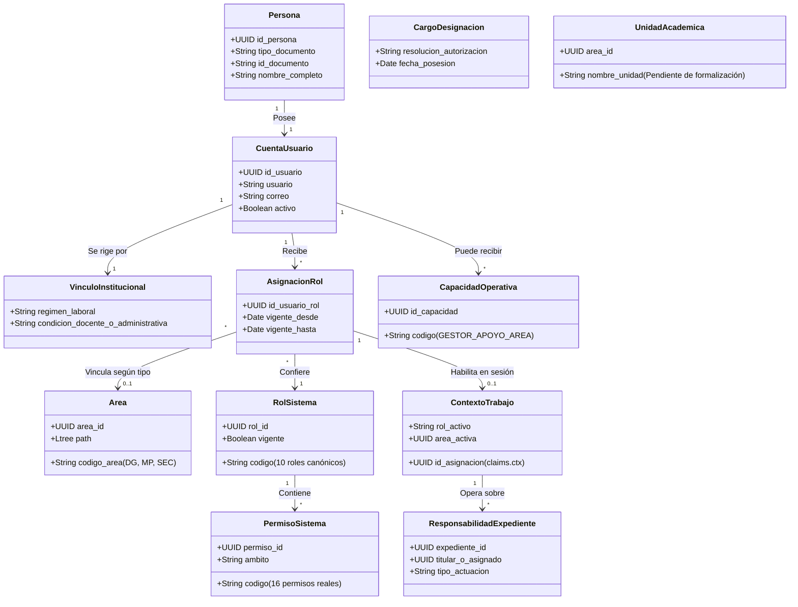
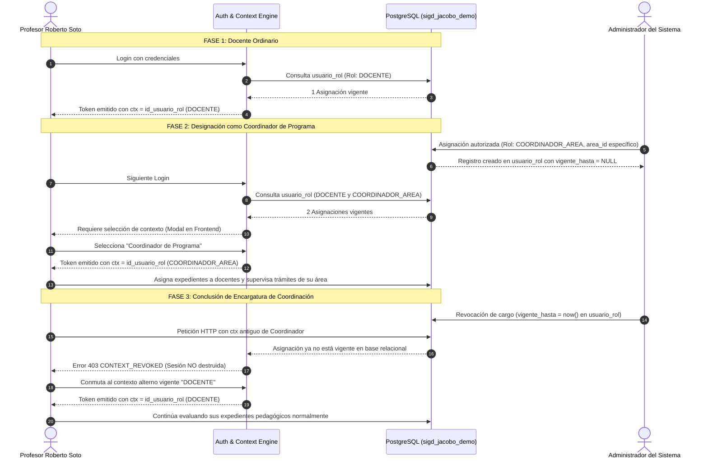

# SIGD SUIZA — MODELO DE ASIGNACIONES MULTICONTEXTO V1.1
## ARQUITECTURA DE IDENTIDAD, ASIGNACIONES PLURALES Y AISLAMIENTO DE CONTEXTOS
### INSTITUTO DE EDUCACIÓN SUPERIOR TECNOLÓGICO PÚBLICO «SUIZA» — PUCALLPA, UCAYALI
**Rama Exclusiva:** `B_JACOBO` | **Entorno Oficial:** Entorno Aislado B_JACOBO | **Base de Datos:** `sigd_jacobo_demo`  
**Estado:** Corrección y Consolidación de Diseño (TSK-1.1A) — Sin ejecución de migraciones en BD  
**Fecha:** Noviembre de 2026

---

## 1. PRINCIPIO ESTRUCTURAL: UNA PERSONA → UNA CUENTA → MÚLTIPLES CONTEXTOS

El SIGD del IESTP Público «Suiza» unifica la identidad digital de cada integrante de la comunidad institucional bajo una arquitectura jerárquica y determinista, erradicando la duplicidad de cuentas de usuario:

$$\text{PERSONA} \longrightarrow \text{CUENTA INSTITUCIONAL} \longrightarrow \left\{ \begin{array}{l} \text{ASIGNACIÓN DE ROL 1} \\ \text{ASIGNACIÓN DE ROL 2} \\ \text{CAPACIDAD OPERATIVA (PENDIENTE)} \end{array} \right\} \longrightarrow \mathbf{\text{UN CONTEXTO ACTIVO POR SESIÓN}}$$

### Los Doce Elementos Ontológicos del Modelo:

---

## 2. DESGLOSE DE LAS DOCE DISTINCIONES CONCEPTUALES

Para evitar confusiones doctrinales y garantizar un código limpio, se establecen las doce entidades técnicas del sistema:

1. **Persona (`sigd_auth.persona` / `persona_natural`):** Sujeto humano o jurídico con existencia civil acreditada (RENIEC / SUNAT). Inmutable.
2. **Cuenta (`sigd_auth.cuenta_usuario`):** Identidad digital única en la plataforma SIGD (credenciales, correo institucional, clave argon2id).
3. **Vínculo Institucional:** Naturaleza legal de la relación con el instituto (Docente Nombrado, Docente Contratado, Administrativo D.L. 276, CAS, Estudiante Matriculado, Egresado).
4. **Cargo o Designación (`sigd_org.cargo`):** Función oficial respaldada por acto administrativo o resolución rectoral formal.
5. **Unidad Académica:** Macroestructura pedagógica que agrupa múltiples áreas o carreras formativas. *(Actualmente pendiente de formalización en el organigrama del sistema)*.
6. **Área (`sigd_org.area`):** Unidad orgánica específica u oficina institucional. *(Actualmente solo existen tres en el esquema activo: `DG`, `MP` y `SEC`)*.
7. **Rol (`sigd_org.rol_sistema`):** Entidad canónica del catálogo de exactamente diez (10) roles institucionales que agrupa un conjunto estandarizado de permisos.
8. **Asignación de Rol (`sigd_org.usuario_rol`):** Vinculación formal y temporal entre una cuenta institucional y un rol del catálogo, con delimitación de ámbito según su naturaleza.
9. **Permiso (`sigd_org.permiso_sistema`):** Privilegio atómico para ejecutar una operación en un ámbito específico (`ADMIN_USUARIOS`, `EXPEDIENTE_DERIVAR`).
10. **Capacidad Operativa (`sigd_org.capacidad_sistema`):** Habilitación administrativa independiente de asistencia de área (`GESTOR_APOYO_AREA`), pendiente de implementación física.
11. **Contexto de Trabajo (`claims.ctx` en JWT):** Asignación particular que el usuario selecciona activamente para operar en una sesión determinada.
12. **Responsabilidad sobre Expediente:** Relación jurídica o funcional transitoria entre un usuario y un expediente (Titular solicitante, Operador receptor, Evaluador técnico con asignación expresa).

---

## 3. SITUACIÓN DEL ORGANIGRAMA INSTITUCIONAL Y CONDICIONES DE ÁMBITO (`area_id`)

### 3.1. Estado Real del Organigrama en la Base de Datos (`sigd_org.area`)
De la auditoría técnica sobre `sigd_jacobo_demo`, se constata que actualmente **únicamente existen tres (3) áreas de nivel 1**:
1. `DG` (Dirección General, UUID `05f2ee8f-c90f-4239-898c-3ac113afc424`)
2. `MP` (Mesa de Partes, UUID `a1a3a496-ff7f-45d8-b63c-3e54fcf79de1`)
3. `SEC` (Secretaría Académica, UUID `2b147b0d-7c8f-434f-b75a-598a1ccb855b`)

> [!IMPORTANT]
> Las unidades académicas intermedias, carreras profesionales y programas de estudios (e.g. Desarrollo de Sistemas, Enfermería Técnica) **no existen actualmente en `sigd_org.area`** y deberán incorporarse únicamente cuando se disponga de la estructura institucional confirmada por la Dirección. No se deben inventar unidades ni códigos ad-hoc.

### 3.2. Revisión Crítica de la Restricción `area_id`: Condiciones por Tipo de Asignación
Se descarta la propuesta de aplicar una restricción general `area_id NOT NULL` a todos los roles no directivos. Las condiciones de ámbito deben regirse según la naturaleza de cada asignación:

| Tipo de Asignación | Roles Comprendidos | Regla sobre `area_id` en `sigd_org.usuario_rol` | Justificación Arquitectónica |
| :--- | :--- | :---: | :--- |
| **1. Roles Institucionales / Alcance Global** | `ADMINISTRADOR`, `DIRECTOR`, `TESORERO` | **`area_id` NULL o Nivel Institucional** | Operan transversalmente sobre toda la plataforma y no deben estar encasillados en una sub-oficina subordinada. |
| **2. Roles Vinculados a una Unidad** | `JEFE_UNIDAD_ACADEMICA` | **`area_id` Obligatorio (a nivel de Unidad)** | Confinado a la Unidad Académica designada y a las áreas que cuelgan de su jerarquía `ltree`. |
| **3. Roles Vinculados a un Área** | `COORDINADOR_AREA`, `MESA_PARTES`, `SECRETARIO`, `DOCENTE` | **`area_id` Obligatorio (a nivel de Área/Oficina)** | Deben operar confinados estrictamente a su departamento formativo, ventanilla o secretaría. |
| **4. Roles Personales por Titularidad** | `ESTUDIANTE`, `CIUDADANO` | **`area_id` Obligatoriamente NULL** | No tienen adscripción orgánica. Su ámbito de consulta está gobernado por titularidad (`solicitante_id = persona.id_persona`). |

---

## 4. DIEZ REGLAS OBLIGATORIAS DE SEGURIDAD Y AUTORIZACIÓN

1. **Una Persona = Una Cuenta:** Toda persona física o jurídica cuenta con un único registro de usuario en `sigd_auth.cuenta_usuario`.
2. **Pluralidad de Asignaciones Justificadas:** Una cuenta institucional puede poseer simultáneamente múltiples asignaciones de roles o capacidades operativas legítimas.
3. **Prohibición de Acumulación Automática:** Si una cuenta posee más de un rol vigente, el sistema **NO consolida ni suma permisos**. No existe acumulación automática de privilegios.
4. **Selección Obligatoria de Contexto:** Al autenticarse, si la cuenta cuenta con múltiples asignaciones, el frontend y backend exigen seleccionar un único contexto activo (`claims.ctx`).
5. **Verificación Estricta en Backend:** Cada petición entrante a una ruta protegida revalida contra PostgreSQL relacional la vigencia del contexto activo enviado en el token.
6. **Aislamiento de Revocación de Contexto (DEC-25):** Si se revoca o vence una asignación específica, el middleware invalida únicamente ese contexto (`403 CONTEXT_REVOKED`); **la sesión del usuario permanece activa** si conserva otros contextos vigentes.
7. **Desactivación Integral de Cuenta (Nivel 4):** La desactivación de una cuenta (`cu.activo = FALSE`) revoca atómicamente todas sus sesiones en todos los dispositivos de manera inmediata.
8. **Recálculo Inmediato por Traslado:** Si un trabajador es trasladado de área en `usuario_rol.area_id`, pierde al instante el acceso a los expedientes del área anterior y adquiere los de la nueva.
9. **Inmutabilidad de la Historia:** Ninguna asignación histórica se elimina físicamente de la base de datos; las desvinculaciones se formalizan actualizando `vigente_hasta = now()`.
10. **Evidencia Documental en Designaciones:** Toda creación de asignación de directivos o coordinadores debe respaldarse registrando el número de resolución y justificación en la bitácora WORM.

---

## 5. CASO DE APLICACIÓN OBLIGATORIO: CICLO DE VIDA DE DOCENTE A COORDINADOR

A fin de validar empíricamente la robustez del modelo, se modela el ciclo de vida de un docente institucional promovido a coordinador:

Este ciclo de vida ilustra cómo el sistema asegura la continuidad operativa, el respeto al principio de mínimo privilegio y la total trazabilidad administrativa del personal institucional sin duplicidad de cuentas ni vulnerabilidad ante sesiones zombi.
