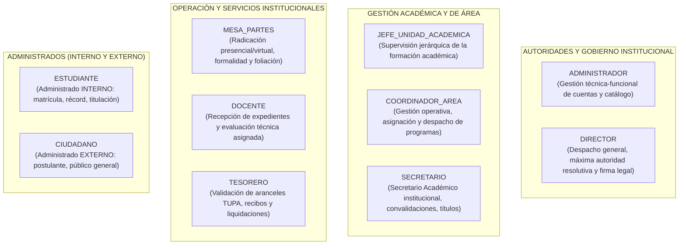
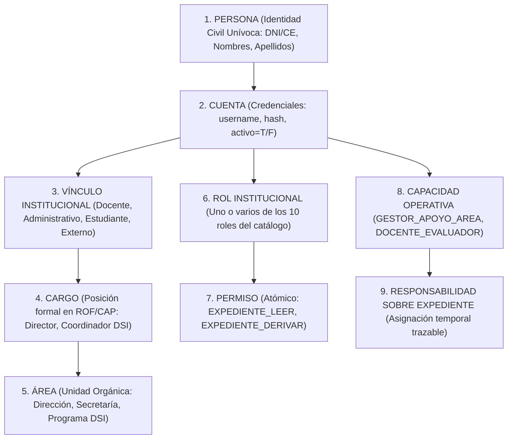
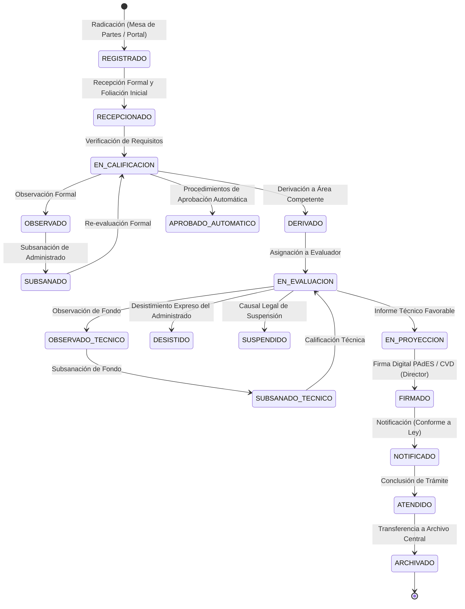
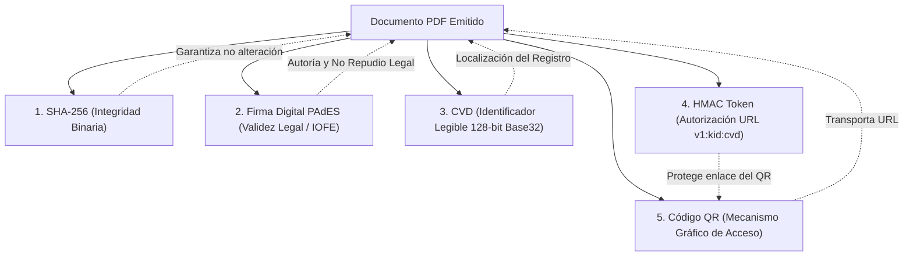
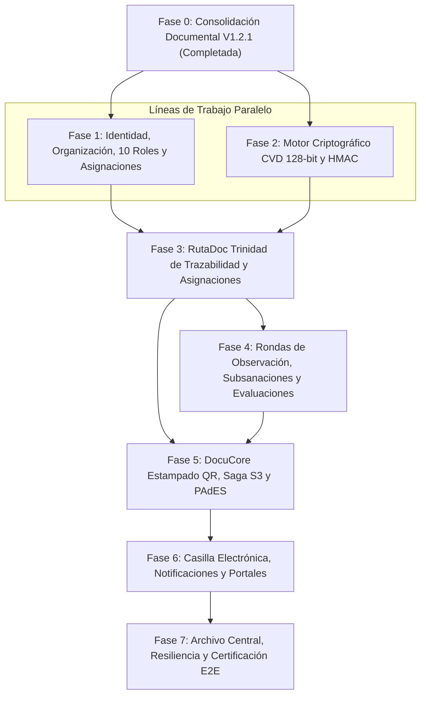

# SIGD RENATO — PLAN MAESTRO V1.2.1 (REVISIÓN CRÍTICA Y ARMONIZADA)
## CONSOLIDACIÓN FUNCIONAL, ARQUITECTÓNICA Y ROADMAP RECTOR DE IMPLEMENTACIÓN
### INSTITUTO DE EDUCACIÓN SUPERIOR TECNOLÓGICO PÚBLICO «SUIZA»
### LÍNEA DE DESARROLLO OFICIAL: RAMA `B_JACOBO`

---

## CONTROL DE REVISIÓN Y METADATOS TÉCNICOS

| Atributo | Certificación Técnica Registrada |
| :--- | :--- |
| **Proyecto** | Sistema Integral de Gestión Documentaria (SIGD RENATO) |
| **Institución** | Instituto de Educación Superior Tecnológico Público «Suiza» (Pucallpa, Ucayali, Perú) |
| **Documento Rector** | Plan Maestro de Implementación V1.2.1 — Versión Armonizada y Corregida |
| **Rama Git Oficial** | `B_JACOBO` (Verificada con `git branch --show-current`) |
| **Commit Base HEAD** | `bf30d8a0c85e266a86381fb10bf3740a8451c032` |
| **Línea Base Preservada** | `C:\Users\Liz\Desktop\SIGD_BACKUPS\b_jacobo_pre_v1231_20261110_084908\` (`RESPALDO COMPLETO Y VERIFICADO`) |
| **Base de Datos Activa** | `sigd_jacobo_demo` (PostgreSQL 18.6, Puerto Host 5433, 8 esquemas de usuario) |
| **Stack Real de Ejecución**| Node.js 22 / TypeScript 5.8 / Express 5.1 / Zod / React 19 / Vite 6 / PostgreSQL 18.6 / Redis 7 / MinIO |
| **Fecha de Emisión** | Noviembre de 2026 |

---

## 1. OBJETIVO Y MARCO DE REFERENCIA FUNCIONAL

El presente **Plan Maestro V1.2.1 Armonizado** constituye el documento rector y vinculante de todas las etapas de ingeniería y desarrollo del SIGD RENATO en la rama **`B_JACOBO`**. 

Su propósito es guiar la implementación directa de funcionalidades, consolidando los avances del trabajo colaborativo inicial y adaptando las decisiones arquitectónicas y funcionales desarrolladas por Geric (Fases 5G a 5K) a la infraestructura real de `B_JACOBO`.

### 1.1. Principios Rectores Innegociables
1. **Continuidad Operativa:** Se trabaja sobre la base de código existente en `B_JACOBO`. No se reinicia el proyecto, no se crean módulos paralelos ni se duplican funcionalidades.
2. **Adaptación Funcional vs. Copia Ciega:** Se adopta el modelo de alta trazabilidad de Geric (custodia independiente, evaluadores asignados, rondas de observaciones y notificaciones) adaptándolo limpiamente a nuestra arquitectura Domain-Driven Design (DDD) en TypeScript y PostgreSQL.
3. **Catálogo Institucional Estricto de 10 Roles:** Se establece el catálogo unívoco de diez roles institucionales. Ningún perfil operativo de apoyo se convertirá arbitrariamente en rol.
4. **Respaldo Inalterable:** El estado físico previo se encuentra sellado en `b_jacobo_pre_v1231_20261110_084908`. No se ejecutarán nuevos respaldos sin justificación técnica fundada.

---

## 2. EL CATÁLOGO INSTITUCIONAL OBLIGATORIO: EXACTAMENTE DIEZ ROLES

En estricta correspondencia con el modelo organizacional del IESTP Suiza, el sistema gobernará sus accesos a través de **exactamente diez (10) roles institucionales**:

### 2.1. Definición Funcional y Ámbitos de los Diez Roles

| # | Rol Institucional | Naturaleza | Ámbito Organizacional (Scope) | Finalidad y Facultades Centrales |
| :-: | :--- | :--- | :--- | :--- |
| **1** | **`ADMINISTRADOR`** | Institucional | `GLOBAL` | Administración de usuarios, personas, dependencias, catálogo de cargos y asignación de roles. **Sin facultades de firma, resolución o calificación documental de negocio.** |
| **2** | **`DIRECTOR`** | Autoridad | `GLOBAL` | Máxima autoridad ejecutiva del Instituto. Emisión y firma digital de Resoluciones Directorales, decretos, proveídos superiores y convenios. |
| **3** | **`JEFE_UNIDAD_ACADEMICA`** | Autoridad | `UNIDAD_ACADEMICA` | Dirección y supervisión global de las carreras profesionales. Dictamina convalidaciones complejas, resuelve recursos y eleva expedientes a Dirección. |
| **4** | **`COORDINADOR_AREA`** | Gestión | `PROGRAMA_ESTUDIOS` o `UNIDAD_ACADEMICA` (según designación) | Conducción del programa o área asignada. Asigna, supervisa y reasigna docentes evaluadores para trámites curriculares y EFSRT en su ámbito autorizado. |
| **5** | **`SECRETARIO`** | Gestión | `INSTITUCIONAL` | **Secretario Académico del IESTP Suiza.** Custodia de libros de actas, registro curricular, certificados oficiales de estudio, emisión de carnés y proyectos de titulación. |
| **6** | **`MESA_PARTES`** | Operación | `MESA_PARTES` | Recepción, radicación presencial y virtual, asignación de CUT, verificación formal de requisitos TUPA, foliación y derivación inicial. |
| **7** | **`DOCENTE`** | Docencia | `ASIGNADO` y `PROPIO` | Docente institucional. Presenta solicitudes personales y evalúa expedientes académicos **exclusivamente cuando ha sido formalmente asignado**. |
| **8** | **`TESORERO`** | Operación | `TESORERIA` | Concentra la totalidad de responsabilidades de Tesorería: validación de pagos, comprobantes de caja, conciliación bancaria y liquidación de tasas TUPA. |
| **9** | **`ESTUDIANTE`** | Administrado | `INTERNO` (identidad académica) | **Usuario interno institucional** con matrícula activa o histórica. Vinculado a su identidad académica (DNI/código de estudiante), tramita certificaciones y titulación. |
| **10** | **`CIUDADANO`** | Administrado | `EXTERNO` | **Usuario externo** (postulante, persona natural/jurídica externa, proveedor). Tramita vía mesa de partes virtual pública con DNI/RUC y correo personal. |

### 2.2. Roles Expresamente Prohibidos y Descartados
Queda terminantemente prohibido incorporar o revivir los siguientes perfiles:
* **`ESPECIALISTA`:** Descartado. Sus funciones quedan distribuidas entre el `JEFE_UNIDAD_ACADEMICA`, `COORDINADOR_AREA` y `DOCENTE` con capacidad evaluadora.
* **`CAJERO`, `APROBADOR_DEVOLUCIONES`, `SUPERVISOR_TESORERIA`:** Descartados. Todas las funciones de recaudación y validación financiera recaen unívocamente en **`TESORERO`**.
* **`SUPER_ADMIN_TECNICO`:** Descartado como rol institucional. Las actividades de mantenimiento de servidores, backups y MinIO se gestionan mediante credenciales técnicas de infraestructura, sin personificación de rol en el sistema documental.
* **`ADMINISTRATIVO/DOCENTE`:** Descartado como denominación de rol. Los términos "administrativo" y "docente" corresponden a vínculos laborales institucionales, no a roles del sistema.

### 2.3. Política Institucional de Revocación Inmediata (DEC-24)
Conforme a la decisión de gobierno institucional (Política B), se erradica la antigua política de conservación de permisos hasta el cierre de sesión:
* **Efecto Inmediato en Peticiones Protegidas:** La revocación de un rol o capacidad operativa surte efecto en la petición inmediata subsiguiente sin esperar expiración de JWT.
* **Desactivación Integral de Cuenta:** Desactivar una cuenta revoca atómicamente todas sus sesiones en `sigd_auth.sesion_usuario` en todos los dispositivos y bloquea cualquier intento de renovación o inicio de sesión.
* **Recálculo Inmediato por Ámbito:** Los traslados de área recalculan al instante el alcance territorial de los permisos documentarios.
* **Preservación Multirrol:** El retiro de una asignación específica no revoca otros roles activos legítimos de la misma cuenta institucional.

---

## 3. MODELO INSTITUCIONAL DE IDENTIDAD, ACCESO Y ASIGNACIONES

Para evitar la suplantación, duplicidad de cuentas y la concesión desmedida de privilegios, se implementa una separación ontológica de nueve capas:

### 3.1. Diferenciación de Facultades y Ámbitos
1. **Personal Administrativo de Apoyo (`GESTOR_APOYO_AREA`):**
   * El personal de apoyo secretarial u operativo de un programa o unidad posee vínculo institucional **administrativo** (o docente en apoyo) y cuenta de usuario estándar.
   * Se le otorga la capacidad operativa **`GESTOR_APOYO_AREA`** circunscrita a su unidad orgánica.
   * Esta capacidad le faculta a registrar entregables, foliar, ordenar carpetas y preparar proveídos, **sin constituir un nuevo rol institucional y sin facultades de firma ni reasignación**.
2. **Coordinador de Área y su Ámbito Organizacional:**
   * El `COORDINADOR_AREA` administra, supervisa, asigna y reasigna expedientes dentro de su ámbito autorizado.
   * Si bien típicamente su ámbito es un Programa de Estudios, por designación institucional justificada puede abarcar una Unidad Académica completa o programas afines, **sin concederle acceso global automático a toda la institución**.
3. **Múltiples Roles por Cuenta y Régimen de Contexto Activo:**
   * Una persona natural conserva **una sola cuenta de usuario** en el sistema (`id_usuario`).
   * Puede tener **múltiples asignaciones de roles institucionales** (ej. un funcionario que es `DOCENTE` y a la vez `COORDINADOR_AREA`), registradas en `sigd_org.usuario_rol`.
   * Cada asignación contiene: rol, ámbito organizacional (`area_id`), justificación o acto de designación, estado activo/inactivo (`activo: true/false`), responsable de asignación (`asignado_por`) e historial de modificaciones.
   * **Régimen de Contexto de Sesión Confirmado, Implementado y Endurecido (TSK-1.0 / TSK-1.0A):** Se adopta y ejecuta el modelo **`UNA PERSONA → UNA CUENTA → MÚLTIPLES ASIGNACIONES → UN CONTEXTO ACTIVO POR SESIÓN (SIN ACUMULACIÓN AUTOMÁTICA DE PERMISOS)`**. Si la cuenta posee más de un contexto activo, el login **no preselecciona silenciosamente** ninguno; exige selección explícita mediante `POST /api/v1/auth/seleccionar-contexto`, devolviendo token sin contexto y bloqueando acceso operativo hasta la selección. El contexto activo viaja firmado en el claim `ctx` del JWT, validado contra el header `x-contexto-id` para neutralizar IDOR/BOLA. Capacidades normalizadas en tablas relacionales (`sigd_org.capacidad_sistema`, `sigd_org.capacidad_permiso`, `sigd_org.usuario_capacidad`), y evaluadores con historial e índices parciales en `sigd_rut.expediente_evaluador`. Toda conmutación se audita en bitácora WORM.
4. **Estudiante Institucional:**
   * El rol `ESTUDIANTE` es un perfil interno diferenciado del trabajador institucional.
   * Su acceso se fundamenta en su **identidad académica** (código de estudiante, DNI, matrícula activa o histórica) y no depende obligatoriamente del dominio de correo `@iestpsuiza.edu.pe`.
   * Está restringido a sus propios expedientes, certificaciones y Casilla Electrónica. Los egresados conservan su historial académico y no son degradados automáticamente a `CIUDADANO` salvo pérdida de vínculo institucional.

---

## 4. MODELO DE TRAZABILIDAD INTEGRAL EN RUTADOC

RutaDoc implementa una máquina de estados no monolítica y un historial append-only, donde cada movimiento conserva la identidad del actor, origen, destino, motivo y marcas temporales auditadas:

### 4.1. Cuádruple Separación en Trazabilidad
RutaDoc separa formalmente cuatro conceptos independientes:
1. **Estado Procesal del Expediente:** Situación administrativa reglamentaria (`REGISTRADO`, `RECEPCIONADO`, `EN_CALIFICACION`, `DERIVADO`, `EN_EVALUACION`, `OBSERVADO`, `SUBSANADO`, `EN_PROYECCION`, `FIRMADO`, `NOTIFICADO`, `ATENDIDO`, `ARCHIVADO`, `DESISTIDO`, `SUSPENDIDO`).
2. **Custodia Institucional:** Dependencia u oficina que tiene la responsabilidad formal del expediente (`area_custodia_id`).
3. **Responsable Operativo:** Servidor o docente específico encargado de la evaluación o proyección actual (`evaluador_asignado_id`).
4. **Estado de Notificación:** Situación legal de la comunicación del acto administrativo (`PENDIENTE_NOTIFICACION`, `DEPOSITADO`, `ACCEDIDO`, `NOTIFICADO_EFECTIVO`, `PLAZO_VENCIDO`).

### 4.2. No Universalidad de Plazos y Reglas TUPA
* Los plazos de atención, calificación y subsanación **no son universales ni fijos** (no se generalizan arbitrariamente 48 horas ni 10-15 días para todos los trámites).
* Cada procedimiento se rige estrictamente por su ficha TUPA aprobada:
  * Trámites de aprobación automática (sin evaluación previa).
  * Trámites de evaluación previa con silencio positivo o negativo (plazos legales variables de 5, 15 o hasta 30 días hábiles).
* Cualquier plazo que no cuente con respaldo directo en el TUPA 2026 vigente se clasifica como **`PENDIENTE`** de validación institucional.

---

## 5. DISTINCIÓN CRIPTOGRÁFICA Y DE NOTIFICACIONES

### 5.1. Segregación Criptográfica en DocuCore
Se establece la separación conceptual y técnica entre cinco elementos comúnmente confundidos:

1. **CVD (Código de Verificación Digital):** Código alfanumérico legible generado por CSPRNG con 128 bits de entropía en Crockford Base32. Permite identificar y ubicar el registro en el validador institucional. **No sustituye a la firma digital.**
2. **Código QR:** Representación bidimensional para escaneo móvil que transporta la URL canónica estructurada. **Su sola presencia no acredita autenticidad ni validez legal.**
3. **Hash SHA-256:** Huella digital criptográfica de los bytes del PDF que garantiza su integridad frente a modificaciones.
4. **HMAC:** Token simétrico rotativo (`v1:kid:cvd`) embebido en la URL del QR para autenticar la petición y permitir acceso al documento completo (Nivel 2).
5. **Firma Digital PAdES-B-LT:** Estándar de firma electrónica avanzada/cualificada con certificados acreditados en la IOFE (Indecopi). Otorga presunción legal de autoría y no repudio.
* *Independencia de Resultados:* La verificación de firma (PKI) y la verificación de correspondencia documental (hash y metadatos) deben reportar resultados independientes en la API y el portal público.

### 5.2. Régimen Legal de Notificaciones
* El simple depósito de un documento en la Casilla Electrónica **no equivale automáticamente a notificación legalmente eficaz**.
* Se estructuran las cuatro evidencias de validez conforme a la LPAG (art. 20 a 25):
  1. **Evidencia de Depósito:** Registro en base de datos con fecha/hora cierta de almacenamiento en el buzón.
  2. **Evidencia de Puesta a Disposición:** Aviso de cortesía remitido al correo personal/institucional del administrado.
  3. **Evidencia de Acceso:** Registro forense del momento en que el administrado ingresa a su casilla e interactúa con la notificación.
  4. **Eficacia Legal:** El cómputo de términos administrativos se inicia a partir del día hábil siguiente a aquel en que la notificación adquiere eficacia conforme a la normativa vigente.

---

## 6. GESTIÓN Y CONTROLES EN TESORERÍA

Se mantiene unívocamente el rol institucional **`TESORERO`**, descartando de manera definitiva los roles de cajero y supervisor.

Para mitigar los riesgos derivados de la concentración operativa en el área de Tesorería, se establecen los siguientes controles:
1. **Control de Auto-Operación:** El Tesorero no puede validar sus propios pagos ni aprobar solicitudes de devolución en las que sea titular o beneficiario.
2. **Trazabilidad WORM en Transacciones:** Todo registro de comprobante, liquidación de tasa y autorización se asienta con el `actor_id` del usuario en sesión en la bitácora inmutable.
3. **Mecanismo de Doble Aprobación para Devoluciones (Clasificado como `PROPUESTA`):**
   * Las devoluciones que superen un monto umbral institucional requerirán la visación adicional de la Dirección General o Administración antes de su ejecución bancaria.

---

## 7. REFORMULACIÓN DEL ROADMAP DE IMPLEMENTACIÓN

Se eliminan los cronogramas rígidos basados en fechas fijas arbitrarias. El avance se supedita estrictamente a **dependencias técnicas, pruebas automatizadas y criterios de aceptación**:

### Factores de Ejecución en Paralelo:
* **Fase 1 y Fase 2 pueden ejecutarse en paralelo:** La adecuación del catálogo de roles (Fase 1 en `identicore`/`organicore`) no interfiere con el desarrollo del algoritmo CVD Crockford y HMAC (Fase 2 en `docucore`). Ambas convergen para habilitar la trazabilidad completa en RutaDoc (Fase 3).

---

## 8. CONDICIÓN DE PARADA

* **Código fuente:** Cero líneas modificadas.
* **Base de datos:** Cero mutaciones, cero DDL/DML ejecutados.
* **Historial Git:** Cero commits, cero cambios de rama, working tree intacto.
* **Estado Operativo:** El equipo de desarrollo se detiene en este punto, a la espera de la autorización expresa del usuario para comenzar la codificación de la **Fase 1**.
