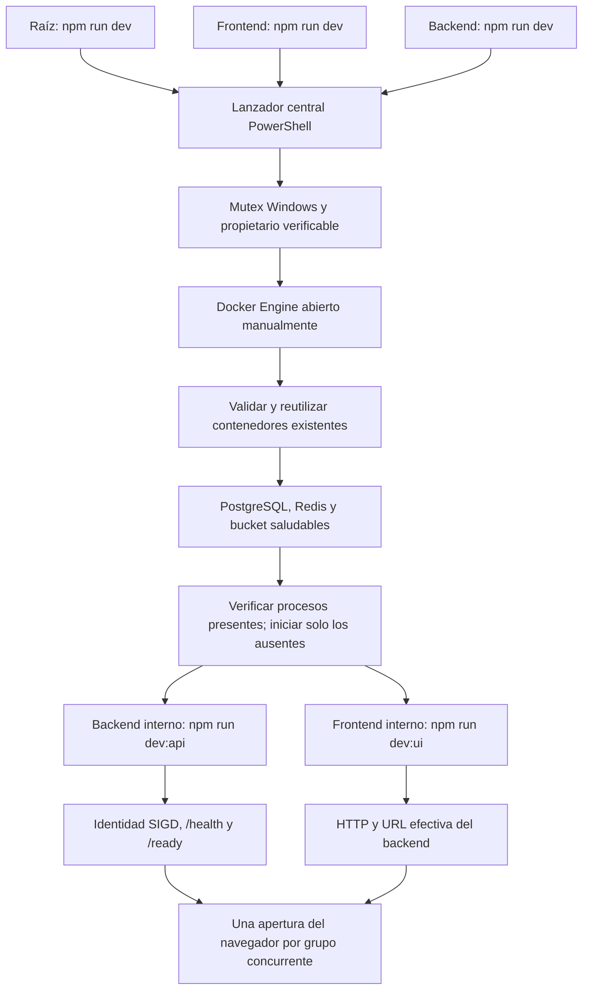

# Arranque unificado del SIGD — B_JACOBO

Fecha: 31/10/2026. Repositorio: `C:\Users\Liz\Desktop\SIGD\SIGD`.
HEAD verificado: `bf30d8a0c85e266a86381fb10bf3740a8451c032`.

## Resultado

Los tres puntos de entrada delegan en `scripts/iniciar-sigd-local.ps1`:

| Directorio | Comando público | Resultado comprobado con los servidores actuales |
|---|---|---|
| Raíz | `npm run dev` | Reutiliza API 3008 y Vite 5178; abre la interfaz |
| `frontend` | `npm run dev` | Mismo lanzador, comprobaciones e interfaz |
| `backend` | `npm run dev` | Mismo lanzador, comprobaciones e interfaz |

Las pruebas reales conservaron backend PID **25760**, padre **13384**, y frontend PID **8120**, padre **22496**. Se comprobó su directorio de trabajo mediante lectura del proceso Windows, además del comando, ruta del repositorio, puerto, fecha de creación y salud HTTP.

No se detuvieron ni reiniciaron estos servidores. No hubo nuevas instancias de backend o frontend. No se ejecutaron migraciones, cambios de esquema, cargas institucionales ni operaciones de negocio.

## Uso

1. Abrir **Docker Desktop manualmente** y esperar a que Docker Engine esté disponible.
2. Abrir una terminal en cualquiera de los tres directorios.
3. Ejecutar `npm run dev`.
4. Esperar el mensaje de disponibilidad y la apertura de `http://127.0.0.1:5178/`.

En PowerShell, si la política local impide ejecutar `npm.ps1`, el equivalente utilizado en las pruebas es `npm.cmd run dev`. No es necesario cambiar la política global de Windows.

```powershell
# Desde la raíz
cd C:\Users\Liz\Desktop\SIGD\SIGD
npm run dev

# Alternativamente, desde frontend
cd C:\Users\Liz\Desktop\SIGD\SIGD\frontend
npm run dev

# Alternativamente, desde backend: también abre la interfaz completa
cd C:\Users\Liz\Desktop\SIGD\SIGD\backend
npm run dev
```

## Arquitectura



Los comandos públicos nunca se invocan recursivamente. Se conserva `tsx watch src/server.ts` como `backend:dev:api`. El comando original de Vite se conserva como `frontend:dev:ui`.

`scratch/serve_demo.ts` mantiene la carga y validación de la configuración privada, la comprobación PostgreSQL de solo lectura, Redis PING y S3 HeadBucket. Al iniciar componentes, usa los comandos npm internos con logs separados. Vite recibe `--port 5178 --host 127.0.0.1 --strictPort`; `BROWSER=none` evita que Vite abra otra pestaña por su cuenta.

El coordinador espera identidad y salud del backend antes de avanzar a la comprobación o inicio del frontend. Si un componente ya existe, lo reutiliza. Un proceso desconocido en un puerto provoca un error; nunca se reemplaza.

## Infraestructura y configuración

| Servicio | Dirección | Ejecución |
|---|---|---|
| Backend | `127.0.0.1:3008` | Windows, Node |
| Frontend | `127.0.0.1:5178` | Windows, Vite |
| PostgreSQL | `127.0.0.1:5433` | `sigd-postgres-1` |
| Redis | `127.0.0.1:6379`, base lógica 1 | `sigd-redis-1` |
| Almacenamiento S3 | `127.0.0.1:9000` | `sigd-minio-1` |
| Consola S3 | `127.0.0.1:9001` | Mismo contenedor |

Proyecto Compose existente: `sigd`, red `sigd_default`, definido en `docker-compose.sigd.yml`. Volúmenes existentes: `sigd-integrado_pgdata`, `sigd-integrado_redisdata`, `sigd-integrado_miniodata`.

El lanzador no ejecuta Compose para recrear servicios: solo permite `docker start` sobre contenedores existentes detenidos, tras validar nombre, proyecto, servicio, volúmenes y puertos locales. Comprueba que el ID no cambia. Un contenedor ausente, desconocido o unhealthy requiere intervención manual. No abre Docker Desktop ni crea contenedores, proyectos o volúmenes.

Archivo privado vigente: `%LOCALAPPDATA%\SIGD\secrets\demo-runtime.env`. No se modificó ni se copió a la documentación. Configuración validada:

- Base exclusiva `sigd_jacobo_demo`, usuario técnico `sigd_jacobo_user`, PostgreSQL 5433.
- `MIGRATE_ON_BOOT=false`, `VITE_AUTOSTART=false` y configuración existente `SIGD_SAFE_BOOT=false`.
- Bucket `sigd-sandbox-e2e`, Redis DB 1.
- `SIGD_DEMO_OMITIR_PAGO=true`, leído del entorno del backend activo y conservado en el registro local sin cambiar su valor. Si la configuración privada o heredada contradice ese valor verificado, el arranque falla en lugar de sustituirlo silenciosamente.

La reutilización comprueba también los destinos efectivos no secretos del backend activo, no solamente el archivo privado. Los `.env` históricos no se sobrescribieron: `backend/.env` conserva referencias a 3001 y `sigd_prueba`; `frontend/.env.local`, a 5174 y 3002. Los comandos internos iniciados por el coordinador reciben la configuración de demostración que prevalece sobre esos valores.

## Procesos, bloqueo y seguridad

- Mutex compartido `Local\SIGD-3008-5178-start`: un coordinador trabaja mientras los demás esperan.
- `startup-owner.json` identifica PID y fecha de creación del coordinador. La autoridad de exclusión es el mutex de Windows, no la antigüedad de un archivo.
- Un mutex abandonado se recupera mediante el mecanismo del sistema operativo. No se elimina un bloqueo activo por tiempo transcurrido.
- El registro versión 2 distingue procesos **administrados** de **reutilizados**. Los servidores de Antigravity quedan como `owned=false`, sin adoptar sus procesos padres.
- Para procesos propios se registra el supervisor npm, su componente y fecha de creación. Antes de detenerlos se verifican nuevamente comando, directorio y pertenencia del listener a su árbol.
- La fecha de finalización del arranque permite agrupar solicitudes concurrentes y abrir el navegador una sola vez. Una solicitud posterior independiente puede abrir nuevamente la interfaz.
- Un fallo de inicio intenta cerrar exclusivamente los árboles verificados que esa ejecución acaba de crear. Conserva los servidores preexistentes y los contenedores.
- Si Windows no permite verificar procesos o listeners, se aborta; no se interpreta la falta de permisos como un puerto libre.

La lectura de directorio y entorno requiere Windows y PowerShell de 64 bits y permisos de lectura sobre los procesos del usuario. No se devuelven credenciales, tokens ni el entorno completo. Ante incompatibilidad o denegación de acceso se falla de forma segura.

## Comandos auxiliares desde la raíz

| Comando | Comportamiento |
|---|---|
| `npm run status` | Docker Engine, contenedores, PID, puertos, propiedad, HTTP y conexiones de demostración |
| `npm run stop` | Cierra solo árboles propios verificables; conserva los reutilizados y Docker |
| `npm run restart` | Aplica esa parada limitada y vuelve al lanzador central |

En el entorno actual, `stop` y `restart` **no detienen** los servidores de Antigravity. Esto se probó realmente y los PID permanecieron iguales. No se ejecutó una parada real de un backend/frontend propio nuevo, porque está prohibido detener los actuales o crear servidores adicionales para la prueba.

## Logs y archivos de ejecución

En `%LOCALAPPDATA%\SIGD\runtime`:

- `demo-processes.json`: registro de componentes y propiedad, destinos no secretos y configuración económica preservada.
- `startup-owner.json`: propietario del bloqueo durante la coordinación.
- `pending-launch.json`: identificación del supervisor recién creado, con nonce por ejecución.
- `backend-<fecha>.log` y `frontend-<fecha>.log`: salida de nuevos procesos administrados.

Los servidores reutilizados conservan sus logs originales; no se redirige su salida ni se reinician para cambiarla. Los mensajes del coordinador se muestran en la terminal.

## Pruebas ejecutadas

| Prueba | Resultado | Tipo de evidencia |
|---|---|---|
| Entrada desde raíz | Aprobada | npm real; mismos PID; navegador |
| Entrada desde frontend | Aprobada | npm real; mismos PID; navegador |
| Entrada desde backend | Aprobada | npm real; mismos PID; navegador |
| Tres entradas concurrentes | Aprobada | Tres comandos reales, una apertura de navegador, sin listeners ni contenedores adicionales |
| Portada en Chrome | Aprobada | Playwright, espera al cierre del splash, capturas de las tres entradas |
| Comunicación navegador → backend | Aprobada | `fetch` real del catálogo TUPA desde la página, HTTP 200, incluyendo CORS |
| PostgreSQL, Redis y S3 | Aprobada | Preflight real de lectura; contenedores healthy; IDs conservados |
| `status`, `stop`, `restart` con procesos reutilizados | Aprobada | Comandos reales, PID conservados |
| Docker no disponible | Aprobada aisladamente | Bloque real de coordinación con adaptadores; no se apagó Docker |
| Recuperación de backend/frontend/ambos ausentes | Aprobada aisladamente | Solo se solicitan componentes ausentes; sin procesos reales |
| Fallo al iniciar un componente | Aprobada aisladamente | Limpieza limitada al supervisor propio; servidor preexistente protegido |
| PID obsoleto, listener ajeno y parada propia | Aprobada aisladamente | Barreras reales con adaptadores de proceso y parada |
| Mutex abandonado | Aprobada | Coordinador PowerShell de prueba, mutex Windows independiente, recuperación y liberación reales |
| Contratos del lanzador Node | 5/5 aprobadas | Código real transpilado, adaptadores en memoria; sin sockets ni procesos |
| Coordinación PowerShell aislada | 30 aserciones aprobadas | Código real de coordinación, sin infraestructura real |
| Sintaxis PowerShell, Node y transpilación TypeScript | Aprobada | Verificaciones dirigidas al alcance |

Evidencias reproducibles:

```powershell
powershell.exe -NoProfile -ExecutionPolicy Bypass -File scripts/pruebas/arranque-aislado.ps1
powershell.exe -NoProfile -ExecutionPolicy Bypass -File scripts/pruebas/bloqueo-aislado.ps1
node --test scripts/pruebas/lanzador-node-aislado.cjs
node scripts/pruebas/arranque-real.cjs
```

La última prueba exige que los dos servidores estén activos. Usa el Chrome instalado; no descarga navegadores. Genera `scratch/evidencias-arranque-unificado/resultados.json` y las capturas `raiz.png`, `frontend.png` y `backend.png`. Compara PID, listeners y los tres IDs Docker antes y después.

## Archivos inspeccionados y modificados

Inspeccionados: manifiestos raíz/backend/frontend, lanzadores centrales y auxiliares, `scratch/serve_demo.ts`, lanzadores actuales `run_backend.cjs`/`run_frontend.cjs`, Vite, servidor backend, configuración privada filtrada, Compose, registro de procesos y servicios activos.

Modificados en esta intervención:

- `frontend/package.json`: delegación pública y conservación de Vite como `dev:ui`.
- `scripts/iniciar-sigd-local.ps1`: coordinación compartida, reutilización, recuperación parcial, comprobaciones y apertura única.
- `scripts/estado-demo.ps1`, `scripts/detener-demo.ps1`, `scripts/reiniciar-demo.ps1`: estado y operaciones limitadas a procesos propios.
- `scratch/serve_demo.ts`: preflight conservado, preservación económica e inicio mediante comandos internos.

Creados: `scripts/procesos-sigd.ps1`, cuatro archivos de pruebas en `scripts/pruebas/` y este informe. Se generaron evidencias bajo `scratch/evidencias-arranque-unificado/`.

Los comandos raíz y backend ya delegaban correctamente: se conservaron sin cambios en esta intervención. Los cambios ajenos de manifiestos, dependencias y módulos se preservaron.

## Limitaciones y errores frecuentes

- **Docker no disponible:** el mensaje pide abrirlo manualmente. El lanzador no abre Docker Desktop y no inicia procesos dependientes.
- **Puerto ocupado por identidad desconocida:** se aborta sin terminar el proceso. Investigar su origen antes de volver a intentar.
- **Contenedor ausente o volumen distinto:** se aborta, sin crear ni reconstruir infraestructura.
- **Configuración económica incompatible:** revisar el entorno privado/heredado; no cambiar el valor de pago para superar la comprobación.
- **Faltan dependencias:** prepararlas mediante un procedimiento autorizado; el lanzador no instala nada.
- **Acceso a procesos denegado:** utilizar la misma sesión de Windows del propietario y PowerShell de 64 bits; no se fuerza una reutilización no verificable.

No se probó un arranque real con backend/frontend o infraestructura detenidos, porque el alcance exige conservarlos encendidos. Esa ruta se verificó de forma aislada. No se ejecutó una regresión funcional completa de los nueve módulos: se comprobaron portada, catálogo, salud y conectividad, sin modificar código de negocio.

No se modificó Compose ni `sigd_prueba`. No se hicieron commits ni pushes. Los lanzadores previos `scratch/run_backend.cjs` y `scratch/run_frontend.cjs` se conservaron para respetar los procesos existentes; para futuros arranques ordinarios corresponde usar los tres puntos públicos del coordinador.
