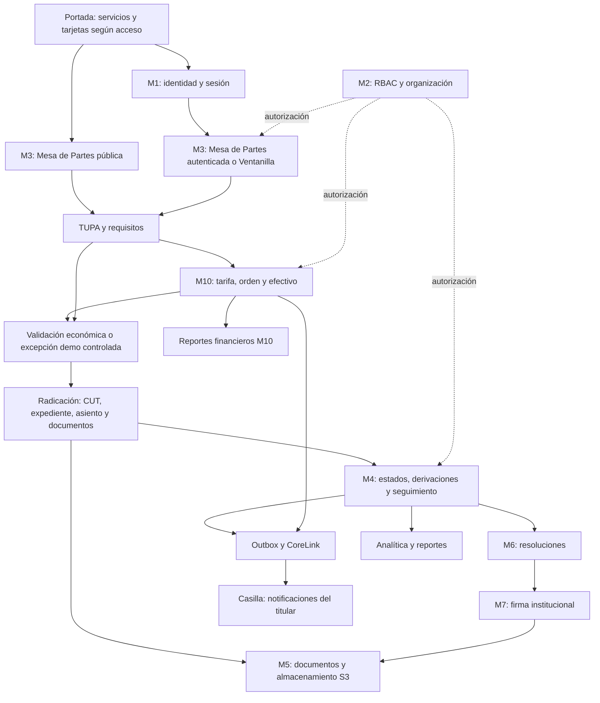

# Auditoría integral de módulos, tarjetas e integración del SIGD

**Institución:** IESTP Público «Suiza».  
**Fecha de cierre de la inspección:** 31 de octubre de 2026, America/Lima.  
**Repositorio:** `C:\Users\Liz\Desktop\SIGD\SIGD`.  
**Rama verificada:** `B_JACOBO`.  
**HEAD:** `bf30d8a0c85e266a86381fb10bf3740a8451c032`.  
**Alcance:** auditoría de solo lectura; la única escritura autorizada es este informe.

## 1. Resumen ejecutivo

El inventario documentado anterior a Tesorería contiene **nueve módulos funcionales**. M10 es una incorporación adicional: el inventario institucional llega a **diez**, aunque no existe una correspondencia de una tarjeta por módulo.

Los informes AF-23 y AF-30 identifican los nueve originales como **IdentiCore, OrganiCore, TramiCore, RutaDoc, DocuCore, Despacho, FirmaCore, CoreLink y Analítica MGD-PCM**. La documentación posterior de M10 llama **NotiCore** a M8 y agrupa **CoreLink/Analítica** en M9. Esta diferencia de nomenclatura existe en el repositorio: no constituye evidencia de un módulo nuevo ni de uno perdido. La Casilla existe como funcionalidad, con interfaz, API y persistencia propias, implementada dentro del dominio IdentiCore y conectada al despachador de notificaciones.

Las **ocho tarjetas del administrador** son Panel de Administración, Ventanilla Presencial, Bandeja de Expedientes, Firma Digital, Resoluciones, Reportes y Tableros de Control, Validador CVD y Tesorería. El paso de seis a ocho está explicado por la habilitación de **Ventanilla para el administrador** y la incorporación de **M10 como tarjeta independiente**, según el código y el informe de accesos. No se encontró un «noveno módulo faltante» que deba transformarse automáticamente en una tarjeta adicional.

Hay integración real entre M1, M3, M4, documentos y M10. PostgreSQL conserva los dos expedientes de demostración del cierre público/autenticado de Tesorería, con referencias documentales y aplicaciones de pago. Sin embargo, **no es correcto certificar todos los módulos como completamente funcionales**:

- Seguridad, dentro de Administración, utiliza datos y acciones locales de demostración; el mensaje de auditoría WORM no corresponde a una llamada real al backend desde ese hook.
- Tablas Maestras mezcla lectura real de organigrama con un listado y modificaciones locales de catálogos.
- Algunas lecturas de catálogos administrativos están expuestas sin autenticación. Se observaron respuestas 200 antes de la interrupción y el código confirma la ausencia de guardia en esas rutas.
- La recuperación de identidades mediante OTP depende de la entrega institucional no configurada; la firma digital real depende del servicio/certificado correspondiente.
- SUZ26-068 sigue pendiente; las otras 18 tarifas tienen una fila vigente validada en M10.
- **Al retomar la auditoría, el backend 3008 dejó de estar disponible:** `/health` y `/ready` no conectan. El frontend responde 200 en 5178 y la infraestructura Docker está saludable. No se inició ni reinició ningún servicio. Las comprobaciones HTTP anteriores no se presentan como disponibilidad actual.

## 2. Continuidad, método y límites

### 2.1 Estado al reanudar

Se conservaron las evidencias de la primera parte de esta auditoría: lectura de HomePage, AppRouter, ProtectedRoute, Administración, montaje de routers, RBAC, servicios M10, informes históricos, consultas de metadatos/roles/contadores PostgreSQL y comprobaciones HTTP sin credenciales.

Al reanudar:

- El informe solicitado **no existía**.
- La rama y HEAD seguían iguales.
- Se observaron **299 entradas preexistentes** en `git status --porcelain`, entre modificaciones y archivos sin seguimiento. No se eliminaron, restauraron ni editaron.
- Quedaban por completar el contraste de nomenclatura histórica, las pantallas administrativas parcialmente simuladas, algunas relaciones documentarias y la redacción del informe.
- No se atribuye a una falla de autenticación de la herramienta una causa dentro del SIGD: no existe evidencia para esa relación.

### 2.2 Niveles de evidencia

| Nivel | Significado |
|---|---|
| Código inspeccionado | La ruta, regla o integración existe en fuente; no demuestra por sí sola ejecución correcta. |
| Lectura real | Resultado observado de HTTP sin credenciales, Docker, puertos o SELECT en la base autorizada. |
| Evidencia histórica | Resultado registrado en informes anteriores; se identifica como tal y no se vuelve a contar como prueba ejecutada ahora. |
| Pendiente | No se comprobó el recorrido completo, faltan credenciales/servicios o probarlo requeriría escrituras no autorizadas. |

Las consultas SQL usaron la conexión de demostración del lanzador existente, validaron el nombre `sigd_jacobo_demo` antes de consultar y se ejecutaron con `BEGIN READ ONLY`; PostgreSQL devolvió `transaction_read_only=on`. Se cerraron con `ROLLBACK`. No se consultó `sigd_prueba`, no se ejecutaron DDL/DML, migraciones, radicaciones, pagos ni cambios de roles.

No se ejecutaron suites de pruebas, builds ni E2E que pudieran producir archivos o modificar datos. No se iniciaron sesiones con contraseñas inventadas. Las pruebas históricas no equivalen a validación autenticada actual.

## 3. Estado del entorno y cambio de disponibilidad

| Componente | Evidencia anterior dentro de esta auditoría | Comprobación al reanudar |
|---|---|---|
| Backend 3008 | Listener PID 3728; `/health` 200 y `/ready` 200 | Sin listener 3008 en `netstat`; ambas peticiones fallan por imposibilidad de conexión, corte 14:36 America/Lima. No se diagnostica la causa de la salida del proceso. |
| Frontend 5178 | Listener PID 25016 | Listener PID 25016; GET `/` devuelve 200. Esto demuestra disponibilidad del servidor, no funcionamiento integral de APIs. |
| PostgreSQL | Conexión demo verificada | `sigd-postgres-1`, ID `f057f2bf4352`, saludable; 127.0.0.1:5433 → 5432; SELECT autorizado correcto. |
| Redis | Servicio existente | `sigd-redis-1`, ID `9da1bb32864b`, saludable; 127.0.0.1:6379. |
| Almacenamiento S3/MinIO | Integración documental inspeccionada | `sigd-minio-1`, ID `54d72bc68ce7`, saludable; 9000/9001; imagen compatible S3 `pgsty/silo`. No se descargaron ni revalidaron objetos en este cierre. |
| Docker Compose | Proyecto institucional existente | Los tres contenedores declaran proyecto `sigd`, archivo `docker-compose.sigd.yml` y directorio del repositorio auditado. |

No se creó ni utilizó `sigd-validacion`, otra base o un proyecto Compose alternativo. No se detuvo ni reinició ningún proceso. La indisponibilidad actual del backend impide certificar los flujos vivos de los diez módulos en este corte.

## 4. Inventario institucional y discrepancia de nombres

### 4.1 Los nueve módulos originales documentados

Se toma como referencia del inventario previo a M10 la enumeración explícita de `docs/INFORME_AF-23_VALIDACION_INTEGRAL.md` (diagrama, líneas 98–105 y secciones por módulo) y `docs/INFORME_AF-30_VALIDACION_DEFINITIVA_Y_CIERRE_PROTOTIPO.md` (líneas 210–218).

| Código histórico | Nombre en AF-23/AF-30 | Responsabilidad | Ubicación actual de la implementación |
|---|---|---|---|
| M1 | IdentiCore | Identidad, registro y autenticación | `backend/src/domains/identicore`; registro/login frontend; Casilla también reside técnicamente aquí. |
| M2 | OrganiCore | Organización, usuarios y RBAC | `backend/src/domains/organicore`; Administración y sus herramientas. |
| M3 | TramiCore | Recepción, radicación y CUT | `backend/src/domains/tramicore`; Mesa de Partes virtual/presencial. |
| M4 | RutaDoc | Expedientes, estados y derivaciones | `backend/src/domains/rutadoc`; bandeja y detalle. |
| M5 | DocuCore | Documentos, folios, integridad y CVD | `backend/src/domains/docucore` y almacenamiento transversal. |
| M6 | Despacho | Proyección y gestión de resoluciones | `resoluciones.controller.ts`, `resoluciones.service.ts`, dentro de DocuCore. |
| M7 | FirmaCore | Firma digital y conector ReFirma | `firma.controller.ts`, `firma.service.ts`, servicios ReFirma/PAdES, dentro de DocuCore. |
| M8 | CoreLink | Eventos, SSE, auditoría e integración; AF-30 lo ejemplifica mediante Casilla | `backend/src/modules/corelink`, `backend/src/audit`, Casilla en IdentiCore. |
| M9 | Analítica MGD-PCM | Indicadores y reportes | `backend/src/domains/corelink`; tablero y hooks de reportes. |
| M10, adicional | Tesorería | Órdenes, efectivo, recibos, caja y devoluciones | `backend/src/domains/tesoreria`, `frontend/src/pages/tesoreria`, esquema `sigd_tes`. |

### 4.2 Por qué no hay una única numeración consistente en todos los informes

| Fuente | Diferencia relevante |
|---|---|
| AF-21, `INFORME_AF-21_VALIDACION_FUNCIONAL.md` | Enumera M6 FirmaCore, M7 CoreLink, M8 Analítica y M9 Storage S3; no coincide con el inventario posterior. |
| AF-23 y AF-30 | Separan Despacho y FirmaCore; M8 CoreLink, M9 Analítica. Storage pasa a ser capacidad transversal. |
| `M10_TESORERIA/INTEGRACIONES_M10.md` | Denomina M8 NotiCore y M9 CoreLink, agrupando notificaciones y analítica de otra manera. |
| Código de portada | Usa subtítulos heredados `ENT-M05-01`, `ENT-M02-05`, `MOD-04`, `06_reportes-tablero-control` y M10; no implementa un registro uniforme M1–M10. |

**Conclusión:** los nombres anteriores están documentados, pero su codificación no es uniforme. Se debe ratificar un catálogo institucional único antes de renombrar interfaces o documentación. Esta auditoría no cambia nombres ni inventa un módulo once. NotiCore/Casilla y CoreLink/Analítica son denominaciones posteriores de responsabilidades ya presentes.

En `backend/src/domains` hay siete directorios: `identicore`, `organicore`, `tramicore`, `rutadoc`, `docucore`, `corelink`, `tesoreria`. Eso no significa siete módulos: Despacho y FirmaCore comparten dominio técnico con DocuCore. Tampoco se encontró una tabla de catálogo de módulos en la búsqueda de metadatos por nombre `%modul%`; la portada construye su catálogo en TypeScript.

## 5. Inventario de tarjetas, rutas y componentes

### 5.1 Servicios públicos: cuatro tarjetas

Fuente: `frontend/src/pages/HomePage.tsx`, arreglo `SERVICIOS_PUBLICOS`, líneas 29–61; rutas en `frontend/src/routes/AppRouter.tsx`.

| Tarjeta / identificador de navegación | Ruta | Componente | Acceso y conexión |
|---|---|---|---|
| Mesa de Partes Virtual | `/tramite` | `TramitePage` / wizard | Entrada pública; API de sesión/radicación pública, TUPA, PDF y CUT. M3. |
| Casilla Electrónica | `/casilla` | `CasillaElectronicaPage` | La página tiene ruta pública, pero los datos de notificaciones requieren JWT y cuenta activa. No significa acceso anónimo a casillas. |
| Consulta de Trámite | `/consulta` | `ConsultaPublicaPage` | API de consulta pública por CUT y validaciones del mecanismo público. M3/M4. |
| Validador CVD | `/validador-cvd` | `ValidadorPublicoCvdPage` | Verificación pública limitada de documentos. M5. |

La sección pública se renderiza cuando no hay sesión. Login y Registro son rutas de acceso, no tarjetas adicionales del inventario institucional.

### 5.2 Administrador: ocho tarjetas de gestión

Fuente: `HomePage.tsx`, líneas 179–251; `AppRouter.tsx`; `ProtectedRoute.tsx`. Para las tarjetas autenticadas la clave React es la ruta (`mod.ruta`), no un identificador de módulo persistido.

| Tarjeta | Ruta | Componente efectivo | Visibilidad y guardia relevante | Conexión real en fuente |
|---|---|---|---|---|
| Panel de Administración | `/administracion` | `AdministracionPage` + `AdminRoutes` | Administrador; facultad global `ADMIN_USUARIOS` | APIs de usuarios, RBAC, auditoría y catálogos; hay herramientas parciales detalladas abajo. |
| Ventanilla Presencial | `/tramite/ventanilla-presencial` | `VentanillaPresencialPage` | `MESA_PARTES` o `ADMINISTRADOR` | `POST /api/v1/tramites/ventanilla-presencial`; cargo. |
| Bandeja de Expedientes | `/expedientes` | `BandejaExpedientesPage` | Rutas para ADMINISTRADOR, SUPER_ADMIN, DIRECTOR, SECRETARIO, ESPECIALISTA, MESA_PARTES; backend aplica facultades/área | Listado, detalle, estados, derivaciones y trazabilidad RutaDoc. |
| Firma Digital | `/flujo-validez-legal/firma` | `PasarelaFirmaPage` | Visibilidad por facultad de firma/admin; ruta DIRECTOR/ADMINISTRADOR/SUPER_ADMIN | API de firma, sesión/callback y documentos firmables. Dependencia externa para firma efectiva. |
| Resoluciones | `/flujos/proyector-resoluciones` | `ProyectorResolucionesPage` | Admin/SECRETARIO/ESPECIALISTA en portada; ruta también contempla DIRECTOR | API `/api/v1/resoluciones`, persistencia documental. |
| Reportes y Tableros de Control | `/reportes/dashboard` | `DashboardEjecutivoPage` (reexporta página de `pages/reportes`) | Admin o facultades de reportes; backend exige `REPORTE_LEER` global | Resumen, tendencias y cuellos de botella desde APIs reales. |
| Validador CVD | `/validador-cvd` | `ValidadorPublicoCvdPage` | Acceso público también reutilizado institucionalmente | Misma capacidad de M5; no un segundo módulo CVD. |
| Tesorería | `/tesoreria` | `TesoreriaPage` | Admin/global `ADMIN_USUARIOS`, TESORERO; vista ciudadana diferenciada | M10, capacidades y APIs; administrador lectura/reportes, TESORERO operativo. |

Los alias `/admin`, `/ventanilla`, `/mesa-partes`, `/tramite/mesa-partes-virtual` y `/casilla-electronica` no añaden módulos.

### 5.3 Otras sesiones

- **CIUDADANO sin roles institucionales:** cinco tarjetas: Casilla, Nuevo Trámite, Consulta, Validador CVD y Mis pagos y devoluciones. Esta última usa `/tesoreria`, pero muestra la experiencia personal, no el panel administrativo.
- **TESORERO sin otros roles:** tarjeta M10; `esSoloTesoreria` evita conceder las tarjetas generales por el mero hecho de estar autenticado.
- **Otros trabajadores:** selección condicional por roles y facultades. La guardia de la ruta y la autorización backend siguen siendo necesarias; una tarjeta visible no concede una operación.
- Una cuenta con varios roles puede obtener una combinación distinta. El conteo de ocho se refiere al perfil administrador examinado en fuente, no a cualquier combinación posible.

### 5.4 Explicación del cambio de seis a ocho

`M10_TESORERIA/ACCESOS_ADMIN_TESORERO.md:31–33` documenta expresamente la incorporación de la tarjeta M10 para administrador/tesorero y la visibilidad de Ventanilla para administrador. La condición actual de Ventanilla es `esVentanilla || esAdmin`; M10 se agrega fuera de las opciones internas de Administración.

Las seis anteriores se reconstruyen como Administración, Bandeja, Firma, Resoluciones, Reportes y CVD; las dos adiciones son Ventanilla y Tesorería. Es una conclusión sustentada en fuente e informe de cambios, **no una comparación de capturas capturadas durante esta auditoría**. Los cambios locales no confirmados impiden atribuir toda la transición a un commit específico sin evidencia adicional.

No falta una novena tarjeta obligatoria: M1 opera mediante login/registro/perfil; CoreLink incluye servicios transversales sin tarjeta propia; Casilla tiene acceso ciudadano y público de entrada. La Analítica histórica M9 ya está representada por Reportes. Crear otra tarjeta para cumplir un número duplicaría responsabilidades sin justificación.

## 6. Administración: seis herramientas internas y sus límites

Fuente: `pages/administracion/AdministracionPage.tsx` y `routes/AdminRoutes.tsx`. El router vivo utiliza `pages/administracion`, aunque hay archivos heredados en otras carpetas.

| Opción | Subruta | Estado demostrado por inspección |
|---|---|---|
| Usuarios | `/administracion/usuarios` | Página/hook y API de administración reales; requiere facultad de edición. No se creó, editó ni desbloqueó un usuario en esta auditoría. |
| Roles y Permisos | `/administracion/roles-permisos` | `useRbacConfig.ts` consulta `/api/v1/admin/roles-permisos` y actualiza `/api/v1/roles/:id/permisos`. Persistencia RBAC existente. No se ejecutó PUT. |
| Auditoría | `/administracion/auditoria` | `useAuditLogs`, API protegida de bitácora y tabla real `sigd_audit.bitacora_auditoria`. Sin certificación forense completa de inmutabilidad en este corte. |
| Tablas Maestras | `/administracion/tablas-maestras` | **PARCIAL.** Organigrama se obtiene por API; listado `registrosIniciales`, `crearRegistro` y `alternarEstado` del hook son locales. No equivalen a cambios PostgreSQL. |
| Calendario Laboral | `/administracion/calendario-laboral` | Hook conectado a GET calendario y POST feriado excepcional; mutación protegida. No se registraron feriados. |
| Seguridad | `/administracion/seguridad` | **SOLO FRONTEND para las políticas/desbloqueo mostrados.** `useSeguridadPolicies.ts` usa arrays y `useState`, sin llamada API para guardar/desbloquear. |

Hallazgos específicos:

1. `useSeguridadPolicies.ts:31–54` contiene intentos y cuentas de ejemplo. `guardarPoliticas` (62) devuelve un objeto y cambia un mensaje; `desbloquearCuenta` (78–96) filtra el estado local. El mensaje «Evento registrado en auditoría WORM» no está respaldado por una escritura desde esta implementación. La autenticación real del backend es otra responsabilidad y no queda desactivada por esta pantalla.
2. `useTablasMaestras.ts:60–77,180,204` conserva registros iniciales y altas/inactivaciones en memoria. Su organigrama sí consulta la API (95–96), diferencia UUID reales y marca el respaldo de ejemplo `esReal:false`. No debe confundirse ese árbol real con persistencia del CRUD de catálogos.
3. `backend/src/app.ts:420–425` devuelve dos sedes codificadas en fuente en `/api/v1/admin/maestras/sede`. No es evidencia de un catálogo de sedes mantenido en PostgreSQL.

Estas opciones son herramientas de OrganiCore y capacidades transversales de identidad/auditoría. No se suman como seis módulos independientes ni contienen M10.

## 7. Matriz maestra frontend, backend y PostgreSQL

**Criterio de clasificación:** FUNCIONAL exige integración completa y comprobación suficiente del alcance; PARCIAL identifica implementación con pendientes concretos; PENDIENTE DE VALIDACIÓN indica que no se comprobó todo su funcionamiento. La indisponibilidad final de la API afecta la validación viva de todos los módulos. No se confunde con ausencia de implementación.

| ID de referencia | Módulo / tarjeta | Frontend | Backend y servicios principales | Persistencia real y relaciones | RBAC / integración | Estado del alcance completo |
|---|---|---|---|---|---|---|
| M1 | IdentiCore; sin tarjeta administrativa exclusiva | Login, Registro, identidad del wizard | `auth.router`, `registroCiudadano.service`, `argon2.service`, `identidadOtp.service`; `/api/v1/auth/me` | `sigd_auth.persona`, natural/jurídica, cuenta, perfil, consentimiento, sesión | JWT y cuenta activa; relación cuenta-persona; M3 y Casilla | **PARCIAL:** identidad/registro implementados; reclamación depende de contacto verificado/OTP institucional. Login actual no probado. |
| M2 | OrganiCore; Administración | Seis herramientas, usuarios/roles | `usuariosAdmin.routes`, `adminMaestras.routes`, organigrama, RBAC | `sigd_org.area`, `rol_sistema`, `usuario_rol`, `rol_permiso`, permisos; cuentas en `sigd_auth` | `ADMIN_USUARIOS`, ámbitos y vigencia; transversal | **PARCIAL:** RBAC real, pero Seguridad y parte de catálogos son locales. |
| M3 | TramiCore; MPV, Ventanilla, Consulta | Wizard, Ventanilla, consulta y Mis trámites | `tramites.controller`, `radicacionVirtual.service`, `radicacionPublica.router`, `ventanillaPresencial.service`, `consultaPublica.service` | TUPA/requisitos en `sigd_doc`; expediente en doc/tra; asiento, radicación pública y secuencia CUT | Identidad pública o autenticada; M1/M10 antes de radicar, M4/M5 después | **PENDIENTE DE VALIDACIÓN integral actual:** subflujos E2E históricos y persistencia corroborada; no se radicó ahora. |
| M4 | RutaDoc; Bandeja | Bandeja y detalle de expediente | `rutadoc.router/controller/service/repository`, derivaciones | `sigd_rut.estado_actual_expediente`, movimientos, transiciones; expedientes doc/tra | Lectura/derivación por facultad y ámbito; M3, M5, Despacho, Outbox | **PENDIENTE DE VALIDACIÓN integral:** fuente y modelo reales, sin nuevas actuaciones en esta auditoría. |
| M5 | DocuCore; CVD y documentos transversales | Validador, adjuntos/visores | `docucore.router`, `validadorCvd.controller`, integridad/folios, `core/storage` | `sigd_doc.documento_adjunto`, requisitos/formularios; objetos S3 | Documentos privados por titularidad/facultad, verificación pública limitada; M3/M4/M6/M7/M10 | **PENDIENTE DE VALIDACIÓN integral:** referencias reales; no se certificaron todos los objetos ni firmas actuales. |
| M6 | Despacho; Resoluciones | `ProyectorResolucionesPage` | `resoluciones.controller/service`, generación/edición A4 | `sigd_doc.resolucion`, expediente y documento_adjunto | Facultades de despacho; M4, M5 y M7 | **PENDIENTE DE VALIDACIÓN integral:** tabla canónica existente; generación/emisión no ejecutada. |
| M7 | FirmaCore; Firma Digital | `PasarelaFirmaPage` | `firma.controller/service`, gateway/callback ReFirma, verificador PAdES | `sigd_doc.firma_digital_documento`, adjuntos, sesiones de firma | Facultades de firma; documentos y Despacho | **PARCIAL:** integración implementada; firma institucional efectiva requiere certificado/conector y prueba verificable. |
| M8 histórico | CoreLink; notificaciones llamadas NotiCore en informes recientes | Casilla, avisos SSE; sin tarjeta admin independiente | `/api/v1/realtime`, Outbox, `despachador-notificaciones`, `casilla.router` | `sigd_audit.evento_outbox`, bitácora; `sigd_auth.notificacion_casilla` | JWT/cuenta activa y destinatario; M3/M4/M10 → Casilla | **PARCIAL:** cadena en fuente y persistencia existente; entrega/acuse actual no verificado; correo externo pendiente. |
| M9 histórico | Analítica MGD-PCM; Reportes; agrupada bajo CoreLink en M10 | Dashboard y hooks métricos | `domains/corelink/reportes.router/controller`, `mgdAnalytics.service` y repositorio | Lecturas/vistas sobre información documentaria y movimientos; no necesita duplicar expedientes | `REPORTE_LEER` global; refresco exige administración; M4/M8 | **PENDIENTE DE VALIDACIÓN integral:** APIs/hook reales; métricas no recalculadas ni vistas refrescadas aquí. |
| M10 | Tesorería; tarjeta independiente/pagos personales | TesoreriaPage, CajaTesoreria, servicio API | Router, service, repository, rules, efectivo, pública, radicación y constancia | Diez tablas actuales `sigd_tes`; FK a persona, cuenta, TUPA y expediente | Admin supervisa; TESORERO opera; ciudadano titular; M1/M2/M3/M5/M8 | **PARCIAL para operación institucional:** E2E de demo documentados y persistencia comprobada; SUZ26-068 y validación viva por rol pendientes. |

No se identificó una de estas diez áreas completamente carente de implementación. Tampoco se identificó una tarjeta principal sin ningún backend asociado. Sí hay funcionalidades internas SOLO FRONTEND y capacidades transversales sin tarjeta propia; son casos distintos.

## 8. Inventario API y contratos realmente montados

El montaje efectivo se encuentra en `backend/src/app.ts:283–440`. Los siguientes endpoints son representativos y verificables en routers; la tabla no afirma que cada operación haya sido invocada durante la auditoría.

| Área | Rutas/operaciones localizadas |
|---|---|
| IdentiCore | Routers de autenticación y registro bajo `/api/v1`; `GET /api/v1/auth/me`, capacidades de registro y verificación de titularidad. |
| Casilla | GET `/api/v1/casilla/notificaciones`, `/casilla/bandeja`, detalle y estadísticas; PATCH lectura; POST acuse; descargas autorizadas de documento/acuse. Todas requieren JWT y cuenta activa. |
| OrganiCore | `/api/v1/admin/usuarios`, alias `/api/v1/usuarios`; roles-permisos, auditoría/bitácora, organigrama, tablas maestras y calendario. |
| TramiCore | GET `/api/v1/tramites/tipos`, `/tramites/tupa`, `/tramites/mis-expedientes`, `/tramites/consulta-publica/:cut`; POST radicación virtual y ventanilla-presencial; GET cargo de Ventanilla; router público en `/api/v1/tramites/publico`. |
| RutaDoc | GET `/api/v1/expedientes`, detalle, trazabilidad, foliación y SLA; rutas de derivación, documentos y reversión de actuación. |
| Despacho/Firma | `/api/v1/resoluciones`, `/api/v1/firma`, alias `/api/v1/firmas` y cola de firmantes; servicios dentro de DocuCore. |
| CVD/Storage | `/api/v1/validador/cvd/:codigo`, router DocuCore bajo `/api`, almacenamiento bajo `/api/v1`. |
| CoreLink/Analítica | `/api/v1/realtime`; `/api/v1/reportes/dashboard/resumen`, `/cuellos-botella`, `/tendencias`, alias KPIs/dashboard-ejecutivo, tiempos-atención. |
| Tesorería | Bajo `/api/v1/tesoreria`: capacidades, catálogo, tarifas, órdenes, caja/cierre, pagos/efectivo, revisión, devoluciones/constancia/revisión, movimientos, reportes y documentos. |

Se conservaron todos los DTO y contratos. El middleware de errores y la validación de entrada no se infieren de la existencia de una tarjeta: se observaron validaciones y controladores concretos. No se certifica cobertura exhaustiva de todas las combinaciones de error.

**Precaución para auditorías:** `GET /api/v1/reportes/vistas-materializadas/refresh` llama a un servicio de refresco. Aunque utilice GET, tiene efectos operativos; **no se invocó** por el alcance de solo lectura. El método HTTP no garantiza ausencia de escrituras.

## 9. PostgreSQL: evidencia e integridad entre dominios

### 9.1 Inventario observado

Base comprobada: `sigd_jacobo_demo`; host/puerto de configuración de demostración: 127.0.0.1:5433. No se imprime cadena de conexión.

| Esquema | Tablas base observadas en information_schema |
|---|---:|
| `public` | 1 |
| `sigd_audit` | 2 |
| `sigd_auth` | 13 |
| `sigd_doc` | 11 |
| `sigd_org` | 10 |
| `sigd_rut` | 14 |
| `sigd_tes` | 10 |
| `sigd_tra` | 7 |

El conteo incluye tablas de particiones expuestas por PostgreSQL, por ejemplo movimientos 2026/2027/default; no equivale a cantidad de entidades de negocio.

Tablas documentarias confirmadas: `sigd_doc.resolucion`, `firma_digital_documento`, `documento_adjunto`, `expediente`, TUPA y requisitos. En TramiCore: `expediente`, `asiento_registro`, `tramite`, `radicacion_publica`, `secuencia_anual_cut`, acumulación y folios. Por tanto, una advertencia histórica sobre ausencia de la tabla de resoluciones **no se traslada como fallo vigente**: el servicio actual detecta la tabla canónica y esta existe.

### 9.2 Relaciones comprobadas

- `sigd_doc.expediente.solicitante_id` → `sigd_auth.persona`; procedimiento → `sigd_doc.tipo_tramite_tupa`; área → `sigd_org.area`; formulario → `formulario_version`.
- `sigd_tra.expediente.solicitante_id` → persona; área destino → área institucional.
- `radicacionVirtual.service.ts:472–495` crea expediente doc y tra con el mismo UUID/CUT dentro del flujo de radicación. Las fechas `envioReal` y `radicacionLegal` tienen propósitos distintos; no se modificaron ni se confundieron.
- No se observó una FK directa entre los dos registros de expediente en las restricciones de esas tablas. La sincronización requiere conservar la transacción y lógica existente; no se concluye una inconsistencia solo por la coexistencia de ambas tablas.
- `sigd_tes.orden_pago` relaciona persona, cuenta cuando corresponde, TUPA y tarifa.
- `sigd_tes.aplicacion_pago.expediente_id` referencia **`sigd_doc.expediente`**, no una tabla financiera paralela de expedientes.
- Pagos se relacionan con orden, caja, documento y usuario registrador/verificador. Devoluciones conservan pago original, solicitante/evaluador/aprobador; ejecuciones enlazan caja, documento y ejecutor. Movimientos e historial conservan referencias y actor.

### 9.3 Persistencia financiera observada antes de la interrupción

| Tabla M10 | Filas |
|---|---:|
| tarifa | 18 |
| orden_pago | 5 |
| pago | 4 |
| devolucion | 3 |
| ejecucion_devolucion | 3 |
| caja | 3 |
| movimiento_caja | 7 |
| documento | 8 |
| historial | 27 |
| aplicacion_pago | 3 |

Las ocho tablas originales aumentaron a diez con caja y movimientos. No se crearon en esta auditoría. Los contadores prueban persistencia, **no prueban entrega de dinero real**, ni sustituyen los escenarios financieros de autorización/concurrencia.

Al reanudar, una consulta de integridad de las tres aplicaciones de pago encontró **cero referencias ausentes** a orden/expediente. Es una comprobación acotada; no una certificación de todos los registros históricos.

### 9.4 Corroboración de expedientes E2E históricos de M10

| CUT documentado | ID del expediente | Existe en doc y tra | Adjuntos en doc | Aplicaciones de pago |
|---|---|---|---:|---:|
| EXP-2026-000041 | `99c15974-38a7-4a50-8aaf-811f168a64d1` | Sí | 1 | 1 |
| EXP-2026-000042 | `5d2cbfbe-0406-4b45-9907-a6337f1eac54` | Sí | 1 | 1 |

`M10_TESORERIA/ACTIVACION_13_Y_E2E_PUBLICO.md` y el encabezado actualizado de `ULTIMA_FASE_CIERRE_M10.md` documentan respectivamente los recorridos público y registrado, con recibos `DEMO-RC-3` y `DEMO-RC-4`. La existencia y relaciones se comprobaron mediante SELECT en este cierre. No se volvió a radicar ni se descargó el PDF en un navegador; la procedencia E2E y la comprobación de objetos MinIO siguen siendo evidencia histórica de esos informes.

## 10. TUPA y condición financiera de M10

La lectura inicial encontró 22 filas totales en TUPA y **19 vigentes**; el GET público de tipos también devolvió 19 antes de la interrupción. M3 y M10 consultan `sigd_doc.tipo_tramite_tupa`; M10 enlaza sus tarifas por `tipo_tramite_id`, no por un catálogo inventado en React.

Al reanudar se verificaron las filas M10 `VALIDADA` cuya vigencia comprende la fecha de consulta:

| Código | Tarifa vigente en M10 (S/) | Estado observado |
|---|---:|---|
| SUZ26-031 | 16.50 | Una tarifa validada |
| SUZ26-034 | 105.00 | Una tarifa validada |
| SUZ26-035 | 124.00 | Una tarifa validada |
| SUZ26-036 | 16.00 | Una tarifa validada |
| SUZ26-044 | 269.00 | Una tarifa validada |
| SUZ26-045 | 309.00 | Una tarifa validada |
| SUZ26-050 | 300.00 | Una tarifa validada |
| SUZ26-051 | 31.00 | Una tarifa validada |
| SUZ26-052 | 42.00 | Una tarifa validada |
| SUZ26-053 | 23.00 | Una tarifa validada |
| SUZ26-054 | 46.50 | Una tarifa validada |
| SUZ26-055 | 46.50 | Una tarifa validada |
| SUZ26-056 | 21.00 | Una tarifa validada |
| SUZ26-063 | 66.00 | Una tarifa validada |
| SUZ26-064 | 66.00 | Una tarifa validada |
| SUZ26-065 | 309.00 | Una tarifa validada |
| SUZ26-066 | 412.00 | Una tarifa validada |
| SUZ26-068 | — | Sin tarifa validada vigente; pendiente |
| SUZ26-072 | 515.00 | Una tarifa validada |

Esta tabla certifica **valores y estados existentes en PostgreSQL**, no una nueva aprobación jurídica de precios ni una nueva lectura del PDF oficial. Se mantuvieron intactos. La documentación de cierre refiere el SQL de carga y `frontend/src/data/tupaSuiza2026.ts` como fuentes del contraste anterior.

SUZ26-068 corresponde a Acceso a la Información Pública. El informe previo registra importes y unidad de cobro ambiguos en la importación (10,50 y 10,00 por hoja) y no disponibilidad del PDF original para resolver la correspondencia. No se selecciona un importe arbitrariamente. Se necesita fuente institucional que aclare concepto, unidad y condiciones.

Ninguna de las 18 tarifas validadas consultadas es cero. El código soporta condición GRATUITO, pero no se acredita con estos datos un procedimiento gratuito vigente que permita un E2E institucional. No se convirtió SUZ26-068 en gratuito ni se alteró el catálogo para probar esa rama.

`tesoreria.rules.ts` diferencia GRATUITO, SUJETO_PAGO y PENDIENTE_VALIDACION; el servicio obtiene importes del backend. El modo `SIGD_DEMO_OMITIR_PAGO` sigue siendo una excepción demo del núcleo de radicación, no una confirmación financiera. El valor efectivo true y `MIGRATE_ON_BOOT=false` estaban registrados en la configuración del proceso previo; con el backend sin listener no se afirma una nueva lectura de su entorno vivo.

## 11. M10: permisos, operaciones e integración comprobables

### 11.1 Matriz efectiva

El rol real encontrado es **`ADMINISTRADOR`**, denominado «Administrador del Sistema» en PostgreSQL. «ADMINISTRADOR GENERAL» es la denominación del requerimiento, no otro código de rol detectado. `SUPER_ADMIN` existe como compatibilidad en el código, pero no fue devuelto como rol en el catálogo consultado.

| Identidad/facultad | Portada y ruta M10 | Backend de supervisión | Operaciones financieras |
|---|---|---|---|
| ADMINISTRADOR o facultad global `ADMIN_USUARIOS` | Tarjeta independiente y acceso | `TESORERIA_LEER`, `TESORERIA_REPORTES` derivados por política | No recibe por sí solo registro de pago, caja o ejecución de devolución. |
| TESORERO vigente | Tarjeta y panel | Lectura/reportes según permisos vigentes | Nueve permisos financieros: lectura, reportes, proponer/validar tarifa, registrar/verificar pago, evaluar/aprobar/ejecutar devolución; caja reutiliza sus capacidades operativas. |
| CIUDADANO | «Mis pagos y devoluciones» en la misma ruta | Consulta restringida a titularidad | Solicitudes propias; no panel/caja/reportes institucionales. |
| Otros trabajadores sin autorización | Sin acceso administrativo M10 | Sin capacidades financieras efectivas | Denegado. |
| Antiguos roles financieros | Conservados históricamente | `CAJERO`, `SUPERVISOR_TESORERIA`, `APROBADOR_DEVOLUCIONES` con `vigente=false` | No autorizan operaciones por sus antiguas filas de permisos. |

Fuentes: `tesoreria.rules.ts:permisosM10ParaRoles`, `tesoreria.router.ts:23–28`, `core/auth/auth.guard.ts:58–78` y SELECT de roles/permisos realizado antes de la interrupción.

El JWT identifica la cuenta; el backend vuelve a obtener autorización y vigencia de PostgreSQL. El filtro descarta el permiso genérico `EXPEDIENTE_LEER` del rol CIUDADANO como lectura global; sus expedientes se consultan por titularidad. La autorización financiera no depende de editar localStorage o un botón.

**Matiz:** una persona con rol ADMINISTRADOR y además TESORERO obtiene la unión de capacidades de ambos. No se asignó esa combinación a nadie. La supervisión sola no concede facultades operativas.

HomePage aún contiene nombres de roles financieros históricos en `esSoloTesoreria` y admite visibilidad M10 por permisos `TESORERIA_*` globales. Esto merece una futura prueba de coherencia con sesiones antiguas o roles personalizados; no demuestra un bypass del backend. No se modificaron esas reglas.

### 11.2 Operaciones reales en fuente

- Órdenes con ciudadano/persona/procedimiento/tarifa; órdenes públicas ligadas al mecanismo de sesión pública, no a conocer un DNI.
- Pago en efectivo, recibido/vuelto, comprobante interno, caja y movimientos.
- Devoluciones con estados, reserva/saldo disponible, aprobación/ejecución diferenciadas y constancia.
- Transacciones, bloqueos de filas y advisory locks, claves de idempotencia, historial y auditoría.
- Importes PostgreSQL `NUMERIC`; validación decimal y aritmética en céntimos `bigint` en `tesoreria.rules.ts`.
- Documentos con validación PDF, límite de 20 MB, SHA-256 y almacenamiento S3; descargas autorizadas.
- Catálogo y verificación de pago consumidos por `tesoreria.radicacion.ts` y `radicacionVirtual.service.ts`; aplicación al expediente real.

No se deduce corrección de todos los escenarios concurrentes solo por la presencia de bloqueos. Se conservan como evidencia histórica los resultados específicos de pruebas financieras anteriores.

### 11.3 Casilla, notificaciones y límites

`tesoreria.repository.ts` registra historial, auditoría y evento `tesoreria_notificacion`. `audit/despachador-notificaciones.ts` procesa ese tipo de evento y persiste en Casilla según habilitación. Las órdenes sin cuenta no tienen automáticamente un destinatario ciudadano autenticado; el código no inventa una cuenta para enviarles una notificación.

Los recibos son **internos de Tesorería**. La auditoría no acredita emisión SUNAT, firma institucional ni operación bancaria. No se alteraron las decisiones de efectivo, TESORERO único operativo y supervisión administrativa.

## 12. Integraciones y recorridos institucionales

El diagrama representa conexiones encontradas, no ejecución completa actual. La conexión con firma institucional tiene dependencia externa. M10 tiene reportes propios; no se halló evidencia suficiente para afirmar que todos sus indicadores estén incorporados al tablero histórico de Analítica. M6/M7 no están obligados a firmar/generar resoluciones por cada operación M10.

| Recorrido | Evidencia | Límite actual |
|---|---|---|
| Registro → login → identidad estructurada | Servicios M1, `/auth/me`, documentos de integración M1–M3 | Sin login real ejecutado en este cierre; reclamación necesita canal OTP disponible. |
| Radicación pública → CUT → documentos → pago aplicado | Código común M3/M10; E2E histórico y expediente 000041 corroborado | No se repitió el envío; backend ahora indisponible. |
| Radicación autenticada → historial | Núcleo común, resolución de titularidad, Mis expedientes; expediente 000042 corroborado | No se reprodujo sesión ni consulta con credencial del titular. |
| Expediente → derivación → resolución → firma → archivo | Rutas, servicios, tablas y controles presentes | No se ejecutaron mutaciones; firma real y expediente completo hasta archivo sin certificación actual. |
| Evento financiero → Outbox → Casilla | Productor, despachador y persistencia identificados | No se emitió evento ni se marcó lectura/acuse; no hay prueba viva de entrega ahora. |
| CVD/seguimiento público | Rutas y servicios reales | No se prueban expedientes ajenos ni se afirma que conocer el CUT otorgue acceso privado. |

## 13. Hallazgos y recomendaciones priorizadas — sin implementación

| Prioridad | Hallazgo | Evidencia y alcance | Acción recomendada |
|---|---|---|---|
| P1 | Backend no disponible al cierre | No listener 3008 y conexión fallida en health/ready; infraestructura y frontend disponibles | Diagnosticar proceso/lanzador con autorización separada. No reiniciar durante esta auditoría. |
| P1 | Seguridad administrativa aparente sin persistencia | `useSeguridadPolicies.ts` modifica estado local y afirma auditoría WORM | Integrar endpoints autorizados o declarar claramente la simulación; eliminar afirmaciones de persistencia no realizadas cuando se autorice corregir. |
| P1 | Exposición sin login de lecturas administrativas | GET tablas-maestras/calendario/organigrama devolvieron 200 sin credenciales antes de la interrupción; routers sin guardia de lectura | Definir qué metadatos son públicos y aplicar mínimos de autorización a los demás. No se demuestra acceso anónimo a finanzas ni a expedientes privados por este hallazgo. |
| P2 | CRUD de catálogos local y sedes codificadas | Hook Tablas Maestras y `app.ts:420–425` | Conectar el CRUD al modelo real y diferenciar datos de ejemplo. |
| P2 | Nomenclatura M8/M9 y etiquetas de tarjeta inconsistentes | AF-21, AF-23, AF-30 e Integraciones M10 | Ratificar catálogo institucional y correspondencia módulo/capacidad/tarjeta; no crear módulos para llenar números. |
| P2 | Informes acumulan estados históricos contradictorios | `ULTIMA_FASE_CIERRE_M10.md` y `ESTADO_FUNCIONAL_M10.md` tienen actualización de activación arriba y apartados antiguos de bloqueo más abajo | Versionar cortes de evidencia. La actualización y SELECT actuales prevalecen sobre el texto histórico, sin borrar su trazabilidad. |
| P2 | SUZ26-068 sin tarifa validada | SELECT de tarifa y documentación de fuente ambigua | Obtener documento institucional que aclare unidad/concepto; conservar las 18 tarifas. |
| P2 | Reclamación de identidad y firma dependen de servicios institucionales | OTP/SMTP deshabilitado sin configuración y conector/certificado de firma | Habilitar únicamente cuando existan canales y autorizaciones; nunca sustituir por coincidencia libre de DNI ni simular firma. |
| P2 | Coherencia de doble expediente requiere preservarse | Inserción coordinada doc/tra, sin FK directa entre ambos en las tablas inspeccionadas | Mantener transacción e identidad compartida; ampliar auditoría de consistencia antes de modificar modelos. No hay evidencia aquí de pérdida en los dos expedientes comprobados. |
| P3 | Permisos de portada y ruta pueden diferir en combinaciones no habituales | Condiciones HomePage por facultad/rol; guards por lista de roles y backend por permisos vigentes | Probar roles mixtos, permisos globales y sesiones antiguas en una siguiente fase autorizada. |
| P3 | GET de reportes puede ejecutar refresco | `reportes.router.ts:45`, `reportes.controller.ts:refrescar` | Evaluar semántica y protección de operación en una revisión de contratos; no invocarlo como supuesto chequeo inocuo. |

No se aplicó ninguna recomendación. No se cambió visibilidad, permisos, código, catálogos, usuarios, expedientes ni operaciones financieras.

## 14. Pruebas y verificaciones: resultados exactos

### 14.1 Ejecutadas en esta auditoría, antes de la interrupción

| Verificación de lectura | Resultado |
|---|---|
| Rama / HEAD / cambios locales | B_JACOBO, HEAD registrado, 299 entradas preexistentes |
| GET `/health`, `/ready` | 200 en el corte inicial; no representan el estado final |
| GET `/api/v1/tramites/tipos` | 200, 19 procedimientos |
| GET `/api/v1/tesoreria/capacidades` sin credenciales | 401 |
| GET `/api/v1/admin/tablas-maestras` sin credenciales | 200 |
| GET `/api/v1/admin/calendario-laboral` sin credenciales | 200 |
| GET `/api/v1/admin/organigrama` sin credenciales | 200 |
| SELECT de base, esquemas, roles, permisos, tarifas, contadores y FK | Solo lectura en sigd_jacobo_demo; resultados incorporados al informe |

### 14.2 Completadas al reanudar

| Verificación | Resultado |
|---|---|
| Existencia del informe antes de escribir | No existía |
| Rama, HEAD y estado | Iguales; 299 entradas preexistentes |
| Frontend 5178 | HTTP 200, listener PID 25016 |
| Backend 3008 | Sin listener; health/ready sin conexión. No se activó |
| Docker | Tres servicios infraestructura saludables del proyecto sigd; sin recreaciones ejecutadas |
| SQL `current_database`, `transaction_read_only` | sigd_jacobo_demo, on |
| Tablas auth/doc/tra/rut y FK de expedientes | Confirmadas mediante metadatos reales |
| Tarifas vigentes | 18 con una tarifa validada; SUZ26-068 con cero |
| Expedientes de los E2E previos | 000041 y 000042 presentes en doc/tra, con adjunto y aplicación de pago |
| Aplicaciones de pago | 3; cero referencias ausentes a orden/expediente |
| Hooks administrativos | Confirmación estática de Seguridad local y CRUD local de Tablas Maestras |

Las primeras consultas de Docker encontraron una restricción de acceso y un problema de comillas en el formato. Se corrigió la consulta de lectura con `docker ps --format json`. Algunas búsquedas de rutas históricas no existentes o patrones de shell fallaron; se utilizaron archivos/rutas reales alternativos. Ningún fallo se interpretó como corrupción de datos.

### 14.3 Evidencia previa reutilizada, no reejecutada

- `ACCESOS_ADMIN_TESORERO.md`: 67 pruebas frontend y 36 backend focalizadas, activación anterior READY; el mismo informe deja pendiente login/navegación real por rol por ausencia de credenciales autorizadas.
- `ACTIVACION_13_Y_E2E_PUBLICO.md`, actualización de `ULTIMA_FASE_CIERRE_M10.md` y `ESTADO_FUNCIONAL_M10.md`: flujos públicos/registrados, caja/devolución, PDF MinIO y controles históricos de demo.
- `CP-IDENTICORE-M3-CIERRE.md`: registro/login/autocompletado y OTP de ensayo mediante pruebas controladas. El documento distingue explícitamente pruebas con rollback/instancia efímera de radicación persistente en 3008; no se mezclan ambas evidencias.
- AF-23/AF-30: inventario histórico, no certificación actual de puertos, credenciales, rutas o bases. No se accedió a los entornos antiguos que mencionan.

No se volvieron a ejecutar las cifras históricas de miles de pruebas. No se declara TypeScript, build ni suite E2E aprobada en esta auditoría por el hecho de que un informe anterior lo indique.

### 14.4 Pendientes de validación

- Navegación real autenticada de administrador, tesorero, ciudadano y otros trabajadores en la instancia actual.
- Prueba funcional completa de cada módulo con la API disponible.
- Firma digital institucional verificable; entrega OTP real cuando exista configuración autorizada.
- Relectura de contenido/hash de objetos MinIO y descarga de cargo desde navegador en una validación autorizada.
- Integridad exhaustiva de todo el historial, métricas de reportes y pruebas negativas/concurrentes adicionales. No se generaron datos para completarlas.

## 15. Archivos y documentación inspeccionados

La lista agrupa las fuentes principales efectivamente utilizadas; las rutas son relativas a la raíz.

### Frontend

- `frontend/src/pages/HomePage.tsx`
- `frontend/src/routes/AppRouter.tsx`, `ProtectedRoute.tsx`, `AdminRoutes.tsx`
- `frontend/src/pages/administracion/AdministracionPage.tsx`, `SeguridadPage.tsx`, `TablasMaestrasPage.tsx`, `RolesPermisosPage.tsx`, `AuditoriaPage.tsx`
- `frontend/src/hooks/useSeguridadPolicies.ts`, `useTablasMaestras.ts`, `useCalendarioLaboral.ts`, `useRbacConfig.ts`, `useDashboardMetrics.ts`
- `frontend/src/pages/DashboardEjecutivoPage.tsx`
- `frontend/src/pages/tesoreria/TesoreriaPage.tsx`

### Backend y modelo

- `backend/src/app.ts`
- `backend/src/core/auth/auth.guard.ts`
- `backend/src/domains/organicore/adminMaestras.routes.ts`, `adminMaestras.controller.ts`
- `backend/src/domains/identicore/casilla.router.ts`, `identidadOtp.service.ts`
- `backend/src/domains/tramicore/tramites.controller.ts`, `radicacionVirtual.service.ts`
- `backend/src/domains/rutadoc/rutadoc.router.ts`
- `backend/src/domains/docucore/resoluciones.controller.ts`, `resoluciones.service.ts`
- `backend/src/domains/corelink/reportes.router.ts`, `reportes.controller.ts`
- `backend/src/domains/tesoreria/tesoreria.router.ts`, `tesoreria.rules.ts`, `tesoreria.service.ts`, `tesoreria.repository.ts`, integración de radicación/pública/efectivo y constancia
- `backend/src/audit/despachador-notificaciones.ts`
- Metadatos `information_schema`, `pg_constraint`; roles y permisos, TUPA, tarifas, aplicaciones y expedientes de demostración en PostgreSQL.

### Documentación

- `docs/INFORME_AF-21_VALIDACION_FUNCIONAL.md`
- `docs/INFORME_AF-23_VALIDACION_INTEGRAL.md`
- `docs/INFORME_AF-30_VALIDACION_DEFINITIVA_Y_CIERRE_PROTOTIPO.md`
- `docs/cambios_prototipo/B_JACOBO/CP-IDENTICORE-M3-CIERRE.md`
- `docs/cambios_prototipo/B_JACOBO/M10_TESORERIA/ACCESOS_ADMIN_TESORERO.md`
- `docs/cambios_prototipo/B_JACOBO/M10_TESORERIA/INTEGRACIONES_M10.md`
- `docs/cambios_prototipo/B_JACOBO/M10_TESORERIA/ESTADO_FUNCIONAL_M10.md`
- `docs/cambios_prototipo/B_JACOBO/M10_TESORERIA/ULTIMA_FASE_CIERRE_M10.md` y evidencia de activación/E2E referenciada por sus actualizaciones.

## 16. Veredicto y respuestas institucionales

1. **Cantidad:** nueve áreas institucionales documentadas originalmente y M10 adicional: diez en el inventario funcional actual. No es el número de carpetas, routers o tarjetas.
2. **Nueve originales:** IdentiCore, OrganiCore, TramiCore, RutaDoc, DocuCore, Despacho, FirmaCore, CoreLink y Analítica MGD-PCM, según AF-23/AF-30. Las denominaciones posteriores NotiCore y CoreLink/Analítica requieren homologación documental.
3. **Ocho tarjetas:** corresponden al perfil administrador; Ventanilla y Tesorería explican las dos incorporaciones. M10 no está dentro de las seis opciones de Administración.
4. **Noveno ausente:** no hay evidencia de un módulo perdido que deba aparecer como novena tarjeta. Analítica ya tiene acceso Reportes; identidad, Casilla y servicios transversales tienen otras vías de acceso.
5. **Qué está realmente conectado:** código y persistencia muestran identidad–radicación–expediente–documentos y Tesorería–orden–pago–aplicación al expediente. Se corroboraron los dos expedientes del E2E histórico. Notificaciones tienen productor, Outbox, despachador y tabla destinataria.
6. **Qué no está cerrado:** herramientas locales de Seguridad/Tablas Maestras, política de publicidad de catálogos administrativos, nomenclatura y documentos desactualizados, SUZ26-068, habilitación institucional de OTP/firma y validación actual por roles y flujos.
7. **Disponibilidad final:** frontend e infraestructura disponibles; backend sin respuesta. No puede afirmarse funcionamiento integral actual ni certificarse todos los módulos como FUNCIONAL.

La auditoría queda documentada con sus límites. La corrección de los hallazgos y cualquier activación de servicios requieren una fase posterior autorizada. Este trabajo solo crea el presente informe y conserva código, historial, configuración, servicios y cambios locales preexistentes.

### Control final del entregable

A las 14:43 America/Lima se repitió únicamente la comprobación de disponibilidad: frontend 5178 respondió HTTP 200; backend 3008 siguió sin conexión en `/health` y `/ready`. No se intentó recuperarlo.

Git identifica este documento como archivo nuevo sin seguimiento (`??`). La salida resumida de estado mantiene 299 entradas porque agrupa directorios sin seguimiento; ese conteo no implica que el informe no se haya creado. No se realizó commit, push ni modificación de los archivos de implementación.
