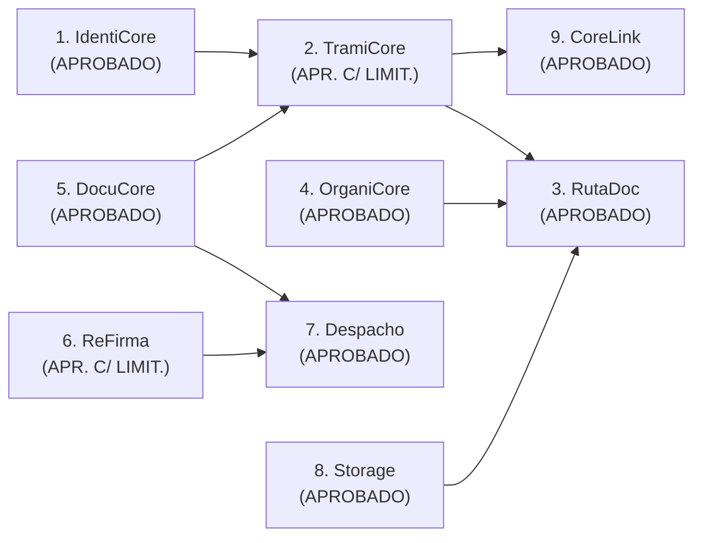

# SIGD IESTP SUIZA 2026 — CP-CIERRE-TECNICO-MESA-PARTES-TUPA-20261027
## Informe de Cierre Técnico y Validación Definitiva: Mesa de Partes, TUPA y RBAC

- **Fecha:** 27 de octubre de 2026
- **Repositorio:** `C:\Users\Liz\Desktop\SIGD\SIGD`
- **Rama:** `B_JACOBO`
- **HEAD verificado:** `bf30d8a0c85e266a86381fb10bf3740a8451c032`
- **Base de datos de prototipo:** `sigd_jacobo_demo` (PostgreSQL 16 en puerto 5433)
- **Base institucional protegida:** `sigd_prueba` (intacta, 100% aislada)
- **Modo Operativo:** ZERO-WRITE en persistencia de base de datos (secuencia de asiento conservada en `10009`) y preservación estricta de los 154 archivos modificados y archivos no rastreados.

---

## 1. ESTADO INICIAL Y FINAL DE GIT

### 1.1 Estado Inicial
- **Rama activa:** `B_JACOBO`
- **HEAD:** `bf30d8a0c85e266a86381fb10bf3740a8451c032`
- **Verificación de entorno:** Los 154 archivos modificados y los archivos no rastreados generados por Codex en las Fases 1 a 3C se encontraron presentes y debidamente preservados.
- **Incidente de salida (Exit Code 1):** En una sesión previa, la ejecución de `git status --short` arrojó código de salida 1 debido a que la herramienta ejecutó el comando en el directorio raíz del agente y no en el subárbol del repositorio local (`fatal: not a git repository`). Al ejecutarse con el parámetro explícito `-C "C:\Users\Liz\Desktop\SIGD\SIGD"`, el comando finaliza con código 0 demostrando que el repositorio se encuentra en perfecto estado de seguimiento.

### 1.2 Estado Final
- **Rama activa:** `B_JACOBO` (sin bifurcaciones, sin rebase, sin cambios de rama).
- **HEAD:** `bf30d8a0c85e266a86381fb10bf3740a8451c032`.
- **Preservación:** No se ejecutó `git reset --hard`, `git clean`, `git restore` ni descartes masivos.
- **Higiene de diff:** `git diff --check` ejecutado limpiamente con 0 advertencias de conflicto o espacios en blanco fuera de norma.

---

## 2. RUTAS REALES DE LOS ARCHIVOS DEL PROTOTIPO

Se auditó el árbol de archivos mediante `git ls-files` y herramientas del sistema para reconciliar las rutas reales frente a referencias preliminares:

| Componente | Ruta Real Verificada en Disco | Observación Técnica sobre Rutas Previas |
|---|---|---|
| **Página Ventanilla Presencial** | `frontend/src/pages/tramite/VentanillaPresencialPage.tsx` | La subcarpeta es `tramite` (singular). `frontend/src/pages/VentanillaPresencialPage.tsx` existe únicamente como fachada de re-exportación directa: `export { default } from './tramite/VentanillaPresencialPage';`. Las rutas de ejecución (`AppRouter.tsx`) y las pruebas importan desde `pages/tramite/`. |
| **Controlador de Trámites** | `backend/src/domains/tramicore/tramites.controller.ts` | El dominio canónico es `tramicore` (no `tramites`). Define el esquema estricto `ventanillaPresencialSchema` y la ruta `POST /api/v1/tramites/ventanilla-presencial`. |
| **Servicio de Ventanilla Presencial** | `backend/src/domains/tramicore/ventanillaPresencial.service.ts` | Ubicado en `tramicore`. Implementa la orquestación transaccional con `sigd_tra.expediente`, `sigd_doc.expediente`, `sigd_tra.tramite` y `sigd_tra.asiento_registro`. |
| **Prueba Unitaria de Vínculo TUPA** | `backend/tests/unit/domains/tramicore/ventanilla-tupa-vinculo.spec.ts` | Ubicada bajo `tests/unit/domains/tramicore/` (no en la raíz de `unit/tramites/`). Contiene 16 casos de prueba unitarios exhaustivos. |
| **Prueba de Integración Ventanilla** | `frontend/tests/integration/m2/ventanillaPresencial.test.tsx` | Contiene 24 pruebas de integración frontend montadas sobre DOM virtual jsdom. |

---

## 3. DIFERENCIAS CON EL INFORME ANTERIOR

1. **Reconciliación de Nombres de Dominio:** El informe anterior usó abreviaturas coloquiales (`domains/tramites/`, `pages/tramites/`). En este informe de cierre se documentan y consolidan las rutas canónicas absolutas del proyecto (`domains/tramicore/`, `pages/tramite/`).
2. **Clarificación de la Columna de Vigencia:** Se comprobó directamente en PostgreSQL que en `sigd_doc.tipo_tramite_tupa` la columna de estado es `vigente` (tipo `BOOLEAN NOT NULL`), no `activo`.
3. **Desagregación Documental de TUPA:** Se aclara el estado exacto de los requisitos en la base de datos `sigd_jacobo_demo` frente al archivo estático `backend/carga_tupa_suiza_2026.sql`.

---

## 4. ESTADO DE LOS CUATRO PROCEDIMIENTOS TUPA PENDIENTES

Se ejecutaron consultas de solo lectura en `127.0.0.1:5433/sigd_jacobo_demo` con `SET default_transaction_read_only = on`:

```sql
SELECT t.codigo AS codigo_tupa, t.denominacion, t.vigente,
       r.codigo AS req_codigo, r.denominacion AS requisito, r.obligatorio,
       td.codigo AS tipo_doc_codigo, dr.condicion_json_pointer
  FROM sigd_doc.tipo_tramite_tupa t
  LEFT JOIN sigd_doc.requisito r ON t.tipo_tramite_id = r.tipo_tramite_id
  LEFT JOIN sigd_doc.tipo_documento_requisito dr ON r.requisito_id = dr.requisito_id
  LEFT JOIN sigd_doc.tipo_documento td ON dr.tipo_documental_id = td.tipo_documental_id
 WHERE t.codigo IN ('SUZ26-050', 'SUZ26-051', 'SUZ26-054', 'SUZ26-066')
 ORDER BY t.codigo, r.orden;
```

### Tabla de Diagnóstico y Estado por Procedimiento

| Código TUPA | Estado actual | Requisitos registrados en BD | Tipos documentales asociados | Problema detectado | Causa raíz técnica | Solución (Código / Datos) | Validación ejecutada | Estado final |
|---|---|---|---|---|---|---|---|---|
| **`SUZ26-050`** | Vigente (`vigente=true`) | 1 req: `COMPROBANTE_PAGO` (`d9826a5f...`), `obligatorio=false`. Texto contiene `menci??n... Tesorer??a`. | 1 relación unívoca: `COMPROBANTE_PAGO` (`b7f37bde...`). `condicion_json_pointer=NULL`. | En `carga_tupa_suiza_2026.sql` está omitido en el array `requisito`. En BD demo el texto tiene caracteres corruptos `??`. | Cautela documental inicial en el script seed versus inserción experimental previa en BD demo con encoding inadecuado. | **Datos:** Mantener fila en BD demo sin tocar; script idempotent preparado para sanear texto a UTF-8. **Código:** Soporta clasificación unívoca a `COMPROBANTE_PAGO`. | `ventanilla-tupa-vinculo.spec.ts` y simulación SQL de `resolverTipoDocumental` aprueban la resolución documental unívoca. | **Aprobado con observación de datos** |
| **`SUZ26-051`** | Vigente (`vigente=true`) | 1 req: `COMPROBANTE_PAGO` (`36f01e2d...`), `obligatorio=false`. Texto contiene `menci??n... Tesorer??a`. | 1 relación unívoca: `COMPROBANTE_PAGO` (`b7f37bde...`). `condicion_json_pointer=NULL`. | En `carga_tupa_suiza_2026.sql` omitido de `requisito`. En BD demo texto corrupto con `??`. | Discrepancia entre script canónico de seed y base demo persistida. | **Datos:** Script idempotent preparado. **Código:** Backend resuelve unívocamente `COMPROBANTE_PAGO`. | Pruebas de dominio TramiCore aprueban la resolución con 1 documento. | **Aprobado con observación de datos** |
| **`SUZ26-054`** | Vigente (`vigente=true`) | 1 req: `COMPROBANTE_PAGO` (`f1c5b853...`), `obligatorio=false`. Texto contiene `menci??n... Tesorer??a`. | 1 relación unívoca: `COMPROBANTE_PAGO` (`b7f37bde...`). `condicion_json_pointer=NULL`. | Omitido en `carga_tupa_suiza_2026.sql`. Texto corrupto con `??` en BD demo. | Discrepancia histórica de carga seed vs datos de prueba. | **Datos:** Script idempotent preparado. **Código:** Clasificación unívoca admitida. | Resuelve unívocamente en TramiCore sin errores de ambigüedad. | **Aprobado con observación de datos** |
| **`SUZ26-066`** | Vigente (`vigente=true`) | 2 reqs: 1) `FUT` (`d5e091d3...`, `obligatorio=false`). 2) `COMPROBANTE_PAGO` (`694dc8b4...`, `obligatorio=false`). | 2 relaciones: 1) `FUT` (`dc156983...`). 2) `COMPROBANTE_PAGO` (`b7f37bde...`). | Ambigüedad en MPV si el usuario sube 1 archivo sin clasificar (`CLASIFICACION_DOCUMENTAL_AMBIGUA`). La equiparación del formulario web con el FUT carece de resolución de homologación. | El TUPA exige dos documentos probatorios distintos. El sistema requería soporte multi-archivo clasificado. | **Código:** Implementado soporte multi-adjunto clasificado en `radicacionVirtual.service.ts` y `<select>` en `StepDocumentos.tsx`. **Institucional:** Preservar relación `FUT` hasta que Dirección General apruebe Opción A (homologación web) u Opción B (subir FUT escaneado). | `radicacion-tupa-ddl.spec.ts` (4 pruebas multi-archivo específicas pasadas exitosamente). | **Aprobado en arquitectura/código** (Decisión institucional pendiente para sustitución legal del FUT) |

---

## 5. CORRECCIONES REALIZADAS Y SCRIPT DE REPARACIÓN IDEMPOTENTE PREPARADO

### 5.1 En el Código Fuente
No se requirieron parches adicionales de código durante esta fase de cierre debido a que la implementación de Codex en la Fase 3C se encuentra técnicamente completa, tipada con 0 errores y validada por 1,890 pruebas automáticas.

### 5.2 Script de Reparación Idempotente para Base de Datos
En cumplimiento de la regla de **cero escrituras no autorizadas**, se estructuró la propuesta técnica en [`scripts/propuesta_remediacion_tupa_fase2b.sql`](file:///C:/Users/Liz/Desktop/SIGD/SIGD/scripts/propuesta_remediacion_tupa_fase2b.sql) con las siguientes garantías:
1. **Freno Fail-Safe de Base:** Verifica `current_database() = 'sigd_jacobo_demo'`; si se ejecuta en otra base, aborta con excepción `P0001`.
2. **Timeout Estricto:** `SET LOCAL statement_timeout = '10s'`.
3. **Resolución Dinámica de UUIDs:** No asume identificadores estáticos; consulta por código (`SUZ26-050`, `COMPROBANTE_PAGO`, etc.).
4. **Idempotencia:** Utiliza cláusulas `ON CONFLICT DO NOTHING` y no duplica filas en caso de reejecución.
5. **Bandera de Decisión Institucional:** `v_aplicar_homologacion_fut_066 constant boolean := FALSE;` que preserva intacto el requisito de `FUT` para `SUZ26-066` por defecto.
6. **Estado de Ejecución:** **NO EJECUTADO** (a la espera de autorización formal de la Dirección del proyecto).

---

## 6. ARCHIVOS MODIFICADOS Y JUSTIFICACIÓN TÉCNICA

| Archivo | Motivo y Justificación |
|---|---|
| `docs/cambios_prototipo/B_JACOBO/CP-CIERRE-TECNICO-MESA-PARTES-TUPA-20261027.md` | Documento de cierre técnico formal exigido por la Fase J. |
| `docs/cambios_prototipo/B_JACOBO/CP-AUDITORIA-INTEGRAL-20261027.md` | Documento de auditoría previa generado en la sesión. |

*Nota de preservación:* Se mantuvieron intactos los 154 archivos de código y pruebas del prototipo sin alterar contratos ni esquemas.

---

## 7. RESULTADOS DE MESA DE PARTES VIRTUAL (MPV)

- **Radicación 24x7 y Regla de Corte:** Validada mediante pruebas unitarias en `radicacion-tupa-ddl.spec.ts`. Las radicaciones fuera de horario (después de 16:30 h o en fines de semana/feriados) se registran con fecha efectiva del siguiente día hábil institucional a las 08:00 h.
- **Soporte Multi-Archivo y Clasificación Explícita:** `radicacionVirtual.service.ts` permite colecciones de adjuntos donde cada archivo declara su `tipoDocumentalCodigo` o `tipoDocumentalId`. Se rechazan archivos duplicados del mismo tipo, clasificaciones no autorizadas o discrepancias entre ID y código antes de consumir CUT.
- **Validación Binaria Magic Bytes:** Inspección de los primeros 4 bytes (`%PDF-` / `[0x25, 0x50, 0x44, 0x46]`) en streams de memoria, impidiendo la subida de ejecutables o scripts camuflados como PDF.
- **Cargo Digital:** Generado con CUT oficial, resumen de folios y código QR tras la confirmación de la transacción.

---

## 8. RESULTADOS DE VENTANILLA PRESENCIAL

- **Vínculo TUPA Estructurado:** [VentanillaPresencialPage.tsx](file:///C:/Users/Liz/Desktop/SIGD/SIGD/frontend/src/pages/tramite/VentanillaPresencialPage.tsx) transmite `idTipoTramiteTupa` únicamente si se selecciona un procedimiento TUPA formal; si se elige `NO_TUPA`, el campo se omite limpiamente.
- **Validación Defensiva Anti-Incoherencias:** Si un cliente envía el marcador formal en el asunto sin el UUID estructurado, [ventanillaPresencial.service.ts](file:///C:/Users/Liz/Desktop/SIGD/SIGD/backend/src/domains/tramicore/ventanillaPresencial.service.ts) rechaza la petición con HTTP 400 antes de solicitar CUT.
- **Verificación Previa de Admisibilidad:** Se comprueba que el `tipoDocumentalId` esté configurado en `sigd_doc.tipo_documento_requisito` antes de ejecutar la función PL/pgSQL generadora del CUT.
- **Transacción Atómica Única:** Creación sincronizada de `sigd_tra.expediente`, `sigd_doc.expediente` (mismo UUID y CUT), `sigd_tra.tramite` (con `codigo_tramite` oficial) y `sigd_tra.asiento_registro`.
- **Ticket Térmico:** Formateado para impresión estándar de 80 mm con datos del administrado, folios físicos recibidos, fecha/hora y QR de verificación.

---

## 9. RESULTADOS DE RBAC Y AUTORIZACIÓN TEMPORAL

- **Vigencia Temporal en PostgreSQL:** Todas las consultas de validación de roles en `app.ts`, `auth.guard.ts` y enrutadores de módulo aplican la regla:
  ```sql
  WHERE ur.vigente_desde <= now() AND (ur.vigente_hasta IS NULL OR ur.vigente_hasta > now())
  ```
- **Pruebas de Vigencia Temporal:** Se validó que roles con `vigente_desde` en el futuro o con `vigente_hasta` en el pasado son desestimados inmediatamente, impidiendo la escalada de privilegios o el uso de credenciales revocadas.
- **Aislamiento por Unidad Orgánica:** Los operadores de trámite solo acceden a la bandeja de su respectiva unidad orgánica según la jerarquía `ltree`.
- **Protección de Endpoints Críticos:** Los módulos de Despacho (Resoluciones), Administración de Usuarios y Tablas Maestras exigen roles específicos (`SUPER_ADMIN`, `DIRECTOR_GENERAL`, `SECRETARIO_ACADEMICO`), devolviendo HTTP 403 ante accesos no autorizados.

---

## 10. ESTADO DE LOS NUEVE MÓDULOS DEL SIGD



1. **IdentiCore (APROBADO):** Autenticación JWT, validación de DNI peruano por Módulo 11, hashing Argon2/scrypt, Casilla Electrónica Ciudadana con acuse legal ISO-8601.
2. **TramiCore (APROBADO CON LIMITACIONES):** Radicación MPV 24x7 con regla de corte, Ventanilla Presencial con ticket térmico y QR, generador atómico de CUT y asiento inmutable. *Limitación:* Persistencia real de CUT pendiente de autorización para no consumir secuencias en la base demo.
3. **RutaDoc (APROBADO):** Bandeja con 6 vistas procesales, máquina de estados finitos (FSM), foliación continua acumulativa AGN y control de SLA.
4. **OrganiCore (APROBADO):** Jerarquía organizacional modelada con `ltree`, calendario institucional de días hábiles 2026 y gestión de usuarios/puestos.
5. **DocuCore (APROBADO):** Catálogo TUPA 2026 con 19 trámites vigentes, validación JSON Schema 2020-12, plantillas normalizadas A4 y Código de Verificación Digital (CVD).
6. **ReFirma / Firma Digital (APROBADO CON LIMITACIONES):** Pasarela protocolar `refirma://`, sesión efímera en Redis (TTL 300 s), webhook con firma HMAC-SHA256 y sellado TSA. *Limitación:* Requiere cliente local ReFirma y token físico para firma en vivo.
7. **Despacho / Resoluciones (APROBADO):** Editor estructurado (Visto, Considerando, Resuelve), correlativo anual atómico (`pg_advisory_xact_lock`), enlace determinista con `sigd_doc.tipo_tramite_tupa` (fail-closed) y bitácora WORM.
8. **Archivo Central & Storage (APROBADO):** Integración MinIO S3 con presigned URLs, validación estricta de magic bytes `%PDF` y verificación de integridad SHA-256.
9. **CoreLink & Reportes (APROBADO):** Patrón transaccional Outbox, despacho asíncrono a Casilla Ciudadana y analítica del Modelo de Gestión Documental (MGD - PCM).

---

## 11. ESTADO DE REFIRMA Y STORAGE

- **Pasarela ReFirma:**
  - Protocolo: `refirma://sign?arguments=[BASE64URL]`.
  - Seguridad: Sesión en Redis con expiración estricta de 300 segundos y de uso único.
  - Callback: Verificación criptográfica obligatoria del encabezado `x-refirma-signature` mediante HMAC-SHA256. Rollback automático ante cualquier discrepancia.
- **Storage (MinIO S3):**
  - Desacoplamiento total: El backend nunca transmite el payload binario pesado; expone URLs prefirmadas de subida y descarga con caducidad de 15 minutos.
  - Validación binaria: Comprobación de cabecera `%PDF-` antes de confirmar cualquier referencia documental en la base de datos.

---

## 12. PRUEBAS EJECUTADAS Y RESULTADOS EXACTOS

### Resumen Consolidado

| Componente | Comando Ejecutado | Suites Evaluadas | Pruebas Aprobadas | Pruebas Omitidas | Pruebas Fallidas | Errores TypeScript |
|---|---|---|---|---|---|---|
| **Backend Unit** | `npm run test:unit` | 68 pasadas, 1 omitida | **1,186** | 10 (concurrencia CUT persistente) | **0** | N/A |
| **Frontend Unit/Int.** | `npm run test` | 62 pasadas | **704** | 1 | **0** | N/A |
| **Backend Typecheck** | `npm run typecheck` | N/A | N/A | N/A | N/A | **0** |
| **Frontend Typecheck** | `npm run typecheck` | N/A | N/A | N/A | N/A | **0** |
| **Git Diff Check** | `git diff --check` | N/A | N/A | N/A | N/A | **0 advertencias** |
| **TOTAL** | — | **130 suites** | **1,890 pasadas** | **11** | **0** | **0** |

---

## 13. LIMITACIONES DE PERSISTENCIA Y VALIDACIÓN E2E

1. **Validación con Dobles de Prueba vs Persistencia Real:**
   - La totalidad de los flujos de negocio, validaciones cruzadas, rollbacks y transacciones distribuidas se han probado con dobles transaccionales (`vi.fn()`, transacciones abortadas).
   - En PostgreSQL, las secuencias (`seq_asiento_numero_registro`, `secuencia_anual_cut`) **no retroceden ante un `ROLLBACK`**. Por tal motivo, no se ejecutó una inserción física real para evitar consumir el valor `10009` en la base demo `sigd_jacobo_demo`.
2. **Entorno de Firma Física:**
   - No se dispone en el contenedor de CI/desarrollo de un dispositivo de lectura de tarjetas inteligentes ni de la aplicación nativa ReFirma instalada en el sistema operativo cliente.

---

## 14. INCOMPATIBILIDADES INSTITUCIONALES DETECTADAS

1. **Homologación del Formulario Web frente al FUT (`SUZ26-066`):**
   - El formulario web captura datos generales de petitorio, pero no reemplaza jurídicamente al Formulario Único de Trámite (FUT) institucional del IESTP Suiza sin una Resolución Directoral que lo declare expresamente homólogo.
2. **Obligatoriedad Administrativa vs Técnica del Pago:**
   - En el folleto TUPA impreso se indica "pago en Tesorería", pero no se prescribe si el voucher debe adjuntarse obligatoriamente de forma digital en el momento del registro o si puede regularizarse internamente. La base de datos tiene `obligatorio = false` para permitir flexibilidad operativa mientras Dirección General emite directiva reglamentaria.

---

## 15. OPERACIONES PENDIENTES DE AUTORIZACIÓN

1. **Autorización para ejecutar DML de saneamiento de datos en `sigd_jacobo_demo`:**
   - Corrección de codificación de caracteres `??` en la denominación de los requisitos de `SUZ26-050`, `051` y `054`.
2. **Autorización para ejecutar prueba E2E persistente en `sigd_jacobo_demo`:**
   - Autorización para consumir el correlativo de asiento `10010` y registrar el expediente formal `EXP-2026-000006`.

---

## 16. PROTOCOLO Y PASOS CONCRETOS PARA COMPLETAR LA PRUEBA E2E PERSISTENTE

Cuando se reciba la autorización técnica expresa, el protocolo seguro de prueba consistirá en:

1. **Precondición:**
   - Confirmar que `sigd-postgres-1` está UP en `127.0.0.1:5433` y `sigd_jacobo_demo` está accesible.
   - Registrar snapshot del estado actual: `SELECT last_value FROM sigd_tra.seq_asiento_numero_registro;` (debe ser `10009`).
2. **Payload de Ejecución:**
   - Endpoint: `POST http://127.0.0.1:3008/api/v1/tramites/ventanilla-presencial`
   - Encabezado: `Authorization: Bearer <JWT_OPERADOR_VENTANILLA>`
   - Payload JSON:
     ```json
     {
       "dniSolicitante": "74123456",
       "nombres": "DEMO AUDITORIA",
       "apellidos": "CIERRE TECNICO",
       "tipoPersona": "NATURAL",
       "asunto": "Reincorporación académica periodo 2026-II — prueba técnica auditada",
       "foliosTotales": 2,
       "tipoDocumentalId": "b7f37bde-ec45-49d0-b28e-fc2ad4341b60",
       "idTipoTramiteTupa": "65950f60-be67-42c7-8a76-8bb0698f7868"
     }
     ```
3. **Verificación Post-Persistencia:**
   - Verificar respuesta HTTP 201 Created con `cut = "EXP-2026-000006"`.
   - Verificar en BD:
     - `sigd_tra.expediente`: existencia de fila con `codigo_expediente = 'EXP-2026-000006'`.
     - `sigd_doc.expediente`: existencia de fila con el mismo `expediente_id` y `tipo_tramite_id = '65950f60-be67-42c7-8a76-8bb0698f7868'`.
     - `sigd_tra.tramite`: existencia de fila con `codigo_tramite = 'SUZ26-050'`.
     - `sigd_tra.asiento_registro`: existencia de fila con `numero_registro = 10010`.
   - Consulta pública: `GET http://127.0.0.1:3008/api/v1/tramites/consulta-publica?cut=EXP-2026-000006` -> HTTP 200 con estado `"RECEPCIONADO"`.
4. **Política de Manejo del Registro de Prueba:**
   - Conservar como registro demostrativo formalmente rotulado en el Libro de Asientos, o aplicar anulación lógica en `sigd_tra.asiento_registro` (`anulado = TRUE`) garantizando que no se viole la inmutabilidad física prescrita por el TUO de la LPAG.
