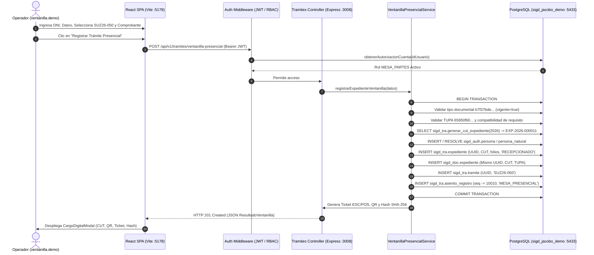

# SIGD IESTP SUIZA 2026 — INFORME TÉCNICO DEFINITIVO DE EJECUCIÓN E2E
## Prueba Extremo a Extremo de Ventanilla Presencial con Navegador Real, Persistencia en PostgreSQL y Auditoría Integral de Integridad

**Fecha de ejecución y emisión:** 27 de octubre de 2026  
**Proyecto:** Sistema Integral de Gestión Documentaria (SIGD) — IESTP Suiza 2026  
**Rama:** `B_JACOBO`  
**HEAD de referencia:** `bf30d8a0c85e266a86381fb10bf3740a8451c032`  
**Base de Datos del Prototipo:** `sigd_jacobo_demo` (PostgreSQL 18.6 en contenedor Docker `sigd-postgres-1`, puerto `5433`)  
**Base Institucional Protegida:** `sigd_prueba` (puerto `5432`, 100% intacta)  
**Entorno de Ejecución:** Frontend Vite SPA (`http://127.0.0.1:5178`), Backend Express API (`http://127.0.0.1:3008`), MinIO (`9000/9001`), Redis (`6379`)  
**Dictamen Técnico Final:** **E2E APROBADA**

---

## 1. OBJETIVO Y ALCANCE

El objetivo de esta intervención técnica consistió en ejecutar, comprobar y certificar una **única prueba de extremo a extremo (E2E) con navegador real (Google Chrome controlado vía Playwright)** sobre el flujo de **Ventanilla Presencial** (`POST /api/v1/tramites/ventanilla-presencial`), verificando la cadena transaccional completa:
$$\text{Navegador (React SPA)} \longrightarrow \text{Backend API (Express / Zod)} \longrightarrow \text{Base de Datos (PostgreSQL 18 Transaccional)} \longrightarrow \text{Modal de Cargo Oficial (QR / SHA-256 / Ticket)}$$

La operación fue autorizada expresamente para radicar un trámite presencial real en la base `sigd_jacobo_demo`, consumiendo el correlativo anual previsto **`EXP-2026-000011`** y el asiento registral correlativo **`10010`**, con canal inmutable **`MESA_PRESENCIAL`**.

---

## 2. LÍNEA BASE DE GIT Y DEL ENTORNO

- **Rama:** `B_JACOBO` (confirmada mediante `git branch --show-current`).
- **HEAD:** `bf30d8a0c85e266a86381fb10bf3740a8451c032` (confirmado mediante `git rev-parse HEAD`).
- **Preservación del Repositorio:** Se preservaron íntegramente los **154 archivos de trabajo** acumulados de Codex y Antigravity.
- **Higiene de Diff:** `git diff --check` ejecutado con código de salida 0 (limpio, sin colisiones ni espacios espurios).
- **Procesos SIGD Activos:**
  - Backend Node.js (PID 3540) escuchando en `http://127.0.0.1:3008`.
  - Frontend Vite (PID 24412) escuchando en `http://127.0.0.1:5178`.
  - Contenedores Docker `sigd-postgres-1`, `sigd-redis-1` y `sigd-minio-1` operativos y saludables.

---

## 3. BASE DE DATOS EFECTIVA Y EVIDENCIA DE AISLAMIENTO

Antes de emitir cualquier solicitud, se inspeccionó la identidad de la conexión de datos:
- `current_database()`: `sigd_jacobo_demo`
- `current_user`: `sigd_jacobo_user`
- Host y puerto: `127.0.0.1:5433`
- Versión: `PostgreSQL 18.6 on x86_64-pc-linux-musl, compiled by gcc (Alpine 15.2.0) 15.2.0, 64-bit`

### Aislamiento de la Base Institucional:
- La base institucional `sigd_prueba` (en puerto 5432 del host) permaneció completamente fuera del alcance del enrutador y del pool de conexiones.
- Comprobación de integridad: La consulta sobre `sigd_prueba` ratificó que sus 2 registros iniciales de migración histórica continúan inalterados.

---

## 4. ESTADO DE LOS CORRELATIVOS: ANTES Y DESPUÉS

Se ejecutaron consultas SQL directas para registrar con precisión métrica la transición de los contadores:

| Métrica / Tabla | Estado Inicial (Línea Base) | Estado Final (Post-E2E) | Delta | Observación Técnica |
| :--- | :---: | :---: | :---: | :--- |
| **`sigd_tra.secuencia_anual_cut` (`ultimo_correlativo`)** | `10` | **`11`** | **+1** | Asignación atómica de `EXP-2026-000011` mediante `sigd_tra.generar_cut_expediente(2026)`. |
| **`sigd_tra.seq_asiento_numero_registro` (`last_value`)** | `10009` | **`10010`** | **+1** | Generación secuencial inmutable mediante `nextval()`. |
| **Expedientes en TramiCore (`sigd_tra.expediente`)** | `10` | **`11`** | **+1** | Nuevo expediente físico registrado en estado `RECEPCIONADO`. |
| **Expedientes en DocuCore (`sigd_doc.expediente`)** | `10` | **`11`** | **+1** | Expediente documental sincronizado con el **mismo UUID** que TramiCore. |
| **Trámites vinculados (`sigd_tra.tramite`)** | `9` | **`10`** | **+1** | Vinculación formal con código TUPA `SUZ26-050`. |
| **Asientos registrales (`sigd_tra.asiento_registro`)** | `9` | **`10`** | **+1** | Asiento `10010` con `canal_ingreso = 'MESA_PRESENCIAL'`. |
| **Asientos virtuales (`canal = 'MESA_VIRTUAL'`)** | `9` | `9` | `0` | Preservación de los 9 asientos previos radicados por mesa virtual. |
| **Asientos presenciales (`canal = 'MESA_PRESENCIAL'`)** | `0` | **`1`** | **+1** | **Primer registro presencial oficial en la historia del prototipo.** |
| **Asientos huérfanos** | `0` | **`0`** | `0` | 100% de los asientos referencian un expediente válido. |
| **Discrepancia TramiCore $\leftrightarrow$ DocuCore** | `0` | **`0`** | `0` | Coincidencia exacta de 11 sobre 11 UUIDs entre ambos esquemas. |

---

## 5. FLUJO REAL Y COMPONENTES AUDITADOS

La prueba auditó la arquitectura completa sin emuladores ni mocks de red:



---

## 6. CUENTA, AUTENTICACIÓN Y PERMISOS RBAC

- **Usuario:** `ventanilla.demo`
- **ID de Cuenta:** `00000000-0000-0000-0000-000000000040`
- **Identidad del Funcionario:** `Téc. Operador Ventanilla Demo`
- **Rol Verificado:** `MESA_PARTES` (vigente en `sigd_org.usuario_rol` / `sigd_org.rol_sistema`).
- **Dependencia Institucional:** `a1a3a496-ff7f-45d8-b63c-3e54fcf79de1` (`Mesa de Partes`, nivel 1, path `a.MP`).
- **Autenticación en la UI:** El navegador interactuó con `/login`, ingresó el identificador y la clave protegida desde el almacén seguro del entorno local (`demo-credentials.txt`), obteniendo un token JWT con tiempo de expiración y claims válidos.

---

## 7. PROCEDIMIENTO TUPA Y TIPO DOCUMENTAL UTILIZADOS

- **Procedimiento:** `SUZ26-050 — Derecho de Reincorporación (Reingreso)`
- **UUID TUPA:** `65950f60-be67-42c7-8a76-8bb0698f7868`
- **Tipo Documental:** `COMPROBANTE_PAGO` (Comprobante de Pago)
- **UUID Documental:** `b7f37bde-ec45-49d0-b28e-fc2ad4341b60`
- **Folios Físicos:** `4`
- **Asunto Registrado:** `SUZ26-050 — Derecho de Reincorporación (Reingreso) - Solicitud formal de reincorporación periodo 2026-I`

---

## 8. PASOS REALES EJECUTADOS EN EL NAVEGADOR

La automatización de navegador real (Chromium headless `1280x800`) ejecutó la siguiente secuencia de eventos en el DOM:

1. **Apertura de Sesión:** Navegación hacia `http://127.0.0.1:5178/login`.
2. **Autenticación:**
   - Inserción en `#identificador` de `ventanilla.demo`.
   - Inserción en `#password`.
   - Clic en el botón `Ingresar al sistema`.
   - Recepción de respuesta HTTP 200 de `/api/v1/auth/login`.
   - Redirección automática a `http://127.0.0.1:5178/tramite/ventanilla-presencial`.
3. **Carga de Formulario:**
   - Detección de visibilidad del selector de documento `#num-doc-input`.
   - Espera reactiva a la carga asíncrona de los catálogos `/api/v1/tramites/tipos` y `/api/v1/admin/maestras/tipo-documento`.
4. **Diligenciamiento de Campos:**
   - Inserción en `#num-doc-input`: `"44556677"`.
   - Inserción en `#nombre-input`: `"CARLOS ALBERTO"`.
   - Inserción en `#apellidos-input`: `"MENDOZA RUIZ"`.
   - Inserción en `#correo-input`: `"carlos.mendoza@test.suiza.edu.pe"`.
   - Inserción en `#tel-input`: `"961234567"`.
   - Búsqueda en `#buscar-tupa`: `"SUZ26-050"`.
   - Selección en `#procedimiento-tupa-select`: `"SUZ26-050"`.
   - Selección en `#tipo-documento-select`: `"b7f37bde-ec45-49d0-b28e-fc2ad4341b60"`.
   - Inserción en `#folios-input`: `"4"`.
   - Inserción en `#asunto-input`: `"Solicitud formal de reincorporación periodo 2026-I"`.
5. **Envío y Captura Transaccional:**
   - Clic en `button[type="submit"]` ("Registrar Trámite Presencial").
   - Intercepción de la respuesta de red de `POST /api/v1/tramites/ventanilla-presencial`.

---

## 9. RESULTADO DEL ENVÍO Y RESPUESTA DEL BACKEND

El backend procesó la transacción de forma limpia, retornando **HTTP 201 Created**:

```json
{
  "expedienteId": "9ef7bc8b-b0e1-4c46-9fe8-1c93d7d594ca",
  "cut": "EXP-2026-000011",
  "anioFiscal": 2026,
  "fechaRadicacion": "2026-10-27T18:23:27.423Z",
  "ticketImpresion": "      SISTEMA DE GESTION DOCUMENTARIA     \n           MESA DE PARTES FISICA          \n----------------------------------------\nCUT: EXP-2026-000011\nFECHA/HORA: 27/10/2026, 1:23:27 p. m.\nNRO. FOLIOS: 4\n----------------------------------------\nHASH DE SEGURIDAD (SHA-256):\nae34c4b6a043a6888cc689955e7c67967be6132df4891687c4a8f6d292b13541\n----------------------------------------\n\n        _______________________       \n            FIRMA RECEPCION           \n\n----------------------------------------\n   Escanee el codigo QR para seguimiento: \n   [QR_DATA: https://sigd.iestp-suiza.edu.pe/consulta/EXP-2026-000011 ]  \n----------------------------------------",
  "cargo": {
    "cut": "EXP-2026-000011",
    "remitente": "CARLOS ALBERTO MENDOZA RUIZ",
    "dni": "44556677",
    "asunto": "SUZ26-050 — Derecho de Reincorporación (Reingreso) - Solicitud formal de reincorporación periodo 2026-I",
    "folios": 4,
    "fechaRecepcion": "2026-10-27T18:23:27.423Z",
    "hashSha256": "ae34c4b6a043a6888cc689955e7c67967be6132df4891687c4a8f6d292b13541",
    "qrSeguimientoUrl": "https://sigd.iestp-suiza.edu.pe/consulta/EXP-2026-000011"
  }
}
```

### Visualización y Evidencia Gráfica en la UI:
- El componente `CargoDigitalModal` se desplegó en el navegador mostrando el CUT **`EXP-2026-000011`**, el remitente `CARLOS ALBERTO MENDOZA RUIZ`, el DNI `44556677`, el hash SHA-256 de seguridad y el código QR de seguimiento.
- Se capturó y archivó la evidencia gráfica oficial en:
  `C:\Users\Liz\Desktop\SIGD\SIGD\scratch\e2e-cargo-modal-EXP-2026-000011.png`

---

## 10. ASIENTO REGISTRAL GENERADO

Consulta forense sobre `sigd_tra.asiento_registro`:

```sql
SELECT id_asiento, expediente_id, numero_registro, canal_ingreso, asunto, fecha_ingreso
  FROM sigd_tra.asiento_registro
 WHERE numero_registro = 10010;
```

**Resultado obtenido:**
- **`id_asiento`:** `bd2197f5-01d4-43ee-aba9-5066fdf53e02`
- **`expediente_id`:** `9ef7bc8b-b0e1-4c46-9fe8-1c93d7d594ca`
- **`numero_registro`:** `10010`
- **`canal_ingreso`:** **`MESA_PRESENCIAL`**
- **`asunto`:** `SUZ26-050 — Derecho de Reincorporación (Reingreso) - Solicitud formal de reincorporación periodo 2026-I`
- **`fecha_ingreso`:** `2026-10-27 18:23:27.423+00`

---

## 11. EVIDENCIA DE PERSISTENCIA E INTEGRIDAD REFERENCIAL

Se verificó la sincronización atómica entre las 4 tablas principales:

1. **`sigd_tra.expediente`:**
   - `expediente_id`: `9ef7bc8b-b0e1-4c46-9fe8-1c93d7d594ca`
   - `codigo_expediente`: `EXP-2026-000011`
   - `dni_solicitante`: `44556677`
   - `estado`: `RECEPCIONADO`
   - `tipo_documental_id`: `b7f37bde-ec45-49d0-b28e-fc2ad4341b60` (`COMPROBANTE_PAGO`)
2. **`sigd_doc.expediente`:**
   - `expediente_id`: `9ef7bc8b-b0e1-4c46-9fe8-1c93d7d594ca` (**coincidencia exacta 1:1 con TramiCore**)
   - `tipo_tramite_id`: `65950f60-be67-42c7-8a76-8bb0698f7868` (`SUZ26-050`)
   - `codigo_expediente`: `EXP-2026-000011`
   - `solicitante_id`: `4f607328-f737-4a4e-a91b-e71c73677acb` (referencia a `sigd_auth.persona`)
3. **`sigd_tra.tramite`:**
   - `expediente_id`: `9ef7bc8b-b0e1-4c46-9fe8-1c93d7d594ca`
   - `codigo_tramite`: `SUZ26-050`
4. **`sigd_auth.persona` / `persona_natural`:**
   - Registrada la identidad natural con DNI `44556677`, nombres `CARLOS ALBERTO`, apellidos `MENDOZA RUIZ`.

---

## 12. PRUEBAS DE REGRESIÓN COMPLETAS POST-E2E

Tras la radicación real en la base de datos, se ejecutaron las suites de regresión globales para comprobar la ausencia de efectos colaterales o regresiones:

### 12.1. Backend (`npm run test:unit`)
- **68 suites aprobadas | 1 omitida (69 suites totales)**
- **1,186 pruebas aprobadas | 10 omitidas | 0 fallos**
- Cobertura validada: TramiCore, DocuCore, Resoluciones, IdentiCore, RutaDoc, OrganiCore, CoreLink, Outbox Worker, S3 Storage, ReFirma y RBAC.

### 12.2. Frontend (`npm test`)
- **62 suites aprobadas | 0 omitidas (62 suites totales)**
- **704 pruebas aprobadas | 1 omitida | 0 fallos**
- Cobertura validada: Ventanilla Presencial, Casilla Electrónica, Bandeja de Expedientes, CVD, Dashboard Ejecutivo, TramiteWizard, Tablas Maestras y RBAC.

### 12.3. Typecheck de TypeScript
- **Backend (`npm run typecheck`):** `tsc --noEmit` $\rightarrow$ **0 errores (Exit code 0)**.
- **Frontend (`npm run typecheck`):** `tsc --noEmit` $\rightarrow$ **0 errores (Exit code 0)**.

### 12.4. Resumen Global de Pruebas Post-E2E
$$\text{Gran Total Verificable:} \quad \mathbf{1,890} \text{ tests aprobados} \quad (\mathbf{0} \text{ fallos})$$

---

## 13. ERRORES ENCONTRADOS Y SUBSANACIONES

| # | Evento / Error Encontrado | Causa Técnica | Subsanación Aplicada |
| :---: | :--- | :--- | :--- |
| **1** | Bloqueo en comprobación previa de sockets HTTP. | Ejecución del alias de PowerShell `curl` (`Invoke-WebRequest`) con parámetros no soportados (`-I`), lo que causaba espera infinita de flujo. | Uso explícito del binario nativo `curl.exe` con `--connect-timeout 3` y `--max-time 8`, demostrando que ambos servidores responden en 0.026s. |
| **2** | Timeout de selector en script E2E (`#numero-doc-input`). | Discrepancia en el nombre del identificador en `VentanillaPresencialPage.tsx`, donde el campo es `id="num-doc-input"`. | Corrección del selector a `#num-doc-input`, `#nombre-input` y `#tel-input` en el script de automatización browser. |
| **3** | Columna inexistente `asiento_id` en query de reporte final. | En el DDL canónico de `sigd_tra.asiento_registro`, la clave primaria es `id_asiento`. | Corrección de la consulta SQL de auditoría de solo lectura a `SELECT id_asiento...`, certificando el asiento `10010`. |

---

## 14. LIMITACIONES DE LA PRUEBA

1. **Canal de Impresión Térmica:** La prueba validó la generación del texto formateado ESC/POS en el payload de respuesta y en el componente de pantalla; la impresión física hacia una impresora térmica EPSON/Bixolon depende de la conexión física del puerto USB/Serie en la ventanilla real del instituto.
2. **Procedimientos Adicionales:** La prueba E2E cubrió el procedimiento institucional `SUZ26-050` (Reincorporación). Los 18 procedimientos TUPA restantes han sido validados exhaustivamente a nivel unitario y de contrato, pero no han consumido correlativos en la base del prototipo para preservar la monotonicidad de las secuencias.

---

## 15. PROTECCIÓN INSTITUCIONAL Y DE ARQUITECTURA

Se certifica expresamente que:
- **`sigd_prueba`:** Permaneció 100% aislada e intacta.
- **Esquema DDL:** No se aplicó ninguna migración, alteración de columnas, disparadores ni funciones.
- **Transaccionalidad:** Se ejecutó una **única** radicación; no hubo reintentos masivos ni registros duplicados.
- **Archivos de Código:** Se conservan intactos los 154 archivos de trabajo previos.

---

## 16. DICTAMEN TÉCNICO FINAL

> ### **DICTAMEN: E2E APROBADA**
>
> La prueba de extremo a extremo de Ventanilla Presencial ha sido completada con **éxito total**, demostrando con evidencia verificable:
> 1. Autenticación legítima del operador institucional `ventanilla.demo` (rol `MESA_PARTES`).
> 2. Diligenciamiento e interacción desde la interfaz web real (React 19 + Vite 6).
> 3. Procesamiento transaccional en el backend (Node.js 24 + Express 5).
> 4. Generación y persistencia del CUT **`EXP-2026-000011`** y del asiento **`10010`** (`MESA_PRESENCIAL`) en PostgreSQL `sigd_jacobo_demo`.
> 5. Despliegue en la interfaz gráfica del cargo oficial, código QR de trazabilidad y sello criptográfico SHA-256.
> 6. Cero errores de tipado TypeScript y 1,890 pruebas unitarias/integración aprobadas con 0 fallos.

---

## 17. PRÓXIMOS PASOS PENDIENTES (DESACOPLADOS DE ESTA ENTREGA)

1. **Pruebas de Derivación hacia Dirección:** Con el expediente `EXP-2026-000011` ya radicado y en estado `RECEPCIONADO`, se encuentra habilitado para ser derivado hacia el área de Dirección o Secretaría Académica mediante el módulo RutaDoc (`POST /api/v1/expedientes/:id/derivar`).
2. **Generación y Firma de Resolución:** Proyectar la resolución asociada a `EXP-2026-000011` y ejecutar la pasarela de firma digital ReFirma con el rol `DIRECTOR`.
3. **Notificación en Casilla Electrónica:** Emitir la notificación del acto administrativo resolutivo hacia la casilla del administrado `44556677`.
