# SIGD IESTP SUIZA 2026 — FASE 6 Y PLAN DE INTEGRACIÓN E2E INTERMODULAR
## Auditoría Técnica, Diagnóstico de Contratos y Plan Maestro de Integración Multi-Módulo

- **Fecha:** 27 de octubre de 2026
- **Entorno de Trabajo:** `C:\Users\Liz\Desktop\SIGD\SIGD`
- **Rama de Trabajo:** `B_JACOBO`
- **HEAD de Referencia:** `bf30d8a0c85e266a86381fb10bf3740a8451c032`
- **Base de Datos Prototipo:** `sigd_jacobo_demo` (PostgreSQL 18.6, puerto 5433)
- **Base Protegida Institucional:** `sigd_prueba` (puerto 5432, Inmutable — ZERO TOUCH)
- **Expediente de Referencia:** `EXP-2026-000011` (`9ef7bc8b-b0e1-4c46-9fe8-1c93d7d594ca`)
- **Asiento Registral:** `10010` (Canal `MESA_PRESENCIAL`, Fecha: `2026-10-27 18:23:27`)
- **Procedimiento TUPA:** `SUZ26-050` — Derecho de Reincorporación (Reingreso)

---

## 1. RESUMEN EJECUTIVO Y LÍNEA BASE

Tras la exitosa ejecución y persistencia de la prueba E2E de Ventanilla Presencial que dio origen al expediente institucional **`EXP-2026-000011`** y al asiento registral **`10010`**, se ejecutó una auditoría exhaustiva, diagnóstica y no intrusiva de los módulos restantes del ecosistema SIGD:
1. **RutaDoc** (Bandejas de expedientes, Máquina de Estados Finitos - FSM, derivaciones internas y RBAC por área).
2. **DocuCore** (Sincronización TramiCore-DocuCore, proyección de resoluciones directorales, correlativos anuales atómicos y almacenamiento MinIO/S3).
3. **ReFirma** (Pasarela de firma digital institucional, tokens de sesión Redis, URI protocolar desktop, verificación HMAC callback e integridad SHA-256).
4. **Casilla Electrónica & CoreLink** (Outbox transaccional, despachador de notificaciones legales Ley N° 29733, acuse digital con sellado de tiempo y motor analítico MGD-PCM).

### Garantías de Protección y Cero Escritura en Diagnóstico
Conforme a la regla inmutable de preservación, durante esta fase de auditoría técnica **NO se realizaron escrituras de prueba ni consumo de correlativos** sobre `sigd_jacobo_demo` ni sobre `sigd_prueba`:
- **`sigd_prueba`:** Conteo de expedientes permanece intacto en 2.
- **`sigd_jacobo_demo`:**
  - `sigd_tra.expediente`: 11 registros.
  - `sigd_tra.asiento_registro`: 10 registros.
  - `sigd_tra.secuencia_anual_cut`: `ultimo_correlativo = 11`.
  - `sigd_tra.seq_asiento_numero`: `last_value = 10010`, `is_called = true`.
  - `sigd_doc.resolucion`: 4 registros (`RD-2026-000002`, `000004`, `000006`, `000008`).
  - `sigd_auth.notificacion_casilla`: 2 registros.

---

## 2. FASE 6: AUDITORÍA Y DIAGNÓSTICO DE RUTADOC

### 2.1. Arquitectura de Bandejas Operativas
RutaDoc clasifica los expedientes en 6 pestañas operativas exhaustivas conforme a `backend/src/domains/rutadoc/rutadoc.types.ts`:
- **`PENDIENTES`:** Estados `['REGISTRADO', 'RECEPCIONADO', 'EN_CALIFICACION']`.
- **`EN_TRAMITE`:** Estados `['EN_REVISION', 'OBSERVADO', 'SUBSANADO']`.
- **`DERIVADOS`:** Estado `['DERIVADO']`.
- **`POR_FIRMAR`:** Estado `['EN_FIRMA']`.
- **`ATENDIDOS`:** Estado `['RESUELTO']`.
- **`ARCHIVADOS`:** Estado `['ARCHIVADO']`.

El expediente `EXP-2026-000011` se encuentra clasificado en la pestaña **`PENDIENTES`**, con estado `RECEPCIONADO` en `sigd_tra.expediente` y estado `EN_CALIFICACION` (evento `INICIAR_CALIFICACION`, secuencia 1) en `sigd_rut.estado_actual_expediente`.

### 2.2. Máquina de Estados Finitos (FSM)
La máquina de estados implementada en `backend/src/domains/rutadoc/rutadoc.fsm.ts` y respaldada por la tabla `sigd_rut.transicion_estado_tramite` define las siguientes transiciones válidas:
- `REGISTRADO` + `RECEPCION` $\rightarrow$ `RECEPCIONADO`
- `RECEPCIONADO` + `INICIAR_CALIFICACION` $\rightarrow$ `EN_CALIFICACION`
- `EN_CALIFICACION` + `DERIVACION` $\rightarrow$ `DERIVADO`
- `EN_CALIFICACION` + `INICIAR_REVISION` $\rightarrow$ `EN_REVISION`
- `EN_CALIFICACION` + `OBSERVACION` $\rightarrow$ `OBSERVADO`
- `DERIVADO` + `RECEPCION` $\rightarrow$ `EN_REVISION`
- `EN_REVISION` + `ENVIAR_A_FIRMA` $\rightarrow$ `EN_FIRMA`
- `EN_FIRMA` + `FIRMA` $\rightarrow$ `RESUELTO`
- `RESUELTO` + `CIERRE` $\rightarrow$ `ARCHIVADO`

### 2.3. Control de Acceso RBAC y Ámbitos de Derivación
En `backend/src/domains/rutadoc/derivaciones.service.ts` y `rutadoc.router.ts`:
- El endpoint `POST /api/v1/expedientes/:id/derivar` exige el permiso **`EXPEDIENTE_DERIVAR`**.
- Cuando el operador cuenta con ámbito `AREA`, el sistema valida que el expediente pertenezca a la unidad orgánica del operador mediante `sigd_rut.estado_actual_expediente.area_actual_id`.
- Para expedientes ingresados por Ventanilla Presencial (`MESA_PRESENCIAL`) o Virtual (`MESA_VIRTUAL`) sin derivación previa, el middleware resuelve automáticamente el área efectiva como Mesa de Partes (`MP`, UUID: `a1a3a496-ff7f-45d8-b63c-3e54fcf79de1`).
- La persistencia utiliza la función trigger `sigd_rut.tr_registrar_movimiento_identidad` para generar atómicamente la secuencia de movimientos y `sigd_rut.tr_estado_actual_movimiento` para actualizar el estado y área actual en `sigd_rut.estado_actual_expediente`.

### 2.4. Formulación de la Derivación para `EXP-2026-000011`
Para la posterior fase de ejecución autorizada:
- **Expediente:** `9ef7bc8b-b0e1-4c46-9fe8-1c93d7d594ca` (`EXP-2026-000011`)
- **Área Origen:** Mesa de Partes (`MP`, UUID `a1a3a496-ff7f-45d8-b63c-3e54fcf79de1`)
- **Área Destino Institucional:** Secretaría Académica (`SEC`, UUID `2b147b0d-7c8f-434f-b75a-598a1ccb855b`) competente para la calificación de reincorporaciones bajo `SUZ26-050`.
- **Payload Propuesto:**
  ```json
  {
    "destinos": [
      {
        "area_destino_id": "2b147b0d-7c8f-434f-b75a-598a1ccb855b",
        "es_copia": false
      }
    ],
    "proveido": "Pase a Secretaría Académica para evaluación de procedencia académica y emisión de informe conforme al TUPA SUZ26-050."
  }
  ```

---

## 3. FASE 7: AUDITORÍA DE DOCUCORE Y RESOLUCIONES DIRECTORALES

### 3.1. Sincronización TramiCore — DocuCore
Se comprobó la perfecta sincronía entre `sigd_tra.expediente` y `sigd_doc.expediente`:
- En `sigd_doc.expediente` existe un registro con UUID exacto `9ef7bc8b-b0e1-4c46-9fe8-1c93d7d594ca`, CUT `EXP-2026-000011`, y clave foránea `tipo_tramite_id = '65950f60-be67-42c7-8a76-8bb0698f7868'`.
- Dicho `tipo_tramite_id` corresponde inequívocamente al procedimiento `SUZ26-050` en `sigd_doc.tipo_tramite_tupa` ("Derecho de Reincorporación (Reingreso)").
- Cero desincronización y cero riesgo de `EXPEDIENTE_SIN_PROCEDIMIENTO_TUPA`.

### 3.2. Proyección de Resoluciones y Concurrencia Atómica
El servicio `backend/src/domains/docucore/resoluciones.service.ts`:
- Expone `POST /api/v1/resoluciones/proyectar` (Endpoint #32).
- Asigna números correlativos mediante serialización estricta con `pg_advisory_xact_lock(hashtext('secuencia_resolucion_2026'))` sobre la tabla `sigd_doc.resolucion`.
- Tipos de resolución reconocidos por el esquema:
  - `DIRECTORAL_ADMINISTRATIVA` (aplica a `SUZ26-050`)
  - `DIRECTORAL_CONVALIDACION`
  - `DIRECTORAL_TITULACION`
- El siguiente número correlativo corresponderá al formato canónico `RD-2026-000009` (o inmediato disponible de la serie anual).
- El borrador HTML/JSON se persiste tanto en PostgreSQL (`sigd_doc.resolucion`) como en el almacenamiento S3/MinIO (`resoluciones/borradores/{id}.json`).

---

## 4. FASE 8: AUDITORÍA DE REFIRMA Y FIRMA DIGITAL

### 4.1. Ciclo de Vida y Protocolo de Invocación
El servicio `backend/src/domains/docucore/firma.service.ts`:
- Expone `POST /api/v1/firma/invocar-refirma` (Endpoint #35).
- Genera el documento A4 institucional normalizado y calcula su huella inmutable `SHA-256`.
- Crea una sesión de firma en Redis con TTL de 300 segundos y emite la URI protocolar:
  `refirma://sign?arguments=[BASE64URL]`
  conteniendo el hash SHA-256 de origen, el token de un solo uso y los parámetros de estampa de firma.

### 4.2. Verificación del Callback e Integridad Criptográfica
En `backend/src/domains/docucore/callbackRefirma.service.ts`:
- Endpoint: `POST /api/v1/firma/callback-refirma` (Endpoint #36).
- Autenticación del webhook mediante cabecera HMAC SHA-256 (`x-refirma-signature`) contra el secreto institucional utilizando `crypto.timingSafeEqual` para prevenir ataques de temporización.
- Función `cotejarPdfFirmado`:
  - Valida Magic Bytes `%PDF-` en la cabecera.
  - Verifica que el SHA-256 del documento firmado coincida con la huella declarada.
  - Impide directory traversal en los nombres de clave y balde S3.
  - Genera el Código de Verificación Digital (CVD) alfanumérico inmutable (16 caracteres) conforme a la Ley N° 27269 y D.S. 070-2013-PCM.

---

## 5. FASE 9: AUDITORÍA DE CASILLA ELECTRÓNICA Y CORELINK

### 5.1. Despachador de Notificaciones y Outbox Transaccional
En `backend/src/audit/despachador-notificaciones.ts`:
- Los eventos resolutivos (`resolucion_emitida`, `expediente_resuelto`) se registran atómicamente en la tabla outbox institucional.
- El despachador `DestinoCasilla`:
  - Verifica la disponibilidad de `sigd_auth.notificacion_casilla` mediante `to_regclass`.
  - Deposita el acto administrativo asociándolo al `usuario_id` del solicitante (`4f607328-f737-4a4e-a91b-e71c73677acb`) con estado inicial `NO_LEIDO`.
- Despachador `DestinoSse`: emite en tiempo real a los clientes conectados para actualizar el contador de campana (`CasillaBadgeRealtime`).

### 5.2. Asiento de Lectura y Acuse Notificatorio Digital
En `backend/src/domains/identicore/casilla.router.ts`:
- `PATCH /api/v1/casilla/notificaciones/:id/lectura` (Endpoint #9): registra la marca de tiempo de primera lectura procesal.
- `POST /api/v1/casilla/notificaciones/:id/acuse` (Endpoint #10):
  - Emite el Acuse de Notificación Legal conforme a la Ley N° 29733 y TUO de la LPAG (Ley N° 27444).
  - Calcula la huella inmutable `acuse_hash_sha256` y fecha/hora con sellado de tiempo (`acuse_sellado_tiempo`).
  - Actualiza el estado a `NOTIFICADO`.

### 5.3. CoreLink MGD Analytics
En `backend/src/domains/corelink/reportes.controller.ts`:
- Endpoints ejecutivos: `/api/v1/reportes/dashboard/resumen`, `cuellos-botella`, `tendencias`.
- Requieren permiso RBAC persistido `REPORTE_LEER` (roles `DIRECTOR` o `SUPER_ADMIN`).
- Computan métricas del Modelo de Gestión Documental PCM:
  - **VTEP:** Volumen Total de Expedientes Procesados.
  - **TPR:** Tiempo Promedio de Respuesta en horas hábiles.
  - **TRO:** Tasa de Resolución Oportuna dentro del plazo SLA.
  - **TEO:** Tasa de Expedientes Observados.

---

## 6. FASE 10: REGRESIONES GLOBALES Y MÉTRICAS DE VALIDACIÓN

Se ejecutaron de manera íntegra todas las baterías de pruebas y chequeos de tipos del repositorio:

| Componente / Suite | Total Pruebas | Aprobadas | Omitidas | Falladas | Duración |
| :--- | :---: | :---: | :---: | :---: | :---: |
| **Backend Vitest Unit** | 1196 | **1186** | 10 | **0** | 14.55s |
| **Frontend Vitest Suites** | 705 | **704** | 1 | **0** | 66.59s |
| **Backend Typecheck (`tsc --noEmit`)** | — | **0 errores** | — | **0** | 6.82s |
| **Frontend Typecheck (`tsc --noEmit`)** | — | **0 errores** | — | **0** | 9.15s |
| **Git Diff Check (`git diff --check`)** | — | **0 errores** | — | **0** | 1.12s |

### Integridad de Repositorio y Base de Datos
- **Archivos modificados rastreados:** Exactamente **154 archivos** preservados sin alteraciones no autorizadas.
- **Base institucional protegida `sigd_prueba`:** 2 expedientes (100% aislada e intacta).
- **Base del prototipo `sigd_jacobo_demo`:** 11 expedientes, 10 asientos, 4 resoluciones, 2 notificaciones en casilla (cero escrituras espurias durante el diagnóstico).

---

## 7. PUERTA DE CONTROL: PLAN MAESTRO DE INTEGRACIÓN E2E INTERMODULAR

Para la ejecución autorizada posterior, se formula el siguiente plan secuencial de integración multi-módulo sobre `EXP-2026-000011`:

```mermaid
flowchart LR
    A["EXP-2026-000011<br/>(Mesa de Partes)"] -->|1. Derivación RutaDoc| B["Secretaría Académica<br/>(Estado: DERIVADO)"]
    B -->|2. Proyección DocuCore| C["Resolución Directoral<br/>(RD-2026-000009)"]
    C -->|3. Pasarela ReFirma| D["Firma Digital + CVD<br/>(Estado: RESUELTO)"]
    D -->|4. Casilla Electrónica| E["Notificación Legal<br/>(Acuse SHA-256)"]
    E -->|5. MGD Analytics| F["Consolidado Dashboard<br/>(VTEP / TPR / TRO)"]
```



### Paso 1: Derivación Documentaria en RutaDoc (TramiCore $\rightarrow$ RutaDoc)
- **Actor:** Operador de Mesa de Partes (`MP`, token con permiso `EXPEDIENTE_DERIVAR`).
- **Endpoint:** `POST /api/v1/expedientes/9ef7bc8b-b0e1-4c46-9fe8-1c93d7d594ca/derivar`.
- **Destino:** Secretaría Académica (`2b147b0d-7c8f-434f-b75a-598a1ccb855b`).
- **Resultado Esperado:** Transición a `DERIVADO`, nuevo registro en `sigd_rut.movimiento_tramite` (secuencia 2) y evento `ExpedienteDerivado` en Outbox.

### Paso 2: Proyección de Resolución Directoral (DocuCore)
- **Actor:** Especialista / Secretario Académico (`EXPEDIENTE_RESOLVER`).
- **Endpoint:** `POST /api/v1/resoluciones/proyectar`.
- **Datos:** Tipo `DIRECTORAL_ADMINISTRATIVA`, expediente `9ef7bc8b-b0e1-4c46-9fe8-1c93d7d594ca`, sustento TUPA `SUZ26-050`.
- **Resultado Esperado:** Generación de borrador con número correlativo `RD-2026-000009` en `sigd_doc.resolucion` y borrador JSON en MinIO S3.

### Paso 3: Firma Digital y Sellado CVD (ReFirma $\rightarrow$ DocuCore $\rightarrow$ Archivo Central)
- **Actor:** Director General (`DG`).
- **Endpoints:**
  1. `POST /api/v1/firma/invocar-refirma` $\rightarrow$ sesión Redis y URI `refirma://sign?...`.
  2. `POST /api/v1/firma/callback-refirma` $\rightarrow$ webhook HMAC verificado, cotejo SHA-256 del PDF y estampa lateral de CVD y QR.
- **Resultado Esperado:** Resolución en estado `FIRMADA`, expediente en estado `RESUELTO`.

### Paso 4: Despacho a Casilla Electrónica y Emisión de Acuse Legal (IdentiCore)
- **Actor:** Administrado titular (`4f607328-f737-4a4e-a91b-e71c73677acb`).
- **Endpoints:**
  1. `GET /api/v1/casilla/notificaciones` $\rightarrow$ visualización de la resolución notificada.
  2. `PATCH /api/v1/casilla/notificaciones/:id/lectura` $\rightarrow$ asiento de lectura.
  3. `POST /api/v1/casilla/notificaciones/:id/acuse` $\rightarrow$ emisión de Acuse Notificatorio Digital con hash SHA-256 y sello de tiempo inmutable.

### Paso 5: Consolidación Analítica MGD-PCM (CoreLink)
- **Actor:** Director / Supervisor (`REPORTE_LEER`).
- **Endpoint:** `GET /api/v1/reportes/dashboard/resumen`.
- **Resultado Esperado:** Métricas de atención del IESTP "Suiza" actualizadas con el expediente `EXP-2026-000011` computado como atendido oportunamente.

---

> [!IMPORTANT]
> **ESTADO DE LA PUERTA DE CONTROL:**
> La fase de auditoría técnica, verificación de contratos y diseño del plan de integración multi-módulo se encuentra **COMPLETADA AL 100%**.
> Conforme al mandato estricto de seguridad, **no se ha ejecutado ninguna escritura persistente de derivación, resolución ni notificación**.
> El sistema se encuentra en estado óptimo, saludable y listo para la ejecución controlada una vez otorgada la autorización expresa.
