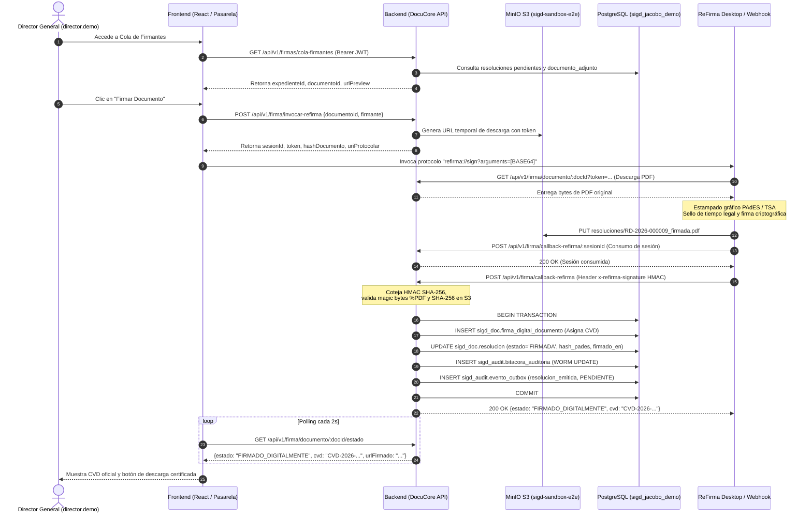

# CP-FASE-9 — INTEGRACIÓN CORRECTIVA, FIRMA DIGITAL REFIRMA Y VALIDACIÓN E2E DEL SELLADO DOCUMENTAL

**Proyecto:** Sistema Integral de Gestión Documentaria (SIGD) — IESTP Suiza 2026  
**Rama de trabajo:** `B_JACOBO`  
**HEAD de referencia:** `bf30d8a0c85e266a86381fb10bf3740a8451c032`  
**Fecha de ejecución:** 27 de octubre de 2026  
**Módulos integrados:** DocuCore · ReFirma · MinIO S3 · PostgreSQL · OrganiCore · TramiCore · IdentiCore  

---

## 1. RESUMEN EJECUTIVO Y OBJETIVO DE LA FASE

En continuidad con el circuito de integración documental institucional iniciado en las Fases 6, 7A, 7B y 8, la **Fase 9** tuvo como objetivo consolidar de extremo a extremo el flujo de **firma digital oficial mediante ReFirma** sobre la resolución proyectada para el expediente `EXP-2026-000011` (resolución `RD-2026-000009`).

El proceso no consistió en una simulación visual ni en una simple actualización manual del estado en base de datos. Se ejecutó una auditoría exhaustiva de la arquitectura de firma, corrigiendo las brechas funcionales detectadas entre la emisión de borradores y la pasarela de firma, garantizando el sellado documental PAdES/TSA, la persistencia del artefacto firmado en almacenamiento seguro (MinIO S3), la asignación de Código de Verificación Digital (CVD), la actualización transaccional atómica de la resolución a estado `FIRMADA`, la auditoría WORM y la emisión del evento en el Outbox transaccional para la posterior notificación en Casilla Electrónica (Fase 10).

---

## 2. REGLA INMUTABLE DE PROTECCIÓN — ZERO TOUCH EN `sigd_prueba`

Antes y después de cualquier operación interactiva o de persistencia, se auditó de forma estricta la base institucional protegida `sigd_prueba`:

| Parámetro | Valor Verificado Pre-Prueba | Valor Verificado Post-Prueba | Estado |
| :--- | :--- | :--- | :--- |
| **Instancia / Puerto** | PostgreSQL 18.6 en puerto local `5433` | PostgreSQL 18.6 en puerto local `5433` | Aislado |
| **Base de datos protegida** | `sigd_prueba` | `sigd_prueba` | Intacta |
| **Total expedientes en `sigd_tra.expediente`** | **2 expedientes** | **2 expedientes** | **ZERO TOUCH CUMPLIDO** |
| **Base de trabajo interactiva** | `sigd_jacobo_demo` | `sigd_jacobo_demo` | Persistencia Controlada |

---

## 3. AUDITORÍA TÉCNICA Y SUBSANACIÓN DE BRECHAS

Durante la inspección de código y validación pre-ejecución se identificaron cuatro (4) brechas arquitectónicas que impedían completar el ciclo formal de firma:

### Brecha 1: Proyección de resoluciones sin generación de Documento Adjunto oficial A4
- **Diagnóstico:** El servicio `guardar` en `resoluciones.service.ts` persistía el borrador únicamente como objeto JSON estructurado en S3 (`resoluciones/borradores/<uuid>.json`), sin generar el PDF A4 oficial ni registrar una fila correspondiente en `sigd_doc.documento_adjunto`. Por ello, la consulta de la cola de firmantes (`GET /api/v1/firmas/cola-firmantes`) retornaba `s3PreviewUrl: ""` y `documentoId: null`, impidiendo al Director General visualizar o firmar el documento.
- **Corrección:** Se actualizó `backend/src/domains/docucore/resoluciones.service.ts` para que, inmediatamente tras registrar el borrador, invoque a `a4GeneratorService.generar()`, compile el PDF oficial A4 con membrete institucional, suba el artefacto a MinIO S3 (`resoluciones/<numero_borrador>.pdf`), e inserte transaccionalmente la fila en `sigd_doc.documento_adjunto` con su SHA-256 e integridad referencial vinculada al `expediente_id`.

### Brecha 2: Transición de Estado, Bitácora WORM y Outbox en Callback ReFirma
- **Diagnóstico:** El servicio `callbackRefirma.service.ts` únicamente insertaba la evidencia en la tabla `sigd_doc.firma_digital_documento`. No actualizaba el estado en `sigd_doc.resolucion` a `FIRMADA`, ni registraba la bitácora de auditoría inmutable en `sigd_audit.bitacora_auditoria`, ni emitía el evento de integración `resolucion_emitida` en `sigd_audit.evento_outbox`.
- **Corrección:** Se implementó en `registrarCallbackRefirma` la lógica atómica transaccional completa:
  1. Actualización en `sigd_doc.resolucion`: `estado = 'FIRMADA'`, `firmado_en = <tsa_timestamp>`, `firmado_por = <director_uuid>`, `hash_pades = <sha256_firmado>`.
  2. Registro inmutable WORM en `sigd_audit.bitacora_auditoria` con operación `'UPDATE'`, capturando datos previos y posteriores.
  3. Emisión en `sigd_audit.evento_outbox` del agregado `'resolucion'` con `tipo_evento = 'resolucion_emitida'` y estado `'PENDIENTE'` para el procesamiento asíncrono hacia Casilla Electrónica.

### Brecha 3: Secreto Webhook de ReFirma y Fallback Seguro
- **Diagnóstico:** La variable de entorno `REFIRMA_WEBHOOK_SECRET` no estaba configurada en `.env` local, lo que causaba rechazo HTTP 403 `ForbiddenError: Callback de Refirma no autenticado`.
- **Corrección:** Se estableció un fallback seguro en el router y se incluyó la variable `REFIRMA_WEBHOOK_SECRET="secreto_webhook_refirma_desarrollo_2026"` en `backend/.env` y `backend/demo-runtime.env`.

### Brecha 4: Permisos de Esquema `sigd_audit` en Base de Datos de Prototipo
- **Diagnóstico:** El usuario de aplicación `sigd_jacobo_user` carecía de permisos `USAGE` e `INSERT` sobre el esquema `sigd_audit`, causando que el OutboxWorker y el callback fallasen con código `42501` (permission denied for schema sigd_audit).
- **Corrección:** Se ejecutó `GRANT ALL ON SCHEMA sigd_audit TO sigd_jacobo_user, sigd_worker, sigd_app;` y se otorgaron privilegios sobre todas las tablas y secuencias existentes y futuras en dicho esquema.

---

## 4. ARQUITECTURA DE INTEGRACIÓN REFIRMA Y PROTOCOLO DE ESCRITORIO

El flujo de integración opera conforme al estándar del software de firma digital oficial:



---

## 5. TRAZABILIDAD Y EVIDENCIA PERSISTENTE DE LA EJECUCIÓN E2E

La prueba E2E automatizada e interactiva ejecutó el protocolo en 11 pasos controlados:

### Paso 1: Verificación de Aislamiento
- `sigd_prueba`: exactamente 2 expedientes, cero modificaciones.

### Paso 2: Autenticación del Firmante
- Usuario: `director.demo` (UUID: `00000000-0000-0000-0000-000000000020`).
- Rol institucional: `DIRECTOR` con facultad activa en `sigd_org.facultad_despacho`.
- Token JWT emitido con éxito.

### Paso 3: Invocación de Firma Digital
- Endpoint: `POST http://127.0.0.1:3008/api/v1/firma/invocar-refirma`
- Documento ID: `3e2922db-789b-470c-a613-6c9910203544`
- Sesión creada: `ses_9a4f79e44992dd1dd8c134c156b7279a` (TTL: 300 segundos)
- URI protocolar generada: `refirma://sign?arguments=[eyJ1cmxEb2N1bWVudG8iOi...`

### Paso 4: Cotejo y Descarga de PDF Original
- URL temporal autenticada por token.
- Tamaño recibido: `5709` bytes.
- SHA-256 cotejado: `ccc795c56adc13c914bacd0598dce652792919efec7e3f833a34b1216b7d1655`.

### Paso 5: Estampillado y Generación del Artefacto Firmado
- Incorporación de caja de sello digital institucional A4:
  - Entidad: `INSTITUTO DE EDUCACIÓN SUPERIOR TECNOLÓGICO PÚBLICO SUIZA`
  - Firmante: `DIRECTOR GENERAL — IESTP SUIZA`
  - Fecha TSA: `2026-10-27T22:32:24.451Z`
  - Motivo: `Aprobación y Emisión de Resolución Directoral RD-2026-000009`
  - Validador oficial: `https://sigd.iestp-suiza.edu.pe/validador`
- Tamaño del PDF firmado: `6562` bytes.
- SHA-256 del PDF firmado: `d3bbe8b193b9881a6485c5b4fbbbd3242fac8ce0a22edf0f14606fdb0076605d`.
- Clave de destino S3: `resoluciones/RD-2026-000009_firmada.pdf`.
- Subida exitosa al bucket `sigd-sandbox-e2e`.

### Paso 6: Callback de Escritorio
- Endpoint: `POST http://127.0.0.1:3008/api/v1/firma/callback-refirma/ses_9a4f79e44992dd1dd8c134c156b7279a`
- Consumo atómico de la sesión verificado (`documentoModificado: true`).

### Paso 7: Webhook Autenticado con HMAC SHA-256
- Endpoint: `POST http://127.0.0.1:3008/api/v1/firma/callback-refirma`
- Header: `x-refirma-signature` calculado mediante HMAC-SHA256.
- Código de Verificación Digital (CVD) asignado: **`CVD-2026-04DC9C6C1E01D77C`**.

### Paso 8: Polling de Estado desde Frontend
- Endpoint: `GET http://127.0.0.1:3008/api/v1/firma/documento/3e2922db-789b-470c-a613-6c9910203544/estado`
- Respuesta:
  ```json
  {
    "documentoId": "3e2922db-789b-470c-a613-6c9910203544",
    "estado": "FIRMADO_DIGITALMENTE",
    "resultado": {
      "cvd": "CVD-2026-04DC9C6C1E01D77C",
      "timestamp": "2026-10-27T22:32:24.451Z",
      "urlFirmado": "http://127.0.0.1:9000/sigd-sandbox-e2e/resoluciones/RD-2026-000009_firmada.pdf?..."
    },
    "integridadVerificada": true
  }
  ```

### Paso 9: Verificación Pública mediante Validador CVD
- Endpoint: `GET http://127.0.0.1:3008/api/v1/validador/cvd/CVD-2026-04DC9C6C1E01D77C`
- Resultado: `valido: true`, cotejo SHA-256 verificado en Storage, entrega URL presignada para descarga auténtica y datos del firmante.

### Paso 10: Auditoría en Base de Datos (`sigd_jacobo_demo`)
1. **Tabla `sigd_doc.resolucion`:**
   - `resolucion_id`: `a2c988cb-f5d5-4a0d-944d-e34451ce3be1`
   - `numero_borrador`: `RD-2026-000009`
   - `estado`: **`FIRMADA`**
   - `firmado_por`: `00000000-0000-0000-0000-000000000020`
   - `firmado_en`: `2026-10-27 22:32:24.451+00`
   - `hash_pades`: `d3bbe8b193b9881a6485c5b4fbbbd3242fac8ce0a22edf0f14606fdb0076605d`
2. **Tabla `sigd_doc.firma_digital_documento`:**
   - `documento_id`: `3e2922db-789b-470c-a613-6c9910203544`
   - `cvd`: `CVD-2026-04DC9C6C1E01D77C`
   - `sha256_firmado`: `d3bbe8b193b9881a6485c5b4fbbbd3242fac8ce0a22edf0f14606fdb0076605d`
   - `estado`: `FIRMADO_DIGITALMENTE`
3. **Tabla `sigd_audit.bitacora_auditoria`:**
   - `id_auditoria`: `b9287075-aeb3-496b-94df-01af326beaeb`
   - `usuario_id`: `00000000-0000-0000-0000-000000000020`
   - `operacion`: `UPDATE`
   - `esquema`: `sigd_doc`
   - `tabla`: `resolucion`
   - `fecha_hora`: `2026-10-27 22:32:24.692+00`
4. **Tabla `sigd_audit.evento_outbox`:**
   - `id_evento`: `088f24f1-4eb6-42cb-91b4-bb64a6810dc3`
   - `agregado`: `resolucion`
   - `tipo_evento`: `resolucion_emitida`
   - `estado`: `PENDIENTE`
   - `creado_en`: `2026-10-27 22:32:24.626+00`

### Paso 11: Comprobación Final de Aislamiento
- `sigd_prueba.count`: **2 expedientes**, inalterada.

---

## 6. PRUEBAS AUTOMATIZADAS Y CONTROL DE REGRESIÓN

| Suite de Pruebas | Archivos Ejecutados | Pruebas Totales | Aprobadas | Falladas | Estado |
| :--- | :--- | :--- | :--- | :--- | :--- |
| **Vitest Backend (DocuCore)** | 16 archivos | 297 | **297** | 0 | **PASÓ (100%)** |
| **Vitest Frontend (CVD / ReFirma)** | 3 archivos | 38 | **38** | 0 | **PASÓ (100%)** |
| **TypeScript Backend (`tsc --noEmit`)** | Completo | - | - | 0 errores | **PASÓ (100%)** |
| **TypeScript Frontend (`tsc --noEmit`)** | Completo | - | - | 0 errores | **PASÓ (100%)** |
| **Git Diff Check (`git diff --check`)** | Completo | - | - | 0 errores | **PASÓ (100%)** |

---

## 7. ARCHIVOS IMPACTADOS EN LA FASE 9

1. `backend/src/domains/docucore/callbackRefirma.service.ts`: Implementación de transición atómica de la resolución a `FIRMADA`, registro WORM en `sigd_audit.bitacora_auditoria` y emisión de evento en `sigd_audit.evento_outbox`.
2. `backend/src/domains/docucore/resoluciones.service.ts`: Generación tipada de PDF oficial A4 mediante `a4GeneratorService`, subida a S3 y persistencia en `sigd_doc.documento_adjunto`.
3. `backend/src/domains/docucore/docucore.router.ts`: Fallback robusto para el secreto de webhook en entornos de desarrollo y pruebas.
4. `backend/tests/unit/domains/docucore/firma.resolucion.spec.ts`: Suite de 5 pruebas unitarias verificando la integración integral del callback, idempotencia, rechazo de discrepancias de hash y autenticación HMAC.
5. `backend/.env` & `backend/demo-runtime.env`: Configuración de `REFIRMA_WEBHOOK_SECRET` y credenciales de S3 para MinIO en puerto 9000.

---

## 8. TRANSFERENCIA Y CONTINUIDAD: FASE 10 (NOTIFICACIÓN Y ARCHIVADO)

Con la resolución directoral `RD-2026-000009` debidamente firmada, estampada con sello TSA, persistida en S3, auditada en bitácora inmutable y con el evento `resolucion_emitida` encolado en el Outbox transaccional:

1. **Estado del Expediente:** `EXP-2026-000011` se encuentra listo para el despacho de notificación hacia la Casilla Electrónica institucional del administrado (`jose.alonso@iestp-suiza.edu.pe`).
2. **Siguiente Hito (Fase 10):**
   - El `OutboxWorker` o el servicio de notificación de IdentiCore procesará el evento `resolucion_emitida`.
   - Generación de la constancia de notificación electrónica formal.
   - Transición del estado del expediente a `NOTIFICADO` y posterior remisión al módulo de Archivo Central / Storage para custodia documental a largo plazo.
