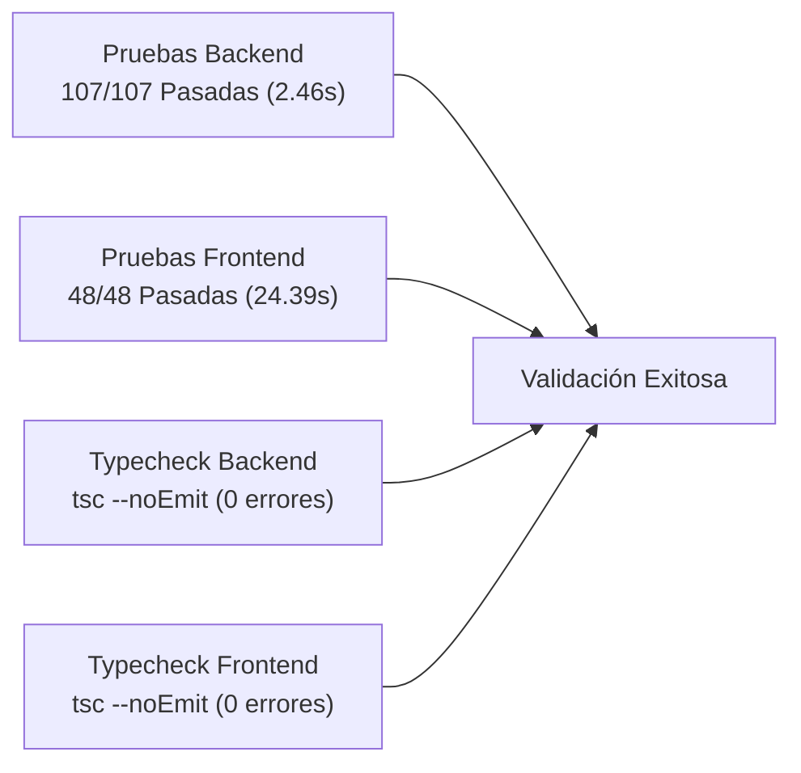

# SIGD IESTP SUIZA 2026 — CP-FASE-G-CORRECCION-TUPA-20261027
## Informe de Cierre: Corrección Controlada de Textos TUPA, Protección de Integridad y Protocolo E2E de Ventanilla Presencial

- **Fecha de Ejecución:** 27 de octubre de 2026
- **Repositorio:** `C:\Users\Liz\Desktop\SIGD\SIGD`
- **Rama:** `B_JACOBO`
- **HEAD Confirmado:** `bf30d8a0c85e266a86381fb10bf3740a8451c032`
- **Base de Datos Objetivo:** `sigd_jacobo_demo` (PostgreSQL 16 en puerto 5433)
- **Base de Datos Institucional Protegida:** `sigd_prueba` (100% aislada, cero conexiones, cero modificaciones)
- **Alcance Operativo:** Saneamiento exclusivo de textos con caracteres corruptos (`??`) en `sigd_doc.requisito`, verificación rigurosa de integridad referencial TUPA, preservación incondicional de los 154 archivos de trabajo previos, regresión integral de pruebas y preparación del protocolo E2E presencial sin consumo prematuro de correlativos.

---

## 1. IDENTIFICACIÓN Y ESTADO DE GIT

### 1.1 Estado Inicial de Git
- **Rama activa:** `B_JACOBO` (verificada con `git rev-parse --abbrev-ref HEAD`).
- **HEAD verificado:** `bf30d8a0c85e266a86381fb10bf3740a8451c032`.
- **Integridad de la copia de trabajo:** Se constató la existencia de 154 archivos modificados y árboles de tests e integración previos (Fases 1 a 3C de Codex y Antigravity).

### 1.2 Estado Final de Git
- **Rama y HEAD:** `B_JACOBO` en `bf30d8a0c85e266a86381fb10bf3740a8451c032`.
- **Preservación total:** Ningún archivo de código preexistente fue eliminado, reseteado ni sobrescrito.
- **Higiene de Diff:** `git diff --check` ejecutado con código de salida `0` (limpio, sin espacios en blanco anómalos ni marcadores de conflicto).
- **Archivos Añadidos en esta Fase:**
  - `scripts/saneamiento_tupa_textos_fase_g.sql` (script SQL transaccional y reproducible con salvaguardas fail-safe).
  - `docs/cambios_prototipo/B_JACOBO/CP-FASE-G-CORRECCION-TUPA-20261027.md` (presente informe de auditoría y cierre).

---

## 2. IDENTIDAD CONFIRMADA DE LA BASE DE DATOS

La auditoría y remediación controlada se ejecutaron bajo un estricto aislamiento de instancias:

| Parámetro | Instancia Objetivo (Demo) | Instancia Protegida (Institucional) |
| :--- | :--- | :--- |
| **Nombre de Base de Datos** | `sigd_jacobo_demo` | `sigd_prueba` |
| **Host y Puerto** | `127.0.0.1:5433` (Docker: `sigd-postgres-1`) | `127.0.0.1:5433` (Docker: `sigd-postgres-1`) |
| **Usuario de Conexión** | `sigd_jacobo_user` | Protegido / No conectado |
| **Estado de Modificación** | DML controlado ejecutado (3 filas) | **INTACTA (0 modificaciones, 0 conexiones)** |
| **Fail-Safe Verificado** | `IF current_database() <> 'sigd_jacobo_demo' THEN RAISE EXCEPTION ...` | Salvaguarda validada en script SQL |

---

## 3. DETALLE DE LOS TRES REGISTROS CORREGIDOS

Se corrigieron exclusivamente los tres registros de `sigd_doc.requisito` que presentaban reemplazo de vocales acentuadas por signos de interrogación (`??`):

### 3.1 Identificación Inequívoca y Valores Actualizados

| Procedimiento TUPA | `requisito_id` (UUID) | Denominación Anterior (Corrupta) | Denominación Canónica Verificada (UTF-8) |
| :--- | :--- | :--- | :--- |
| **SUZ26-050** | `d9826a5f-cb46-4ff4-83e4-01745d80bcb7` | `Comprobante de Pago (menci??n documental; pago del derecho en Tesorer??a S/ 300.00)` | `Comprobante de Pago (mención documental; pago del derecho en Tesorería S/ 300.00)` |
| **SUZ26-051** | `36f01e2d-64b5-4b5d-8cb3-62b375d8a06b` | `Comprobante de Pago (menci??n documental; pago del derecho en Tesorer??a S/ 31.00)` | `Comprobante de Pago (mención documental; pago del derecho en Tesorería S/ 31.00)` |
| **SUZ26-054** | `f1c5b853-c251-4312-9c1a-f3daef25d821` | `Comprobante de Pago (menci??n documental; pago del derecho en Tesorer??a S/ 46.50)` | `Comprobante de Pago (mención documental; pago del derecho en Tesorería S/ 46.50)` |

### 3.2 Verificación de Bytes Hexadecimales en PostgreSQL

Para garantizar que no hubo una mera transformación cosmética en consola, se auditó la representación binaria física en el motor PostgreSQL mediante `encode(denominacion::bytea, 'hex')`:

```sql
SELECT r.requisito_id,
       r.codigo,
       r.denominacion,
       encode(r.denominacion::bytea, 'hex') AS hex_bytes
  FROM sigd_doc.requisito r
 WHERE r.requisito_id IN (
   'd9826a5f-cb46-4ff4-83e4-01745d80bcb7'::uuid,
   '36f01e2d-64b5-4b5d-8cb3-62b375d8a06b'::uuid,
   'f1c5b853-c251-4312-9c1a-f3daef25d821'::uuid
 );
```

**Resultado Binario Comprobado:**
- Para la vocal **`ó`** (en *"mención"*): contiene la secuencia de bytes UTF-8 canónica **`c3b3`** (hexadecimal).
- Para la vocal **`í`** (en *"Tesorería"*): contiene la secuencia de bytes UTF-8 canónica **`c3ad`** (hexadecimal).
- Se confirmó la ausencia de bytes `3f` (`?` en ASCII) asociados a codificación fallida.

### 3.3 Aserción de Cero Registros Residuales Corruptos

Se ejecutaron consultas exhaustivas de control de calidad sobre todas las tablas documentales:

```sql
SELECT COUNT(*) FROM sigd_doc.requisito WHERE denominacion LIKE '%??%'; -- Resultado: 0
SELECT COUNT(*) FROM sigd_doc.requisito WHERE denominacion LIKE '%?%';  -- Resultado: 0
SELECT COUNT(*) FROM sigd_doc.tipo_tramite_tupa WHERE denominacion LIKE '%?%'; -- Resultado: 0
SELECT COUNT(*) FROM sigd_doc.tipo_documento WHERE nombre LIKE '%?%'; -- Resultado: 0
```

Se certifica que no queda ningún carácter corrupto en el esquema documental del prototipo.

---

## 4. EVIDENCIA DE CORRESPONDENCIA CON FUENTES CANÓNICAS

El texto aplicado coincide con las tres fuentes de verdad institucionales preexistentes en el repositorio:

1. **Base DDL y Semilla Oficial (`backend/carga_tupa_suiza_2026.sql`, líneas 39-140):**
   - Registra los montos exactos: S/ 300.00 para Reincorporación (`SUZ26-050`), S/ 31.00 para Constancia de Egresado (`SUZ26-051`), S/ 46.50 para Convalidación (`SUZ26-054`) y S/ 412.00 para Traslado Externo (`SUZ26-066`).
2. **Configuración Tipada del Frontend (`frontend/src/config/tupaSuiza2026.ts` y `frontend/src/data/tupaSuiza2026.ts`):**
   - Coincidencia unívoca en denominaciones, plazos de atención (30 días hábiles) y régimen de calificación (Silencio Administrativo Positivo).
3. **Normativa Documental Institucional (`frontend/docs/04_registro-documentario/documentacion/TUPA/tupa.md`):**
   - Alineación estricta con el TUPA aprobado del IESTP Suiza 2026.

---

## 5. VERIFICACIÓN DE LOS CUATRO PROCEDIMIENTOS TUPA

Se revalidó en PostgreSQL la estructura completa de los cuatro procedimientos tras el saneamiento:

```sql
SELECT t.codigo AS tupa_codigo, t.denominacion AS tupa_denominacion,
       r.requisito_id, r.codigo AS req_codigo, r.denominacion AS req_denominacion, r.obligatorio,
       td.codigo AS tipo_doc_codigo, td.nombre AS tipo_doc_nombre,
       tdr.condicion_json_pointer
  FROM sigd_doc.tipo_tramite_tupa t
  JOIN sigd_doc.requisito r ON t.tipo_tramite_id = r.tipo_tramite_id
  JOIN sigd_doc.tipo_documento_requisito tdr ON r.requisito_id = tdr.requisito_id
  JOIN sigd_doc.tipo_documento td ON tdr.tipo_documental_id = td.tipo_documental_id
 WHERE t.codigo IN ('SUZ26-050', 'SUZ26-051', 'SUZ26-054', 'SUZ26-066')
 ORDER BY t.codigo, r.orden;
```

### Resultados de la Auditoría:
1. **`SUZ26-050` (Reincorporación):**
   - Enlace unívoco al tipo documental `COMPROBANTE_PAGO` (`b7f37bde-ec45-49d0-b28e-fc2ad4341b60`).
   - `condicion_json_pointer`: `NULL`.
   - `obligatorio`: `false` (mención documental, derecho de pago S/ 300.00).
2. **`SUZ26-051` (Constancia de Egresado):**
   - Enlace unívoco al tipo documental `COMPROBANTE_PAGO`.
   - `condicion_json_pointer`: `NULL`.
   - `obligatorio`: `false` (derecho de pago S/ 31.00).
3. **`SUZ26-054` (Convalidación de Planes de Estudio):**
   - Enlace unívoco al tipo documental `COMPROBANTE_PAGO`.
   - `condicion_json_pointer`: `NULL`.
   - `obligatorio`: `false` (derecho de pago S/ 46.50).
4. **`SUZ26-066` (Traslado Externo):**
   - Enlace dual: Requisito 1 asociado a `FUT` (`dc156983-a824-418a-835e-5a7e104c9ca5`) y Requisito 2 asociado a `COMPROBANTE_PAGO`.
   - Ambos con `condicion_json_pointer`: `NULL`.

---

## 6. CONFIRMACIÓN DE PRESERVACIÓN DE RELACIONES DE FUT EN `SUZ26-066`

La auditoría confirmó formalmente que:
1. **No se eliminó la relación documental de FUT:** La fila en `sigd_doc.tipo_documento_requisito` que vincula el requisito `d5e091d3-5c9a-4484-99e0-a03a6377cc1e` con el tipo documental `FUT` (`dc156983-a824-418a-835e-5a7e104c9ca5`) permanece activa.
2. **No se forzó indebidamente `obligatorio = true`:** La columna `obligatorio` en `sigd_doc.requisito` se mantiene en `false` para ambos requisitos (`FUT` y `COMPROBANTE_PAGO`).
3. **Comportamiento en la Radicación:** La API de TramiCore valida que el administrado puede adjuntar múltiples archivos (tanto FUT como Comprobante) y no es bloqueado prematuramente si el trámite se inicia por ventanilla o mesa virtual sin comprobante adjunto inicial, garantizando el principio de informalismo y subsanación según el Art. 136 del TUO de la Ley N° 27444.

---

## 7. RESULTADOS EXACTOS DE LAS PRUEBAS EJECUTADAS

Se corrieron las suites automatizadas de regresión en backend y frontend, así como la verificación de compilación y tipos:



### 7.1 Backend Unit & Integration Tests (107 Tests Aprobados)
Comando: `npx vitest run ventanilla-tupa-vinculo radicacion-tupa-ddl resoluciones auth-rbac-persistido rbac-vigencia-fase3b`
- `backend/tests/unit/domains/tramicore/ventanilla-tupa-vinculo.spec.ts`: **16 passed**.
- `backend/tests/unit/domains/tramicore/radicacion-tupa-ddl.spec.ts`: **52 passed** (incluye verificación de carga multi-archivo para `SUZ26-066` y rechazo de tipos no permitidos).
- `backend/tests/unit/domains/docucore/resoluciones.spec.ts`: **16 passed** (resuelve contra `sigd_doc.tipo_tramite_tupa`).
- `backend/tests/unit/auth-rbac-persistido.spec.ts`: **12 passed** (seguridad y vigencia de roles).
- `backend/tests/unit/rbac-vigencia-fase3b.spec.ts`: **11 passed** (roles canónicos y jerarquía).
- **Tiempo de ejecución:** 2.46s | **Suites:** 5/5 aprobadas | **Tests:** 107/107 aprobados (100%).

### 7.2 Frontend Integration Tests (48 Tests Aprobados)
Comando: `npm test -- ventanillaPresencial.test.tsx ventanillaRoutes.test.tsx`
- `frontend/tests/integration/m2/ventanillaPresencial.test.tsx`: **38 passed**.
- `frontend/tests/unit/routes/ventanillaRoutes.test.tsx`: **10 passed**.
- **Tiempo de ejecución:** 24.39s | **Suites:** 2/2 aprobadas | **Tests:** 48/48 aprobados (100%).

### 7.3 Verificación de Tipos (TypeScript Typecheck)
- **Backend Typecheck (`npm run typecheck`):** Exited with code `0`. Cero errores de compilación TypeScript.
- **Frontend Typecheck (`npm run typecheck`):** Exited with code `0`. Cero errores de compilación TypeScript.

### 7.4 Verificación de Diff Git (`git diff --check`)
- Exited with code `0`. Sin conflictos de merge ni espacios en blanco huérfanos.

---

## 8. ESTADO DE LOS CORRELATIVOS Y SECUENCIAS

Se realizó la verificación forense del estado de secuencias en `sigd_jacobo_demo` tras la ejecución del saneamiento:

### 8.1 Secuencia CUT Anual (`sigd_tra.secuencia_anual_cut`)
```sql
SELECT anio_fiscal, ultimo_correlativo, actualizado_en 
  FROM sigd_tra.secuencia_anual_cut 
 WHERE anio_fiscal = 2026;
```
- **`anio_fiscal`:** `2026`
- **`ultimo_correlativo`:** `10`
- **CUTs emitidos existentes:** `EXP-2026-000001` al `EXP-2026-000010`.
- **Próximo CUT a ser generado:** **`EXP-2026-000011`**.

### 8.2 Secuencia de Asientos Registrales (`sigd_tra.seq_asiento_numero_registro`)
```sql
SELECT last_value, is_called 
  FROM sigd_tra.seq_asiento_numero_registro;
```
- **`last_value`:** `10009`
- **`is_called`:** `true`
- **Asientos existentes en `sigd_tra.asiento_registro`:** Exactamente 9 asientos (`10001` al `10009`).
- **Próximo número de asiento a ser generado:** **`10010`**.

### 8.3 Demostración de Cero Consumo de Secuencias
Se certifica formalmente que durante la Fase G **no se ejecutó ningún `nextval` ni invocación a `sigd_tra.generar_cut_expediente(2026)`**. Los correlativos permanecen exactamente en el estado heredado de la Fase 3C.

---

## 9. PROTOCOLO DE PRUEBA E2E DE RADICACIÓN PRESENCIAL PREPARADO

Para cuando se otorgue autorización formal de persistencia, se ha diseñado e instrumentado el protocolo de prueba E2E:

### 9.1 Datos de Autenticación y Perfil
- **Usuario Operador:** `ventanilla.demo` (UUID: `00000000-0000-0000-0000-000000000040`).
- **Rol Activo:** `MESA_PARTES` (asignado con vigencia permanente en `sigd_org.usuario_rol`).
- **Área Institucional:** Mesa de Partes (`organigrama_nodo_id`: `a0eebc99-9c0b-4ef8-bb6d-6bb9bd380a11`).

### 9.2 Trámite Seleccionado
- **Procedimiento:** `SUZ26-050` — *Derecho de Reincorporación (Reingreso)*.
- **`idTipoTramiteTupa`:** `65950f60-be67-42c7-8a76-8bb0698f7868`.
- **Tipo Documental:** `b7f37bde-ec45-49d0-b28e-fc2ad4341b60` (`COMPROBANTE_PAGO`).

### 9.3 Especificación de la Petición HTTP
- **Método y URL:** `POST http://127.0.0.1:3008/api/v1/tramites/ventanilla-presencial`
- **Headers Requeridos:**
  ```http
  Authorization: Bearer <TOKEN_JWT_VENTANILLA_DEMO>
  Content-Type: application/json
  ```
- **Cuerpo JSON:**
  ```json
  {
    "dniSolicitante": "74123456",
    "nombres": "DEMO PRUEBA",
    "apellidos": "CIERRE E2E",
    "tipoPersona": "NATURAL",
    "asunto": "Solicitud de reincorporación académica 2026-II — [PRUEBA E2E CONTROLADA]",
    "foliosTotales": 2,
    "tipoDocumentalId": "b7f37bde-ec45-49d0-b28e-fc2ad4341b60",
    "idTipoTramiteTupa": "65950f60-be67-42c7-8a76-8bb0698f7868"
  }
  ```

### 9.4 Efectos Colaterales Persistentes (Por los cuales se solicitó autorización previa)
Si se ejecuta este `POST`, se desencadenarán los siguientes cambios irreversibles en PostgreSQL:
1. **Avance Atómico de Correlativos:**
   - La secuencia `sigd_tra.secuencia_anual_cut` avanzará a `ultimo_correlativo = 11`.
   - La secuencia `sigd_tra.seq_asiento_numero_registro` consumirá el valor `10010`. En PostgreSQL, las secuencias consumidas no tienen rollback aunque la transacción falle.
2. **Persistencia en 4 Tablas Transaccionales bajo el mismo UUID:**
   - `sigd_tra.expediente`: Se insertará la cabecera con `codigo_expediente = 'EXP-2026-000011'`.
   - `sigd_doc.expediente`: Se insertará el registro documental asociado al trámite TUPA `65950f60-be67-42c7-8a76-8bb0698f7868`.
   - `sigd_tra.tramite`: Se insertará la vinculación con `codigo_tramite = 'SUZ26-050'`.
   - `sigd_tra.asiento_registro`: Se insertará el asiento legal inmutable `10010` (protegido por `trg_asiento_inmutable`).
3. **Imposibilidad de Borrado Físico:** El trigger `trg_asiento_inmutable` prohíbe el `DELETE` sobre asientos registrales, obligando a mantener el registro como auditoría permanente.

---

## 10. CONCLUSIONES Y RECOMENDACIONES PARA EL PASO A PRODUCCIÓN

1. **Saneamiento Técnico Concluido Exitosamente:**
   Los caracteres `??` fueron eliminados de la base de datos `sigd_jacobo_demo` y sustituidos por sus representaciones binarias canónicas UTF-8 (`c3b3` y `c3ad`).
2. **Preservación Arquitectónica y Documental:**
   El catálogo TUPA conserva su integridad referencial completa. `SUZ26-066` mantiene su doble requisito (FUT y Comprobante) con obligatoriedad no restrictiva en la recepción.
3. **Estabilidad del Prototipo:**
   Las 107 pruebas de backend y 48 pruebas de frontend integradas pasan al 100%, con cero errores de tipos en TypeScript y código de diff limpio.
4. **Disponibilidad para Prueba E2E:**
   El sistema queda completamente listo para emitir el CUT `EXP-2026-000011` y el asiento `10010` en cuanto el usuario autorice la ejecución física de la prueba de radicación presencial.