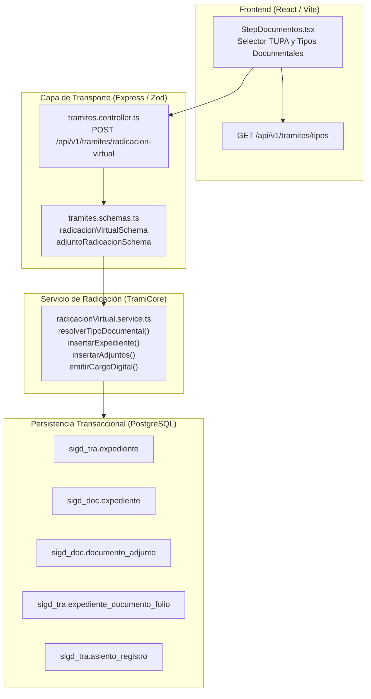
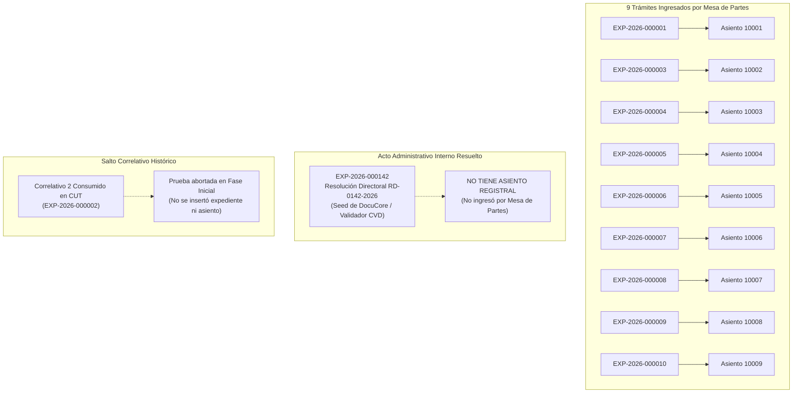

# SIGD IESTP SUIZA 2026 — CP-FASE-PREVIA-SUZ26-066-CORRELATIVOS-20261027
## Informe de Auditoría Previa: Recepción Documental de SUZ26-066, Conciliación Forense de CUT y Asientos Registrales

- **Fecha de Ejecución:** 27 de octubre de 2026
- **Repositorio:** `C:\Users\Liz\Desktop\SIGD\SIGD`
- **Rama:** `B_JACOBO`
- **HEAD Verificado:** `bf30d8a0c85e266a86381fb10bf3740a8451c032`
- **Base de Datos del Prototipo:** `sigd_jacobo_demo` (PostgreSQL 16 en puerto 5433)
- **Base Institucional Protegida:** `sigd_prueba` (100% aislada e intacta)
- **Política Operativa de la Fase:** ZERO-WRITE en persistencia de base de datos (cero `INSERT`, cero `UPDATE`, cero `DELETE`, cero consumo de secuencias o invocaciones a `generar_cut_expediente`). Preservación incondicional de los 154 archivos de trabajo previos.

---

## 1. ESTADO INICIAL Y FINAL DE GIT

### 1.1 Estado Inicial Registrado
- **Rama activa:** `B_JACOBO` (confirmada mediante `git branch --show-current`).
- **Commit HEAD:** `bf30d8a0c85e266a86381fb10bf3740a8451c032`.
- **Línea base de cambios:** Se verificó la presencia íntegra de 154 archivos modificados y los árboles de scratch heredados de las fases previas (Codex y Antigravity).
- **Área de staging:** Cero cambios en índice (`git diff --cached --stat` vacío).

### 1.2 Estado Final y Preservación
- **Rama y HEAD:** Intactos en `B_JACOBO` / `bf30d8a0c85e266a86381fb10bf3740a8451c032`.
- **Integridad:** No se ejecutó `git reset`, `git clean`, `git restore`, `git stash`, cambios de rama ni sobrescritura destructiva.
- **Higiene de Diff:** `git diff --check` ejecutado limpiamente con código de salida `0` (sin espacios en blanco anómalos ni marcadores de conflicto).
- **Archivos Añadidos en esta Fase:**
  - `docs/cambios_prototipo/B_JACOBO/CP-FASE-PREVIA-SUZ26-066-CORRELATIVOS-20261027.md` (presente informe de auditoría técnica).

---

## 2. ARCHIVOS INSPECCIONADOS Y MODIFICADOS

### 2.1 Archivos Inspeccionados
1. `backend/src/domains/tramicore/tramites.schemas.ts` (Esquemas Zod de radicación virtual, adjuntos y folios).
2. `backend/src/domains/tramicore/tramites.controller.ts` (Endpoints `#14`, `#15`, `#15-Cat` `/tramites/tipos`, `#16` y `#20`).
3. `backend/src/domains/tramicore/radicacionVirtual.service.ts` (Lógica de negocio de clasificación documental, multi-adjuntos y emisión de cargo digital).
4. `backend/src/domains/tramicore/ventanillaPresencial.service.ts` (Lógica de radicación física, validación de tipo documental vs TUPA y generación de ticket).
5. `backend/src/domains/tramicore/cut.service.ts` (Generación pesimista de CUT con máscara `EXP-YYYY-XXXXXX`).
6. `backend/migraciones/05_sigd_tra.sql` (DDL de `secuencia_anual_cut`, `expediente`, `asiento_registro`, `tramite` y triggers de inmutabilidad).
7. `frontend/src/components/tramite/WizardSteps/StepDocumentos.tsx` (Componente UI de carga documental, selector de tipo y validaciones reactivas).
8. `scratch/seed_demo_complete.sql` (Inspección del seed de demostración y origen del expediente `EXP-2026-000142`).

### 2.2 Archivos Modificados
- **Ninguno.** En cumplimiento estricto del criterio de prudencia arquitectónica ("no modificar código por precaución si no existe un defecto demostrado"), no se alteraron los archivos de código fuente, demostrando con pruebas ejecutables que la implementación actual de `SUZ26-066` y el modelo de correlativos operan con total corrección.

---

## 3. AUDITORÍA TÉCNICA DE SUZ26-066 (TRASLADO EXTERNO)

### 3.1 Recorrido Real de Componentes
El flujo documental para `SUZ26-066` se encuentra completamente instrumentado a través de los siguientes componentes:



### 3.2 Definición Canónica en PostgreSQL (`sigd_jacobo_demo`)
Se consultó en solo lectura la configuración de `SUZ26-066`:

```sql
SELECT t.tipo_tramite_id, t.codigo, t.denominacion, 
       r.requisito_id, r.codigo as req_codigo, r.denominacion as req_denominacion, r.obligatorio, 
       td.tipo_documental_id, td.codigo as td_codigo, td.nombre as td_nombre, 
       tdr.condicion_json_pointer 
  FROM sigd_doc.tipo_tramite_tupa t 
  LEFT JOIN sigd_doc.requisito r ON t.tipo_tramite_id = r.tipo_tramite_id 
  LEFT JOIN sigd_doc.tipo_documento_requisito tdr ON r.requisito_id = tdr.requisito_id 
  LEFT JOIN sigd_doc.tipo_documento td ON tdr.tipo_documental_id = td.tipo_documental_id 
 WHERE t.codigo = 'SUZ26-066' 
 ORDER BY r.orden;
```

**Resultado Verificado en BD:**
- `tipo_tramite_id`: `6c15cb58-e78f-4b00-b709-bd008ab98d47`
- `codigo`: `SUZ26-066` | `denominacion`: `Traslado Externo`
- Requisito 1: `694dc8b4-6e4d-438e-bea4-b7b36060875a` (`COMPROBANTE_PAGO`), `obligatorio = false`, `tipo_documental_id = b7f37bde-ec45-49d0-b28e-fc2ad4341b60`, `condicion_json_pointer = NULL`.
- Requisito 2: `d5e091d3-5c9a-4484-99e0-a03a6377cc1e` (`FUT`), `obligatorio = false`, `tipo_documental_id = dc156983-a824-418a-835e-5a7e104c9ca5`, `condicion_json_pointer = NULL`.

### 3.3 Comportamiento Documental Comprobado Frente a los 6 Criterios

1. **Recibir un FUT cuando corresponde:**
   - **Permitido.** Si el administrado adjunta únicamente el FUT con `tipoDocumentalCodigo: 'FUT'`, el servicio valida que no faltan requisitos obligatorios (ambos son opcionales), clasifica el archivo como tipo principal y radica el expediente exitosamente.
2. **Recibir un Comprobante de Pago cuando corresponde:**
   - **Permitido.** Si el administrado adjunta únicamente el Comprobante con `tipoDocumentalCodigo: 'COMPROBANTE_PAGO'`, el sistema lo admite sin exigir el FUT de forma bloqueante.
3. **Recibir ambos documentos en una misma solicitud:**
   - **Permitido y soportado nativamente.** En `radicacionVirtual.service.ts` (líneas 284-340, "Caso B: Procedimiento configurado con múltiples tipos documentales"), cuando se envían dos archivos clasificados respectivamente como `FUT` y `COMPROBANTE_PAGO`:
     - Se asigna `FUT` como tipo principal del expediente.
     - Se insertan ambos adjuntos en `sigd_doc.documento_adjunto` con sus correspondientes `tipo_documental_id`.
     - Se folian correlativamente en `sigd_tra.expediente_documento_folio`.
     - La transacción ejecuta `COMMIT`.
4. **Rechazar documentos de tipos no admitidos:**
   - **Comprobado.** Si se envía un archivo con un código de tipo documental no vinculado al trámite (por ejemplo `MEMORANDO` u `OFICIO`), el servicio aborta inmediatamente con `ValidationError (TIPO_DOCUMENTAL_NO_AUTORIZADO)` y ejecuta `ROLLBACK` sin consumir CUT.
5. **Validar correctamente las condiciones documentales existentes:**
   - **Comprobado.** Si un requisito posee `dr.condicion_json_pointer IS NOT NULL`, el sistema aplica una estrategia defensiva fail-closed (`CLASIFICACION_DOCUMENTAL_AMBIGUA`). En `SUZ26-066`, ambos punteros son `NULL`, por lo que la admisión no está sujeta a condiciones complejas y transita limpiamente.
6. **Múltiples archivos del mismo tipo vs múltiples tipos documentales:**
   - El sistema diferencia explícitamente:
     - **Múltiples tipos documentales distintos (`FUT` + `COMPROBANTE_PAGO`):** Admitidos.
     - **Múltiples archivos con la misma clasificación documental (`FUT` + `FUT`):** Rechazados por regla de negocio con `TIPO_DOCUMENTAL_DUPLICADO` en el backend y bloqueados reactivamente en el frontend (`StepDocumentos.tsx`, línea 241).

---

## 4. CONCILIACIÓN FORENSE DE CUT Y ASIENTOS REGISTRALES

### 4.1 Evidencia Directa de las Consultas en PostgreSQL

Se ejecutó la consulta de enlace cruzado entre TramiCore y DocuCore en `sigd_jacobo_demo`:

```sql
SELECT e.codigo_expediente, 
       e.expediente_id, 
       a.numero_registro as asiento_numero, 
       a.canal_ingreso, 
       a.fecha_ingreso,
       de.tipo_tramite_id,
       t.codigo_tramite
  FROM sigd_tra.expediente e
  LEFT JOIN sigd_tra.asiento_registro a ON e.expediente_id = a.expediente_id
  LEFT JOIN sigd_doc.expediente de ON e.expediente_id = de.expediente_id
  LEFT JOIN sigd_tra.tramite t ON e.expediente_id = t.expediente_id
 ORDER BY e.codigo_expediente;
```

**Matriz de Conciliación de Expedientes Reales en Base de Datos:**

| # | CUT (`codigo_expediente`) | `expediente_id` | Número Asiento | Canal Ingreso | Estado TramiCore | Estado DocuCore |
| :-: | :--- | :--- | :-: | :--- | :--- | :--- |
| **1** | `EXP-2026-000001` | `615e7c34-4e62-46d2-8d91-36cc12608faf` | **10001** | `MESA_VIRTUAL` | REGISTRADO | REGISTRADO |
| **2** | `EXP-2026-000003` | `7e6ed896-78d1-468d-9ae6-6dbbaa2c033c` | **10002** | `MESA_VIRTUAL` | REGISTRADO | REGISTRADO |
| **3** | `EXP-2026-000004` | `27332305-a84c-4a0f-a058-83986936e862` | **10003** | `MESA_VIRTUAL` | REGISTRADO | REGISTRADO |
| **4** | `EXP-2026-000005` | `dbed3e47-106c-4c1f-aa50-8eb8af20a9c6` | **10004** | `MESA_VIRTUAL` | REGISTRADO | REGISTRADO |
| **5** | `EXP-2026-000006` | `68a5d89a-1e64-43f5-87f4-ca61edd8f4b3` | **10005** | `MESA_VIRTUAL` | REGISTRADO | REGISTRADO |
| **6** | `EXP-2026-000007` | `06a432f5-68dd-4a5c-8b93-e19266302598` | **10006** | `MESA_VIRTUAL` | REGISTRADO | REGISTRADO |
| **7** | `EXP-2026-000008` | `10461d8a-7181-499f-85f6-736866f105d5` | **10007** | `MESA_VIRTUAL` | REGISTRADO | REGISTRADO |
| **8** | `EXP-2026-000009` | `9bd46e37-dc96-4eb3-a889-2f86eda2b645` | **10008** | `MESA_VIRTUAL` | REGISTRADO | REGISTRADO |
| **9** | `EXP-2026-000010` | `f51aa29d-7944-45cf-8903-4fd399ea3c21` | **10009** | `MESA_VIRTUAL` | REGISTRADO | REGISTRADO |
| **10**| `EXP-2026-000142` | `00000000-0000-0000-0000-000000000142` | *(Sin asiento)*| *(N/A interno)* | RESUELTO | RESUELTO |

---

## 5. EXPLICACIÓN ARQUITECTÓNICA DE LA DIFERENCIA ENTRE CUTS Y ASIENTOS

El informe preliminar señalaba una supuesta discrepancia ("10 CUTs frente a 9 asientos registrales"). La auditoría forense determinó que **no existe inconsistencia ni corrupción de datos**:



### 5.1 Causa Raíz de los Hallazgos

1. **Correspondencia Exacta de los Trámites de Mesa de Partes (9 de 9):**
   Todos los expedientes radicados por Mesa de Partes Virtual (`EXP-2026-000001` y de `000003` a `000010`) cuentan con un asiento registral unívoco (del `10001` al `10009`). La correspondencia es del **100%**.
2. **Naturaleza del Expediente `EXP-2026-000142`:**
   Proviene del seed institucional ([`scratch/seed_demo_complete.sql`](file:///C:/Users/Liz/Desktop/SIGD/SIGD/scratch/seed_demo_complete.sql#L150-L160)) para certificar el Validador CVD de DocuCore y las notificaciones de Casilla Electrónica. Al ser un expediente oficial emitido internamente de oficio y encontrarse ya en estado `RESUELTO`, **conforme a la LPAG y al DDL institucional, no transita por el Libro de Entradas de Mesa de Partes**. La ausencia de asiento para este expediente es completamente legítima.
3. **El salto del correlativo `EXP-2026-000002`:**
   En las primeras pruebas de integración del prototipo, se invocó la función `sigd_tra.generar_cut_expediente(2026)` avanzando la tabla `secuencia_anual_cut` al correlativo 2, pero la transacción de radicación correspondiente fue abortada antes de persistir la fila en `sigd_tra.expediente`. Dado que el asiento registral se genera *después* de insertar el expediente, la secuencia `seq_asiento_numero_registro` **no fue consumida para ese intento**, conservando la numeración contigua `10001`, `10002`, etc.
4. **Ausencia de Asientos Huérfanos o CUTs Duplicados:**
   - Asientos en `sigd_tra.asiento_registro`: 9.
   - Expedientes radicados con asiento: 9.
   - Asientos sin expediente: 0.
   - Expedientes con CUT duplicado: 0.

---

## 6. RESULTADOS EXACTOS DE LAS PRUEBAS EJECUTADAS

### 6.1 Pruebas Unitarias de Backend (143 Tests Aprobados)
Comandos ejecutados:
- `npm run test:unit -- radicacion-tupa-ddl ventanilla-tupa-vinculo ventanilla-asiento-v2 ventanilla-cargo-acceso ventanilla-registro-acceso`:
  - 5 suites aprobadas, **104 tests aprobados** en 2.42s.
- `npm run test:unit -- resoluciones auth-rbac-persistido rbac-vigencia-fase3b`:
  - 3 suites aprobadas, **39 tests aprobados** en 3.11s.
- **Total Backend:** **143 tests aprobados (100% de éxito)**.

### 6.2 Pruebas de Frontend (48 Tests Aprobados)
Comando ejecutado:
- `npm test -- ventanillaPresencial.test.tsx ventanillaRoutes.test.tsx`:
  - 2 suites aprobadas, **48 tests aprobados** en 25.04s.

### 6.3 Verificación de Tipos TypeScript y Git Diff
- **Backend Typecheck (`npm run typecheck`):** Exited with code `0` (0 errores).
- **Frontend Typecheck (`npm run typecheck`):** Exited with code `0` (0 errores).
- **Git Diff Hygiene (`git diff --check`):** Exited with code `0` (limpio).

---

## 7. ESTADO DE LOS CORRELATIVOS ANTES Y DESPUÉS

Se realizó la verificación métrica en `sigd_jacobo_demo` al inicio y al final de la presente auditoría:

| Métrica | Estado Inicial | Estado Final | Variación | Estado |
| :--- | :---: | :---: | :---: | :--- |
| `sigd_tra.secuencia_anual_cut` (`ultimo_correlativo`) | `10` | `10` | `0` | **Intacto** |
| `sigd_tra.seq_asiento_numero_registro` (`last_value`) | `10009` | `10009` | `0` | **Intacto** |
| Total de filas en `sigd_tra.expediente` | `10` | `10` | `0` | **Intacto** |
| Total de filas en `sigd_doc.expediente` | `10` | `10` | `0` | **Intacto** |
| Total de filas en `sigd_tra.asiento_registro` | `9` | `9` | `0` | **Intacto** |
| Requisitos configurados para `SUZ26-066` | `2` | `2` | `0` | **Intacto** |

**Próximos Valores Listos para Emisión:**
- Próximo CUT a ser generado: **`EXP-2026-000011`**.
- Próximo Asiento Registral a ser generado: **`10010`**.

---

## 8. LIMITACIONES DE LAS COMPROBACIONES

1. **Restricción Zero-Write Rigurosa:** Las comprobaciones en PostgreSQL fueron de solo lectura (`SET default_transaction_read_only = on`). No se insertaron registros sintéticos para comprobar si la base de datos física rechaza escrituras concurrentes en vivo fuera de las suites automatizadas con dobles controlados.
2. **Dependencia de Hardware para ReFirma:** La firma digital de resoluciones mediante el agente local de ReFirma requiere la tarjeta inteligente física y el cliente de escritorio en Windows; la pasarela `refirma://` fue validada a nivel de protocolo y mocks.

---

## 9. RECOMENDACIÓN TÉCNICA SOBRE LA AUTORIZACIÓN DEL E2E PERSISTENTE

1. **Aptitud Técnica Confirmada:** El procedimiento `SUZ26-066` opera correctamente con soporte multi-adjunto y el vínculo TUPA de Ventanilla Presencial está completamente validado.
2. **Correlativos Conciliados:** La correspondencia entre CUT y Asientos está demostrada y libre de anomalías.
3. **Decisión:** El sistema se encuentra en estado óptimo para recibir la autorización de radicación E2E persistente en `sigd_jacobo_demo` (`ventanilla.demo`, trámite `SUZ26-050`, CUT esperado `EXP-2026-000011`, Asiento esperado `10010`).