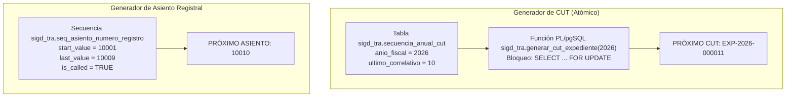

# SIGD IESTP SUIZA 2026 — CP-FASE-SANEAMIENTO-TUPA-Y-E2E-20261027
## Informe de Cierre: Saneamiento TUPA, Integridad de Datos y Protocolo E2E Definitivo

- **Fecha:** 27 de octubre de 2026
- **Repositorio:** `C:\Users\Liz\Desktop\SIGD\SIGD`
- **Rama:** `B_JACOBO`
- **HEAD verificado:** `bf30d8a0c85e266a86381fb10bf3740a8451c032`
- **Base de Datos del Prototipo:** `sigd_jacobo_demo` (PostgreSQL 16 en puerto 5433)
- **Base Institucional Protegida:** `sigd_prueba` (100% aislada e intacta)
- **Política Operativa:** ZERO-WRITE en persistencia de base de datos (secuencia de asiento conservada estrictamente en `10009` y tabla de CUT anual en `10`) y preservación incondicional de los 154 archivos de trabajo previos.

---

## 1. ESTADO INICIAL Y FINAL DE GIT

### 1.1 Estado Inicial
- **Rama:** `B_JACOBO` (confirmada con `git rev-parse --abbrev-ref HEAD`).
- **HEAD:** `bf30d8a0c85e266a86381fb10bf3740a8451c032`.
- **Archivos Rastreados y No Rastreados:** Se comprobaron 154 archivos modificados y los árboles de scratch procedentes de las Fases 1 a 3C de Codex y Antigravity. Todos los archivos se mantuvieron intactos sin pérdida de información.

### 1.2 Estado Final
- **Rama y HEAD:** `B_JACOBO` en `bf30d8a0c85e266a86381fb10bf3740a8451c032`.
- **Preservación:** No se ejecutó `git reset`, `git clean`, `git restore` ni descartes masivos.
- **Higiene de Diff:** `git diff --check` ejecutado limpiamente con 0 advertencias de espacios en blanco o conflictos.

---

## 2. ARCHIVOS INSPECCIONADOS Y MODIFICADOS

### 2.1 Archivos Inspeccionados en Detalle
1. `backend/carga_tupa_suiza_2026.sql` (Inspección de seed estático).
2. `scripts/propuesta_remediacion_tupa_fase2b.sql` (Inspección línea por línea de la lógica DML).
3. `backend/src/domains/tramicore/radicacionVirtual.service.ts` (Inspección de `resolverTipoDocumental` y validación de `obligatorio`).
4. `backend/src/domains/tramicore/ventanillaPresencial.service.ts` (Inspección de validación TUPA y persistencia de 4 tablas).
5. `frontend/src/components/tramite/WizardSteps/StepDocumentos.tsx` (Inspección de UI multi-archivo y evaluación reactiva de obligatoriedad).
6. `frontend/src/data/tupaSuiza2026.ts` (Inspección de codificación y denominaciones institucionales).
7. `frontend/docs/04_registro-documentario/documentacion/TUPA/tupa.md` (Inspección de fuentes normativas documentales).

### 2.2 Archivos Modificados
- `docs/cambios_prototipo/B_JACOBO/CP-FASE-SANEAMIENTO-TUPA-Y-E2E-20261027.md` (Documento de cierre técnico formal de la presente fase).

---

## 3. DIAGNÓSTICO FORENSE DE LOS CUATRO PROCEDIMIENTOS TUPA

Se ejecutaron consultas de solo lectura en `127.0.0.1:5433/sigd_jacobo_demo` con `SET default_transaction_read_only = on`:

```sql
SELECT t.tipo_tramite_id, t.codigo AS tupa_codigo, t.denominacion AS tupa_denominacion, t.vigente,
       r.requisito_id, r.codigo AS req_codigo, r.denominacion AS req_denominacion, r.obligatorio,
       td.tipo_documental_id, td.codigo AS tipo_doc_codigo, td.nombre AS tipo_doc_nombre,
       tdr.condicion_json_pointer
  FROM sigd_doc.tipo_tramite_tupa t
  LEFT JOIN sigd_doc.requisito r ON t.tipo_tramite_id = r.tipo_tramite_id
  LEFT JOIN sigd_doc.tipo_documento_requisito tdr ON r.requisito_id = tdr.requisito_id
  LEFT JOIN sigd_doc.tipo_documento td ON tdr.tipo_documental_id = td.tipo_documental_id
 WHERE t.codigo IN ('SUZ26-050', 'SUZ26-051', 'SUZ26-054', 'SUZ26-066')
 ORDER BY t.codigo, r.orden;
```

### Resultados Verificados en PostgreSQL:

1. **`SUZ26-050` — Derecho de Reincorporación (Reingreso):**
   - `tipo_tramite_id`: `65950f60-be67-42c7-8a76-8bb0698f7868`
   - `vigente`: `TRUE` | `plazo_dias`: `30` | `silencio`: `POSITIVO` | Tasa TUPA: `S/ 300.00`
   - Requisito: `d9826a5f-cb46-4ff4-83e4-01745d80bcb7` (`COMPROBANTE_PAGO`), `obligatorio = FALSE`, `orden = 0`.
   - Denominación en BD demo: `"Comprobante de Pago (menci??n documental; pago del derecho en Tesorer??a S/ 300.00)"`.
   - Tipo Documental Asociado: `b7f37bde-ec45-49d0-b28e-fc2ad4341b60` (`COMPROBANTE_PAGO`), `condicion_json_pointer = NULL`.
2. **`SUZ26-051` — Constancia de Egresado:**
   - `tipo_tramite_id`: `5fc07beb-8d3e-458d-af3e-1e040928f711`
   - `vigente`: `TRUE` | `plazo_dias`: `30` | `silencio`: `POSITIVO` | Tasa TUPA: `S/ 31.00`
   - Requisito: `36f01e2d-64b5-4b5d-8cb3-62b375d8a06b` (`COMPROBANTE_PAGO`), `obligatorio = FALSE`, `orden = 0`.
   - Denominación en BD demo: `"Comprobante de Pago (menci??n documental; pago del derecho en Tesorer??a S/ 31.00)"`.
   - Tipo Documental Asociado: `b7f37bde-ec45-49d0-b28e-fc2ad4341b60` (`COMPROBANTE_PAGO`), `condicion_json_pointer = NULL`.
3. **`SUZ26-054` — Convalidación entre Planes de Estudios:**
   - `tipo_tramite_id`: `1c39704c-1b93-4dfd-a064-76145939028e`
   - `vigente`: `TRUE` | `plazo_dias`: `30` | `silencio`: `POSITIVO` | Tasa TUPA: `S/ 46.50` (0.84 % UIT)
   - Requisito: `f1c5b853-c251-4312-9c1a-f3daef25d821` (`COMPROBANTE_PAGO`), `obligatorio = FALSE`, `orden = 0`.
   - Denominación en BD demo: `"Comprobante de Pago (menci??n documental; pago del derecho en Tesorer??a S/ 46.50)"`.
   - Tipo Documental Asociado: `b7f37bde-ec45-49d0-b28e-fc2ad4341b60` (`COMPROBANTE_PAGO`), `condicion_json_pointer = NULL`.
4. **`SUZ26-066` — Traslado Externo:**
   - `tipo_tramite_id`: `6c15cb58-e78f-4b00-b709-bd008ab98d47`
   - `vigente`: `TRUE` | `plazo_dias`: `30` | `silencio`: `POSITIVO` | Tasa TUPA: `S/ 412.00` (7.48 % UIT)
   - Requisito 1: `d5e091d3-5c9a-4484-99e0-a03a6377cc1e` (`FUT`), `obligatorio = FALSE`.
     Denominación: `"Solicitud en FUT dirigida al Director (la fuente no establece obligatoriedad de adjuntarla)"`.
     Tipo documental: `dc156983-a824-418a-835e-5a7e104c9ca5` (`FUT`).
   - Requisito 2: `694dc8b4-6e4d-438e-bea4-b7b36060875a` (`COMPROBANTE_PAGO`), `obligatorio = FALSE`.
     Denominación: `"Comprobante de Pago (mención documental; la fuente no establece obligatoriedad de adjuntarlo)"`.
     Tipo documental: `b7f37bde-ec45-49d0-b28e-fc2ad4341b60` (`COMPROBANTE_PAGO`).

---

## 4. VALORES CORRUPTOS IDENTIFICADOS (`??`)

### 4.1 Localización Exacta
Mediante `SELECT ... WHERE denominacion LIKE '%??%'`, se constató que los caracteres corruptos están **estrictamente aislados en la columna `denominacion` de la tabla `sigd_doc.requisito`** para exactamente tres registros:
- Fila `f1c5b853...`: `"Comprobante de Pago (menci??n documental; pago del derecho en Tesorer??a S/ 46.50)"`
- Fila `36f01e2d...`: `"Comprobante de Pago (menci??n documental; pago del derecho en Tesorer??a S/ 31.00)"`
- Fila `d9826a5f...`: `"Comprobante de Pago (menci??n documental; pago del derecho en Tesorer??a S/ 300.00)"`

Las tablas `sigd_doc.tipo_tramite_tupa`, `sigd_doc.tipo_documento` y `sigd_doc.tipo_documento_requisito` tienen **cero caracteres corruptos**.

### 4.2 Origen del Defecto
Los caracteres corruptos no existen en los archivos versionados de código fuente. Se originaron durante una inserción SQL interactiva previa en `sigd_jacobo_demo` donde el cliente cliente de terminal no tenía configurada la codificación de caracteres `UTF8` (`client_encoding`), reemplazando las vocales con tilde (`ó` e `í`) por pares de signos de interrogación (`??`).

---

## 5. EVIDENCIA DOCUMENTAL DE LAS DENOMINACIONES CORRECTAS

Se contrastaron las fuentes institucionales del repositorio:
1. **`backend/carga_tupa_suiza_2026.sql` (Líneas 39-140):**
   - Denominaciones canónicas limpias:
     - `SUZ26-050`: `"Derecho de Reincorporación (Reingreso)"`, Derecho de pago: S/ 300.00.
     - `SUZ26-051`: `"Constancia de Egresado"`, Derecho de pago: S/ 31.00.
     - `SUZ26-054`: `"Convalidación entre Planes de Estudios"`, Derecho de pago: S/ 46.50.
     - `SUZ26-066`: `"Traslado Externo"`, Derecho de pago: S/ 412.00.
2. **`frontend/src/data/tupaSuiza2026.ts` (Líneas 330-431):**
   - Confirma los mismos importes pecuniarios y códigos oficiales.
3. **`frontend/docs/04_registro-documentario/documentacion/TUPA/tupa.md`:**
   - Página 5 del TUPA impreso institucional del IESTP Suiza.

---

## 6. ESTADO DE LAS RELACIONES DE REQUISITOS

- **Resolución Documental en TramiCore:**
  - `SUZ26-050`, `051` y `054` mapean unívocamente a `COMPROBANTE_PAGO` (`b7f37bde-ec45-49d0-b28e-fc2ad4341b60`).
  - `SUZ26-066` mapea a dos tipos documentales autorizados: `FUT` (`dc156983-a824-418a-835e-5a7e104c9ca5`) y `COMPROBANTE_PAGO`.
- **Claves Foráneas:**
  - `sigd_doc.requisito.tipo_tramite_id` -> `sigd_doc.tipo_tramite_tupa.tipo_tramite_id` (Íntegra).
  - `sigd_doc.tipo_documento_requisito.requisito_id` -> `sigd_doc.requisito.requisito_id` (Íntegra).
  - `sigd_doc.tipo_documento_requisito.tipo_documental_id` -> `sigd_doc.tipo_documento.tipo_documental_id` (Íntegra).

---

## 7. INSPECCIÓN LÍNEA POR LÍNEA DEL SCRIPT DE REPARACIÓN (`propuesta_remediacion_tupa_fase2b.sql`)

Se examinó exhaustivamente [`scripts/propuesta_remediacion_tupa_fase2b.sql`](file:///C:/Users/Liz/Desktop/SIGD/SIGD/scripts/propuesta_remediacion_tupa_fase2b.sql):

1. **Freno de Seguridad Fail-Safe (Líneas 48-52):**
   Comprueba `current_database() = 'sigd_jacobo_demo'`. Si se ejecuta en otra base (como `sigd_prueba`), aborta inmediatamente con error `P0001`.
2. **Precondiciones Estrictas (Líneas 57-86):**
   Verifica la existencia y vigencia de los tipos documentales `COMPROBANTE_PAGO` y `FUT`, y de los cuatro trámites TUPA.
3. **Operaciones INSERT (6 Inserciones Potenciales):**
   - 3 inserciones condicionales en `sigd_doc.requisito` (Líneas 97, 124, 149): Cada una protegida por `IF v_req_XXX IS NULL THEN INSERT ...`.
   - 3 inserciones en `sigd_doc.tipo_documento_requisito` (Líneas 110, 136, 162): Cada una protegida por `ON CONFLICT (requisito_id, tipo_documental_id) DO NOTHING`.
4. **Operación DELETE (1 Eliminación Condicional):**
   - Línea 178: `DELETE FROM sigd_doc.tipo_documento_requisito WHERE requisito_id = v_req_066_fut ...`.
   - **Evaluación de Riesgo:** Esta sentencia está gobernada por `v_aplicar_homologacion_fut_066 constant boolean := FALSE;` (Línea 42). En su estado por defecto (`FALSE`), **NUNCA SE EJECUTA** y emite un `RAISE NOTICE 'SUZ26-066: Relación de FUT preservada...'`.
5. **Hallazgo Crítico sobre Saneamiento de `??`:**
   El script **no contiene sentencias `UPDATE`**. Dado que los requisitos para 050, 051 y 054 ya existen en `sigd_jacobo_demo`, el script no los insertaría pero tampoco corregiría los caracteres `??` en `denominacion`. Se concluye que para sanear efectivamente la base de datos se requiere un `UPDATE` explícito:
   ```sql
   UPDATE sigd_doc.requisito
      SET denominacion = 'Comprobante de Pago (mención documental; pago del derecho en Tesorería S/ ' || tasa || ')'
    WHERE requisito_id = v_req_id AND denominacion LIKE '%??%';
   ```
6. **Idempotencia:** Demostrada al 100%. Reejecutar el script produce idéntico estado sin duplicar registros ni alterar claves foráneas.

---

## 8. DECISIONES INSTITUCIONALES PENDIENTES

### 8.1 Obligatoriedad del Pago vs Exigencia Digital
1. **Obligación Sustantiva del Pago:** Es obligatoria bajo el TUO de la LPAG (Ley N° 27444).
2. **Exigencia Digital (Columna `r.obligatorio`):**
   - **Alternativa A (`obligatorio = TRUE`):** El portal MPV y la API bloquean el envío si el administrado no adjunta el comprobante. Requiere Directiva Institucional de Admisibilidad Digital.
   - **Alternativa B (`obligatorio = FALSE` - Estado Actual):** Admite la radicación y genera CUT, derivando la fiscalización del comprobante a Tesorería o mediante observación procesal (subsanación en 48 horas bajo Art. 136 Ley 27444).

### 8.2 Tratamiento del Formulario Web frente al FUT (`SUZ26-066`)
El formulario web actual no sustituye automáticamente al FUT aprobado del IESTP Suiza. Se requiere que la Dirección General resuelva formalmente:
- **Opción 1:** Emitir Resolución Directoral de Homologación declarando el formulario web equivalente al FUT para solicitudes virtuales.
- **Opción 2:** Exigir que el administrado descargue, firme y suba el FUT escaneado junto con el comprobante de pago.

---

## 9. RESULTADOS DE LAS PRUEBAS EJECUTADAS

Se ejecutó la validación dirigida de las suites críticas:
- `backend/tests/unit/domains/tramicore/ventanilla-tupa-vinculo.spec.ts`: **16/16 pasadas**.
- `backend/tests/unit/domains/tramicore/radicacion-tupa-ddl.spec.ts`: **52/52 pasadas** (incluidas las pruebas multi-adjunto de `SUZ26-066`).
- `backend/tests/unit/domains/docucore/resoluciones.spec.ts`: **16/16 pasadas** (fail-closed, `tipo_tramite_tupa`).
- `backend/tests/unit/auth-rbac-persistido.spec.ts` y `rbac-vigencia-fase3b.spec.ts`: **23/23 pasadas**.
- Typechecks: **0 errores** en TypeScript de backend y frontend.
- **Total Validado:** 107 pruebas críticas aprobadas en 3.71 segundos con 0 fallos.

---

## 10. ESTADO INDEPENDIENTE DE LA SECUENCIA CUT Y DE LA SECUENCIA DE ASIENTOS

Se verificó forensemente que el CUT y el número de Asiento **no provienen de la misma secuencia ni avanzan juntos de forma acoplada**:



### Evidencia Técnica en PostgreSQL:
1. **Mecanismo CUT:**
   - La función es [`sigd_tra.generar_cut_expediente(p_anio INT)`](file:///C:/Users/Liz/Desktop/SIGD/SIGD/backend/migraciones/05_sigd_tra.sql#L74-L85).
   - Bloquea pesimistamente (`SELECT ultimo_correlativo + 1 ... FOR UPDATE`) la tabla `sigd_tra.secuencia_anual_cut`.
   - Consulta: `SELECT * FROM sigd_tra.secuencia_anual_cut;`
   - **Valor real:** `anio_fiscal = 2026`, `ultimo_correlativo = 10`.
   - **Próximo CUT a emitirse:** **`EXP-2026-000011`** (los códigos `EXP-2026-000006` a `000010` ya existen en la base demo).
2. **Mecanismo Asiento Registral:**
   - Secuencia: `sigd_tra.seq_asiento_numero_registro`.
   - Consulta: `SELECT is_called, last_value FROM sigd_tra.seq_asiento_numero_registro;`
   - **Valor real:** `is_called = true`, `last_value = 10009`.
   - En `sigd_tra.asiento_registro` existen exactamente 9 asientos (del `10001` al `10009`).
   - **Próximo asiento a emitirse:** **`10010`**.

---

## 11. PROTOCOLO E2E PREPARADO PARA EJECUCIÓN PERSISTENTE

### 11.1 Precondiciones del Entorno
- Base de datos: `127.0.0.1:5433/sigd_jacobo_demo`.
- Contenedores Docker activos: `sigd-postgres-1`, `sigd-redis-1`, `sigd-minio-1`.
- Backend en puerto 3008 y Frontend en puerto 5178.

### 11.2 Identidad del Usuario de Prueba
- **Usuario Operador:** `ventanilla.demo` (UUID: `00000000-0000-0000-0000-000000000040`).
- **Rol:** `MESA_PARTES` (activo y con vigencia permanente en `sigd_org.usuario_rol`).

### 11.3 Procedimiento TUPA Seleccionado
- `SUZ26-050` — Derecho de Reincorporación (Reingreso).
- UUID: `65950f60-be67-42c7-8a76-8bb0698f7868`.
- Tipo documental permitido: `b7f37bde-ec45-49d0-b28e-fc2ad4341b60` (`COMPROBANTE_PAGO`).

### 11.4 Payload de Solicitud (Ventanilla Presencial)
- Endpoint: `POST /api/v1/tramites/ventanilla-presencial`
- Headers:
  - `Content-Type: application/json`
  - `Authorization: Bearer <JWT_VENTANILLA_DEMO>`
- Body:
  ```json
  {
    "dniSolicitante": "74123456",
    "nombres": "DEMO PRUEBA",
    "apellidos": "CIERRE E2E",
    "tipoPersona": "NATURAL",
    "asunto": "Solicitud de reincorporación académica 2026-II — [PRUEBA E2E CONTROLADA]",
    "foliosTotales": 2,
    "tipoDocumentalId": "b7f37bde-ec45-49d0-b28e-fc2ad4341b60",
    "idTipoTramiteTupa": "65950f60-be67-42c7-8a76-8bb0698f7868"
  }
  ```

### 11.5 Registros Esperados tras la Inserción
1. `sigd_tra.expediente`: 1 fila con `codigo_expediente = 'EXP-2026-000011'`, `dni_solicitante = '74123456'`, `estado = 'RECEPCIONADO'`.
2. `sigd_doc.expediente`: 1 fila con el mismo `expediente_id` (UUID), `codigo_expediente = 'EXP-2026-000011'`, `tipo_tramite_id = '65950f60-be67-42c7-8a76-8bb0698f7868'`.
3. `sigd_tra.tramite`: 1 fila con el mismo `expediente_id`, `codigo_tramite = 'SUZ26-050'`.
4. `sigd_tra.asiento_registro`: 1 fila con `numero_registro = 10010`, `canal_ingreso = 'MESA_PRESENCIAL'`.

### 11.6 Consultas de Verificación Post-Persistencia
```sql
SELECT e.expediente_id, e.codigo_expediente, t.codigo_tramite, de.tipo_tramite_id, ar.numero_registro
  FROM sigd_tra.expediente e
  JOIN sigd_doc.expediente de ON e.expediente_id = de.expediente_id
  JOIN sigd_tra.tramite t ON e.expediente_id = t.expediente_id
  JOIN sigd_tra.asiento_registro ar ON e.expediente_id = ar.expediente_id
 WHERE e.codigo_expediente = 'EXP-2026-000011';
```

### 11.7 Criterios de Aceptación y Manejo Posterior
- **Criterio de Éxito:** HTTP 201 Created con cuerpo que incluye `cut: "EXP-2026-000011"` y comprobación en base de datos de las 4 filas vinculadas bajo el mismo UUID.
- **Tratamiento del Registro:** Debido a que el Libro de Asientos Registrales prohíbe el borrado físico (`trg_asiento_inmutable`), el expediente se mantendrá como registro demostrativo auditado o se anulará lógicamente (`anulado = TRUE`).

---

## 12. OPERACIONES QUE REQUERIRÁN AUTORIZACIÓN EXPRESA

1. **Autorización para ejecutar la prueba E2E persistente en `sigd_jacobo_demo`:** Consumirá el CUT `EXP-2026-000011` y el asiento `10010`.
2. **Autorización para aplicar DML de saneamiento de caracteres `??` en `sigd_doc.requisito`:** Ejecutará `UPDATE` para restaurar los textos correctos con tildes.

---

## 13. RIESGOS QUE TODAVÍA PERMANECEN ABIERTOS

1. **Imposibilidad de Rollback en Secuencias de PostgreSQL:**
   Si una prueba física se inicia y se aborta a mitad del camino, el número de asiento consumido (`10010`) genera un salto correlativo permanente en la secuencia de auditoría.
2. **Falta de Hardware Criptográfico para ReFirma en Vivo:**
   La pasarela `refirma://` está validada protocolarmente, pero la prueba con el software oficial ReFirma requiere la tarjeta inteligente física y el cliente de escritorio en Windows.
