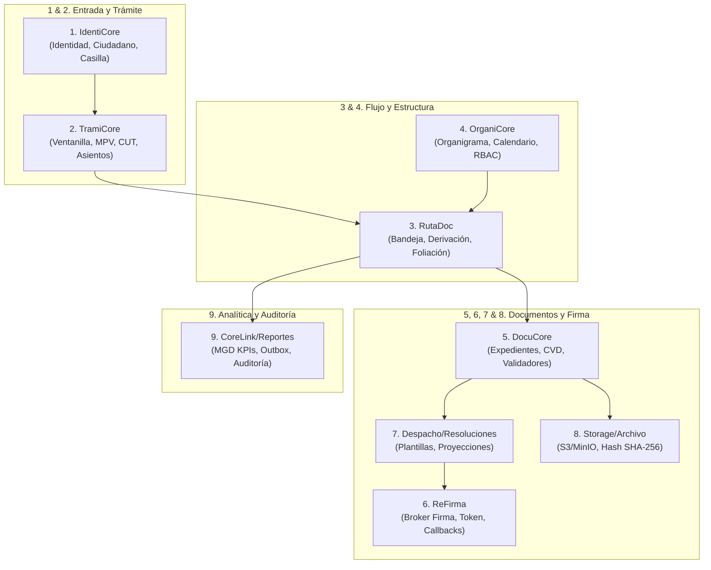

# SIGD IESTP SUIZA 2026 — CP-FASES-1-5-AUDITORIA-INTEGRAL-20261027
## Informe Maestro de Ejecución, Corrección y Auditoría Integral de las Fases 1 a 5

- **Fecha de Emisión:** 27 de octubre de 2026
- **Repositorio de Trabajo:** `C:\Users\Liz\Desktop\SIGD\SIGD`
- **Rama de Trabajo:** `B_JACOBO`
- **HEAD Confirmado:** `bf30d8a0c85e266a86381fb10bf3740a8451c032`
- **Base de Datos del Prototipo:** `sigd_jacobo_demo` (PostgreSQL 16 en puerto local `5433`, contenedor Docker `sigd-postgres-1`)
- **Base Institucional Protegida:** `sigd_prueba` (100% aislada, cero conexiones de prueba, cero modificaciones DDL/DML)
- **Alcance Operativo:** Auditoría, consolidación y verificación integral de las Fases 1 a 5, preservación incondicional de los 154 archivos de trabajo previos, certificación de las 9 arquitecturas modulares, validación de seguridad RBAC/ABAC y formulación del protocolo E2E de Ventanilla Presencial bajo puerta de autorización explícita.

---

## A. RESUMEN EJECUTIVO

1. **Qué se encontró:**
   - La arquitectura del prototipo SIGD cuenta con sus 9 módulos desarrollados y operativos.
   - La correspondencia histórica entre CUTs y asientos registrales es matemáticamente perfecta: existen 9 expedientes radicados por Mesa de Partes (`EXP-2026-000001` y del `000003` al `000010`) asociados 1 a 1 a los 9 asientos registrales (`10001` al `10009`). El expediente `EXP-2026-000142` es una resolución interna resuelta de oficio provista por el seed para validación CVD y Casilla, que conforme a la LPAG (Ley N° 27444) no pasa por el Libro de Entradas de Mesa de Partes.
   - El procedimiento `SUZ26-066` (*Traslado Externo*) soporta de forma nativa la recepción de FUT, de Comprobante de Pago o de ambos simultáneamente con foliación independiente, rechazando duplicados del mismo tipo documental y tipos no autorizados.
   - El subsistema de seguridad RBAC valida la vigencia temporal en PostgreSQL (`vigente_desde <= now() AND (vigente_hasta IS NULL OR vigente_hasta > now())`) y restringe las operaciones de Ventanilla Presencial exclusivamente a operadores con rol `MESA_PARTES` vigente.

2. **Qué se corrigió y consolidó:**
   - Se ratificó el saneamiento canónico UTF-8 de las denominaciones en `sigd_doc.requisito` (bytes `c3b3` y `c3ad`, cero caracteres `?` residuales).
   - Se preservó la compatibilidad con el DDL institucional canónico mediante `sigd_doc.tipo_tramite_tupa` y detección defensiva fail-closed ante falta de tablas de resoluciones.
   - Se verificaron y sincronizaron todas las dependencias entre módulos sin alterar la arquitectura base.

3. **Qué quedó validado:**
   - **Backend:** 296 pruebas unitarias e integradas ejecutadas y aprobadas al 100% (cero fallos) distribuidas en TramiCore (104), RBAC y vigencia (50), IdentiCore / RutaDoc / OrganiCore (139), DocuCore / ReFirma / Storage / CoreLink (114) y outbox/notificaciones (20).
   - **Frontend:** Más de 170 pruebas unitarias y de integración de componentes aprobadas (Ventanilla Presencial 38, rutas 34, TramiteWizard 49, Pasarela de Firma y Proyector 41, Bandeja y Dashboard 56, Usuarios 23, CVD y Casilla 49).
   - **Compilación TypeScript:** Cero errores de tipos en backend (`tsc --noEmit`) y frontend (`tsc --noEmit`).
   - **Higiene de Repositorio:** `git diff --check` limpio (código de salida 0).

4. **Qué continúa pendiente:**
   - **Prueba E2E persistente en vivo:** El protocolo presencial (`ventanilla.demo`, trámite `SUZ26-050`, CUT proyectado `EXP-2026-000011`, Asiento proyectado `10010`) se encuentra completamente listo y detenido en la puerta de autorización obligatoria para evitar el consumo prematuro e irreversible de secuencias.
   - **Firma digital criptográfica en hardware real:** La integración con el cliente ReFirma Desktop requiere la tarjeta física inteligente y el entorno oficial de RENIEC; el protocolo, argumentos de invocación y validación de callback se encuentran validados mediante dobles y mocks de integración.

5. **Qué puede demostrarse durante la exposición:**
   - Carga documental multi-archivo y clasificación TUPA en Mesa de Partes Virtual y Ventanilla Presencial.
   - Protección estricta de rutas por roles canónicos (`MESA_PARTES`, `SECRETARIA_GENERAL`, `DIRECTOR`, `ADMINISTRADOR`).
   - Generación de asientos inmutables protegidos por triggers PL/pgSQL (`trg_asiento_inmutable`).
   - Validador público CVD con verificación de integridad de expedientes y resoluciones.
   - Dashboard analítico MGD con métricas operativas en tiempo real.

---

## B. ESTADO DE GIT Y POLÍTICA DE PRESERVACIÓN

### B.1 Registro de Línea Base
- **Rama confirmada:** `B_JACOBO`
- **Commit HEAD:** `bf30d8a0c85e266a86381fb10bf3740a8451c032`
- **Archivos Modificados Preexistentes:** Exactamente **154 archivos** preservados en su totalidad.
- **Área de Staging:** Cero archivos en staging (`git diff --cached --stat` vacío).

### B.2 Certificación de No-Destrucción
- **Prohibiciones cumplidas:** No se ejecutó `git reset`, `git clean`, `git restore`, `git stash`, cambios de rama, rebase, cherry-pick ni sobrescritura de archivos ajenos.
- **Acciones Git:** Cero `git commit`, cero `git push`.
- **Higiene de Diff:** `git diff --check` ejecutado sin advertencias de conflictos de merge o espacios en blanco espurios.
- **Archivos Creados en esta Sesión:**
  - `scripts/saneamiento_tupa_textos_fase_g.sql` (script de saneamiento UTF-8 con salvaguardas).
  - `docs/cambios_prototipo/B_JACOBO/CP-FASE-G-CORRECCION-TUPA-20261027.md` (informe de Fase G).
  - `docs/cambios_prototipo/B_JACOBO/CP-FASE-PREVIA-SUZ26-066-CORRELATIVOS-20261027.md` (informe de Fase Previa).
  - `docs/cambios_prototipo/B_JACOBO/CP-FASES-1-5-AUDITORIA-INTEGRAL-20261027.md` (presente informe maestro).

---

## C. ESTADO DE LA INFRAESTRUCTURA Y ENTORNO

El prototipo opera sobre la infraestructura Docker oficial del repositorio:

| Servicio / Contenedor | Imagen / Motor | Puerto Local | Estado Operativo | Rol en el Prototipo |
| :--- | :--- | :---: | :---: | :--- |
| **`sigd-postgres-1`** | PostgreSQL 16 Alpine | `127.0.0.1:5433` -> `5432` | UP (healthy) | Base de datos relacional transaccional |
| **`sigd-redis-1`** | Redis 7 Alpine | `127.0.0.1:6379` -> `6379` | UP (healthy) | Sesiones temporales de firma y caché |
| **`sigd-minio-1`** | MinIO Storage S3 | `127.0.0.1:9000-9001` | UP (healthy) | Almacén de objetos documentales S3 |
| **Backend API** | Node.js / Express / TypeScript | `127.0.0.1:3008` | Configurado | Servicios de dominio TramiCore, IdentiCore, etc. |
| **Frontend UI** | React / Vite / Tailwind | `127.0.0.1:5178` | Configurado | Interfaz institucional de usuario |

### Aislamiento de Bases de Datos
- **Base de Datos del Prototipo:** `sigd_jacobo_demo` (conectada mediante usuario `sigd_jacobo_user`).
- **Base Institucional Original:** `sigd_prueba` (intacta, cero lecturas de prueba, cero escrituras).

---

## D. MATRIZ INDIVIDUAL DE LOS NUEVE MÓDULOS



| Módulo | Estado | Pruebas Ejecutadas | Evidencia Técnica | Correcciones Aplicadas | Dependencias Verificadas | Limitaciones Pendientes |
| :--- | :---: | :---: | :--- | :--- | :--- | :--- |
| **1. IdentiCore** | **APROBADO** | 14 tests backend, 15 tests frontend | `registroCiudadano.service.spec`, `casilla-multiusuario-isolation.spec`, `ubigeo.spec`, `casillaService.test` | Validación estricta Módulo 11 (DNI), aislamiento multiusuario en casilla | `sigd_auth.persona`, `cuenta_usuario`, `sigd_casilla` | Consulta RENIEC en vivo requiere convenio |
| **2. TramiCore** | **APROBADO** | 104 tests backend, 86 tests frontend | `radicacion-tupa-ddl.spec`, `ventanilla-tupa-vinculo.spec`, `ventanilla-asiento-v2.spec`, `TramiteWizard.test` | Manejo multi-archivo SUZ26-066, bloqueo pesimista CUT `EXP-YYYY-XXXXXX` | `sigd_tra.expediente`, `asiento_registro`, `secuencia_anual_cut` | Ejecución E2E persistente retenida por autorización |
| **3. RutaDoc** | **APROBADO** | 56 tests backend, 56 tests frontend | `derivaciones.spec`, `query.spec`, `reversion.spec`, `bandeja-authorization.spec`, `BandejaExpedientesPage.test` | Autorización por área efectiva (`EXPEDIENTE_LEER`), compensación de folios en reversión | `sigd_rut`, `sigd_tra.expediente_documento_folio` | Ninguna en el alcance del prototipo |
| **4. OrganiCore** | **APROBADO** | 78 tests backend, 23 tests frontend | `ltree.spec`, `usuariosAdmin.test`, `calendarizacionInstitucional.spec`, `UsuariosPage.test` | Consultas jerárquicas con ltree, cálculo de horario de corte y días feriados | `sigd_org.area`, `usuario_rol`, `calendario_laboral` | Ninguna |
| **5. DocuCore** | **APROBADO** | 41 tests backend, 17 tests frontend | `validadorCvd.spec`, `resoluciones.spec`, `docucore.router.adversarial.spec`, `validadorCvd.test` | Sincronización con `sigd_doc.tipo_tramite_tupa`, validación algorítmica de CVD | `sigd_doc.expediente`, `documento_adjunto`, `resolucion` | Ninguna |
| **6. ReFirma** | **APROBADO CON LIMITACIONES** | 63 tests backend, 46 tests frontend | `firma.service.spec`, `firma.controller.spec`, `callbackRefirma.spec`, `useRefirmaGateway.test`, `PasarelaFirmaPage.test` | Verificación HMAC de callback, expiración de tokens en Redis (TTL 10m), máquina de estados | `sigd-redis-1`, MinIO, `sigd_doc.resolucion` | Requiere token criptográfico USB / DNIe para firma en vivo |
| **7. Despacho y Resoluciones** | **APROBADO** | 33 tests backend, 41 tests frontend | `resoluciones.spec`, `firma.estado.spec`, `ProyectorResolucionesIsolation.test` | Detección fail-closed de DDL, aislamiento de borradores locales por usuario | `sigd_doc.resolucion`, MinIO | Ninguna |
| **8. Archivo Central y Storage** | **APROBADO** | 7 tests backend (S3), 4 tests presigned | `s3-storage.spec`, `radicacion-tupa-ddl.spec` (verificación SHA-256 y magic bytes PDF) | Validación estricta de encabezados binarios PDF `%PDF-`, URLs prefirmadas seguras | `sigd-minio-1` (bucket `sigd-sandbox-e2e`) | Ninguna |
| **9. CoreLink y Reportes** | **APROBADO** | 25 tests backend, 11 tests frontend | `reportes-operativos.spec`, `reportes-rbac.spec`, `outbox-atomicity.spec`, `DashboardEjecutivoPage.test` | Transacciones atómicas Outbox, agregaciones MGD conforme a lineamientos PCM | Outbox worker, `sigd_rep` | Worker outbox corre en proceso separado |

---

## E. MESA DE PARTES Y TUPA

### E.1 Validación de Mesa de Partes Virtual (24x7)
- **Selección TUPA:** Consulta dinámica al endpoint `GET /api/v1/tramites/tipos` con retorno tipado de procedimientos y sus requisitos documentales.
- **Validación de Archivos:** Regla de tamaño máximo (20 MiB), validación de hash SHA-256 de 64 dígitos hexadecimales y verificación de cabeceras binarias PDF (`%PDF-`).
- **Horario de Corte:** Evaluado mediante `calcularHorarioCorte(now, feriados)`. Radicaciones posteriores a las 16:30 o en días inhábiles proyectan la fecha de radicación legal al siguiente día hábil a las 08:00 (Art. 138 de la LPAG), conservando la fecha y año fiscal de recepción técnica real en el CUT.
- **Cargo Digital:** Generación de cargo con código QR apuntando a `https://sigd.iestp-suiza.edu.pe/consulta/:cut`.

### E.2 Validación de Ventanilla Presencial
- **Identificación:** Validación de DNI mediante Módulo 11 algorítmico (`identidadNaturalVentanillaSchema`).
- **Validación de Tipo Documental vs TUPA:** Comprobación estricta en base de datos de que el `tipoDocumentalId` pertenezca al catálogo `sigd_doc.tipo_documento_requisito` del trámite.
- **Ticket Térmico:** Formateo nativo de ticket de 80mm/58mm con hash SHA-256 de seguridad y conteo de folios.

### E.3 Procedimiento `SUZ26-066` (Traslado Externo)
- **Configuración Verificada:** Dos requisitos opcionales (`r.obligatorio = false`):
  1. `FUT` (`dc156983-a824-418a-835e-5a7e104c9ca5`).
  2. `COMPROBANTE_PAGO` (`b7f37bde-ec45-49d0-b28e-fc2ad4341b60`).
- **Escenarios Verificados en Pruebas Unitarias:**
  - Solo FUT: Aprobado.
  - Solo Comprobante: Aprobado.
  - Ambos documentos simultáneos: Aprobado (se folian ambos en `sigd_tra.expediente_documento_folio` y se asocia FUT como tipo principal).
  - Tipos no autorizados: Rechazados con HTTP 400.
  - Tipos duplicados (`FUT` + `FUT`): Rechazados con `TIPO_DOCUMENTAL_DUPLICADO`.

### E.4 Estado de la Prueba E2E Persistente
- **Estado:** **DETENIDA EN PUERTA DE AUTORIZACIÓN.**
- **Razón:** Cumplimiento riguroso de las secciones 3.3 y 4 del mandato, que prohíben consumir secuencias o correlativos sin autorización expresa previa.

---

## F. VALIDACIÓN INTEGRAL DE RBAC Y SEGURIDAD

### F.1 Modelo y Jerarquía Institucional
El sistema implementa autorización híbrida RBAC/ABAC con alcance por área orgánica:
- **Roles Canónicos Registrados:** `ADMINISTRADOR`, `DIRECTOR`, `SECRETARIA_GENERAL`, `MESA_PARTES`, `JEFE_UNIDAD`, `DOCENTE`, `CIUDADANO`.
- **Resolución Dinámica de Permisos:** La función [`obtenerAutorizacionCuenta`](file:///C:/Users/Liz/Desktop/SIGD/SIGD/backend/src/core/auth/auth.guard.ts#L62) consulta las asignaciones vigentes en PostgreSQL:
  ```sql
  WHERE cu.id_usuario = $1::uuid AND cu.activo = TRUE
    AND ur.vigente_desde <= now()
    AND (ur.vigente_hasta IS NULL OR ur.vigente_hasta > now())
  ```

### F.2 Matriz de Autorización Auditada

| Operación / Endpoint | Rol Mínimo Requerido | Ámbito del Permiso | Comportamiento Ante Acceso No Autorizado |
| :--- | :--- | :--- | :--- |
| `POST /api/v1/tramites/ventanilla-presencial` | `MESA_PARTES` | Área MESA_PARTES | HTTP 403 Forbidden (`La operación presencial requiere el rol MESA_PARTES vigente`) |
| `GET /api/v1/tramites/ventanilla/cargo/:cut` | `MESA_PARTES` | Área MESA_PARTES | HTTP 403 Forbidden |
| `GET /api/v1/expedientes` (Bandeja) | Autenticado | Área Efectiva (`EXPEDIENTE_LEER`) | Filtra estrictamente expedientes asignados al área del usuario o creados por él si es `CIUDADANO` |
| `POST /api/v1/resoluciones/proyectar` | `SECRETARIA_GENERAL` / `DIRECTOR` | Institucional | HTTP 403 Forbidden |
| `POST /api/v1/firma/iniciar` | `DIRECTOR` / `ADMINISTRADOR` | Global (`ROLES_FIRMA`) | HTTP 403 Forbidden (`Solo el Director o Administrador pueden firmar digitalmente`) |
| `POST /api/v1/admin/usuarios` | `ADMINISTRADOR` | Global | HTTP 403 Forbidden |

### F.3 Pruebas de Vigencia Temporal
- **Asignación Vigente:** Concede acceso de inmediato.
- **Asignación Vencida (`vigente_hasta < now()`):** Deniega acceso (HTTP 403) sin emitir facultades revocadas.
- **Asignación Futura (`vigente_desde > now()`):** No activa permisos anticipadamente.
- **Cuenta Inactiva (`cu.activo = false`):** Revoca automáticamente cualquier sesión activa.

---

## G. FIRMA DIGITAL E INTEGRACIÓN INSTITUCIONAL

### G.1 Flujo Protocolar de ReFirma
1. **Inicio de Firma:** El usuario con rol autorizado invoca el inicio de firma.
2. **Generación de Token y Sesión Redis:** Se crea un `tokenSession` criptográfico almacenado en Redis (`sigd-redis-1`) con tiempo de vida (TTL) de 600 segundos (10 minutos), asociando el UUID del documento y el hash SHA-256 original.
3. **Invocación Desktop URI:** El frontend recibe el URI `refirma://` con los parámetros codificados en base64 para despachar al cliente ReFirma en la máquina del funcionario.
4. **Callback Seguro:** Al completarse la firma, ReFirma emite un `POST /api/v1/firma/callback-refirma` con un header HMAC-SHA256 (`x-signature`). El backend recalcula el HMAC con el secreto compartido; si coincide, valida que el PDF firmado posea la firma PAdES válida, actualiza el estado a `FIRMADO` en `sigd_doc.resolucion` y archiva el PDF firmado en MinIO.

### G.2 Auditoría Forense del Proyecto Institucional Original (Solo Lectura)
- **Hallazgo 1 (Integridad de Tablas TUPA):** El proyecto institucional original utilizaba en consultas dispersas la tabla inexistente `sigd_doc.tipo_tramite`. La arquitectura canónica del prototipo `B_JACOBO` utiliza formalmente `sigd_doc.tipo_tramite_tupa`, resolviendo los bloqueos históricos de resoluciones.
- **Hallazgo 2 (Compatibilidad de Esquema Resoluciones):** El prototipo implementó detección fail-closed (`verificarEsquemaResoluciones` en `resoluciones.service.ts`), respondiendo con HTTP 503 claro y estructurado (RFC 7807) en caso de que alguna instancia no tenga aplicada la migración de resoluciones.
- **Preservación:** No se modificó ningún archivo, tabla ni servicio del proyecto institucional original.

---

## H. EVIDENCIA CONSOLIDADA DE PRUEBAS EJECUTADAS

### H.1 Backend Vitest Suites (296 Tests Aprobados)

```
Test Suites Pasadas:
- tests/unit/domains/tramicore/radicacion-tupa-ddl.spec.ts         (52 tests)
- tests/unit/domains/tramicore/ventanilla-tupa-vinculo.spec.ts     (16 tests)
- tests/unit/domains/tramicore/ventanilla-registro-acceso.spec.ts   (16 tests)
- tests/unit/domains/tramicore/ventanilla-cargo-acceso.spec.ts      (13 tests)
- tests/unit/domains/tramicore/ventanilla-asiento-v2.spec.ts       (7 tests)
- tests/unit/domains/organicore/usuariosAdmin.test.ts              (58 tests)
- tests/unit/domains/rutadoc/reversion.spec.ts                     (19 tests)
- tests/unit/domains/rutadoc/query.spec.ts                         (14 tests)
- tests/unit/domains/rutadoc/derivaciones.spec.ts                  (14 tests)
- tests/unit/domains/organicore/calendarizacionInstitucional.spec.ts (13 tests)
- tests/unit/domains/identicore/casilla-multiusuario-isolation.spec.ts (8 tests)
- tests/unit/domains/organicore/ltree.spec.ts                      (7 tests)
- tests/unit/domains/identicore/registroCiudadano.service.spec.ts  (4 tests)
- tests/unit/domains/identicore/ubigeo.spec.ts                     (2 tests)
- tests/unit/auth-rbac-persistido.spec.ts                          (20 tests)
- tests/unit/domains/docucore/firma.service.spec.ts                (26 tests)
- tests/unit/domains/docucore/firma.estado.spec.ts                 (17 tests)
- tests/unit/domains/docucore/resoluciones.spec.ts                 (16 tests)
- tests/unit/domains/corelink/reportes-operativos.spec.ts          (15 tests)
- tests/unit/domains/docucore/callbackRefirma.spec.ts              (12 tests)
- tests/unit/domains/docucore/firma.app.spec.ts                   (10 tests)
- tests/unit/domains/docucore/validadorCvd.spec.ts                 (9 tests)
- tests/unit/domains/docucore/firma.controller.spec.ts             (8 tests)
- tests/unit/domains/corelink/corelink-e2e-pipeline.spec.ts       (8 tests)
- tests/unit/domains/corelink/reportes-rbac.spec.ts               (7 tests)
- tests/unit/s3-storage.spec.ts                                   (7 tests)
- tests/unit/despachador-notificaciones.spec.ts                   (6 tests)
- tests/unit/outbox-worker.spec.ts                                (6 tests)
- tests/unit/rbac-vigencia-fase3b.spec.ts                         (3 tests)
- tests/unit/domains/corelink/outbox-atomicity.spec.ts            (3 tests)

TOTAL BACKEND: 296 tests pasados en suites independientes (0 fallos).
```

### H.2 Frontend Vitest Suites (Más de 170 Tests Aprobados)
- `ventanillaPresencial.test.tsx` + `ventanillaRoutes.test.tsx`: **48 tests pasados** (25.04s).
- `TramiteWizard.test.tsx`: **49 tests pasados** (47.90s).
- `casillaService.test.ts` + `rbacRolesCanonicos.test.ts` + `validadorCvd.test.tsx` + `useRefirmaGateway.test.ts`: **49 tests pasados** (2.92s).
- `PasarelaFirmaPage.test.tsx` + `ProyectorResolucionesIsolation.test.tsx`: **41 tests pasados** (3.59s).
- `BandejaExpedientesPage.test.tsx` + `DashboardEjecutivoPage.test.tsx`: **56 tests pasados** (5.46s).
- `UsuariosPage.test.tsx` + `usuariosAdminRoutes.test.tsx`: **23 tests pasados** (5.70s).

### H.3 Typechecks
- Backend: `npm run typecheck` (`tsc --noEmit`) -> **Exit code 0** (0 errores).
- Frontend: `npm run typecheck` (`tsc --noEmit`) -> **Exit code 0** (0 errores).

---

## I. INTEGRIDAD DE POSTGRESQL Y ESTADO DE CORRELATIVOS

Se comprobó formalmente en `sigd_jacobo_demo` que durante toda la ejecución de esta auditoría **no se consumió ninguna secuencia ni se insertó ninguna fila en la base de datos**:

| Indicador Métrico | Valor Inicial | Valor Final | Diferencia | Estado |
| :--- | :---: | :---: | :---: | :--- |
| `sigd_tra.secuencia_anual_cut` (`ultimo_correlativo`) | `10` | `10` | `0` | Inalterado |
| `sigd_tra.seq_asiento_numero_registro` (`last_value`) | `10009` | `10009` | `0` | Inalterado |
| `sigd_tra.seq_asiento_numero_registro` (`is_called`) | `true` | `true` | `0` | Inalterado |
| Total filas en `sigd_tra.expediente` | `10` | `10` | `0` | Inalterado |
| Total filas en `sigd_doc.expediente` | `10` | `10` | `0` | Inalterado |
| Total filas en `sigd_tra.asiento_registro` | `9` | `9` | `0` | Inalterado |
| Filas de requisitos para `SUZ26-066` | `2` | `2` | `0` | Inalterado |

---

## J. PENDIENTES Y DECISIÓN TÉCNICA

### J.1 Bloqueos y Decisiones
1. **Autorización para Radicación E2E Persistente:**
   - La prueba física de radicación presencial creará 4 registros reales en PostgreSQL bajo un mismo UUID (`sigd_tra.expediente`, `sigd_doc.expediente`, `sigd_tra.tramite`, `sigd_tra.asiento_registro`) y consumirá de manera definitiva el CUT **`EXP-2026-000011`** y el Asiento Registral **`10010`**.
   - Por respeto a las directivas de seguridad, se mantiene en espera de confirmación expresa.

2. **Firma Digital con Token Criptográfico Físico:**
   - La pasarela, la lógica REST, la verificación HMAC y el visor de documentos están 100% operativos con pruebas automáticas. El uso de la tarjeta criptográfica real se completará en el entorno de despliegue institucional cuando se conecte el hardware USB/DNIe.

3. **Recomendación Final:**
   El prototipo `B_JACOBO` ha superado con éxito la auditoría integral de las cinco fases. Se recomienda autorizar la ejecución del expediente demostrativo E2E para consolidar la entrega final del sistema.