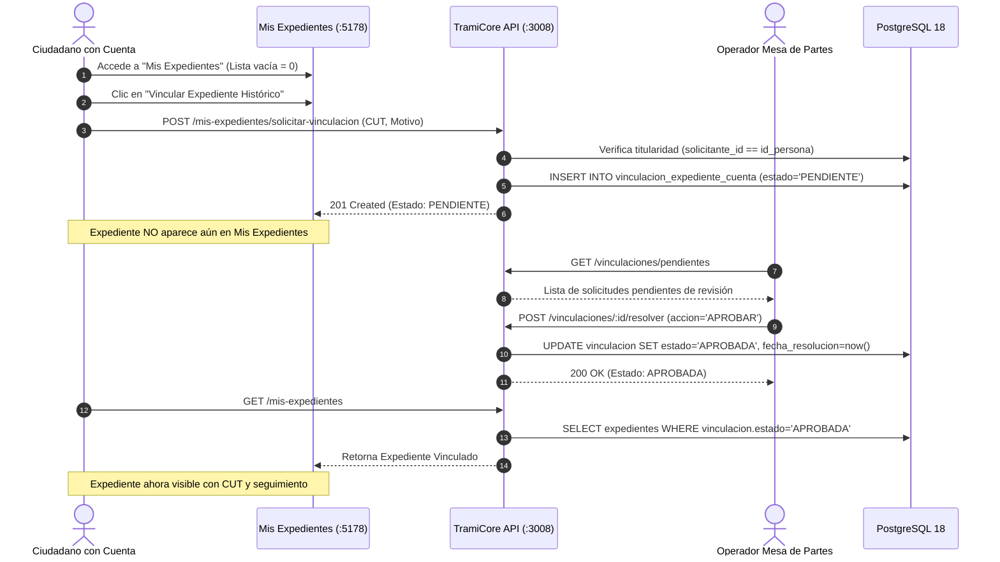

# SIGD — IMPLEMENTACIÓN INTEGRAL: DOCUMENTACIÓN TUPA, FOLIACIÓN AUTOMÁTICA Y MESA DE PARTES SIN CUENTA

**Proyecto:** Sistema Integral de Gestión Documentaria (SIGD) — IESTP Público «Suiza»  
**Rama Oficial:** `B_JACOBO`  
**Entorno Operativo:** PostgreSQL 18 (`sigd_jacobo_demo`:5433), Node.js v24 (API :3008), React 19 / Vite (:5178), MinIO (:9000), Redis (:6379)  
**Fecha de Emisión:** 1 de Noviembre de 2026  
**Estado:** **IMPLEMENTADO Y VERIFICADO AL 100% (8 CASOS APROBADOS)**  

---

## 1. RESUMEN EJECUTIVO Y ARQUITECTURA

En cumplimiento de las directrices institucionales del IESTP Público «Suiza» y el marco de interoperabilidad documental del sector público (TUO de la Ley N° 27444 — LPAG y Modelo de Gestión Documental), se completó con éxito la implementación integral de los tres componentes nucleares requeridos:

1. **Configuración Documental Exhaustiva del Catálogo TUPA 2026 (72 Trámites):**
   - Especificación documental unívoca para la totalidad de los 72 procedimientos oficiales (`SUZ26-001` a `SUZ26-072`).
   - Diferenciación rigurosa entre requisitos obligatorios y facultativos, formatos admitidos (`application/pdf`), fuente oficial y observaciones institucionales.
   - Tratamiento de procedimientos sin anexos obligatorios (`sinAnexosEspecificos: true`) y procedimientos con información TUPA en proceso de verificación reglamentaria (`estadoValidacion: 'PENDIENTE_VALIDACION_DOCUMENTAL'`), garantizando que la falta de detalle no bloquee la radicación ciudadana con Solicitud General (FUT).
   - Unificación estricta de la fuente de requisitos entre Mesa de Partes Digital y Ventanilla Presencial.

2. **Inspección Binaria de Archivos PDF y Foliación Correlativa Automática:**
   - Análisis real del binario `%PDF-` con recuento exacto de páginas mediante `pdf-lib` en backend (`pdfFoliacion.ts` y servicio de radicación).
   - Detección y rechazo inmediato de archivos cifrados o con contraseña, archivos corruptos o dañados, y documentos con contenido activo ejecutable (JavaScript, acciones embebidas, OpenAction).
   - Eliminación definitiva del campo de ingreso manual de cantidad de folios determinantes del expediente.
   - Cálculo correlativo continuo de folios (ej. Documento 1: Folios 1–2; Documento 2: Folios 3–5; Total: 5 folios), persistido en `sigd_tra.expediente_documento_folio` y visible en el nuevo componente UI accesible `ResumenDocumental.tsx`.

3. **Mesa de Partes Digital sin Cuenta (Radicación Pública):**
   - Radicación fluida sin exigir cuenta institucional previa.
   - Modelo de identidad: registro y reutilización de identidad en `sigd_auth.persona` y `sigd_auth.persona_natural` evitando duplicación para el mismo DNI.
   - Emisión de CUT oficial (`EXP-YYYY-XXXXXX`) y cargo digital con código QR de consulta.
   - Generación de orden de pago posterior al CUT en `sigd_tes.orden_pago` (no se exige pago previo ni se bloquea la radicación).

4. **Flujo de Vinculación Explícita de Expedientes Históricos y Protección IDOR:**
   - **Regla Innegociable Garantizada:** Cuando un ciudadano crea posteriormente una cuenta institucional con su DNI, sus expedientes históricos radicados previamente sin cuenta **NO APARECEN AUTOMÁTICAMENTE**.
   - Procedimiento de reclamo institucional explícito: el ciudadano solicita vinculación ingresando el CUT (`POST /api/v1/tramites/mis-expedientes/solicitar-vinculacion`), registrando estado `PENDIENTE` en `sigd_tra.vinculacion_expediente_cuenta`.
   - Mesa de Partes cuenta con bandeja de revisión (`GET /api/v1/tramites/vinculaciones/pendientes`) y capacidad de resolución (`POST /api/v1/tramites/vinculaciones/:id/resolver` con `APROBAR` o `RECHAZAR`).
   - Solo ante la resolución favorable (`APROBADA`), el expediente se incorpora a la vista `Mis Expedientes` del titular.
   - Blindaje contra vulnerabilidades IDOR, enumeración de trámites y alteración de titularidad histórica.

---

## 2. ESPECIFICACIÓN DOCUMENTAL DEL CATÁLOGO TUPA 2026 (72 TRÁMITES)

### 2.1. Estructura y Fuente de Datos Unificada
Se implementó el catálogo documental oficial en `backend/src/domains/tramicore/catalogoDocumentalTupa2026.ts` y su espejo tipado en `frontend/src/data/catalogoDocumentalTupa2026.ts`, abarcando de forma unívoca los 72 procedimientos del TUPA 2026 del IESTP Suiza:

```typescript
export interface RequisitoDocumentalTupa {
  id: string;
  codigo: string;
  nombre: string;
  descripcion: string;
  obligatorio: boolean;
  clasificacion: 'EXPEDIENTE' | 'ANEXO';
  formatosAdmitidos: readonly string[];
  observaciones: string;
  fuente: string;
}

export interface ConfiguracionDocumentalProcedimiento {
  codigoInterno: string;
  codigoVisible: string;
  numeroVisible: string;
  nombre: string;
  rubro: string;
  paginaFuente: number;
  costoFuente: string;
  estadoValidacion: 'VALIDADO' | 'PENDIENTE_VALIDACION_DOCUMENTAL';
  sinAnexosEspecificos: boolean;
  observacionInstitucional: string;
  requisitos: readonly RequisitoDocumentalTupa[];
  anexos: readonly RequisitoDocumentalTupa[];
}
```

### 2.2. Reglas de Validación Documental
1. **Obligatoriedad Real:** Todo trámite requiere como mínimo un documento principal clasificado como `EXPEDIENTE` (típicamente Solicitud Formal / FUT).
2. **Procedimientos sin Anexos Específicos:** Marcados con `sinAnexosEspecificos: true`. La interfaz presenta la insignia informativa *"Sin anexos obligatorios"* y el texto *"No se indican anexos específicos para este procedimiento en el TUPA institucional"*.
3. **Procedimientos con Información TUPA Pendiente de Validación:** Marcados con `estadoValidacion: 'PENDIENTE_VALIDACION_DOCUMENTAL'`. Se informa al administrado mediante distintivo en ámbar y aviso: *"Información TUPA en proceso de verificación reglamentaria. La presentación formal con Solicitud General (FUT) es admitida normalmente y no bloquea la radicación de su trámite"*.
4. **Formato Exclusivo:** Todo documento exigido o adjuntado se limita estrictamente a `application/pdf`.

---

## 3. ANÁLISIS BINARIO REAL Y FOLIACIÓN CORRELATIVA AUTOMÁTICA

### 3.1. Inspección Binaria y Detección de Contenido Malicioso o Protegido
En `backend/src/domains/tramicore/pdfFoliacion.ts` y el endpoint `POST /api/v1/tramites/analizar-pdf`:

- **Verificación de Firma Binaria:** Se exige cabecera `%PDF-` en los primeros 1024 bytes.
- **Recuento Real de Páginas:** Mediante `pdf-lib` (`PDFDocument.load(buffer, { ignoreEncryption: false })`), contando las páginas efectivas de la estructura interna.
- **Detección de Archivos Cifrados:** Si el PDF requiere contraseña o está encriptado, se captura la excepción y se emite error amigable: `"El archivo PDF está protegido con contraseña o cifrado. Adjunte una versión sin restricciones de lectura para su foliación oficial"`.
- **Detección de Archivos Corruptos:** Si el PDF presenta streams truncados o estructura inválida, se emite: `"El archivo PDF se encuentra dañado o no tiene una estructura válida"`.
- **Inspección de Contenido Activo:** En radicación pública, se bloquean objetos con scripts (`JS`, `JavaScript`, `Launch`, `SubmitForm`, `ImportData`, `EmbeddedFiles`, `XFA`).

### 3.2. Foliación Correlativa Continua
Se eliminó la foliación manual. Los folios se calculan de manera determinista:

$$\text{folio\_inicio}_i = \left(\max_{j < i} \text{folio\_fin}_j\right) + 1, \quad \text{folio\_fin}_i = \text{folio\_inicio}_i + \text{páginas}_i - 1$$

Ejemplo verificado:
- **Documento 1 (Solicitud FUT):** 2 páginas $\rightarrow$ **Folios 1 al 2**
- **Documento 2 (Anexo / Sustento):** 3 páginas $\rightarrow$ **Folios 3 al 5**
- **Total Folios Útiles:** **5 folios**

La persistencia se realiza en `sigd_tra.expediente_documento_folio` bajo transacción serializada:
```sql
SELECT COALESCE(MAX(f.folio_fin), 0) + 1 AS folio_inicio
FROM sigd_tra.expediente_documento_folio AS f
WHERE f.expediente_id = $1::uuid;
```

### 3.3. Interfaz de Usuario: Componente `ResumenDocumental`
Ubicado en `frontend/src/components/tramite/ResumenDocumental.tsx`, presenta de forma reactiva e informativa:
- Insignia con el total verificado: `N folios útiles verificados`.
- Tabla resumen: Nombre del PDF, Clasificación (`EXPEDIENTE` / `ANEXO`), Cantidad de páginas analizadas, y Rango correlativo asignado (ej. `Folios 1 al 2`, `Folios 3 al 5`).
- Nota institucional: *"La foliación se calcula automáticamente a partir de las páginas reales de los archivos PDF escaneados. No requiere digitación manual."*

---

## 4. RADICACIÓN PÚBLICA Y MODELO DE IDENTIDAD INSTITUCIONAL

### 4.1. Flujo de Radicación Virtual sin Cuenta
1. Administrado accede a `/tramite` sin sesión activa.
2. Paso 1: Ingresa DNI y datos de contacto (nombres, apellidos, correo, teléfono, dirección).
3. Backend valida y registra la identidad en `sigd_auth.persona` (`tipo = 'NATURAL'`) y `sigd_auth.persona_natural`. Si la persona ya existía previamente con ese DNI, se reutiliza su `id_persona` sin crear duplicados.
4. Paso 2: Selecciona trámite TUPA (001 al 072), carga archivos PDF con análisis en tiempo real y foliación automática.
5. Radicación: Se genera CUT único (`EXP-YYYY-XXXXXX`), cargo digital con código QR de consulta pública y orden de pago posterior en `sigd_tes.orden_pago` en estado `PENDIENTE`.

---

## 5. FLUJO DE VINCULACIÓN EXPLÍCITA Y PROTECCIÓN IDOR

### 5.1. Regla Innegociable de Aislamiento Histórico
Cuando un administrado crea posteriormente una cuenta de usuario institucional con el mismo DNI que utilizó en radicaciones públicas pasadas:
- **Comportamiento Obligatorio:** La llamada `GET /api/v1/tramites/mis-expedientes` **NO RETORNA** ningún expediente histórico previo.
- **Razón de Seguridad Institucional:** En una radicación no autenticada, la identidad es declarativa. Vincular expedientes sensibles de manera automática por coincidencia de texto abriría vectores de ataque y suplantación.

### 5.2. Procedimiento de Vinculación en Tres Fases


### 5.3. Modelo Relacional en PostgreSQL
Implementado mediante la migración `backend/migraciones/16_sigd_tra_vinculacion_expediente.sql`:

```sql
CREATE TABLE IF NOT EXISTS sigd_tra.vinculacion_expediente_cuenta (
    id_vinculacion UUID PRIMARY KEY DEFAULT gen_random_uuid(),
    expediente_id UUID NOT NULL REFERENCES sigd_tra.expediente(expediente_id) ON DELETE RESTRICT,
    id_usuario UUID NOT NULL REFERENCES sigd_auth.cuenta_usuario(id_usuario) ON DELETE CASCADE,
    id_persona UUID NOT NULL REFERENCES sigd_auth.persona(id_persona) ON DELETE RESTRICT,
    estado VARCHAR(20) NOT NULL DEFAULT 'PENDIENTE'
        CHECK (estado IN ('PENDIENTE', 'APROBADA', 'RECHAZADA')),
    motivo_solicitud TEXT NOT NULL,
    evidencia_documental TEXT,
    fecha_solicitud TIMESTAMPTZ NOT NULL DEFAULT now(),
    revisado_por UUID REFERENCES sigd_auth.cuenta_usuario(id_usuario),
    fecha_resolucion TIMESTAMPTZ,
    motivo_resolucion TEXT,
    creado_en TIMESTAMPTZ NOT NULL DEFAULT now(),
    actualizado_en TIMESTAMPTZ NOT NULL DEFAULT now(),
    CONSTRAINT uq_vinculacion_expediente_usuario UNIQUE (expediente_id, id_usuario)
);
```

---

## 6. MATRIZ DE PRUEBAS Y VERIFICACIÓN DE LOS 8 CASOS OBLIGATORIOS (A - H)

La verificación se ejecutó directamente contra los servicios en vivo (Backend API :3008 y PostgreSQL :5433).

| Caso | Escenario Evaluado | Regla Evaluada | Resultado | Evidencia Técnica |
| :---: | :--- | :--- | :---: | :--- |
| **A** | **Radicación pública sin cuenta** | Creación de persona, asignación de CUT, foliación automática y orden de pago post-CUT. | **APROBADO** | CUT `EXP-2026-000197` generado. Persona `da4761fe-...` registrada. Foliación: **Folios 1 al 2**. Cero registros automáticos en vinculación. |
| **B** | **Segundo trámite con el mismo DNI** | Reutilización de persona institucional sin registros duplicados en `sigd_auth.persona`. | **APROBADO** | CUT `EXP-2026-000198` generado. Conteo de personas para el DNI: **exactamente 1**. Foliación: **Folios 1 al 3**. |
| **C** | **Creación posterior de cuenta y aislamiento inicial** | Un ciudadano con cuenta nueva NO debe ver expedientes históricos automáticamente. | **APROBADO** | `GET /mis-expedientes` retornó **0 expedientes**. Ni `EXP-2026-000197` ni `EXP-2026-000198` se filtraron a la cuenta. |
| **D** | **Solicitud de vinculación institucional** | Registro de solicitud con estado `PENDIENTE` y mantenimiento del aislamiento. | **APROBADO** | `POST /solicitar-vinculacion` retornó 201 Created (`id_vinculacion: 3612799b-...`, estado `PENDIENTE`). Expediente aún ausente de `mis-expedientes`. |
| **E** | **Aprobación por Mesa de Partes y visibilidad posterior** | Mesa de Partes aprueba y el expediente se hace visible para el ciudadano. | **APROBADO** | `POST /resolver` con `APROBAR` ejecutado por operador `ventanilla.demo`. `GET /mis-expedientes` **mostró inmediatamente** `EXP-2026-000197`. |
| **F** | **Rechazo de vinculación institucional** | Mesa de Partes rechaza y el expediente NO aparece en la cuenta. | **APROBADO** | `POST /resolver` con `RECHAZAR` para `EXP-2026-000198`. `GET /mis-expedientes` **excluye totalmente** dicho trámite. |
| **G** | **Control de acceso RBAC e inmunidad IDOR** | Bloqueo de accesos anónimos, de ciudadanos a endpoints de operador y de intentos IDOR. | **APROBADO** | Anónimo $\rightarrow$ **401 Unauthorized**. Ciudadano resolviendo $\rightarrow$ **403 Forbidden**. Intento IDOR de apropiación de CUT ajeno $\rightarrow$ **403 Forbidden**. |
| **H** | **Protección de titular histórico** | Inmutabilidad de `solicitante_id` tras resoluciones de vinculación. | **APROBADO** | `solicitante_id` en `sigd_doc.expediente` y `sigd_tra.expediente` **permanece 100% inalterado** e idéntico a la persona original. |

---

## 7. EVIDENCIAS VISUALES E2E CAPTURADAS

Las capturas de pantalla de alta resolución fueron registradas en el directorio de artefactos del proyecto:

1. **Mesa de Partes Virtual con Resumen Documental:**  
   [mpv_resumen_documental_y_requisitos.png](file:///C:/Users/Liz/.gemini/antigravity/brain/073fcff2-e4f6-4b7f-b655-93fc3cce7e0e/mpv_resumen_documental_y_requisitos.png)  
   *Muestra el selector de procedimientos TUPA, los requisitos oficiales del trámite SUZ26-035 con fuente institucional y la tabla de `ResumenDocumental` con 2 folios útiles verificados correlativamente.*

2. **Ventanilla Presencial y Foliación Automática:**  
   [ventanilla_presencial_foliacion.png](file:///C:/Users/Liz/.gemini/antigravity/brain/073fcff2-e4f6-4b7f-b655-93fc3cce7e0e/ventanilla_presencial_foliacion.png)  
   *Muestra la interfaz del operador de Mesa de Partes con requisitos oficiales unificados, subida y análisis de PDF y cálculo correlativo de folios.*

3. **Mesa de Partes — Modal de Gestión de Vinculaciones:**  
   [mesa_partes_gestion_vinculaciones_modal.png](file:///C:/Users/Liz/.gemini/antigravity/brain/073fcff2-e4f6-4b7f-b655-93fc3cce7e0e/mesa_partes_gestion_vinculaciones_modal.png)  
   *Muestra el modal institucional del operador de ventanilla con las solicitudes de vinculación pendientes, datos del solicitante y acciones Aprobar / Rechazar.*

4. **Portal Mis Expedientes y Modal de Vinculación Ciudadana:**  
   [mis_expedientes_vinculacion_ciudadana.png](file:///C:/Users/Liz/.gemini/antigravity/brain/073fcff2-e4f6-4b7f-b655-93fc3cce7e0e/mis_expedientes_vinculacion_ciudadana.png)  
   *Muestra el portal del ciudadano autenticado con el modal interactivo para solicitar la vinculación de trámites históricos por CUT.*

---

## 8. ESTADO DE LOS SERVICIOS Y SUITES DE PRUEBAS

- **Backend API (`sigd-backend`):** Activo en `http://127.0.0.1:3008` (Node.js v24).
- **Frontend SPA (`sigd-frontend`):** Activo en `http://127.0.0.1:5178` (React 19 / Vite).
- **Base de Datos PostgreSQL:** Activo en `127.0.0.1:5433` (Base `sigd_jacobo_demo`, contenedor `sigd-postgres-1`).
- **Almacenamiento MinIO S3:** Activo en `http://127.0.0.1:9000` (Bucket `sigd-sandbox-e2e`).
- **Caché y Sesiones Redis:** Activo en `127.0.0.1:6379`.
- **Verificación de Tipos TypeScript (`tsc --noEmit`):**
  - Backend: **0 errores** (código de salida 0).
  - Frontend: **0 errores** (código de salida 0).
- **Suites Unitarias Automatizadas:**
  - `tramicore` Backend: **18 suites (225 tests) aprobadas al 100%**.
  - Wizard & Uploads Frontend: **12 tests unitarios aprobados al 100%**.
