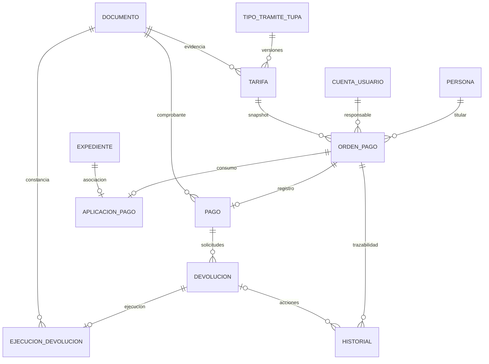

# Modelo de datos M10

## Implementación aditiva

Migraciones `backend/migraciones/10_sigd_tes.sql` y `11_sigd_tes_roles.sql`, aplicadas únicamente a la base demo comprobada. Ocho tablas nuevas en `sigd_tes`; UUID compatibles con las claves existentes, dinero NUMERIC(14,2), moneda PEN, fechas TIMESTAMPTZ y periodos tarifarios DATE de Perú.

PERSONA, CUENTA_USUARIO, TIPO_TRAMITE_TUPA y EXPEDIENTE representan tablas preexistentes; sus nombres físicos son `sigd_auth.persona`, `sigd_auth.cuenta_usuario`, `sigd_doc.tipo_tramite_tupa` y `sigd_doc.expediente`. `evento_outbox` y `bitacora_auditoria` se reutilizan, no se duplican.

| Tabla nueva | Restricciones principales |
|---|---|
| documento | Propietario real, clave MinIO única, SHA-256 hexadecimal, 1–20 MiB |
| tarifa | Fuente y PDF obligatorios, periodo válido, proponente distinto de validador, importe no negativo |
| orden_pago | Referencia OP única, persona/cuenta/TUPA/tarifa FK, snapshot monetario, UNIQUE(cuenta, clave_solicitud) |
| pago | Una operación por orden, UNIQUE(entidad, referencia), verificador distinto del registrador |
| aplicacion_pago | Orden única y expediente único; sin CUT provisional ficticio |
| devolucion | Importe positivo, clave idempotente por cuenta, una solicitud activa por pago, aprobación segregada |
| ejecucion_devolucion | Una ejecución por devolución, referencia externa única, documento y ejecutor obligatorios |
| historial | Acciones append-only con actor, orden y devolución opcional |

## Integridad y concurrencia

Tarifas y operaciones son inmutables en sus datos originales. Solo campos de estado/revisión admiten UPDATE controlado. Triggers rechazan DELETE y TRUNCATE con SQLSTATE 23001 y protegen importes, referencias y documentos originales. FK conservan las relaciones; no hay cascadas destructivas. Índices cubren titular, estados, periodos e historial.

Las reglas de suma de devoluciones se ejecutan bajo bloqueo del pago/orden y transacción. Los periodos validados se serializan antes de comprobar solapamientos. La auditoría y Outbox forman parte del mismo commit. La cuenta operativa sigue siendo propietaria de las nuevas tablas en demo: un propietario con DDL puede desactivar triggers. Por ello estos controles no equivalen a WORM frente a un DBA; separar propietario y usuario operativo es un requisito pendiente para producción.

## Roles y reversibilidad

La migración 11 amplía el CHECK de códigos de roles conservando los seis anteriores, crea cuatro definiciones financieras y sus permisos. No modifica asignaciones de usuarios: 17 antes y después, misma huella `85950ce39814d4ebd4074e20b18c610a`.

Las reversiones están en `backend/migraciones_reversion/10_sigd_tes.down.sql` y `11_sigd_tes_roles.down.sql`. Se niegan a ejecutarse si existen datos o asignaciones que perderían integridad. No fueron ejecutadas. La prueba documental persistente ya impide tratar la base como una instalación vacía.

| Script aplicado | SHA-256 |
|---|---|
| 10_sigd_tes.sql | `0a43dfc5ae132e2a9a7bcb366386c677f48662fc33ff392298278dbd363e97a3` |
| 11_sigd_tes_roles.sql | `cb947c4c42ff86ea05aef579d93e848a9687569b2e37a149d6a7ca6be963d5f1` |

Se creó además el registro canónico `public.sigd_migraciones` con la definición del migrador existente porque no existía. Solo contiene evidencia de 10 y 11; no debe activarse el migrador global sin revisar previamente los scripts históricos.
